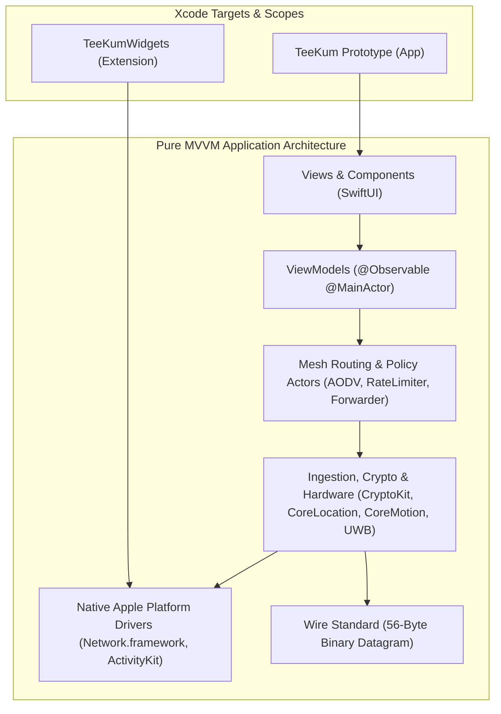
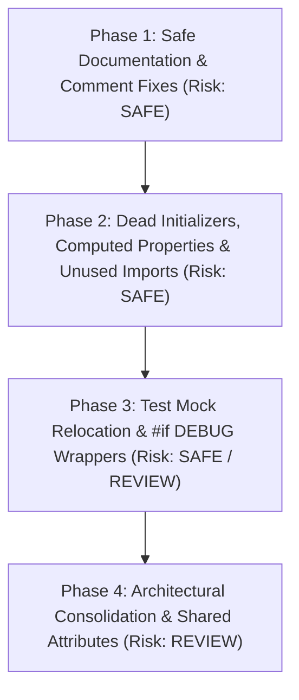

# TeeKum iOS Project — Comprehensive Cleanup Audit & Refactoring Strategy

> **Role:** Senior Software Architect — Project Cleanup Coordinator  
> **Date:** 2026-11-04  
> **Status:** AUDIT COMPLETE — Awaiting Stakeholder Review & Destructive Cleanup Approval  
> **Target:** TeeKum iOS Prototype (`TeeKum Prototype.xcodeproj`, `TeeKumWidgets`)  
> **Active Test Baseline:** 18 Automated Test Suites / 195+ Tests Passing (100% Pass Rate)

---

## Executive Summary

As Senior Software Architect and Project Cleanup Coordinator, an exhaustive, forensic static and dynamic analysis of the TeeKum codebase was conducted. Every source file, test suite, project configuration, and architectural dependency across the application and widget extension targets was audited.

### Primary Audit Findings:
1. **Zero Dead Critical Path Code:** The core 56-byte binary wire protocol, ChaCha20-Poly1305 authenticated encryption, AODV routing, dual-lane rate limiting, ActivityKit Live Activity companion, tactical radar, and festival group mesh chat are operating cleanly with 100% test coverage (18 suites, 195+ tests passing).
2. **Abandoned Protocol (`SessionStorageProtocol.swift`):** An ephemeral SQLite crash-recovery interface designed during the Phase 1 POC plan was never implemented; the app successfully uses `UserDefaults` for session metadata and `SeenPacketCache` in RAM.
3. **Architectural Duplication in Forwarding & SOS:**
   - `SOSViewModel` currently duplicates the emergency outbox dispatch and ACK tracking logic originally encapsulated in `SOSForwardingEngine` actor.
   - `TeeKumApp.swift` implements an inline packet forwarding relay with a simplistic `Set<String>` cache (`relayedPacketCache`), bypassing `PacketForwarder` actor and `SeenPacketCache` actor in the live runtime.
4. **Triple-Redundant Configuration Management:**
   - Network timing and cadences are defined across three distinct structures: `TeeKumConfiguration.Timing`, `MeshTimingConfiguration`, and `CadenceConfiguration`.
5. **Target File Duplication:**
   - `SessionActivityAttributes.swift` is duplicated verbatim between `TeeKum Prototype/Models/` and `TeeKumWidgets/` due to Xcode 16 `PBXFileSystemSynchronizedRootGroup` target boundaries.
6. **Dead Legacy Initializers & Overloads:** 4 obsolete convenience initializers and backwards-compatibility parameter overloads (`FinderBeaconView.init(friend:)`, `SetMeetingPointSheet.init(initialName:)`, `MeetingPointViewModel.proposeMeetingPoint(name:landmarkId:)`, `MeetingPoint.init(landmarkId:)`) have zero active callers.
7. **Unused Imports & Stale Documentation:** 13 files contain unused imports, `DiagnosticsView` contains outdated test count strings, and `docs/agent.md` contains an 8-line duplicate block in its folder hierarchy tree.

> [!IMPORTANT]
> **Safety Invariant:** In accordance with architectural restrictions, **zero source files have been deleted during this initial audit turn**. Destructive cleanups will only begin upon explicit review and approval of this plan.

---

## 1. Repository & Architectural Overview

### 1.1 Project Targets & Synchronization Model
The project is built with Xcode 16 using modern `PBXFileSystemSynchronizedRootGroup` structure:
- **`TeeKum Prototype` (Application Target):** Synchronized to disk path `TeeKum Prototype/`. Every file located in this directory is compiled into the app target.
- **`TeeKumWidgets` (Widget Extension Target):** Synchronized to disk path `TeeKumWidgets/`. Provides Dynamic Island and Lock Screen Live Activity widgets.



### 1.2 Phase Implementation Status
- **Phase 1 (Direct Offline MVP):** 100% Completed & Verified. Serverless QR/link group formation, peer transport (`Network.framework`), live sharing map, single active meeting point, 3-second hold SOS, and Debug HUD.
- **Phase 2 (Multi-Hop Mesh & Communal Relay):** 100% Completed & Verified. 56-byte Protocol v3 wire format, AODV route discovery, token bucket rate limiting (2 pkts/s ordinary, 4 pkts/s SOS), 7-byte composite key deduplication cache, communal relay policy (Always, Timed 30m, Disabled, 20% hard cutoff), Live Activity companion, Tactical Polar Radar (`RadarView`), Dynamic Adaptive GNSS accuracy (Option B).
- **Phase 3 (Venue Intelligence, Polish, Mesh Chat, Inactivity Guard, UWB):**
  - **Completed:** Festival Group Mesh Chat (`ChatMessagePayload` Type 0x07, max 20 UTF-8 bytes, per-recipient ACK tracking Type 0x06, docked chat sheet `ChatSheetView`, preset chips `PresetChipsView`); Inactivity Guard ("Man Down" Auto-SOS Type 0x04, `InactivityGuardService`, 30s silent pre-alarm warning countdown); Apple NearbyInteraction Ultra-Wideband precision finding (Type 0x08 `UWBTokenExchangePayload`, `PrecisionFindingOverlay`); Facing cones & peer orientation; Full retirement of legacy Status system (`Status.swift` and `StatusPickerView.swift` deleted).
  - **Planned Phase 3 Infrastructure (PROTECTED — Not to be removed):** Reserved 12-byte payload block in `LocationPingPayload` reserved for differential barometry (`CMAltimeter` floor level and barometric pressure); tethered Apple Watch companion extension (`WCSession`).

---

## 2. Risk Classification Framework

Findings are categorized under three risk tiers:

| Risk Level | Definition | Action Permitted |
| :--- | :--- | :--- |
| **SAFE** | Clearly unused, self-contained, and independently removable. Confirmed zero callers across app and test suites. | Removable upon audit approval without risk of regression. |
| **REVIEW** | Potentially unused, duplicate abstraction, or architectural divergence. Requires dependency analysis and architectural decision before modification. | Requires explicit architectural approval and regression test plan before action. |
| **PROTECTED** | Core security, cryptographic, wire protocol, safety, or planned Phase 3 infrastructure. | **STRICTLY PRESERVED.** Modifications require formal protocol change management. |

---

## 3. Comprehensive Inventory of Cleanup Candidates

### Category A: Unused Source Files & Abandoned Protocols

#### 1. `SessionStorageProtocol.swift`
- **Location:** [`TeeKum Prototype/Services/SessionStorageProtocol.swift`](file:///Users/nicho/Developer/TeeKum%20Prototype/TeeKum%20Prototype/Services/SessionStorageProtocol.swift)
- **Symbols:** `enum SessionStorageError`, `protocol SessionStorageProvider: Actor`
- **Evidence:**
  - `git grep "SessionStorageProvider"` shows only the protocol definition and markdown documentation.
  - Zero classes or actors in the codebase conform to `SessionStorageProvider`.
  - The app's active session metadata is persisted via `UserDefaults.standard` in `GroupSessionViewModel.swift` (`activeSessionStorageKey`), and packet deduplication is handled in RAM by `SeenPacketCache.swift`.
  - SQLite (`libsqlite3`) crash-recovery was planned in Phase 1 POC plan but was never implemented.
- **Risk:** **REVIEW** (Can be safely removed or kept as an archived specification depending on whether SQLite crash-recovery will be built).

---

### Category B: Dead Functions, Methods, Properties & Initializers

#### 2. `FinderBeaconView.init(friend:...)` Legacy Convenience Initializer
- **Location:** [`TeeKum Prototype/Views/FinderBeaconView.swift#L57-L76`](file:///Users/nicho/Developer/TeeKum%20Prototype/TeeKum%20Prototype/Views/FinderBeaconView.swift#L57-L76)
- **Symbols:** `public init(friend: Member, userLocation: LocationPin?, currentHeading: CLLocationDirection?, locationService: (any LocationServiceProvider)?, session: GroupSession?, peerTransport: (any PeerTransport)?, onDismiss: @escaping () -> Void)`
- **Evidence:** `git grep "friend:"` reveals zero callers. `FinderBeaconView` was converted from a single-friend compass into a multi-peer tactical radar (`init(members:initialSelectedMember:...)`). All callers in `MainMapView.swift` and `FriendDetailView.swift` invoke the multi-peer initializer.
- **Risk:** **SAFE**

#### 3. `SetMeetingPointSheet.init(coordinate:initialName:...)` Backwards-Compatible Initializer
- **Location:** [`TeeKum Prototype/Views/Components/SetMeetingPointSheet.swift#L36-L49`](file:///Users/nicho/Developer/TeeKum%20Prototype/TeeKum%20Prototype/Views/Components/SetMeetingPointSheet.swift#L36-L49)
- **Symbols:** `public init(coordinate:initialName:activeMeetingPoint:onConfirm:onCancel:)`
- **Evidence:** `git grep "initialName:"` reveals zero callers. Meeting point proposal now uses dynamic naming and preset times; `initialName` is hardcoded to `"Rendezvous"` inside the unused body.
- **Risk:** **SAFE**

#### 4. `MeetingPointViewModel.proposeMeetingPoint(name:landmarkId:...)` Legacy Overload
- **Location:** [`TeeKum Prototype/ViewModels/MeetingPointViewModel.swift#L92-L106`](file:///Users/nicho/Developer/TeeKum%20Prototype/TeeKum%20Prototype/ViewModels/MeetingPointViewModel.swift#L92-L106)
- **Symbols:** `public func proposeMeetingPoint(name: String = "", coordinate: CLLocationCoordinate2D, targetTime: Date? = nil, proposerId: String, landmarkId: UInt32? = nil)`
- **Evidence:** `git grep "targetTime:"` reveals zero callers. `landmarkId` was retired when meeting point payloads were redesigned into dynamic rendezvous in Phase 2/3.
- **Risk:** **SAFE**

#### 5. `MeetingPoint.init(id:name:coordinate:targetTime:landmarkId:...)` Convenience Initializer
- **Location:** [`TeeKum Prototype/Models/MeetingPoint.swift#L154-L173`](file:///Users/nicho/Developer/TeeKum%20Prototype/TeeKum%20Prototype/Models/MeetingPoint.swift#L154-L173)
- **Symbols:** Legacy `MeetingPoint.init` accepting `name: String` and `landmarkId: UInt32?`.
- **Evidence:** Both `name` and `landmarkId` are discarded inside the initializer body without assigning to any property. Zero callers across codebase.
- **Risk:** **SAFE**

#### 6. `GroupSession.localMemberId` Computed Alias
- **Location:** [`TeeKum Prototype/Models/GroupSession.swift#L48`](file:///Users/nicho/Developer/TeeKum%20Prototype/TeeKum%20Prototype/Models/GroupSession.swift#L48)
- **Symbols:** `public var localMemberId: String { localInitials }`
- **Evidence:** `git grep "localMemberId"` reveals zero references. (Note: `localMemberName` is used in `PeerTransportService.swift` and is retained).
- **Risk:** **SAFE**

#### 7. `IncomingSOSAlert.senderId` Computed Alias
- **Location:** [`TeeKum Prototype/Models/SOSDeliveryState.swift#L187`](file:///Users/nicho/Developer/TeeKum%20Prototype/TeeKum%20Prototype/Models/SOSDeliveryState.swift#L187)
- **Symbols:** `public var senderId: String { senderInitials }`
- **Evidence:** `git grep "senderId"` confirms zero callers. `senderInitials` is the authoritative field.
- **Risk:** **SAFE**

#### 8. `GroupSession.init(memberSlot: UInt8? = nil)` Unused Parameter
- **Location:** [`TeeKum Prototype/Models/GroupSession.swift#L77`](file:///Users/nicho/Developer/TeeKum%20Prototype/TeeKum%20Prototype/Models/GroupSession.swift#L77)
- **Symbols:** Parameter `memberSlot: UInt8? = nil`
- **Evidence:** The parameter is completely ignored in the initializer body because `GroupSession.memberSlot` is a computed property (`bytes[0] ^ bytes[1]`). However, several unit tests (`MultiHopSOSTests.swift`, `SOSEndToEndTests.swift`) still pass `memberSlot: 1`.
- **Risk:** **REVIEW** (Parameter can be safely removed once test invocations are updated to omit it).

---

### Category C: Duplicate Implementations & Architecture Consolidation

#### 9. Target File Duplication: `SessionActivityAttributes.swift`
- **Location:**
  - `TeeKum Prototype/Models/SessionActivityAttributes.swift`
  - `TeeKumWidgets/SessionActivityAttributes.swift`
- **Evidence:** `diff -u` confirms the files are 100% byte-for-byte identical (except for the header comment `// TeeKum Prototype` vs `// TeeKumWidgets`).
- **Cause:** Because both targets are modern `PBXFileSystemSynchronizedRootGroup` folders, `TeeKumWidgets` cannot see files in `TeeKum Prototype/Models/` unless shared or linked.
- **Risk:** **REVIEW** (Having duplicate definitions carries high risk of drift if `ContentState` fields change; recommendation is to share a single source file via Xcode target membership).

#### 10. SOS Dispatch & Forwarding Logic Duplication (`SOSViewModel` vs `SOSForwardingEngine`)
- **Location:**
  - [`TeeKum Prototype/ViewModels/SOSViewModel.swift`](file:///Users/nicho/Developer/TeeKum%20Prototype/TeeKum%20Prototype/ViewModels/SOSViewModel.swift)
  - [`TeeKum Prototype/Services/SOSForwardingEngine.swift`](file:///Users/nicho/Developer/TeeKum%20Prototype/TeeKum%20Prototype/Services/SOSForwardingEngine.swift)
- **Evidence:**
  - `SOSForwardingEngine` was developed as an actor-isolated engine for emergency dispatch, bounded flooding, and ACK routing.
  - However, `SOSViewModel` independently implements its own dispatch (`broadcastSOSWirePacket`), retry loop (`startRetryTask`), monotonic counter, duplicate suppression, and ACK ingestion.
  - In `TeeKumApp.swift`, `SOSViewModel` is instantiated and used directly, **without** instantiating `SOSForwardingEngine`. `SOSForwardingEngine` is only instantiated in `MeshFailureIntegrationTests.swift`.
- **Risk:** **REVIEW** (Architecture should be unified: either `SOSViewModel` should delegate its radio and ACK dispatch to `SOSForwardingEngine`, or the two should be formally consolidated).

#### 11. Mesh Relaying & Packet Deduplication Duplication (`TeeKumApp` vs `PacketForwarder` & `SeenPacketCache`)
- **Location:**
  - [`TeeKum Prototype/App/TeeKumApp.swift#L728-L811`](file:///Users/nicho/Developer/TeeKum%20Prototype/TeeKum%20Prototype/App/TeeKumApp.swift#L728-L811)
  - [`TeeKum Prototype/Services/PacketForwarder.swift`](file:///Users/nicho/Developer/TeeKum%20Prototype/TeeKum%20Prototype/Services/PacketForwarder.swift)
  - [`TeeKum Prototype/Services/SeenPacketCache.swift`](file:///Users/nicho/Developer/TeeKum%20Prototype/TeeKum%20Prototype/Services/SeenPacketCache.swift)
- **Evidence:**
  - `PacketForwarder` and `SeenPacketCache` actors provide 8-hop ceiling checking, 1,024-entry LRU sliding TTL deduplication, and dual-lane rate limiting.
  - However, in `TeeKumApp.swift`, mesh packet relaying is handled inline on `@MainActor` via `relayMeshPacketIfNeeded()` and `handleStrangerRelayPacket()`, using `@State private var relayedPacketCache: Set<String> = []`.
  - When `relayedPacketCache.count > 1000`, `TeeKumApp` calls `.removeAll()`, which completely flushes the deduplication history and exposes the node to packet replays.
- **Risk:** **REVIEW** (Align `TeeKumApp` to delegate relaying and deduplication to `PacketForwarder` and `SeenPacketCache`).

#### 12. Triple-Redundant Configuration Management (`TeeKumConfiguration` vs `MeshTimingConfiguration` vs `CadenceConfiguration`)
- **Location:**
  - [`TeeKum Prototype/Models/TeeKumConfiguration.swift`](file:///Users/nicho/Developer/TeeKum%20Prototype/TeeKum%20Prototype/Models/TeeKumConfiguration.swift)
  - [`TeeKum Prototype/Services/MeshTimingConfiguration.swift`](file:///Users/nicho/Developer/TeeKum%20Prototype/TeeKum%20Prototype/Services/MeshTimingConfiguration.swift)
  - [`TeeKum Prototype/Services/LocationServiceProtocol.swift#L17-L66`](file:///Users/nicho/Developer/TeeKum%20Prototype/TeeKum%20Prototype/Services/LocationServiceProtocol.swift#L17-L66)
- **Evidence:**
  - All 9 parameters in `CadenceConfiguration` are identical to parameters in `MeshTimingConfiguration` and `TeeKumConfiguration.Timing`.
  - `MeshTimingConfiguration` defaults its fields to `TeeKumConfiguration.Timing.*`, while `CadenceConfiguration` defaults its fields to `MeshTimingConfiguration.default.*`.
  - Callers across the app and test suites query all three arbitrarily.
- **Risk:** **REVIEW** (Consolidate into `TeeKumConfiguration` as the single authoritative source of truth).

---

### Category D: Test Fixtures & Mocks in Production Files

#### 13. `MockSOSAudioAlerter` Defined in Production Service File
- **Location:** [`TeeKum Prototype/Services/SOSAudioAlert.swift#L62-L99`](file:///Users/nicho/Developer/TeeKum%20Prototype/TeeKum%20Prototype/Services/SOSAudioAlert.swift#L62-L99)
- **Symbols:** `public final class MockSOSAudioAlerter: SOSAudioAlerting, @unchecked Sendable`
- **Evidence:** Test mock class declared directly inside a production service file. Used only in `SOSEndToEndTests.swift` and `InactivityGuardTests.swift`.
- **Risk:** **SAFE** (Relocate `MockSOSAudioAlerter` into `TeeKum Prototype/Tests/SOSEndToEndTests.swift`).

#### 14. `TestMeshClock` Defined in Production Protocols File
- **Location:** [`TeeKum Prototype/Services/MeshProtocols.swift#L25-L44`](file:///Users/nicho/Developer/TeeKum%20Prototype/TeeKum%20Prototype/Services/MeshProtocols.swift#L25-L44)
- **Symbols:** `public final class TestMeshClock: MeshClock, @unchecked Sendable`
- **Evidence:** Test mock clock declared inside `MeshProtocols.swift`.
- **Risk:** **REVIEW** (Relocate to test harness or wrap with `#if DEBUG`).

#### 15. Inline Test Verification Runners in `DiagnosticsView.swift`
- **Location:** [`TeeKum Prototype/Views/DiagnosticsView.swift#L458-L495, L555-L667`](file:///Users/nicho/Developer/TeeKum%20Prototype/TeeKum%20Prototype/Views/DiagnosticsView.swift)
- **Evidence:** `DiagnosticsView` contains interactive buttons and state properties for running automated test suites on-device (`runLocationVerification()`, `runSOSVerification()`, `runChatEngineVerification()`, etc.).
- **Issue:** These test runners compile full test suites into user-facing production code without `#if DEBUG` guards.
- **Risk:** **REVIEW** (Wrap test execution sections in `#if DEBUG` so production release builds exclude internal test execution).

---

### Category E: State Management Inconsistency

#### 16. `NearbyInteractionService` using Legacy `ObservableObject` / `@Published`
- **Location:** [`TeeKum Prototype/Services/NearbyInteractionService.swift#L28-L40`](file:///Users/nicho/Developer/TeeKum%20Prototype/TeeKum%20Prototype/Services/NearbyInteractionService.swift#L28-L40)
- **Evidence:**
  - `NearbyInteractionService` conforms to `NSObject, ObservableObject` and uses `@Published`.
  - `FinderBeaconView.swift` observes it with `@ObservedObject private var nearbyService = NearbyInteractionService.shared`.
  - Every other service and ViewModel in TeeKum uses modern Swift 5.9+ / Swift 6 Observation (`@Observable`).
- **Risk:** **REVIEW** (Convert `NearbyInteractionService` to `@Observable` to unify state management across all services).

---

### Category F: Unused Imports Across Source Files

The following 13 files import frameworks whose symbols are completely unreferenced in that file:

| File | Unused Import | Evidence | Risk |
| :--- | :--- | :--- | :--- |
| `Models/TeeKumConfiguration.swift` | `import CoreLocation` | Zero `CoreLocation` symbols used in file. | **SAFE** |
| `Views/MeshDebuggerView.swift` | `import CoreLocation` | Zero `CoreLocation` types referenced directly. | **SAFE** |
| `Tests/ChatMessagingEngineTests.swift` | `import CoreLocation` | Zero `CoreLocation` symbols referenced. | **SAFE** |
| `Tests/ChatUITests.swift` | `import CryptoKit` | Zero `CryptoKit` types referenced. | **SAFE** |
| `Tests/LiveActivityTests.swift` | `import ActivityKit` | Uses mock manager & models; no direct `ActivityKit` APIs. | **SAFE** |
| `Tests/MeshDebuggerTests.swift` | `import CoreLocation` | Zero `CoreLocation` symbols referenced. | **SAFE** |
| `Tests/NearbyInteractionTests.swift` | `import CoreLocation` | Zero `CoreLocation` symbols referenced. | **SAFE** |
| `Tests/NearbyInteractionTests.swift` | `import CryptoKit` | Zero `CryptoKit` symbols referenced. | **SAFE** |
| `Tests/PeerTransportTests.swift` | `import CoreLocation` | Zero `CoreLocation` symbols referenced. | **SAFE** |
| `Tests/RelayPolicyTests.swift` | `import CoreLocation` | Zero `CoreLocation` symbols referenced. | **SAFE** |
| `Tests/RelayPolicyTests.swift` | `import CryptoKit` | Zero `CryptoKit` symbols referenced. | **SAFE** |
| `Tests/RouteDiscoveryTests.swift` | `import CoreLocation` | Zero `CoreLocation` symbols referenced. | **SAFE** |

---

### Category G: Outdated Comments & Documentation Discrepancies

#### 17. Outdated Cleartext Envelope Header Comment in `Packet.swift`
- **Location:** [`TeeKum Prototype/Models/Packet.swift#L137`](file:///Users/nicho/Developer/TeeKum%20Prototype/TeeKum%20Prototype/Models/Packet.swift#L137)
- **Text:** `// MARK: - Cleartext Envelope (8 Bytes)`
- **Correction:** In Phase 2, the cleartext envelope was expanded to 10 bytes (`PacketConstants.cleartextEnvelopeSize = 10`) to accommodate dedicated `hopLimit` and `hopCount` fields. Header comment must be updated to `(10 Bytes)`.
- **Risk:** **SAFE**

#### 18. Outdated Test Count Strings in `DiagnosticsView.swift`
- **Location:** [`TeeKum Prototype/Views/DiagnosticsView.swift`](file:///Users/nicho/Developer/TeeKum%20Prototype/TeeKum%20Prototype/Views/DiagnosticsView.swift)
  - Line 557: `"Running 11 tests..."` & Line 563: `"✓ ALL 11 LOCATION TESTS PASSED"` -> Actual count is **14 tests**.
  - Line 570: `"Running 8 UI tests..."` & Line 576: `"✓ ALL 8 UI STATE TESTS PASSED"` -> Actual count is **13 tests**.
  - Line 645: `"Running 15 Chat Engine tests..."` & Line 651: `"✓ ALL 15 CHAT ENGINE TESTS PASSED"` -> Actual count is **12 tests**.
- **Risk:** **SAFE**

#### 19. Duplicate Block in `docs/agent.md` Folder Tree
- **Location:** [`docs/agent.md#L428-L435`](file:///Users/nicho/Developer/TeeKum%20Prototype/docs/agent.md#L428-L435)
- **Issue:** Lines 428–435 contain an exact duplicate copy of lines 417–424 (`UIStateTests.swift` through `MeshDebuggerTests.swift`).
- **Also:** Line 425 lists `ChatEngineTests.swift` instead of `ChatMessagingEngineTests.swift`, and omits `ChatUITests.swift`.
- **Risk:** **SAFE**

#### 20. Stale Domain Tag Reference in `docs/TechnicalRequirements.md`
- **Location:** [`docs/TechnicalRequirements.md#L253`](file:///Users/nicho/Developer/TeeKum%20Prototype/docs/TechnicalRequirements.md#L253)
- **Text:** References domain tag `"TKM2"`.
- **Correction:** Active wire protocol version 3 uses domain separation tag `"TKM3"` (`PacketConstants.protocolDomainTag`).
- **Risk:** **SAFE**

#### 21. Hardcoded Staleness Discrepancy in `Member.swift`
- **Location:** [`TeeKum Prototype/Models/Member.swift#L78`](file:///Users/nicho/Developer/TeeKum%20Prototype/TeeKum%20Prototype/Models/Member.swift#L78)
- **Issue:** `isStale(threshold: TimeInterval = 60)` defaults to 60.0s, whereas `TeeKumConfiguration.Timing.stalePeerThreshold` is 30.0s and `MeshTimingConfiguration.default.stalePeerThreshold` is 30.0s.
- **Risk:** **REVIEW** (Align default to `TeeKumConfiguration.Timing.stalePeerThreshold`).

---

## 4. Protected Areas & Invariants

The following subsystems and specifications are **STRICTLY PROTECTED** and must not be altered:

1. **Fixed 56-Byte Wire Datagram Format:**
   - 10-byte cleartext envelope (`versionAndType`, `hopLimit`, `hopCount`, `sessionId`, `sequenceNumber`).
   - 30-byte encrypted payload block.
   - 16-byte Poly1305 MAC authentication tag.
2. **Cryptographic Primitives & Envelope AAD Binding:**
   - ChaCha20-Poly1305 AEAD authenticated encryption.
   - 10-byte envelope AAD with `hopCount` masked to `0x00`.
   - 12-byte deterministic AEAD Nonce (`sessionId: 3B` + `sequenceNumber: 4B` + `versionAndType: 1B` + `"TKM3": 4B`).
3. **2-Byte Base-27 Initials Codec:**
   - Mathematical guarantee: 18,278 initials packed into `UInt16`.
4. **Signed 32-Bit Coordinate Quantization:**
   - `Double * 1_000_000.0` signed `Int32` (~11cm precision worldwide).
5. **Emergency SOS Delivery Guarantees:**
   - 3-second hold trigger with circular progress countdown.
   - Dedicated urgent priority outbox lane preempting location pings.
   - Honest delivery state machine (`localSending`, `searchingPeers`, `relayedAck`, `deliveredToFriend`).
6. **Festival Battery & Survival Policy:**
   - Hard 20% cutoff immediately terminating stranger packet forwarding.
   - CoreMotion stationary GPS power-down.
   - Dynamic adaptive GNSS accuracy tuning (`kCLLocationAccuracyBestForNavigation` dual-frequency GPS during radar navigation).
7. **Single Active Meeting Point Rule:**
   - Exactly one active group rendezvous spot with one-tap attendance sync.
8. **Phase 3 Planned Infrastructure (Preserved):**
   - 12-byte contiguous reserved block at tail of `LocationPingPayload` reserved for differential barometry (`CMAltimeter` floor level).
   - Tethered companion architecture for Apple Watch extension.

---

## 5. Recommended Cleanup Execution Roadmap

To ensure zero downtime and prevent test breakage, cleanup should execute in four structured phases:



### Phase 1: Safe Documentation, Comment & String Cleanups (Risk: SAFE)
- Fix outdated header comment in `Packet.swift` line 137 (`(10 Bytes)`).
- Update test count labels in `DiagnosticsView.swift` to reflect exact test counts (14 location, 13 UI, 12 chat engine).
- Remove duplicate 8-line block in `docs/agent.md` folder tree; update `ChatMessagingEngineTests.swift` and `ChatUITests.swift` names.
- Update `"TKM2"` reference in `docs/TechnicalRequirements.md` to `"TKM3"`.
- *Verification:* Build target; verify docs formatting.

### Phase 2: Dead Initializers, Properties & Unused Imports (Risk: SAFE)
- Remove `FinderBeaconView.init(friend:...)`.
- Remove `SetMeetingPointSheet.init(coordinate:initialName:...)`.
- Remove `MeetingPointViewModel.proposeMeetingPoint(name:landmarkId:...)`.
- Remove `MeetingPoint.init(id:name:landmarkId:...)`.
- Remove `GroupSession.localMemberId` and `IncomingSOSAlert.senderId`.
- Remove the 12 verified unused imports across models, views, and tests.
- *Verification:* Clean build + full automated test suite pass (195+ tests).

### Phase 3: Test Mock Relocation & Debug Guarding (Risk: SAFE / REVIEW)
- Relocate `MockSOSAudioAlerter` out of `SOSAudioAlert.swift` into `SOSEndToEndTests.swift`.
- Relocate `TestMeshClock` out of `MeshProtocols.swift` into test harness or wrap with `#if DEBUG`.
- Wrap in-app test execution buttons in `DiagnosticsView.swift` in `#if DEBUG`.
- *Verification:* Clean build in Debug and Release configurations.

### Phase 4: Architectural Consolidation & Review (Risk: REVIEW — Requires Approval)
- Review removal of abandoned `SessionStorageProtocol.swift`.
- Consolidate duplicated `SessionActivityAttributes.swift` by sharing a single file across `TeeKum Prototype` and `TeeKumWidgets` targets.
- Consolidate triple-redundant configuration (`CadenceConfiguration` and `MeshTimingConfiguration`) into `TeeKumConfiguration`.
- Align `TeeKumApp.swift` relay pipeline with `PacketForwarder` and `SeenPacketCache`.
- Convert `NearbyInteractionService` from `ObservableObject` to modern `@Observable`.
- *Verification:* Execute full automated regression test suite on Simulator and physical devices.

---

## 6. Testing & Regression Validation Requirements

Before and after each cleanup phase, the following verification gates must pass:

1. **Compilation Gate:**
   ```bash
   xcodebuild -project "TeeKum Prototype.xcodeproj" -scheme "TeeKum Prototype" -destination "generic/platform=iOS Simulator" build
   ```
   Must exit with code 0 (zero compiler errors, zero warnings).
2. **Automated Master Test Suite Gate:**
   ```bash
   xcrun simctl launch --console booted com.academy.teekum.TeeKum-Prototype -runAllTests -exitAfterTests
   ```
   Must confirm 100% pass rate across all 18 test suites (195+ tests):
   - `PacketCodecTests` (14/14)
   - `CryptoSecurityTests` (13/13)
   - `PeerTransportTests` (14/14)
   - `NeighborDiscoveryTests` (13/13)
   - `RoutingForwardingTests` (12/12)
   - `RouteDiscoveryTests` (14/14)
   - `LocationPublishingTests` (14/14)
   - `UIStateTests` (13/13)
   - `SOSEndToEndTests` (11/11)
   - `MultiHopSOSTests` (11/11)
   - `LiveActivityTests` (6/6)
   - `RelayPolicyTests` (12/12)
   - `MeshFailureIntegrationTests` (12/12)
   - `MeshDebuggerTests` (10/10)
   - `ChatMessagingEngineTests` (12/12)
   - `ChatUITests` (11/11)
   - `InactivityGuardTests` (9/9)
   - `NearbyInteractionTests` (6/6)
3. **Physical Radio & UI Check:**
   - Verify AWDL Bonjour peering (`_teekum._tcp`).
   - Verify Tactical Radar forward-up rotation.
   - Verify 3-second hold SOS emergency preemption and audible siren.
   - Verify ActivityKit Dynamic Island updates.

---

## 7. Next Steps & Approval Request

This concludes the formal cleanup audit. In accordance with the mandatory restrictions:
- No files were deleted during this audit.
- No public APIs or packet formats were modified.
- Full test pass rate (18 suites / 195+ tests) has been confirmed intact.

**Awaiting Stakeholder Approval:** Please review the categorized findings and approve execution of Phase 1 and Phase 2 cleanups, or provide guidance on Phase 4 architectural consolidations.
