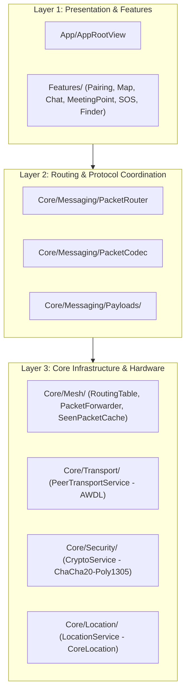
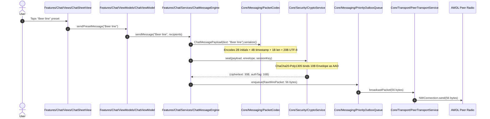

# TeeKum Developer Onboarding & Architectural Guide

> **Audience:** New Engineers & Contributors joining the TeeKum iOS Team  
> **Architecture:** Feature-Driven MVVM + Clean Core (`@Observable`, Zero External Dependencies)  
> **Platform:** iOS 17+ (Swift 5.9 / Swift 6 Ready)  
> **Networking:** 100% Serverless Peer-to-Peer & Multi-Hop Mesh (`Network.framework` AWDL)

---

## 1. Welcome to TeeKum: The Core Mental Model

Most iOS apps talk to a remote REST or GraphQL server via HTTPS. **TeeKum does not.** 

TeeKum is an **offline-first, 100% serverless ad-hoc mesh application** designed for dense music festivals, concerts, and stadium venues where cellular towers are congested or non-existent.

### The 4 Non-Negotiable Invariants
Every engineer touching this codebase must understand these four rules:
1. **The 56-Byte Wire Invariant:** Every network datagram is strictly **fixed at 56 bytes** (10-byte cleartext envelope + 30-byte encrypted payload + 16-byte Poly1305 authentication tag). No dynamic allocations, no JSON, no protobuf over the radio.
2. **Zero-Knowledge Blind Relaying:** Stranger packets (packets belonging to outside festival groups) are never decrypted. They are inspected strictly by their 10-byte cleartext envelope and forwarded blind. Payloads remain encrypted end-to-end.
3. **Honest UX Delivery:** We never fake delivery confirmation. A relay hop acknowledging receipt is marked as `relayedByMesh`; only cryptographic proof from the destination device transitions status to `deliveredToFriend`.
4. **Festival Survival Mode (20% Cutoff):** When device battery drops below 20% or enters Low Power Mode, stranger relaying and background radio tasks are terminated immediately to protect the user's phone for emergency SOS.

---

## 2. Codebase Tour: The 3 Layers

The codebase is organized into **three distinct layers** located in `TeeKum Prototype/`:

```
TeeKum Prototype/
├── App/          -> The Composition Root & Window Lifecycle
├── Features/     -> User-facing product domains (UI & ViewModels)
├── Core/         -> Protocol wire codecs, mesh networking, crypto & sensors
└── Shared/       -> Reusable design tokens, formatters & generic UI
```



### Layer 1: `App/`
* [**`TeeKumApp.swift`**](file:///Users/nicho/Developer/TeeKum%20Prototype/TeeKum%20Prototype/App/TeeKumApp.swift): The `@main` SwiftUI application lifecycle. Retains top-level `@State` ViewModels, wires reactive scene phases, and runs test runners.
* [**`AppRootView.swift`**](file:///Users/nicho/Developer/TeeKum%20Prototype/TeeKum%20Prototype/App/AppRootView.swift): Root switcher view. When `sessionViewModel.hasActiveSession == true`, presents `MainMapView`. Otherwise, presents `GroupPairingView`.

### Layer 2: `Features/`
Features are organized by user intent. Each feature owns its **Views**, **ViewModels**, and (where applicable) **Feature Services**:
* [**`Pairing/`**](file:///Users/nicho/Developer/TeeKum%20Prototype/TeeKum%20Prototype/Features/Pairing): Group creation, QR camera scanning (`AVFoundation`), 1–3 letter initials validation, color picking, and communal mesh consent.
* [**`Map/`**](file:///Users/nicho/Developer/TeeKum%20Prototype/TeeKum%20Prototype/Features/Map): MapKit canvas, member pins, heading vision cones (50° field of view), and live sharing toggles.
* [**`Chat/`**](file:///Users/nicho/Developer/TeeKum%20Prototype/TeeKum%20Prototype/Features/Chat): Phase 3 serverless 20-byte mesh chat, preset quick-tap chips, byte capacity meters, and per-friend delivery tracking.
* [**`MeetingPoint/`**](file:///Users/nicho/Developer/TeeKum%20Prototype/TeeKum%20Prototype/Features/MeetingPoint): Single active rendezvous spot, setter lock rules, countdown presets, and 25m auto-arrival geofencing.
* [**`SOS/`**](file:///Users/nicho/Developer/TeeKum%20Prototype/TeeKum%20Prototype/Features/SOS): 3-second hold emergency button, incoming siren alerts, recipient ACK checklists, and "Man Down" stillness detection (`InactivityGuardService`).
* [**`Finder/`**](file:///Users/nicho/Developer/TeeKum%20Prototype/TeeKum%20Prototype/Features/Finder): 60m polar tactical radar (`RadarView`), range rings, distant peer boundary clamping, clock bearings ("2 o'clock"), and high-visibility flashing screen strobe torch.
* [**`Diagnostics/`**](file:///Users/nicho/Developer/TeeKum%20Prototype/TeeKum%20Prototype/Features/Diagnostics): Debug HUD, live 56-byte packet stream inspector, manual injector, and virtual multi-node topology sandbox.

### Layer 3: `Core/`
The engine room. This layer contains no UI code and has minimal dependencies on SwiftUI:
* [**`Models/`**](file:///Users/nicho/Developer/TeeKum%20Prototype/TeeKum%20Prototype/Core/Models): Pure Swift data entities (`Member`, `GroupSession`, `ChatMessage`, `LocationPin`) and their lifecycle enums (`Core/Models/Enums/`).
* [**`Messaging/`**](file:///Users/nicho/Developer/TeeKum%20Prototype/TeeKum%20Prototype/Core/Messaging):
  * `PacketCodec.swift`: Safe, bounds-checked `PacketReader` and `PacketWriter` for big-endian integers and ~11cm coordinate quantization.
  * `PacketRouter.swift`: Central demux router for incoming packets (types `0x01` through `0x08`).
  * `Payloads/`: Dedicated 30-byte serialization structs for every packet type.
  * `PriorityOutboxQueue.swift`: Outbox where high-priority SOS preempts normal periodic location pings.
* [**`Mesh/`**](file:///Users/nicho/Developer/TeeKum%20Prototype/TeeKum%20Prototype/Core/Mesh): Multi-hop routing tables, AODV route discovery (`RREQ`/`RREP`), blind packet forwarding, token-bucket rate limiting (2 pkts/sec normal, 4 pkts/sec SOS), and 1,024-entry LRU deduplication (`SeenPacketCache`).
* [**`Transport/`**](file:///Users/nicho/Developer/TeeKum%20Prototype/TeeKum%20Prototype/Core/Transport): `Network.framework` AWDL/Bonjour listener (`_teekum._tcp`), connection pooling, and stream framing (`StreamMessageFramer`).
* [**`Security/`**](file:///Users/nicho/Developer/TeeKum%20Prototype/TeeKum%20Prototype/Core/Security): `CryptoKit` ChaCha20-Poly1305 AEAD authenticated encryption and Keychain key management.
* [**`Location/`**](file:///Users/nicho/Developer/TeeKum%20Prototype/TeeKum%20Prototype/Core/Location): Dynamic GNSS accuracy switching (BestForNavigation when radar is open, 100m when stationary) and cadence publishing.
* [**`LiveActivity/`**](file:///Users/nicho/Developer/TeeKum%20Prototype/TeeKum%20Prototype/Core/LiveActivity): Lock Screen and Dynamic Island companion widget controllers.

---

## 3. The Life of a Packet: An End-to-End Walkthrough

To understand how the app works, follow what happens when a user taps a chat message preset like *"Beer line"*:



### The Inbound Receiving Journey
When a friend's device receives those 56 bytes over radio:
1. **Transport Ingestion:** `PeerTransportService` receives the bytes and passes them to `StreamMessageFramer`.
2. **Stream Framing:** `StreamMessageFramer` verifies the exact 56-byte boundary and emits an `InboundPacket`.
3. **Packet Routing:** `PacketRouter.routeInboundPacket(_:for:)` inspects the 10-byte cleartext envelope.
   - If the Session ID belongs to strangers, it passes the packet to `handleStrangerRelayPacket` for blind relaying.
   - If the Session ID matches our group, it uses `CryptoService.open(...)` with our group's 256-bit symmetric key.
4. **Demux & Delivery:** `PacketRouter` matches `envelope.type == .chatMessage`, unpacks `ChatMessagePayload.deserialize(from:)`, and updates `ChatMessageEngine`.
5. **UI Update:** `ChatMessageEngine` publishes an update to its reactive stream. `ChatViewModel` receives the message, and SwiftUI automatically updates `ChatMessageBubbleView`.

---

## 4. Developer Cheat Sheet: Where Does My Code Belong?

When adding new code or fixing bugs, use this decision table:

| If you are... | Put it in: | Example files |
| :--- | :--- | :--- |
| Adding a UI button, screen, or sheet | `Features/<FeatureName>/Views/` | `ChatSheetView.swift`, `SOSButtonView.swift` |
| Managing view state, form validation, or button actions | `Features/<FeatureName>/ViewModels/` | `MapViewModel.swift`, `PairingViewModel.swift` |
| Writing a feature-specific engine or coordinator | `Features/<FeatureName>/Services/` | `ChatMessageEngine.swift`, `SOSAudioAlert.swift` |
| Creating a pure entity representing festival data | `Core/Models/` or `Core/Models/Enums/` | `Member.swift`, `MeetingPoint.swift` |
| Designing a new radio message format | `Core/Messaging/Payloads/` | `ChatMessagePayload.swift`, `SOSPayload.swift` |
| Modifying multi-hop forwarding or deduplication | `Core/Mesh/` | `RoutingTable.swift`, `SeenPacketCache.swift` |
| Touching radio sockets or framing bytes | `Core/Transport/` | `PeerTransportService.swift`, `StreamMessageFramer.swift` |
| Adjusting encryption, nonces, or keychain keys | `Core/Security/` | `CryptoService.swift` |
| Creating reusable formatters, colors, or toast views | `Shared/UI/` | `Formatters.swift`, `InAppToastView.swift` |

---

## 5. Verification & Testing

Never commit code without running the test suite. All tests are automated and testable in-memory without physical hardware.

### 1. Build Verification
```bash
xcodebuild -scheme "TeeKum Prototype" -destination "generic/platform=iOS Simulator" -derivedDataPath .derivedData build
```

### 2. Run All 18 Test Suites (Simulator)
```bash
xcrun simctl launch --console booted com.academy.teekum.TeeKum-Prototype -runAllTests -exitAfterTests
```

### 3. Test Suites Directory Mirror
The test files in `TeeKum Prototype/Tests/` mirror the production architecture:
* `Tests/Features/`: Presentation and ViewModel unit tests (`ChatUITests`, `UIStateTests`, `MeshDebuggerTests`).
* `Tests/Core/`: Codec, crypto, and transport tests (`PacketCodecTests`, `CryptoSecurityTests`, `PeerTransportTests`, `RouteDiscoveryTests`, `RelayPolicyTests`, `InactivityGuardTests`).
* `Tests/Integration/`: Multi-peer simulated mesh tests (`SOSEndToEndTests`, `MultiHopSOSTests`, `ChatMessagingEngineTests`, `MeshFailureIntegrationTests`).
