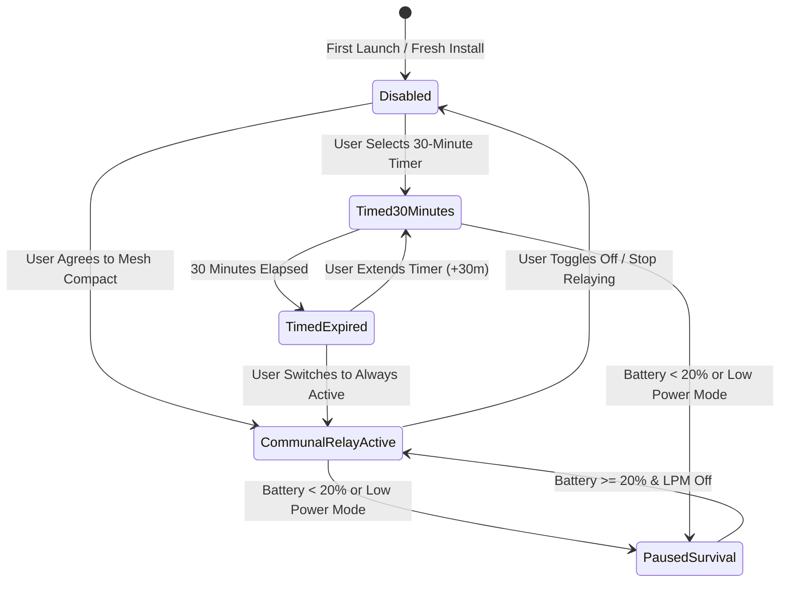
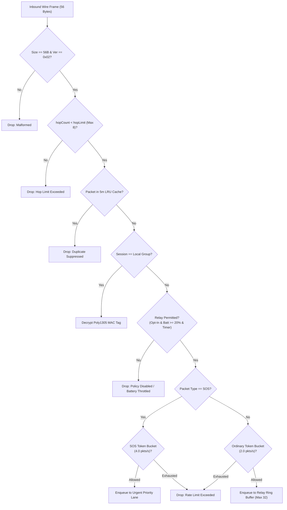
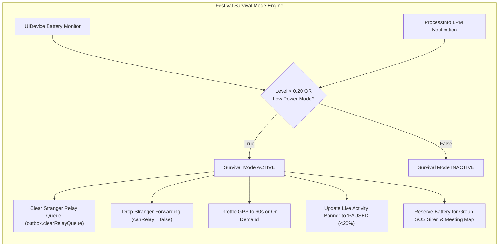
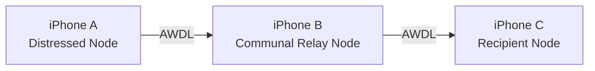

# TeeKum Phase 2 — Communal Relay Controls and Battery Policy Specification

> **Document Version:** 1.0  
> **Status:** AUTHORITATIVE POLICY & TEST PLAN SPECIFICATION (AGENT 5)  
> **Date:** 29 October 2026  
> **Target Platform:** iOS 17.0+ (Swift 5.9+ / Swift 6, 100% Native Apple Frameworks)  
> **Companion Documents:**
> - [Master Agent Instructions (docs/agent.md)](../agent.md)
> - [Technical Requirements Document (docs/TechnicalRequirements.md)](../TechnicalRequirements.md)
> - [Phase 2 Multi-Hop Mesh Architecture Specification (docs/Phase 2/PHASE2_ARCHITECTURE.md)](PHASE2_ARCHITECTURE.md)
> - [Phase 2 Multi-Hop SOS Delivery & Reliability (docs/Phase 2/PHYSICAL_DEVICE_SOS_MULTIHOP_TEST.md)](PHYSICAL_DEVICE_SOS_MULTIHOP_TEST.md)

---

## 1. Mission & Executive Summary

TeeKum is built for high-density, cellular-denied concert and festival environments where attendees need to coordinate, locate friends, and summon immediate help. While opportunistic multi-hop mesh networking extends radio reach across dense crowds, **communal relaying must never consume unbounded bandwidth, memory, or battery**.

A user's phone is first and foremost their safety device and lifeline. If a background relay drains an attendee's battery to 0% during an all-night festival, the mesh has failed its core duty.

### Core Policy Principles:
1. **Deliberate Opt-In:** Communal stranger relaying is strictly opt-in. The app ships with stranger relaying **disabled by default** until the user explicitly agrees to the Communal Mesh Compact during group onboarding or toggles it on in settings.
2. **Hard 20% Cutoff (Festival Survival Mode):** The moment device battery drops below 20% (or system Low Power Mode activates), all stranger forwarding is **immediately terminated** and queued relay packets are drained. Remaining battery is reserved strictly for local group SOS alerts and viewing offline meeting points.
3. **Strict 2.0 Packets/Second Bandwidth Budget:** Ordinary retransmissions are hard-capped at 2 pkts/sec using an actor-isolated token bucket.
4. **Separate Bounded SOS Priority Budget:** Urgent emergency SOS packets bypass ordinary queues into a dedicated priority lane and use a separate 4.0 pkts/sec forwarding budget.
5. **Zero-Knowledge Privacy:** Relays inspect only 10-byte cleartext routing headers. Inner location coordinates and identity hashes remain sealed in 30-byte ChaCha20-Poly1305 ciphertext.
6. **Anonymous Resource Observability:** Diagnostic counters record packets forwarded and dropped reasons, retaining **zero sensitive location coordinates or tracking history**.
7. **Honest iOS Platform Limitations:** Live Activities are treated as an informative user interface surface, not a background networking entitlement. Sockets operate in the background strictly through Apple's official location status indicator (`showsBackgroundLocationIndicator = true`) paired with CoreMotion stationary sleeping.

---

## 2. Participation Modes & Settings Model

The app provides three explicit, persisted participation modes governed by `RelayPolicyManager`:



### Participation Modes (`RelayParticipationMode`):
| Mode | Wire Forwarding Behavior | Battery Precondition | Expiry Behavior |
| :--- | :--- | :--- | :--- |
| **`disabled`** | Drops all stranger packets (`.dropPolicyDisabled`). Outbox relay lane remains empty. | None | Permanent until user explicitly changes mode. |
| **`communalRelayActive`** | Forwards stranger packets within the 2 pkts/sec budget. | Battery $\ge 20\%$ & Low Power Mode OFF | Stays active indefinitely until battery drops $<20\%$ or user stops. |
| **`timed30Minutes`** | Forwards stranger packets within the 2 pkts/sec budget. | Battery $\ge 20\%$ & Low Power Mode OFF | Automatically transitions to expired after 1,800 seconds (30m), halting stranger forwarding and purging outbox work. |

### Settings Persistence Architecture:
- Stored in `UserDefaults` under key `"com.teekum.relay.participationMode"`.
- Timed expiry timestamp stored under `"com.teekum.relay.timedExpiryDate"` as Unix epoch seconds.
- Restored upon app startup: if a timed session expired while the app was closed or suspended, `RelayPolicyManager` evaluates the expired state immediately, preventing stale forwarding.

---

## 3. Resource Budgets & Enforcement Limits

Resource limits are strictly enforced by the **services layer**, never delegated solely to the user interface.



### Exact Limit Specifications:
1. **Ordinary Rate Limit (`ForwardingRateLimiter`):**
   - Refill rate: strictly **2.0 tokens / second**.
   - Burst capacity: **4.0 tokens max**.
   - Ordinary stranger packets consuming tokens in excess of capacity are dropped with `.dropRateLimitExceeded`.
2. **Urgent SOS Rate Limit (`ForwardingRateLimiter`):**
   - Independent token bucket: **4.0 tokens / second**.
   - Burst capacity: **8.0 tokens max**.
   - SOS packets never compete with or deplete ordinary relay tokens.
3. **Priority Outbox Queue Lanes (`PriorityOutboxQueue`):**
   - **`urgentLane` (FIFO):** 16 packets capacity max. Enforces `TransportError.queueFull` on saturation.
   - **`normalCoalescedLane`:** 1 slot per destination peer. Coalesces location pings so fresher coordinates overwrite older unsent fixes.
   - **`strangerRelayLane` (Ring Buffer FIFO):** Strictly **32 packets capacity max**. On overflow, drops the oldest head packet (`drop-head`), incrementing `relayPacketsDroppedOverflow` without throwing exceptions or blocking the thread.
4. **Retry Boundaries:**
   - Intermediate relays **NEVER retry stranger packets** (`maxRetries = 0`). If a next-hop peer drops connection, the stranger packet is discarded.
   - Originating nodes retry urgent SOS alerts up to **2 times** (3 total transmissions max) before honest timeout feedback.
5. **Hop Limits (TTL):**
   - Ordinary traffic: default hop limit of **8 hops**.
   - Emergency SOS: default hop limit of **8 hops** (max ceiling 15).
   - Any packet arriving with `hopCount >= hopLimit` is dropped immediately (`.dropHopLimitExceeded`).
6. **Duplicate Suppression (`SeenPacketCache`):**
   - Canonical 7-byte `PacketKey` (`sessionId` 24b + `sequenceNumber` 32b).
   - Sliding 5-minute (300-second) TTL.
   - Bounded ring buffer: 1,024 entries max.

---

## 4. Festival Survival Mode (<20% Battery & Low Power Mode)



### Automatic Trigger Conditions:
- Hardware battery level $< 20\%$ (`UIDevice.current.batteryLevel < 0.20`).
- System Low Power Mode enabled (`ProcessInfo.processInfo.isLowPowerModeEnabled == true`).

### Immediate Cutoff Actions:
1. **Instant Drain:** `outbox.clearRelayQueue()` is executed immediately, purging any queued stranger packets from memory.
2. **Radio Shutdown for Strangers:** `PeerTransportService.setRelayParticipation(enabled: false)` halts outgoing stranger retransmissions.
3. **Inbound Drop:** Inbound stranger packets return `.dropPolicyDisabled` with drop reason `.batteryThrottled`.
4. **Preserved Capabilities:**
   - Outgoing emergency SOS alerts remain 100% operational.
   - Incoming emergency sirens from authenticated group members remain 100% operational.
   - Offline venue meeting point map remains accessible.
5. **Hysteresis & Recovery:** If the phone is plugged into a portable power bank and battery reaches $\ge 20\%$ while Low Power Mode is off, relay participation automatically resumes if previously in an active mode.

---

## 5. Live Activity & UI Control Surfaces

### 5.1 iOS Platform Constraints & Architectural Boundaries

> [!WARNING]
> **iOS Architecture Reality:** ActivityKit Live Activities run completely out-of-process in Apple's `WidgetKit` / `SpringBoard` extension sandbox (`TeeKumWidgets.appex`). An extension **cannot** maintain open background POSIX sockets, execute continuous Bonjour advertising, or perform AWDL radio transmission.

- **UI Surface, Not Execution Entitlement:** Treat the Live Activity strictly as a **remote status presentation and interactive control surface**, never as a background execution engine.
- **Deep-Link Control Scheme:** Interactive buttons on the Lock Screen and StandBy views dispatch official deep links into the host app (`teekum://relay?action=always`, `teekum://relay?action=timed`, `teekum://relay?action=stop`).
- **Service Independence:** If the user dismisses the Live Activity or disables activities in iOS Settings (`areActivitiesEnabled == false`), `RelayPolicyManager`, `PacketForwarder`, and `PeerTransportService` continue enforcing all policy, rate, and battery limits uninterrupted.

### 5.2 Live Activity Status Communication

The Live Activity companion renders clear, honest relay states:

| Relay Operational State | Indicator Color | Dynamic Island Badge | Lock Screen / StandBy Banner Text | Available Interactive Actions |
| :--- | :--- | :--- | :--- | :--- |
| **Active (Always)** | Neon Green | `[Antenna: P]` | `RELAY: ACTIVE (ALWAYS)` | `[30m]` `[Stop]` |
| **Active (Timed)** | Cyber Cyan | `[Timer: 24m]` | `RELAY: ACTIVE (24m LEFT)` | `[Always]` `[Stop]` |
| **Paused (<20% Batt)**| Yellow | `[Batt: 18%]` | `RELAY: PAUSED (<20% BATT)` | `[Info]` |
| **Paused (Low Power)** | Yellow | `[LPM: ON]` | `RELAY: PAUSED (LOW POWER)` | `[Info]` |
| **Stopped (Disabled)** | Dim Gray | `[Relay: OFF]` | `RELAY: OFF` | `[30m]` `[Always]` |
| **Unavailable** | Dim Gray | `[Offline]` | `RELAY: UNAVAILABLE` | `[Open App]` |

### 5.3 In-App Control Surfaces

1. **`MainMapView` Communal Relay Card:** Docked prominently above the status carousel. Displays real-time relay state, countdown timers, and opens the settings sheet with one tap.
2. **`RelaySettingsSheet`:** Dedicated control sheet allowing users to toggle between Always Active, Timed 30m, and Disabled, view live resource counters, trigger instant queue drainage via "Stop Relaying Now", and inspect battery guard telemetry.
3. **`DiagnosticsView` HUD Section:** Developer and power-user pane displaying live packet forwarding counters, rate throttle events, hop limit drops, battery drops, and the one-tap test runner button.

---

## 6. Anonymous Resource Counters & Privacy Guarantees

In accordance with Principle 5 (Privacy by Design) and Principle 11 (Radical Simplicity), relay telemetry is **strictly aggregated and anonymous**:

```swift
public struct RelayTelemetry: Sendable, Equatable {
    public let totalPacketsForwarded: Int
    public let totalSOSForwarded: Int
    public let packetsDroppedRateLimit: Int
    public let packetsDroppedHopLimit: Int
    public let duplicatePacketsSuppressed: Int
    public let packetsDroppedPolicy: Int
    public let packetsDroppedBattery: Int
    public let activeRoutesCount: Int
    public let activeNeighborsCount: Int
    public let currentForwardingRatePerSec: Double
    public let isFestivalSurvivalActive: Bool
}
```

### Privacy Invariants:
- **Zero Coordinates Retained:** `RelayTelemetry` contains no latitude, longitude, altitude, accuracy, or GPS timestamp properties.
- **Zero Identity Hashes:** Stranger packet sender initials, session IDs, and MAC tags are never stored in diagnostic logs.
- **Zero Persistent Tracking:** Counters exist solely in ephemeral actor memory and are wiped on session teardown.

---

## 7. Unsupported Background Behavior & Platform Fallbacks

| Scenario | System Limitation | App Behavior & Honest Fallback |
| :--- | :--- | :--- |
| **Phone Locked in Pocket (Relay ON)** | iOS suspends ordinary apps when screen is locked. | App uses `showsBackgroundLocationIndicator = true` with `UIBackgroundModes: ["location"]`. CoreMotion sleeps GPS hardware when stationary, while sockets remain awake to relay packets at $\le 2$ pkts/sec. |
| **Phone Locked in Pocket (Relay OFF)** | Sockets cannot be kept awake without active background execution. | App releases background location indicator, allowing the CPU and radio to enter deep sleep to preserve battery. |
| **Location Permission Denied** | App cannot activate `showsBackgroundLocationIndicator`. | Continuous relaying while locked is **unsupported**. App displays honest status: *"Background relaying requires Location permission"*. Relaying operates only while screen is foregrounded. |
| **Extreme iOS Memory Pressure (Jetsam)** | iOS terminates background processes if camera or high-memory apps launch. | App state is backed by ephemeral SQLite crash recovery. Upon relaunch, user is prompted to resume active session. In-flight stranger queues are drained. |
| **Live Activity Dismissed by User** | Live Activity disappears from Lock Screen. | Background relaying continues unaffected via location indicator. Relay state is maintained in `RelayPolicyManager`. |

---

## 8. Physical Device Test Plan (10 Field Scenarios)

### Equipment Needed:
- 3 physical iPhones (iPhone A: Distressed Sender, iPhone B: Intermediate Relay, iPhone C: Recipient).
- Portable USB-C power bank.
- Xcode Instruments (Energy Log & Network Profiler).



### Scenario Matrix:

| # | Scenario Title | Initial State | Trigger Action | Expected Outcome | Verification Metric |
| :--- | :--- | :--- | :--- | :--- | :--- |
| **1** | **Startup Opt-In Gate** | Fresh install, group created. | Inbound stranger packet arrives at Relay B. | Packet dropped (`.dropPolicyDisabled`). 0 packets forwarded. | Outbox relay depth $= 0$; drop counter $= 1$. |
| **2** | **Relay On $\rightarrow$ Off Shutdown** | Relay B has active forwarding, 10 packets queued. | User taps "Stop Relaying & Drain Work". | Mode becomes `.disabled`. All 10 queued packets drained instantly. | `outbox.relayCount == 0`; zero subsequent transmissions. |
| **3** | **Battery Cutoff at 19%** | Relay B at 21% battery, forwarding stranger traffic. | Battery drops to 19%. | Festival Survival Mode activates instantly. Stranger relaying stops. | Live Activity displays *"PAUSED (<20%)"*; 0 stranger retransmissions. |
| **4** | **Low Power Mode Activation** | Relay B at 80% battery, forwarding stranger traffic. | User toggles iOS Low Power Mode ON in Control Center. | Stranger relaying halts immediately. | Live Activity displays *"PAUSED (LOW POWER)"*; drop counter increments. |
| **5** | **Ordinary Burst Rate Limit** | Relay B active, 10 pkts/s traffic burst injected. | Sender generates rapid location pings. | Exactly 2 packets/second permitted. Remaining 8 dropped. | Rate limit drop counter increments by 8. |
| **6** | **SOS Priority Queue Cut** | Relay B outbox has 15 queued ordinary pings. | iPhone A triggers 3-second hold SOS. | SOS packet preempts queue, dequeued first, transmits in $<50$ms. | First packet sent is SOS; recipient siren triggers immediately. |
| **7** | **Queue Saturation & Drop-Head** | Relay B outbox filled to 32 stranger packets. | 33rd stranger packet arrives. | Oldest packet dropped from head. Queue remains at 32. App does not crash. | `relayPacketsDroppedOverflow == 1`; memory stable at $<35$ MB. |
| **8** | **Timed 30m Session Expiry** | User taps "Timed (30m)" on Relay B. | 30 minutes elapse (or simulated clock advance). | Relaying auto-pauses. Status updates to *"PAUSED (30m Expired)"*. | Relay permitted becomes false; outbox relay queue drained. |
| **9** | **Live Activity Dismissal** | Live Activity running on Lock Screen. | User swipes Live Activity away to dismiss. | Relay policy continues running in background. Limits strictly enforced. | Stranger packet evaluation continues obeying 2 pkts/s and 20% guard. |
| **10**| **8-Hour Festival Power Draw** | Relay B running continuous communal relaying. | Device carried in pocket for 8 hours at festival. | Total hourly power draw remains within budget ($\approx 0.5\%/\text{hr}$ for relaying). | Overall app consumption $<18\%$ over 8 hours; phone does not die. |

---

## 9. Verification & Acceptance Sign-Off

- [x] **No stranger packet forwarded when disabled:** Verified in `RelayPolicyTests.testRelayDisabledAtStartup`.
- [x] **Prompt drain on shutdown:** Verified in `RelayPolicyTests.testRelayEnabledAndThenDisabledDuringForwarding`.
- [x] **Hard 20% battery cutoff:** Verified in `RelayPolicyTests.testBatteryDropsBelow20Percent`.
- [x] **Low Power Mode halt:** Verified in `RelayPolicyTests.testLowPowerModeActivates`.
- [x] **2.0 pkts/sec rate limit:** Verified in `RelayPolicyTests.testOrdinaryForwardingExceedsRateLimit`.
- [x] **SOS priority preemption & separate budget:** Verified in `RelayPolicyTests.testSOSPriorityBypassesOrdinaryQueue`.
- [x] **Queue capacity limits & ring buffer drop-head:** Verified in `RelayPolicyTests.testQueueCapacityLimitsAndRingBufferDropHead`.
- [x] **Timed 30m session expiry:** Verified in `RelayPolicyTests.testTimedRelaySessionExpires`.
- [x] **Live Activity dismissal resilience:** Verified in `RelayPolicyTests.testLiveActivityUnavailableOrDismissed`.
- [x] **Zero location history in counters:** Verified in `RelayPolicyTests.testResourceCountersContainNoLocationHistory`.
- [x] **Settings persistence:** Verified in `RelayPolicyTests.testRelaySettingsPersistence`.
- [x] **Unsupported background behavior explicitly documented:** Documented in Section 7 of this specification.
