# TeeKum — 56-Byte Wire Protocol & Payload Developer Guide (Protocol v3)

> **Audience:** iOS Developers, Protocol Engineers, and Security Specialists working on TeeKum.  
> **Scope:** Byte-level wire framing, field quantization algorithms, AEAD cryptographic boundaries, multi-hop blind relaying, and concrete festival scenarios under Protocol v3.  
> **Current Version:** Protocol v3 (Active Phase 2 Offline Mesh Implementation).  
> **Source Code Reference:** [`Packet.swift`](../../TeeKum%20Prototype/Models/Packet.swift), [`CryptoService.swift`](../../TeeKum%20Prototype/Services/CryptoService.swift), [`PacketForwarder.swift`](../../TeeKum%20Prototype/Services/PacketForwarder.swift), [`SeenPacketCache.swift`](../../TeeKum%20Prototype/Services/SeenPacketCache.swift), [`RoutingTable.swift`](../../TeeKum%20Prototype/Services/RoutingTable.swift).

---

## 1. Executive Summary & The 56-Byte Wire Rule

TeeKum is engineered to operate in the harshest radio environments on Earth: massive music festivals (e.g. EDC Las Vegas, Glastonbury, Tomorrowland) and stadium concerts where 50,000 to 100,000 human bodies absorb 2.4 GHz and 5 GHz signals, and cellular infrastructure collapses entirely.

To achieve single-digit millisecond radio airtime, prevent radio collisions on Apple Wireless Direct Link (AWDL) and Wi-Fi Direct, and enable stranger communal relaying without leaking private data, every packet transmitted over `Network.framework` datagram connections is constrained to **exactly 56 bytes**.

```text
+-----------------------+-----------------------------+-------------------------+
|  Outer Envelope (10B) |   Encrypted Payload (30B)   |   Auth Tag (16B)        |
|  (Cleartext Routing)  |   (Zero-Knowledge Cipher)   |   (Poly1305 / RFC 8439) |
+-----------------------+-----------------------------+-------------------------+
0                       10                            40                        56 Bytes
```

### Why Fixed 56 Bytes in Protocol v3?
1. **Zero Radio Fragmentation:** 56 bytes is far below standard peer-to-peer Maximum Transmission Unit (MTU) thresholds (typically 1,500 bytes for AWDL / Wi-Fi Direct), guaranteeing single-frame delivery without fragmentation or IP reassembly.
2. **Micro-Burst Transmissions (<1 ms Airtime):** Sockets open, flash 56 bytes, and immediately yield radio channels, cutting battery drain by ~70% compared to JSON or protobuf transports.
3. **Traffic Analysis Immunity:** Attackers, venue snoopers, and stranger relay nodes cannot distinguish between a routine location ping, a meeting update, an AODV route request, or an emergency SOS alert by packet length alone.
4. **Zero-Knowledge Blind Relaying:** Stranger phones in the crowd inspect only the 10-byte cleartext outer envelope to verify hop bounds and rate limits. The inner 30-byte payload remains sealed under ChaCha20-Poly1305.
5. **Full Payload Preservation:** Unlike earlier proposals that absorbed bytes from inner payloads, Protocol v3 expands the outer envelope to 10 bytes while keeping the 30-byte inner payload 100% intact, providing dedicated 8-bit `hopLimit` and `hopCount` fields and a 24-bit session ID namespace.

---

## 2. Visual Wire Map & Cryptographic Layering

Every Protocol v3 packet is partitioned into three distinct cryptographic layers:

```mermaid
flowchart LR
    subgraph CleartextEnvelope ["1. Cleartext Envelope (Bytes 0..9)"]
        direction TB
        B0["Byte 0: version (4b = 0x3) | type (4b)"]
        B1["Byte 1: hopLimit (UInt8)"]
        B2["Byte 2: hopCount (UInt8)"]
        B3["Bytes 3..5: sessionId (24b big-endian)"]
        B6["Bytes 6..9: sequenceNumber (32b big-endian)"]
    end

    subgraph EncryptedPayload ["2. Encrypted Payload (Bytes 10..39)"]
        direction TB
        P0["Private Coordinates & Timestamps"]
        P1["Member Initials (Base-27 UInt16)"]
        P2["Status Enums & Target References"]
        P3["Reserved Expansion Padding"]
    end

    subgraph AuthTag ["3. Authentication Tag (Bytes 40..55)"]
        direction TB
        T0["128-bit Poly1305 MAC Tag"]
        T1["Seals 30B Ciphertext + 10B Normalized AAD"]
    end

    CleartextEnvelope --> EncryptedPayload --> AuthTag
```



### Endianness & Wire Standards
- **Big-Endian (Network Byte Order):** All multi-byte integers (`UInt16`, `UInt24`, `UInt32`, `Int32`) are serialized and deserialized strictly in Big-Endian format.
- **Fixed Width:** Dynamic length arrays, strings, or variable framing are prohibited on the wire.

---

## 3. Cleartext Outer Routing Envelope (Bytes 0..9)

The 10-byte outer envelope is transmitted in cleartext so intermediate mesh relay nodes can route packets, reject expired frames, and deduplicate broadcasts without decrypting private attendee state.

| Byte Offset | Wire Type | Field Name | Description & Invariant |
| :---: | :---: | :--- | :--- |
| **0** | `UInt8` | `versionAndType` | **High 4 bits:** Protocol Version (`0x3` for Protocol v3).<br>**Low 4 bits:** Packet Type (`0x1` Ping, `0x2` SOS, `0x3` Meeting, `0x4` RouteReq, `0x5` RouteResp, `0x6` ACK). |
| **1** | `UInt8` | `hopLimit` | Forwarding budget ($1 \dots 15$, default `8` for ping, `15` for SOS & meeting). Authenticated verbatim in AAD. |
| **2** | `UInt8` | `hopCount` | Hops traversed ($0 \dots \text{hopLimit}$, starts at `0`). Incremented (+1) per relay hop. **Masked to `0x00` in AAD**. |
| **3..5** | `UInt24` | `sessionId` | Big-endian 24-bit group identifier (`0x000001`..`0xFFFFFF`, $16,777,216$ namespaces). `0x000000` is reserved as invalid. |
| **6..9** | `UInt32` | `sequenceNumber` | Big-endian partitioned counter: **High 8 bits** = `memberSlot` ($0 \dots 255$); **Low 24 bits** = Monotonic counter ($1 \dots 16{,}777{,}215$). Protects against replay and provides nonce uniqueness. |

---

## 4. Cryptographic Proof of Mutable Relay Forwarding

### 4.1 The AAD Hop-Masking Invariant
When calculating the Poly1305 MAC tag, the 10-byte envelope is injected as **Associated Authenticated Data (AAD)** into ChaCha20-Poly1305. If the envelope were authenticated verbatim, any relay incrementing `hopCount` would invalidate the recipient's MAC verification.

**The Solution:** The sender and recipient normalize Byte 2 by **masking `hopCount` to `0x00`**:

$$\text{AAD} = \mathtt{byte0} \parallel \mathtt{hopLimit} [1\text{B}] \parallel \mathtt{0x00} [1\text{B}] \parallel \mathtt{sessionId} [3\text{B}] \parallel \mathtt{sequenceNumber} [4\text{B}]$$

```text
AAD Buffer (10 Bytes):
[ Byte 0: versionAndType (0x3X) ]
[ Byte 1: hopLimit (verbatim) ]
[ Byte 2: 0x00 ]                     <-- hopCount normalized to 0x00
[ Bytes 3..5: sessionId (3 bytes) ]
[ Bytes 6..9: sequenceNumber (4 bytes) ]
```

- **Relay Invariance:** A blind relay increments Byte 2 (`wireData[2] &+= 1`). When the destination calculates AAD, Byte 2 is normalized to `0x00`, producing the exact same AAD bitstream used during sender sealing. The MAC verification succeeds.
- **Forwarding Budget Protection:** `hopLimit` (Byte 1) is authenticated verbatim. If an adversary attempts to inflate `hopLimit` to create infinite routing loops, the MAC check fails immediately and the packet is dropped with `.dropSecurityVerificationFailed`.

### 4.2 RFC 8439 12-Byte Nonce Construction
To ensure deterministic nonce uniqueness without negotiating counters:

$$\text{Nonce} = \mathtt{sessionId} [3\text{B}] \parallel \mathtt{sequenceNumber} [4\text{B}] \parallel \mathtt{versionAndType} [1\text{B}] \parallel \mathtt{"TKM3"} [4\text{B}]$$

- `Bytes 0..2`: `sessionId` (3 bytes, `UInt24` big-endian)
- `Bytes 3..6`: `sequenceNumber` (4 bytes, `UInt32` big-endian)
- `Byte 7`: `versionAndType` (1 byte, envelope Byte 0)
- `Bytes 8..11`: 4-byte protocol domain tag `"TKM3"` (`[0x54, 0x4B, 0x4D, 0x33]`)

Because each group member occupies a unique 8-bit `memberSlot` inside `sequenceNumber` and increments the lower 24-bit counter monotonically, nonces are mathematically guaranteed never to repeat under the same 256-bit symmetric session key.

---

## 5. Core Field Quantization & Encoding Codecs

### 5.1 Coordinate Quantization (Double $\to$ Signed Int32)
Standard Apple `CLLocationCoordinate2D` delivers latitude and longitude as 64-bit IEEE 754 floating point numbers (`Double`). Encoding two doubles directly takes 16 bytes.

TeeKum multiplies degrees by $1{,}000{,}000$ and rounds to a signed 32-bit big-endian integer (`Int32`), consuming only 8 bytes total:

$$\text{rawLatitude} = \text{Int32}(\text{round}(\text{latitude} \times 1{,}000{,}000))$$
$$\text{rawLongitude} = \text{Int32}(\text{round}(\text{longitude} \times 1{,}000{,}000))$$

- **Resolution:** $1 / 1{,}000{,}000^\circ = 0.000001^\circ \approx 11.13\text{ cm}$ precision worldwide.
- **Boundary Range:** Supports full geographic extents ($-90.0^\circ \le \text{lat} \le +90.0^\circ$, $-180.0^\circ \le \text{lon} \le +180.0^\circ$).

### 5.2 2-Byte Base-27 Initials Codec (Zero-Handshake Identity)
To display a friend's initials badge immediately on the map without requiring an out-of-band name exchange, member initials (1 to 3 uppercase letters, e.g. `"D"`, `"AB"`, `"DNA"`) are compressed into exactly **2 bytes** (`UInt16`).

- **Radix Mapping:** Each letter $c$ is mapped to $1 \dots 26$ ($A \to 1, \dots, Z \to 26$). Missing characters evaluate to $0$.
  - 1st letter $a \in [1 \dots 26]$ (weight $27^2 = 729$)
  - 2nd letter $b \in [0 \dots 26]$ (weight $27^1 = 27$)
  - 3rd letter $c \in [0 \dots 26]$ (weight $27^0 = 1$)

$$\text{EncodedValue} = (a \times 729) + (b \times 27) + c$$
$$\text{HighByte} = \lfloor \text{EncodedValue} / 256 \rfloor, \quad \text{LowByte} = \text{EncodedValue} \bmod 256$$

- **Mathematical Range:** Max value for `"ZZZ"` is $(26 \times 729) + (26 \times 27) + 26 = 18{,}954 + 702 + 26 = 19{,}682$.
- All 18,278 possible combinations fit within $19{,}682 \le 65{,}535$ (`UInt16.max`).

### 5.3 1-Byte Festival Activity Status Codes (`StatusCode`)

| Code (Hex) | Name | Display Label | Description |
| :---: | :--- | :--- | :--- |
| `0x00` | `AVAILABLE` | Available | Default active green indicator. |
| `0x01` | `SOS` | Emergency SOS | High-priority siren alert (3-second continuous hold). |
| `0x02` | `OMW` | On My Way | Moving toward friend or meeting point. |
| `0x03` | `LOST` | I'm Lost | Separated from group in dense crowd. |
| `0x04` | `EXPLORING` | Exploring | Roaming festival stages or venue grounds. |
| `0x05` | `WAIT` | Wait For Me | Paused at current location; requesting group wait. |
| `0x06` | `COME_TO_ME` | Come To Me | Directing friends to current GPS location. |
| `0x07` | `GOING_TO` | Going To... | Attaches `targetRefId` of friend or landmark. |
| `0x08` | `CANCEL_MEETING`| Meeting Cancelled| Dismisses current active rendezvous. |
| `0x09` | `AT_MEETING_POINT`| At Meeting Point | Confirms arrival at active rendezvous. |
| `0x0A` | `GETTING_DRINKS`| Getting Drinks | Grabbing beverages or waiting in bar line. |
| `0x0B` | `RESTROOM` | Restroom | Waiting in restroom queue. |
| `0x0C` | `FOOD_MERCH` | Food / Merch | At food truck or merchandise tent. |
| `0x0D` | `MEDICAL` | Medical Tent | At first aid or medical support area. |

---

## 6. Byte-by-Byte Specifications for All Message Types

Every wire datagram is composed of:
1. **Cleartext Envelope:** Bytes 0..9 (10 bytes)
2. **Encrypted Payload:** Bytes 10..39 (30 bytes, ChaCha20 ciphertext)
3. **Authentication Tag:** Bytes 40..55 (16 bytes, Poly1305 MAC)

---

### Type 1: `0x01` — `LOCATION_PING` (Normal Location & Status)
*Broadcast every 3–5 seconds while moving, or 15–30 seconds while stationary.*

```text
+---------------------------------------------------------------------------------------+
| Byte 0: versionAndType (0x31)                                                         |
| Byte 1: hopLimit (UInt8, default 8)                                                   |
| Byte 2: hopCount (UInt8, starts at 0, incremented per relay)                          |
| Bytes 3..5: sessionId (UInt24 big-endian)                                             |
| Bytes 6..9: sequenceNumber (UInt32 big-endian)                                        |
+---------------------------------------------------------------------------------------+
| Bytes 10..13: latitudeRaw (Int32 big-endian, lat * 1,000,000)                         |
| Bytes 14..17: longitudeRaw (Int32 big-endian, lon * 1,000,000)                       |
| Bytes 18..21: timestamp (UInt32 big-endian, Unix epoch seconds)                       |
| Byte 22: accuracy (UInt8, horizontal accuracy radius in meters 0..255)                |
| Byte 23: statusCode (UInt8, festival status enum 0x00..0x0D)                         |
| Bytes 24..27: targetRefId (UInt32 big-endian, optional friend/meeting ID or 0)        |
| Bytes 28..29: senderInitials (UInt16 big-endian, Base-27 compressed initials)         |
| Byte 30: batteryLevel (UInt8, percentage 0..100)                                      |
| Byte 31: heading (UInt8, compass degrees * 255 / 360)                                 |
| Byte 32: colorCode (UInt8, MemberColor code 0x00..0x08, 0x00=unset/initials hash)    |
| Bytes 33..39: reserved (7 bytes padding, 0x00000000000000)                             |
+---------------------------------------------------------------------------------------+
| Bytes 40..55: authTag (16 bytes Poly1305 MAC)                                         |
+---------------------------------------------------------------------------------------+
```

---

### Type 2: `0x02` — `SOS` (Urgent Emergency Alert)
*Dispatched immediately upon 3-second continuous hold. Preempts all outbox queues with 15-hop limit.*

```text
+---------------------------------------------------------------------------------------+
| Byte 0: versionAndType (0x32)                                                         |
| Byte 1: hopLimit (UInt8, fixed 15 = 0x0F)                                             |
| Byte 2: hopCount (UInt8, starts at 0, incremented per relay)                          |
| Bytes 3..5: sessionId (UInt24 big-endian)                                             |
| Bytes 6..9: sequenceNumber (UInt32 big-endian)                                        |
+---------------------------------------------------------------------------------------+
| Bytes 10..13: latitudeRaw (Int32 big-endian, freshest available GPS lat)              |
| Bytes 14..17: longitudeRaw (Int32 big-endian, freshest available GPS lon)            |
| Bytes 18..21: timestamp (UInt32 big-endian, epoch seconds of original GPS fix)        |
| Byte 22: accuracy (UInt8, horizontal accuracy radius in meters)                       |
| Byte 23: statusCode (UInt8, fixed urgent code 0x01 = SOS)                             |
| Bytes 24..27: sosEventId (UInt32 big-endian, unique deduplication event ID)           |
| Bytes 28..29: senderInitials (UInt16 big-endian, Base-27 initials of distressed)     |
| Byte 30: emergencyType (UInt8: 0x00 General, 0x01 Medical, 0x02 Separated, 0x03 Sec) |
| Byte 31: batteryLevel (UInt8, sender battery percentage 0..100)                       |
| Byte 32: colorCode (UInt8, MemberColor code 0x00..0x08, 0x00=unset/initials hash)    |
| Bytes 33..39: reserved (7 bytes padding, 0x00000000000000)                             |
+---------------------------------------------------------------------------------------+
| Bytes 40..55: authTag (16 bytes Poly1305 MAC)                                         |
+---------------------------------------------------------------------------------------+
```

---

### Type 3: `0x03` — `MEETING_UPDATE` (Rendezvous Landmark & Attendance)
*Dispatched when proposing, accepting, declining, or cancelling a rendezvous meeting point.*

```text
+---------------------------------------------------------------------------------------+
| Byte 0: versionAndType (0x33)                                                         |
| Byte 1: hopLimit (UInt8, fixed 15 = 0x0F)                                             |
| Byte 2: hopCount (UInt8, starts at 0, incremented per relay)                          |
| Bytes 3..5: sessionId (UInt24 big-endian)                                             |
| Bytes 6..9: sequenceNumber (UInt32 big-endian)                                        |
+---------------------------------------------------------------------------------------+
| Bytes 10..13: meetingLat (Int32 big-endian, rendezvous coordinate * 1,000,000)        |
| Bytes 14..17: meetingLon (Int32 big-endian, rendezvous coordinate * 1,000,000)        |
| Bytes 18..21: meetupTime (UInt32 big-endian, target epoch seconds, e.g. 11:30 PM)     |
| Byte 22: meetingAction (UInt8: 0x01 Propose, 0x02 Accept, 0x03 Decline, 0x04 Cancel)  |
| Byte 23: attendanceStatus (UInt8: 0x01 Attending, 0x02 Cannot Make It, 0x09 At Spot) |
| Bytes 24..27: meetingPointId (UInt32 big-endian, unique rendezvous instance ID)       |
| Bytes 28..29: senderInitials (UInt16 big-endian, Base-27 initials of member)          |
| Bytes 30..33: landmarkId (UInt32 big-endian, preset venue ID 1=Gate 1, 0 if custom)  |
| Bytes 34..39: customLabel (6 bytes UTF-8 ASCII or zero-padding)                       |
+---------------------------------------------------------------------------------------+
| Bytes 40..55: authTag (16 bytes Poly1305 MAC)                                         |
+---------------------------------------------------------------------------------------+
```

---

### Type 4: `0x06` — `ACK` (Delivery Receipt Confirmation)
*Sent back across the reverse mesh route to confirm delivery of an SOS alert or meeting proposal.*

```text
+---------------------------------------------------------------------------------------+
| Byte 0: versionAndType (0x36)                                                         |
| Byte 1: hopLimit (UInt8, default 8 for ACK)                                           |
| Byte 2: hopCount (UInt8, starts at 0, incremented per relay)                          |
| Bytes 3..5: sessionId (UInt24 big-endian)                                             |
| Bytes 6..9: sequenceNumber (UInt32 big-endian)                                        |
+---------------------------------------------------------------------------------------+
| Bytes 10..13: ackedSeqNumber (UInt32 big-endian, sequence number of original packet)  |
| Bytes 14..15: ackedSenderInitials (UInt16 big-endian, Base-27 initials acknowledged)  |
| Bytes 16..19: ackTimestamp (UInt32 big-endian, epoch seconds when message received)   |
| Byte 20: ackStatus (UInt8: 0x01 Delivered to Friend, 0x02 Relayed by Mesh Hop)        |
| Byte 21: receivedRssi (Int8, arrival signal strength in dBm, e.g. -68 dBm = 0xBC)     |
| Bytes 22..25: originalEventId (UInt32 big-endian, matches sosEventId or meetingId)    |
| Bytes 26..27: responderInitials (UInt16 big-endian, Base-27 initials of confirmer)   |
| Bytes 28..39: reserved (12 bytes padding, 0x000000000000000000000000)                 |
+---------------------------------------------------------------------------------------+
| Bytes 40..55: authTag (16 bytes Poly1305 MAC)                                         |
+---------------------------------------------------------------------------------------+
```

---

### Type 5: `0x04` — `ROUTE_REQ` (AODV On-Demand Route Request)
*Flooded across stranger mesh to discover an active path to a specific group member.*

```text
+---------------------------------------------------------------------------------------+
| Byte 0: versionAndType (0x34)                                                         |
| Byte 1: hopLimit (UInt8, default 8)                                                   |
| Byte 2: hopCount (UInt8, starts at 0, incremented per relay)                          |
| Bytes 3..5: sessionId (UInt24 big-endian)                                             |
| Bytes 6..9: sequenceNumber (UInt32 big-endian)                                        |
+---------------------------------------------------------------------------------------+
| Bytes 10..11: originatorInitials (UInt16 big-endian, Base-27 requester initials)     |
| Bytes 12..13: targetInitials (UInt16 big-endian, Base-27 target member initials)      |
| Bytes 14..17: discoveryNonce (UInt32 big-endian, random route discovery ID)           |
| Byte 18: routeCost (UInt8, cumulative link cost / hops)                               |
| Bytes 19..39: reserved (21 bytes padding, 0x000000000000000000000000000000000000000000)|
+---------------------------------------------------------------------------------------+
| Bytes 40..55: authTag (16 bytes Poly1305 MAC)                                         |
+---------------------------------------------------------------------------------------+
```

---

### Type 6: `0x05` — `ROUTE_RESP` (AODV Route Response)
*Unicast back along the established reverse route to confirm path availability.*

```text
+---------------------------------------------------------------------------------------+
| Byte 0: versionAndType (0x35)                                                         |
| Byte 1: hopLimit (UInt8, default 8)                                                   |
| Byte 2: hopCount (UInt8, starts at 0, incremented per relay)                          |
| Bytes 3..5: sessionId (UInt24 big-endian)                                             |
| Bytes 6..9: sequenceNumber (UInt32 big-endian)                                        |
+---------------------------------------------------------------------------------------+
| Bytes 10..11: originatorInitials (UInt16 big-endian, Base-27 requester initials)     |
| Bytes 12..13: targetInitials (UInt16 big-endian, Base-27 target member initials)      |
| Bytes 14..17: discoveryNonce (UInt32 big-endian, echoed route discovery ID)           |
| Byte 18: routeCost (UInt8, cumulative route cost / hops)                              |
| Bytes 19..39: reserved (21 bytes padding, 0x000000000000000000000000000000000000000000)|
+---------------------------------------------------------------------------------------+
| Bytes 40..55: authTag (16 bytes Poly1305 MAC)                                         |
+---------------------------------------------------------------------------------------+
```

---

## 7. Concrete Worked Hex Scenarios

Below are concrete festival scenarios illustrating exact field conversions, binary serialization, and the resulting 56-byte hexadecimal streams under Protocol v3.

---

### Scenario 1: Alice Broadcasts Location Ping
- **Sender:** Alice (Initials: `"ALI"`, MemberSlot: `1`)
- **Session ID:** `0x014321` (24-bit integer = 82,721)
- **Status:** `GETTING_DRINKS` (`0x0A`)
- **Coordinates:** Lat `36.114704`, Lon `-115.172813`
- **Accuracy:** `6` meters, **Battery:** `84%`, **Heading:** `180°` (South $\to 127 = \mathtt{0x7F}$)
- **Timestamp:** `1730198400` (`2026-10-29 10:40:00 UTC` $\to \mathtt{0x6720D300}$)

#### Byte-Level Conversions:
1. `versionAndType`: Version 3 (`0x3`), Type 1 (`0x1`) $\to$ `0x31`
2. `hopLimit`: `8` $\to$ `0x08`
3. `hopCount`: `0` $\to$ `0x00`
4. `sessionId`: `0x014321` $\to$ `[0x01, 0x43, 0x21]`
5. `sequenceNumber`: Slot `1` (`0x01`), Counter `42` (`0x00002A`) $\to$ `0x0100002A`
6. `latitudeRaw`: $36.114704 \times 1{,}000{,}000 = 36{,}114{,}704$ $\to$ `0x02271110`
7. `longitudeRaw`: $-115.172813 \times 1{,}000{,}000 = -115{,}172{,}813$ $\to$ `0xF9229A33`
8. `senderInitials`: `"ALI"` $\to (1 \times 729) + (12 \times 27) + 9 = 1{,}062$ $\to$ `0x0426`

#### Complete 56-Byte Wire Dump:
```text
Offset  00 01 02 03 04 05 06 07 08 09 0A 0B 0C 0D 0E 0F  Decoded Interpretation
-------------------------------------------------------------------------------------------------
0000    31 08 00 01 43 21 01 00 00 2A                    [Envelope] Ver:3, Type:Ping, Hops:8/0, SID:014321, Seq:1#42
000A    02 27 11 10 F9 22 9A 33 67 20 D3 00 06 0A 00 00  [Payload] Lat:36.114704, Lon:-115.172813, Time, Acc:6m, Drinks
001A    00 00 04 26 54 7F 00 00 00 00 00 00 00 00        [Payload] Initials:"ALI", Bat:84%, Hdg:180°, Reserved
0028    A4 21 CD 88 12 90 BE 44 91 02 73 FA 55 19 CE 01  [AuthTag] 128-bit Poly1305 MAC Signature
```

---

### Scenario 2: Bob Broadcasts Urgent Medical SOS
- **Sender:** Bob (Initials: `"BOB"`, MemberSlot: `2`)
- **Emergency:** `MEDICAL` (`0x01`), Status: `SOS` (`0x01`)
- **Event ID:** `0xA1B2C3D4`
- **Coordinates:** Lat `36.115120`, Lon `-115.173400`
- **Hop Limit:** `15` (`0x0F`), Hop Count: `0` (`0x00`)

#### Complete 56-Byte Wire Dump:
```text
Offset  00 01 02 03 04 05 06 07 08 09 0A 0B 0C 0D 0E 0F  Decoded Interpretation
-------------------------------------------------------------------------------------------------
0000    32 0F 00 01 43 21 02 00 00 05                    [Envelope] Ver:3, Type:SOS, Hops:15/0, SID:014321, Seq:2#5
000A    02 27 12 B0 F9 22 97 E8 67 20 D3 12 04 01 A1 B2  [Payload] Lat:36.115120, Lon:-115.173400, Time, Acc:4m, SOS, EvtID
001A    C3 D4 07 49 01 4B 00 00 00 00 00 00 00 00        [Payload] EvtID, Init:"BOB", Medical, Bat:75%, Reserved
0028    7F 3C E2 90 A1 55 BC 11 DD 49 88 02 E4 91 AA 33  [AuthTag] 128-bit Poly1305 MAC Signature
```

---

### Scenario 3: Relay Node Blindly Forwards Bob's SOS (1-Hop Mutation)
When an unrelated attendee's phone acts as an opt-in blind relay, it inspects only the 10-byte envelope:
1. Verifies `data.count == 56` and `data[0] >> 4 == 0x03`.
2. Verifies `hopCount (0) < hopLimit (15)`.
3. Checks `SeenPacketCache` for `PacketKey(sessionId: 0x014321, sequenceNumber: 0x02000005)`.
4. Checks token bucket forwarding rate limiter (dedicated 4 pkts/s SOS budget).
5. **Mutates only Byte 2:** `wireData[2] = 0x01` (`hopCount` incremented from 0 to 1).
6. Transmits opaque frame to next-hop neighbor without reading Bob's coordinates.

```text
Offset  00 01 02 03 04 05 06 07 08 09 0A 0B 0C 0D 0E 0F  Decoded Interpretation
-------------------------------------------------------------------------------------------------
0000    32 0F 01 01 43 21 02 00 00 05                    [Envelope] Ver:3, Type:SOS, Hops:15/1 (MUTATED), Seq:2#5
000A    02 27 12 B0 F9 22 97 E8 67 20 D3 12 04 01 A1 B2  [Payload] (100% UNTOUCHED CIPHERTEXT)
001A    C3 D4 07 49 01 4B 00 00 00 00 00 00 00 00        [Payload] (100% UNTOUCHED CIPHERTEXT)
0028    7F 3C E2 90 A1 55 BC 11 DD 49 88 02 E4 91 AA 33  [AuthTag] (100% UNTOUCHED POLY1305 MAC TAG)
```

- When destination recipient Charlie receives this packet:
   Charlie constructs AAD with Byte 2 masked to `0x00`.
   The resulting AAD is bit-for-bit identical to Bob's original AAD.
   Poly1305 MAC verification succeeds, and Charlie's phone triggers the emergency alert.

---

## 8. Developer Implementation Checklist

Before committing code touching packet serializers, radio framers, or crypto handlers, verify every item on this checklist:

- [ ] **Exact 56-Byte Validation:** `data.count == PacketConstants.wirePacketSize` (56 bytes) enforced at socket entry points and packet forwarders.
- [ ] **Protocol Version 3 Check:** Byte 0 high nibble (`data[0] >> 4`) must equal `0x03` (`PacketConstants.protocolVersion`).
- [ ] **Big-Endian Integer Serialization:** Always use `Int32(bigEndian:)`, `UInt32(bigEndian:)`, and big-endian byte buffers. Never serialize native host endianness directly.
- [ ] **Byte 2 Masking in AAD:** Ensure Byte 2 (`hopCount`) is normalized to `0x00` in `CleartextEnvelope.authenticatedAssociatedData()` before passing to CryptoKit.
- [ ] **Deterministic RFC 8439 Nonce:** Ensure 12-byte nonce includes 3-byte `sessionId`, 4-byte `sequenceNumber`, 1-byte `versionAndType`, and 4-byte `"TKM3"` (`[0x54, 0x4B, 0x4D, 0x33]`).
- [ ] **Sequence Counter Monotonicity:** Counters must strictly increment using `&+= 1` to prevent overflow trapping.
- [ ] **Coordinate Quantization Rounding:** Always call `(coordinate.latitude * 1_000_000.0).rounded()` prior to casting to `Int32` to avoid truncation drift.
- [ ] **Zero Sensitive Logging:** Never log raw 30-byte ciphertexts, encryption keys, or decoded GPS coordinates to Apple Unified Logging (`os_log`) or console.

---

*Authored by the TeeKum Protocol Engineering Team · Phase 2 Offline Mesh Architecture*
