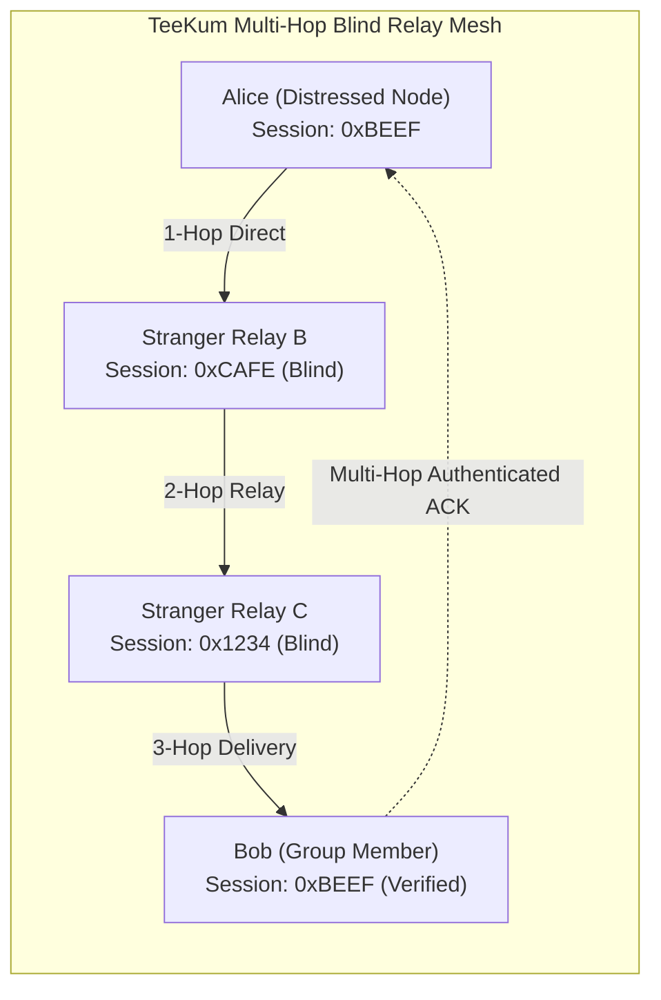
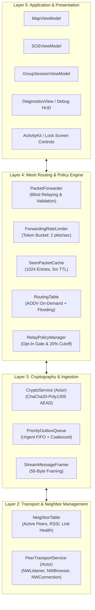
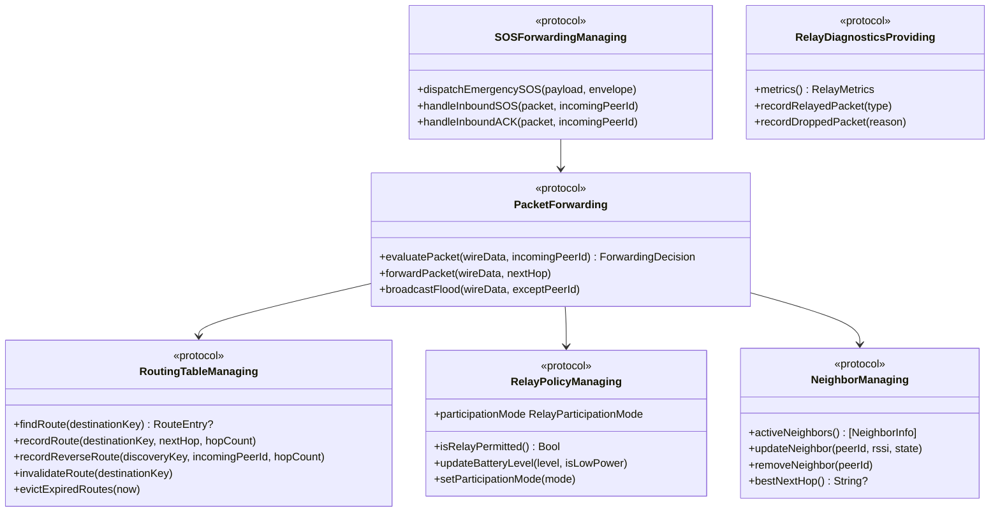
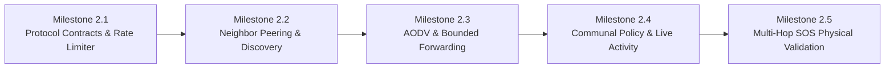

# TeeKum Phase 2 — Multi-Hop Offline Mesh Architecture Specification

> **Document Version:** 2.0  
> **Status:** AUTHORITATIVE ARCHITECTURAL SPECIFICATION  
> **Author:** Agent 0 (Senior iOS Networking Architect & Technical Lead)  
> **Date:** 29 October 2026  
> **Target Platform:** iOS 17.0+ (Swift 5.9+ / Swift 6, 100% Native Apple Frameworks)  
> **Companion Documents:**
> - [Master Agent Instructions (docs/agent.md)](agent.md)
> - [Phase 2 Protocol Decisions (docs/PHASE2_PROTOCOL_DECISIONS.md)](PHASE2_PROTOCOL_DECISIONS.md)
> - [Phase 1 Development Report (docs/PHASE_1_DEVELOPMENT_REPORT.md)](PHASE_1_DEVELOPMENT_REPORT.md)
> - [Networking Architecture (docs/NETWORKING.md)](NETWORKING.md)

---

## 1. Architectural Mission & Principles

Phase 2 transitions TeeKum from a single-hop offline peer-to-peer system into an **ad-hoc, multi-hop mesh network with opt-in communal blind relaying**.



### Core Invariants:
1. **Preserve Phase 1 Without Regression:** Direct peer discovery, serverless QR/link key exchange, adaptive location publishing (3–5s moving, 15–30s stationary), Live Sharing toggling, single active meeting point, and 3-second hold SOS remain 100% functional.
2. **Zero-Knowledge Privacy:** Intermediate stranger relays inspect only cleartext routing headers. Inner location coordinates, status codes, and member initials remain sealed inside 30-byte ChaCha20-Poly1305 ciphertext.
3. **Cryptographic Integrity:** Tampered packets, unauthenticated stranger alerts, or manipulated hop limits fail Poly1305 verification and produce zero application state mutations.
4. **Deterministic Resource Bounds:** Fixed 56-byte wire packets, maximum hop limit of 8, bounded LRU duplicate cache (1,024 entries, 5-minute TTL), 2 packets/second relay rate limit, and bounded queues.
5. **iOS Feasibility:** Realistic lifecycle execution tiers. Communal relaying runs in the background using `showsBackgroundLocationIndicator = true` and auto-terminates at 20% battery.

---

## 2. Multi-Hop System Architecture & Layer Diagram



---

## 3. Subsystem Interface Specifications

To guarantee clean integration, strict thread safety, and independent agent ownership, the mesh system is partitioned into **six core Swift protocol interfaces**.

All services are isolated actors or conform to `@Sendable` contracts and support dependency-injected clocks (`MeshClock`) for deterministic automated testing.



---

### Subsystem 1: Neighbor Management (`NeighborManaging`)

Responsible for tracking 1-hop physical radio connections over AWDL/Wi-Fi Direct, monitoring RSSI signal health, detecting link failures, and maintaining active neighbor topology.

```swift
import Foundation

public enum NeighborState: Sendable, Equatable {
    case connecting
    case connected
    case degraded(packetLossRatio: Double)
    case stale
}

public struct NeighborInfo: Sendable, Equatable, Identifiable {
    public let id: String                    // Remote peer identifier (e.g. initials or UUID)
    public let displayName: String?          // Optional display name from Bonjour TXT
    public let state: NeighborState          // Current link status
    public let rssi: Int8?                   // Signal strength in dBm (-30 dBm to -95 dBm)
    public let lastSeen: Date                // Last packet reception timestamp
    public let roundTripTimeMs: Double?      // Estimated latency over link
    public let isGroupMember: Bool           // True if matches local session ID
}

public protocol NeighborManaging: Actor {
    /// Returns all currently discovered and connected 1-hop physical neighbors.
    func activeNeighbors() -> [NeighborInfo]
    
    /// Updates neighbor telemetry upon packet arrival or keep-alive tick.
    func recordNeighborActivity(peerId: String, rssi: Int8?, isGroupMember: Bool)
    
    /// Updates neighbor connection state.
    func setNeighborState(peerId: String, state: NeighborState)
    
    /// Removes a neighbor upon socket disconnection or keep-alive expiry.
    func removeNeighbor(peerId: String)
    
    /// Selects the healthiest neighbor link for a given next-hop or broadcast candidate.
    func selectBestNextHop(excluding: Set<String>) -> String?
    
    /// Evicts neighbors whose keep-alive has lapsed beyond the timeout threshold.
    func evictStaleNeighbors(thresholdSeconds: TimeInterval)
}
```

---

### Subsystem 2: Routing Table & Route Discovery (`RoutingTableManaging`)

Implements the AODV-inspired on-demand path setup and reverse route tracking.

```swift
import Foundation

public struct RouteEntry: Sendable, Equatable {
    public let destinationId: String          // Destination member initials or session target
    public let nextHopPeerId: String         // Immediate 1-hop neighbor to transmit to
    public let hopCount: UInt8               // Path metric (1..8)
    public let routeCost: UInt8              // Cumulative cost (hops + link quality penalty)
    public let sequenceNumber: UInt32        // Destination sequence counter
    public let expiresAt: Date               // Eviction deadline
    public var isFresh: Bool { Date() < expiresAt }
}

public struct ReverseRouteEntry: Sendable, Equatable {
    public let discoveryKey: UInt32          // Discovery nonce or sequenceNumber
    public let incomingPeerId: String        // Node that forwarded the RREQ
    public let hopCount: UInt8               // Traversal hops observed
    public let expiresAt: Date               // Ephemeral TTL (typically 15s)
}

public protocol RoutingTableManaging: Actor {
    /// Looks up an active, unexpired route towards the given destination.
    func findRoute(to destinationId: String) -> RouteEntry?
    
    /// Inserts or updates a forward route entry.
    func recordForwardRoute(
        destinationId: String,
        nextHop: String,
        hopCount: UInt8,
        cost: UInt8,
        sequenceNumber: UInt32,
        ttl: TimeInterval
    )
    
    /// Records a reverse route entry during RREQ forwarding.
    func recordReverseRoute(
        discoveryKey: UInt32,
        incomingPeerId: String,
        hopCount: UInt8,
        ttl: TimeInterval
    )
    
    /// Retrieves and consumes a reverse route for RREP forwarding.
    func popReverseRoute(for discoveryKey: UInt32) -> ReverseRouteEntry?
    
    /// Invalidates a route when a neighbor link breaks.
    func invalidateRoute(towards destinationId: String)
    
    /// Evicts expired route records from memory.
    func purgeExpiredRoutes()
}
```

---

### Subsystem 3: Packet Forwarding & Forwarding Budgets (`PacketForwarding`)

Coordinates blind packet inspection, rate limiting, duplicate suppression, and transmission over Layer 2 sockets.

```swift
import Foundation

public enum ForwardingDecision: Sendable, Equatable {
    case deliverLocally                     // Packet is addressed to our session and authenticated
    case forward(mutatedWireData: Data, nextHops: [String]) // Relay blindly
    case dropDuplicate                     // Already seen in 5m LRU cache
    case dropHopLimitExceeded              // hopCount >= hopLimit (max 8)
    case dropRateLimitExceeded             // Exceeded 2 pkts/sec budget
    case dropPolicyDisabled                // Relay participation is OFF or battery < 20%
    case dropMalformed                     // Size != 56B or invalid version
}

public protocol ForwardingBudgetManaging: Actor {
    /// Attempts to consume tokens for forwarding ordinary traffic (2 pkts/sec).
    func consumeOrdinaryToken() -> Bool
    
    /// Attempts to consume tokens for urgent SOS forwarding (max 4 pkts/sec).
    func consumeSOSToken() -> Bool
    
    /// Current available ordinary token reserve.
    func availableTokens() -> Double
}

public protocol PacketForwarding: Actor {
    /// Evaluates an inbound wire packet to determine whether it should be delivered locally,
    /// forwarded to other peers, or dropped.
    func evaluateInboundPacket(
        wireData: Data,
        fromPeerId: String
    ) async -> ForwardingDecision
    
    /// Executes the blind forwarding of a packet across designated next hops.
    func executeForward(
        wireData: Data,
        toPeerIds: [String]
    ) async throws
    
    /// Bounded flooding fallback: transmits packet to all connected peers except originator.
    func floodPacket(
        wireData: Data,
        exceptPeerId: String?
    ) async throws
}
```

---

### Subsystem 4: Relay Participation Policy (`RelayPolicyManaging`)

Enforces user consent, Lock Screen Live Activity controls, and the hard 20% battery cutoff.

```swift
import Foundation

public enum RelayParticipationMode: String, Sendable, Codable, CaseIterable {
    case disabled           // Relay OFF: never forwards stranger packets
    case communalRelayActive // Always relay while battery >= 20%
    case timed30Minutes     // Relay for 30 minutes, then automatically pause
}

public struct RelayPolicyState: Sendable, Equatable {
    public let mode: RelayParticipationMode
    public let batteryLevel: Float           // 0.0 to 1.0
    public let isLowPowerModeActive: Bool
    public let timedExpiryDate: Date?
    
    public var isRelayPermitted: Bool {
        guard mode != .disabled else { return false }
        guard batteryLevel >= 0.20 && !isLowPowerModeActive else { return false }
        if let expiry = timedExpiryDate {
            return Date() < expiry
        }
        return true
    }
}

public protocol RelayPolicyManaging: Actor {
    /// Current effective policy state.
    func currentState() -> RelayPolicyState
    
    /// Updates user-selected participation mode (from UI or Lock Screen).
    func setParticipationMode(_ mode: RelayParticipationMode)
    
    /// Updates hardware power metrics from UIDevice / ProcessInfo.
    func updatePowerMetrics(batteryLevel: Float, isLowPowerMode: Bool)
    
    /// Evaluates whether forwarding a packet of the given type is currently permitted.
    func canRelay(packetType: PacketType) -> Bool
}
```

---

### Subsystem 5: SOS Forwarding & Multi-Hop Acknowledgement (`SOSForwardingManaging`)

Governs the prioritized transmission of emergency SOS alerts, multi-hop return routing of delivery confirmations, and honest state feedback.

```swift
import Foundation

public protocol SOSForwardingManaging: Actor {
    /// Dispatches an immediate emergency SOS alert across all mesh links via bounded flooding.
    func broadcastEmergencySOS(
        payload: SOSPayload,
        envelope: CleartextEnvelope,
        symmetricKey: SymmetricKey
    ) async throws
    
    /// Processes an inbound SOS packet: authenticates, sounds siren if new, and routes ACK.
    func handleInboundSOSPacket(
        rawPacket: RawWirePacket,
        fromPeerId: String
    ) async throws
    
    /// Generates and transmits an authenticated ACK back to the distressed member.
    func sendDeliveryACK(
        for originalPacket: RawWirePacket,
        status: ACKStatus
    ) async throws
    
    /// Processes an incoming delivery ACK and updates delivery state.
    func handleInboundACK(
        rawPacket: RawWirePacket,
        fromPeerId: String
    ) async
}
```

---

### Subsystem 6: Relay Diagnostics & Observability (`RelayDiagnosticsProviding`)

Supplies live metrics for the on-device Debug HUD sheet (`DiagnosticsView.swift`) and automated verification assertions.

```swift
import Foundation

public struct RelayTelemetry: Sendable, Equatable {
    public let totalPacketsForwarded: Int
    public let totalSOSForwarded: Int
    public let packetsDroppedRateLimit: Int
    public let packetsDroppedHopLimit: Int
    public let duplicatePacketsSuppressed: Int
    public let activeRoutesCount: Int
    public let activeNeighborsCount: Int
    public let currentForwardingRatePerSec: Double
    public let isFestivalSurvivalActive: Bool
}

public protocol RelayDiagnosticsProviding: Actor {
    /// Returns an instantaneous snapshot of mesh performance and relay telemetry.
    func snapshot() -> RelayTelemetry
    
    /// Records a packet forwarding event.
    func recordForwardEvent(type: PacketType)
    
    /// Records a packet drop event with specific reason.
    func recordDropEvent(reason: DropReason)
}

public enum DropReason: Sendable, Equatable {
    case duplicate
    case hopLimitExceeded
    case rateLimitExceeded
    case batteryThrottled
    case policyDisabled
    case malformed
}
```

---

## 4. Injected Clock Abstraction for Deterministic Verification

To eliminate non-deterministic timing bugs and flaky integration tests, all rate limiters, token buckets, route expiration handlers, and duplicate caches must rely on an injected `MeshClock`:

```swift
public protocol MeshClock: Sendable {
    func now() -> Date
}

public struct SystemMeshClock: MeshClock {
    public init() {}
    public func now() -> Date { Date() }
}

/// Testable clock allowing instant time advancement in unit tests.
public final class TestMeshClock: MeshClock, @unchecked Sendable {
    private var currentDate: Date
    private let lock = NSLock()
    
    public init(initialDate: Date = Date()) {
        self.currentDate = initialDate
    }
    
    public func now() -> Date {
        lock.lock()
        defer { lock.unlock() }
        return currentDate
    }
    
    public func advance(by seconds: TimeInterval) {
        lock.lock()
        defer { lock.unlock() }
        currentDate = currentDate.addingTimeInterval(seconds)
    }
}
```

---

## 5. Integration Milestones & Acceptance Test Suite

Phase 2 development is structured into **five deterministic integration milestones**. Each milestone has precise acceptance criteria that must compile and pass tests before proceeding.



### Milestone 2.1: Protocol Contracts, Rate Limiter & Duplicate Cache
- **Goal:** Author the core data structures, token bucket rate limiter (2 pkts/sec), 5-minute LRU duplicate cache, and testable clock.
- **Acceptance Tests:**
  1. `testForwardingRateLimiterExactEnforcement`: Verify exactly 2 packets per second are permitted; 3rd packet in the same second is rejected.
  2. `testTokenBucketRefillWithInjectedClock`: Advance clock by 1.0s and verify token pool refills to capacity.
  3. `testDuplicateCacheFiveMinuteEviction`: Verify a packet key is identified as duplicate within 299s, and evicted at 301s.
  4. `testPacketKeyCrossGroupCollisionResistance`: Verify identical session ID + sequence number with distinct authTags produce distinct keys.

### Milestone 2.2: Open Neighbor Peering & Topology Management
- **Goal:** Update `PeerTransportService` Bonjour browsing to establish connections with any nearby `_teekum._tcp` node (removing TXT session ID isolation for relays), while keeping application sessions cryptographically isolated.
- **Acceptance Tests:**
  1. `testOpenPeeringDifferentSessionIds`: Node A (session `0x1111`) and Node B (session `0x2222`) successfully discover and peer over AWDL.
  2. `testNeighborTableRSSIAndLinkHealth`: Verify RSSI readings and keep-alive state transitions (`.connected` -> `.degraded` -> `.stale`).
  3. `testDeterministicTieBreakingStrangerPeers`: Simultaneous connection attempts resolve cleanly to a single socket.

### Milestone 2.3: AODV Routing Engine & Bounded Blind Forwarding
- **Goal:** Implement `RoutingTable` and `PacketForwarder`. Enable stranger relays to forward 56-byte packets blindly, incrementing `hopCount` and dropping packets at hop limit 8.
- **Acceptance Tests:**
  1. `testBlindForwardingPreservesAuthTag`: Relay node increments `hopCount` from 0 to 1; destination opens packet with valid MAC tag.
  2. `testHopLimitMax8Drop`: Packets arriving with `hopCount == 8` are dropped immediately with `.dropHopLimitExceeded`.
  3. `testAODVReverseRouteSetup`: RREQ through relay sets reverse route; RREP follows reverse route back to originator.
  4. `testBoundedFloodingFallbackWhenNoRoute`: Packet without route reaches all reachable nodes within 8 hops.

### Milestone 2.4: Communal Relay Policy, Battery Guard & Lock Screen Live Activity
- **Goal:** Implement `RelayPolicyManager`, tie into `MeshAgreementView`, integrate `SessionLiveActivityView` controls, and enforce hard 20% battery cutoff.
- **Acceptance Tests:**
  1. `testRelayOptInRequired`: Forwarding returns `.dropPolicyDisabled` until user explicitly opts in.
  2. `testBatteryCutoffAtTwentyPercent`: When battery drops to 19%, relaying immediately halts.
  3. `testTimedThirtyMinutesExpiry`: Relay mode auto-disables after 30 minutes.
  4. `testLiveActivityStateSync`: Live Activity updates lock screen pill to reflect active relay status.

### Milestone 2.5: Multi-Hop SOS End-to-End Delivery & Two-Device Validation
- **Goal:** Connect SOS dispatch, bounded flooding, multi-hop ACK return, and honest delivery state progression.
- **Acceptance Tests:**
  1. `testMultiHopSOSTransmission`: 3-hop topology (Alice -> Relay -> Bob) delivers SOS to Bob in <50ms.
  2. `testMultiHopACKDeliveryState`: Bob's ACK returns across relay to Alice, transitioning state from `RELAY_ACK` to `DELIVERED_TO_FRIEND`.
  3. `testDuplicateSOSSuppressionOnRelays`: Repeated SOS packets do not produce repeated sirens on relays or destination.
  4. `testPhysicalTwoDeviceRelaySimulation`: Validation harness simulating realistic packet loss and link dropouts.
