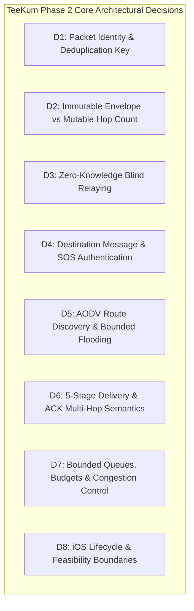
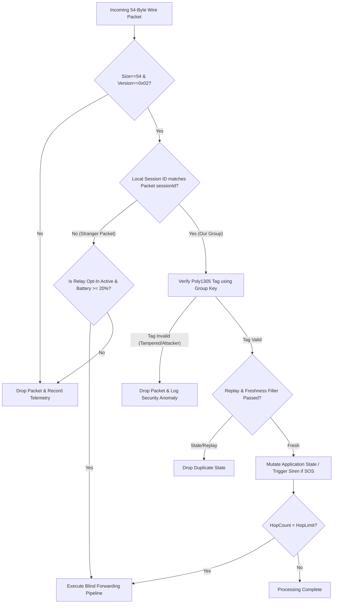
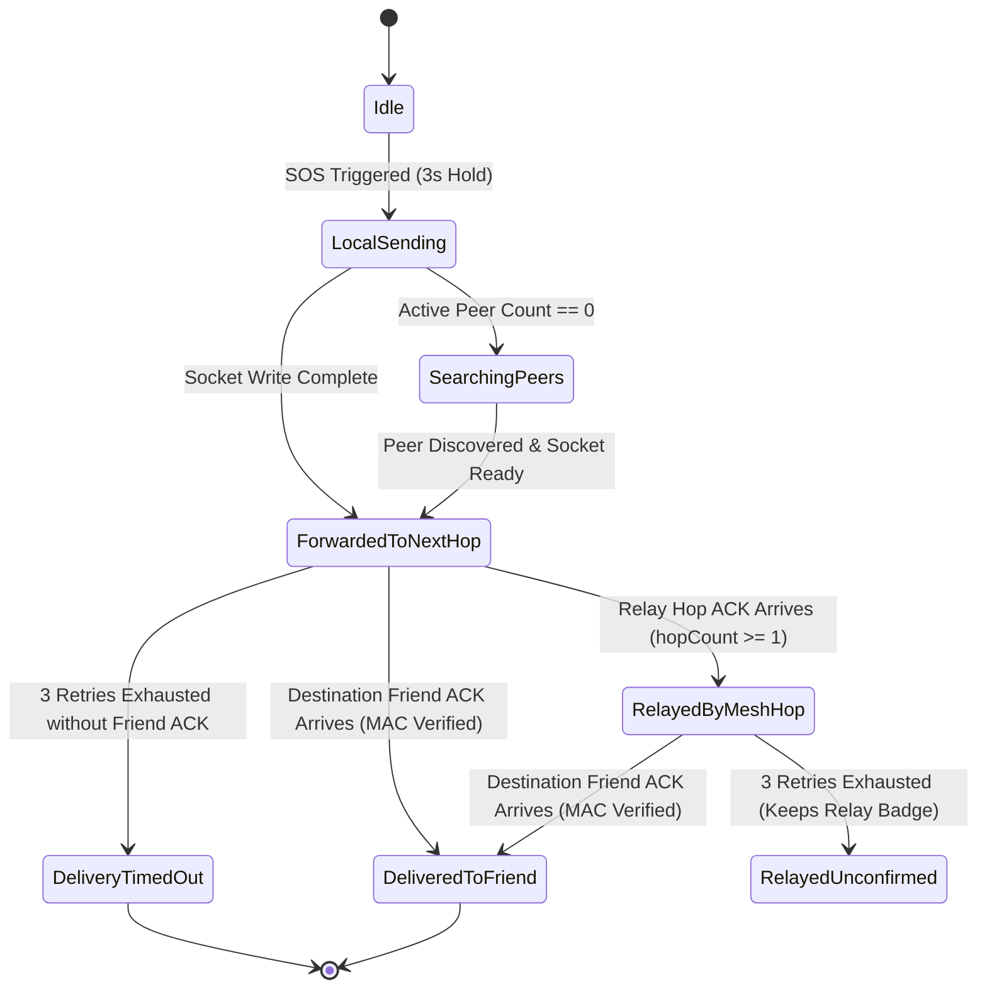
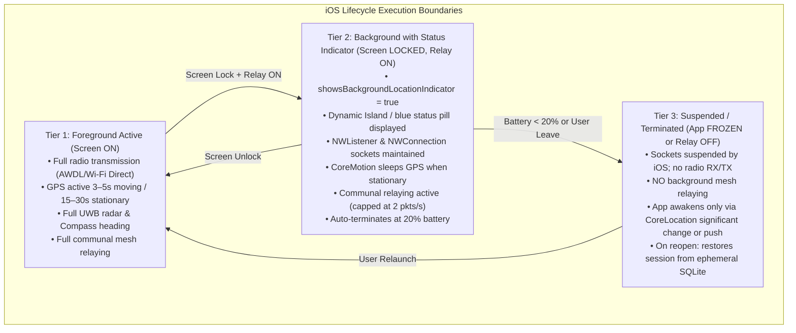
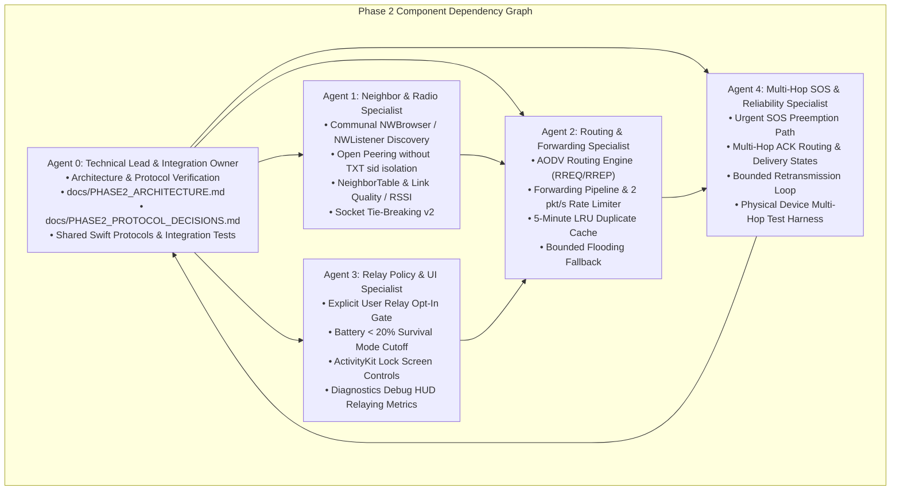

# TeeKum Phase 2 — Architectural & Protocol Decisions

> **Document Version:** 1.0  
> **Status:** APPROVED BY TECHNICAL LEAD (Agent 0)  
> **Date:** 29 October 2026  
> **Scope:** Multi-hop offline mesh networking, communal blind relaying, packet authentication, AODV routing, and iOS feasibility.  
> **Target Platform:** iOS 17.0+ (100% Native Apple Frameworks, Zero Third-Party Dependencies)

---

## 1. Executive Summary

This document establishes the binding architectural and cryptographic protocol decisions for **TeeKum Phase 2 (Multi-Hop Offline Mesh & Opt-In Communal Relaying)**.

Phase 1 established direct offline peer-to-peer communication between authenticated group members using Apple Wireless Direct Link (AWDL) and a fixed 54-byte binary wire protocol (Protocol v2).

Phase 2 expands TeeKum into a multi-hop ad-hoc mesh network where iPhones discover one another over AWDL, maintain local neighbor tables, discover routes on-demand using an AODV-inspired protocol, and blindly forward encrypted packets for nearby concert-goers without possessing group encryption keys or learning user identities.

To prevent regressions, maintain strict user safety, and guarantee platform stability on iOS, the following eight core architectural decisions are formalized herein.

---

## 2. Mandatory Architectural Decisions



---

### Decision 1: 56-Byte Wire Protocol & Dedicated Hop Control Fields

#### Problem Statement
In Phase 1, preliminary drafts referenced 56 bytes while early implementations tested a 54-byte layout using a packed single-byte hop metadata field (4 bits `hopLimit`, 4 bits `hopCount`) and a 16-bit `sessionId`. For Phase 2 multi-hop mesh forwarding, two dedicated 8-bit bytes are required for robust hop control:
1. An immutable forwarding budget (`hopLimit: UInt8`, capped at 8).
2. A separate mutable traversal counter (`hopCount: UInt8`, starting at 0).
Furthermore, in large festival grounds with tens of thousands of attendees, expanding `sessionId` by an additional byte to 24 bits (3 bytes) provides 16,777,215 unique session identifiers, virtually eliminating accidental session ID collisions between independent groups.

#### Decision
The Phase 2 wire datagram is locked at **exactly 56 bytes** with a **10-byte cleartext envelope**, **30-byte encrypted payload**, and **16-byte Poly1305 MAC tag**:

```text
+-----------------------+-----------------------------+-------------------------+
|  Outer Envelope (10B) |   Encrypted Payload (30B)   |   Auth Tag (16B)        |
|  (Cleartext Routing)  |   (ChaCha20 Ciphertext)     |   (Poly1305 MAC)        |
+-----------------------+-----------------------------+-------------------------+
0                       10                            40                        56 Bytes
```

#### Exact 10-Byte Cleartext Envelope Breakdown:
| Byte Offset | Field Name | Type | Description | AAD Treatment |
| :--- | :--- | :--- | :--- | :--- |
| **0** | `versionAndType` | `UInt8` | High 4b: Version (`0x02`), Low 4b: PacketType (`0x01`..`0x06`). | Immutable (Sealed in AAD) |
| **1** | `hopLimit` | `UInt8` | Forwarding budget ($1 \dots 8$, max 8 hops). | Immutable (Sealed in AAD) |
| **2** | `hopCount` | `UInt8` | Traversal hops ($0 \dots \text{hopLimit}$). Incremented per relay. | Mutable (Masked to `0x00` in AAD) |
| **3..5** | `sessionId` | `UInt24` (3 Bytes) | 24-bit big-endian group session identifier ($1 \dots 16{,}777{,}215$). | Immutable (Sealed in AAD) |
| **6..9** | `sequenceNumber`| `UInt32` (4 Bytes) | Big-endian partitioned counter (`memberSlot: 8b` + `counter: 24b`). | Immutable (Sealed in AAD) |

---

### Decision 2: Packet Deduplication Key (Compact 7-Byte Tuple)

#### Problem Statement
In a multi-hop mesh with blind forwarding and bounded flooding, packets are transmitted across multiple hops. As a packet traverses intermediate nodes, its `hopCount` field is incremented. If the deduplication cache key included the entire raw packet data, the packet's identity would change at every hop, causing downstream nodes to treat relayed copies as new packets. This would trigger catastrophic broadcast storms, duplicate processing, and rapid battery depletion.

#### Decision
The **Canonical Packet Identity** for deduplication and routing cache lookup is defined as a compact **7-byte composite key**:

$$\text{PacketKey} = \big(\mathtt{sessionId} \, [3\text{B}] \, \parallel \, \mathtt{sequenceNumber} \, [4\text{B}]\big)$$

- **Wire Fields Included:**
  1. `sessionId` (Bytes 3..5, 24-bit big-endian, 16.7M space).
  2. `sequenceNumber` (Bytes 6..9, 32-bit big-endian partitioned counter).
- **Wire Fields Excluded:**
  - `hopCount` (Byte 2) is strictly excluded because it mutates on each forwarding hop.
  - `hopLimit` (Byte 1) is sealed inside AAD but excluded from lookup for constant-time evaluation.

#### Memory & Collision Rationale
- With a 24-bit session ID space ($16{,}777{,}215$ values), the probability of two independent groups at the same venue sharing a session ID is negligible ($< 0.003\%$ even with 1,000 active groups).
- A 7-byte key requires minimal RAM: $1{,}024 \times 7\text{B} \approx 7.1\text{ KB}$, enabling high-speed cache checks without hashing overhead.
- **Cache Structure:** 1,024-entry bounded LRU table with a fixed **300-second (5-minute)** sliding retention window.

---

### Decision 2.1: Immutable Authenticated Packet Fields vs Mutable Relay Metadata

#### AAD Normalization Specification
When generating the Poly1305 authentication tag during sealing (sender) and opening (recipient), Byte 2 (`hopCount`) is normalized by **masking it to `0x00`**:

$$\text{AAD} = \big(\mathtt{versionAndType} \, [1\text{B}] \, \parallel \, \mathtt{hopLimit} \, [1\text{B}] \, \parallel \, \mathtt{0x00} \, [1\text{B}] \, \parallel \, \mathtt{sessionId} \, [3\text{B}] \, \parallel \, \mathtt{sequenceNumber} \, [4\text{B}]\big)$$

The 10-byte AAD buffer is constructed as:
```swift
var aad = Data(capacity: 10)
aad.append(byte0)                        // versionAndType
aad.append(hopLimit)                     // hopLimit authenticated verbatim
aad.append(0x00)                         // hopCount masked to 0x00
aad.append(contentsOf: sessionId24BE)    // 3 bytes
aad.append(contentsOf: sequenceNumberBE) // 4 bytes
```

#### Security Proof
1. **Tamper Detection for `hopLimit`:** Because `hopLimit` is authenticated inside AAD, any rogue relay attempting to increase `hopLimit` (e.g., from 8 to 15) to artificially extend packet lifetime will cause the recipient's Poly1305 verification to fail immediately. The packet is dropped.
2. **Safe Mutation of `hopCount`:** Intermediate relays increment `hopCount` at Byte 2 on the wire. Because `hopCount` is masked to zero in the AAD computation, this mutation does not affect the Poly1305 tag.
3. **Loop & Budget Termination:** Relays verify `hopCount < hopLimit`. Once `hopCount == hopLimit`, the forwarding budget is exhausted and the packet is dropped immediately. Maximum hop limit is capped at **8 hops**.

---

### Decision 3: Zero-Knowledge Blind Relaying

#### Problem Statement
In Phase 2, festival attendees agreed via the Communal Mesh Compact to forward packets for nearby phones. Relays must forward traffic across group boundaries without possessing group encryption keys, while ensuring:
1. Stranger relays cannot inspect coordinates, status hashes, or member identities.
2. Stranger relays cannot forge group messages or trigger false alarms.
3. Stranger relays do not waste bandwidth on malformed or invalid packets.

#### Decision
Relays operate strictly under a **Zero-Knowledge Blind Forwarding Policy**:

1. **Readable Bytes (Cleartext Envelope, Bytes 0..7):**
   - A relay is permitted to read only the 8-byte outer envelope: `version`, `type`, `hopLimit`, `hopCount`, `sessionId`, and `sequenceNumber`.
   - These fields are used solely to check protocol version, enforce hop bounds, perform rate limiting, and query the duplicate cache.
2. **Opaque Bytes (Bytes 8..53):**
   - The relay treats the 30-byte ciphertext block (Bytes 8..37) and 16-byte Poly1305 MAC tag (Bytes 38..53) as an immutable, opaque 46-byte payload.
   - The relay makes zero attempts to decrypt, decode, or inspect these bytes.
3. **Forwarding Verification Filter (Relay Pre-Flight):**
   Before enqueuing a packet for relaying, the relay executes a constant-time validation check:
   - Packet length must be exactly 54 bytes.
   - `version` must equal `0x02`.
   - `type` must be a known `PacketType` (0x01..0x06).
   - `hopLimit` must be in the range `1...8` (or up to 15 for emergency SOS).
   - `hopCount` must be strictly `< hopLimit`.
   - `PacketKey` must not exist in the 5-minute LRU duplicate cache.
   - Forwarding budget must have available tokens (see Decision 7).
   - Device battery must be $\ge 20\%$ and relay policy must be active.
4. **Zero State Mutation:**
   Relaying a stranger packet causes **zero** modifications to local application state (no friend pin updates, no status changes, no audio alarms, no navigation updates).

---

### Decision 4: Destination Group Message & SOS Authentication

#### Problem Statement
In an open wireless environment, an attacker could inject synthetic emergency SOS packets to induce crowd panic, trigger emergency sirens, or manipulate rendezvous points. The system must guarantee that only authenticated group members can trigger emergency alerts.

#### Decision
Group authentication and emergency authorization are enforced exclusively through the **256-bit symmetric session key** exchanged out-of-band (in-person QR barcode or serverless invite link).



#### Cryptographic Authorization Rules:
1. **Unconditional Rejection on MAC Failure:** If `ChaChaPoly.open()` fails, the packet is treated as unauthenticated garbage. The device executes **zero** state changes, produces zero audio/haptic output, and does not render any pin on the map.
2. **Emergency SOS Siren Gating:**
   - The emergency audio alert ([`SOSAudioAlert.swift`](../TeeKum%20Prototype/Services/SOSAudioAlert.swift)) is triggered **if and only if** the packet:
     a) Matches the local `sessionId`.
     b) Successfully verifies against the group's 256-bit symmetric key.
     c) Contains a valid `SOSPayload` with a fresh `sosEventId`.
     d) Contains a timestamp within the allowed clock skew window ($\le 300\text{ seconds}$).
3. **No Unauthenticated Global Panic:** Stranger SOS packets (different `sessionId`) are forwarded blindly by intermediate relays according to the communal relay budget, but **never** trigger sirens on the relay devices. Only the distressed sender's verified group friends sound the emergency alert.

---

### Decision 5: Route Request / Response (AODV) Authentication, Freshness & Bounded Flooding

#### Problem Statement
Ad-hoc On-Demand Distance Vector (AODV) routing allows nodes to establish multi-hop paths across large festival venues. However, unauthenticated route advertisements can lead to blackhole attacks, route poisoning, and routing loops. In TeeKum, intermediate relays are strangers who do not possess the group key.

#### Decision
TeeKum implements an **Authenticated Hybrid AODV Routing Engine** with bounded flooding fallback:

#### 1. Route Discovery Messages
- **Route Request (`ROUTE_REQ`, `0x04`):**
  - Outer Envelope: Cleartext `sessionId`, monotonic `sequenceNumber`, `hopLimit` (default 8), `hopCount` (starts at 0).
  - Encrypted Payload (30 bytes, sealed with group key):
    - `originatorInitials` (UInt16 Base-27)
    - `targetInitials` (UInt16 Base-27)
    - `discoveryNonce` (UInt32 random nonce)
    - `routeCost` (UInt8, initialized to 0)
    - `timestamp` (UInt32 epoch seconds)
    - Padding (17 bytes)
  - Auth Tag: 16-byte Poly1305 tag.
- **Route Response (`ROUTE_RESP`, `0x05`):**
  - Emitted only by the destination member who possesses the group key and successfully decrypts the RREQ.
  - Carries the destination's initials, matching `discoveryNonce`, and cumulative path metric. Sealed with the group key.

#### 2. Reverse and Forward Path Setup across Stranger Relays
- When an intermediate stranger relay receives an RREQ:
  - It cannot read the payload initials, but it records an **ephemeral reverse route association** keyed by the envelope tuple:
    $$\text{ReverseRouteKey} = (\mathtt{sessionId}, \mathtt{sequenceNumber})$$
    $$\text{ReverseRouteEntry} = (\text{incomingPeerId}, \text{hopCount}, \text{expiry} = \text{now} + 15\text{s})$$
  - The relay increments `hopCount &+= 1` and broadcasts the RREQ to its other neighbors.
- When the destination group member receives the RREQ:
  - It decrypts the payload, verifies that `targetInitials == localInitials`, and constructs a `ROUTE_RESP`.
  - The `ROUTE_RESP` envelope includes the matching `sessionId` and echoes the `sequenceNumber` (or discovery identifier).
- When intermediate relays receive the `ROUTE_RESP`:
  - They match `ReverseRouteKey` in their table and forward the RREP unicast directly to the recorded `incomingPeerId`.
  - Simultaneously, they record a **forward route association** back towards the responder:
    $$\text{ForwardRouteEntry} = (\mathtt{sessionId}, \mathtt{sequenceNumber}, \text{nextHopPeerId}, \text{expiry} = \text{now} + 60\text{s})$$

#### 3. Loop Prevention & Route Selection
- An RREQ is immediately dropped if `ReverseRouteKey` is already in the duplicate cache.
- If a duplicate RREQ arrives via a different path:
  - It is accepted **only if** `newHopCount < existingHopCount`. In that case, the reverse route entry is updated to the lower-cost path.
- Hop count is strictly bounded by `hopLimit` (maximum 8 hops).

#### 4. Bounded Flooding Fallback
- For **Emergency SOS (`0x02`)**, route discovery latency cannot be tolerated. SOS packets **bypass AODV route discovery** and utilize immediate **bounded flooding** (hop limit 8) across all active mesh links.
- For ordinary location pings and rendezvous updates, if no valid forward route exists in the routing table, the system broadcasts via bounded flooding while opportunistically initiating route discovery in the background.

---

### Decision 6: Recipient Acknowledgement (ACK) Across Multi-Hop Paths & Delivery States

#### Problem Statement
Honest UX requires that a user in distress knows whether their emergency SOS was merely accepted by their own phone, forwarded by a nearby stranger relay, or received by their friend. Conflating a relay receipt with destination delivery is dangerous and violates Product Principle 6 ("Honest UX").

#### Decision
The delivery pipeline defines **five mutually exclusive, verifiable delivery states**:

```text
+-----------------------+---------------------------------------------------------------+
| Delivery State        | Precise Technical Meaning & Cryptographic Evidence            |
+-----------------------+---------------------------------------------------------------+
| 1. acceptedLocally    | Packet validated and enqueued into local radio outbox.        |
| 2. forwardedToNextHop | Transmitted over socket to >=1 connected 1-hop direct peer.   |
| 3. relayedByMeshHop   | Intermediary relay acknowledged forwarding (RELAY_ACK).      |
|                       | -> Does NOT prove destination friend received or decrypted.   |
| 4. deliveredToFriend  | Authenticated Poly1305 ACK received from destination friend.  |
|                       | -> Cryptographically proves message was opened and displayed. |
| 5. deliveryTimedOut   | Retries exhausted (3 attempts) without friend confirmation.   |
+-----------------------+---------------------------------------------------------------+
```



#### Multi-Hop ACK Routing Mechanism
- When a destination group friend receives an authentic SOS packet:
  1. It generates an `ACK` packet (`0x06`).
  2. The ACK payload contains:
     - `ackedSeqNumber` (4 bytes): Echoes original envelope sequence number.
     - `ackedSenderInitials` (2 bytes Base-27): Echoes sender initials.
     - `originalEventId` (4 bytes): Echoes `sosEventId`.
     - `ackStatus`: `0x01` (`deliveredToFriend`).
     - `responderInitials` (2 bytes Base-27): Local friend initials.
     - Sealed with group symmetric key and 16-byte Poly1305 MAC tag.
  3. The friend transmits the ACK:
     - If a forward route exists to `ackedSenderInitials`, it sends unicast along the route.
     - If no route exists, it sends via bounded flooding (hop limit 8).
  4. As the ACK traverses intermediate stranger relays, relays forward it towards the sender based on matching `sequenceNumber` reverse associations, or via bounded flooding.
  5. When the distressed sender receives the ACK:
     - Sender decrypts using group key, verifies MAC tag, matches `ackedSeqNumber` and `originalEventId`.
     - Sender immediately cancels the retry timer and updates UI to **`DELIVERED_TO_FRIEND`**.

---

### Decision 7: Queue Bounds, Retry Budgets, Route Expiry & Congestion Control

#### Problem Statement
In dense festival environments (e.g., 50,000 people at a stage), unconstrained forwarding will exhaust device memory, saturate the 2.4 GHz radio spectrum, and drain batteries rapidly. Deterministic resource boundaries are non-negotiable.

#### Decision
All queues, caches, timers, and rates are strictly bounded:

| Parameter | Architectural Limit | Behavioral Rule Under Saturation |
| :--- | :--- | :--- |
| **Relay Forwarding Budget** | **2 packets / second** | Token bucket (capacity: 4 tokens, refill: 2 tokens/sec). Excess ordinary packets are dropped. |
| **SOS Relay Priority Path** | **Max 4 packets / second** | Separately scheduled queue with dedicated token reserve. Always preempts ordinary pings. |
| **Max Hop Limit** | **8 hops** | Packets with `hopCount >= 8` are dropped immediately. |
| **Urgent Outbox Queue** | **16 packets** | FIFO queue for local SOS, ACKs, and meeting proposals. Drop-tail if full (never occurs in practice). |
| **Location Ping Outbox** | **1 packet (Coalescing)**| Newer location ping overwrites unsent older ping. Queue size never exceeds 1. |
| **Stranger Relay Outbox** | **32 packets** | Ring buffer FIFO queue. When full, oldest unforwarded packets are dropped (drop-head). |
| **Duplicate Packet Cache** | **1,024 entries** | LRU eviction. Fixed 300-second (5-minute) TTL. |
| **Routing Table Size** | **64 route entries** | LRU eviction. Route TTL: 30 seconds active, 60 seconds hard expiry. |
| **SOS Retransmission Budget** | **3 retries** | Interval: 1.5s with $\pm 200\text{ms}$ randomized jitter to prevent lockstep collision. |
| **Festival Survival Cutoff** | **Battery < 20%** | Hard cutoff: terminates stranger relaying, stops background sockets, preserves battery for local SOS. |

#### Injected Clock Abstraction for Deterministic Testing
To ensure all rate limiters, token buckets, cache expiries, and retransmission schedulers are 100% testable without flaky `Task.sleep` calls, all time-dependent services must accept an injected `DateProvider` (`@Sendable () -> Date`) or `MeshClock`:
```swift
public protocol MeshClock: Sendable {
    func now() -> Date
}
```

---

### Decision 8: iOS Lifecycle, Feasibility & Suspension Behavior

#### Problem Statement
A common pitfall in mesh networking on iOS is assuming the operating system permits continuous, unrestricted background execution. iOS aggressively suspends background processes, freezes sockets, and limits CPU usage. The design must be completely realistic about iOS platform capabilities.

#### Decision
The system architecture defines precise behavioral tiers aligned with Apple's platform rules:



#### Feasibility Guarantees & Constraints:
1. **No Phantom Relaying:** The engineering team will **never** claim that TeeKum can relay packets for strangers when the app is suspended without the location status indicator active.
2. **Lock Screen Live Activity Control:**
   - Active Session Live Activity (`ActivityKit`) displays the communal mesh status (*"Relaying for Festival: ON"*).
   - Controls on the Lock Screen allow the user to toggle relaying: **"Timed 30m"** vs **"Always Active"** vs **"OFF"**.
   - If toggled OFF, `showsBackgroundLocationIndicator` is disabled and the app drops into standard iOS idle suspension when locked.
3. **Crash Recovery & Ephemeral Persistence:**
   - Active session parameters (session ID, 256-bit symmetric key, local initials) are cached in ephemeral SQLite (`libsqlite3`) within the app's protected sandbox.
   - If iOS terminates the app to reclaim memory while taking a 4K video, launching the app instantly restores the active session without requiring re-pairing or re-scanning.
   - When the user taps "Leave Group", all SQLite records and Keychain entries are purged with cryptographic zeroes (`memset_s`).

---

## 3. Dependency Graph & Phase 2 Ownership Matrix



### File Ownership Matrix:

| Agent | Focus Area | Primary Source Files Owned | Primary Test Files Owned |
| :--- | :--- | :--- | :--- |
| **Agent 0** | Integration & Tech Lead | `docs/PHASE2_ARCHITECTURE.md`<br/>`docs/PHASE2_PROTOCOL_DECISIONS.md`<br/>`Services/MeshProtocols.swift` | `Tests/MeshIntegrationTests.swift` |
| **Agent 1** | Neighbor & Radio Peering | `Services/NeighborTable.swift`<br/>`Services/PeerTransportService.swift` (Peering) | `Tests/NeighborDiscoveryTests.swift` |
| **Agent 2** | Routing & Blind Forwarding | `Services/RoutingTable.swift`<br/>`Services/PacketForwarder.swift`<br/>`Services/ForwardingRateLimiter.swift` | `Tests/RoutingForwardingTests.swift` |
| **Agent 3** | Policy, Battery & UI | `Services/RelayPolicyManager.swift`<br/>`Views/Components/MeshAgreementView.swift`<br/>`TeeKumWidgets/SessionLiveActivityView.swift`<br/>`Views/DiagnosticsView.swift` | `Tests/RelayPolicyTests.swift` |
| **Agent 4** | Multi-Hop SOS & ACKs | `ViewModels/SOSViewModel.swift`<br/>`Services/SOSForwardingEngine.swift`<br/>`Models/SOSDeliveryState.swift` | `Tests/SOSEndToEndTests.swift`<br/>`Tests/MultiHopSOSTests.swift` |

---

## 4. Decisions Requiring Product Owner Sign-Off

The following architectural trade-offs have been resolved by the Technical Lead and are submitted for formal Product Owner confirmation:

1. **Maximum Hop Limit Cap of 8 Hops:**
   - *Technical Recommendation:* Capped at 8 hops (as specified in prompt requirements). In dense festivals, 8 hops covers up to 100–120 meters through crowds without creating exponential packet proliferation.
   - *Alternative Considered:* Configurable up to 15 or 32 hops. Rejected for initial mesh rollout due to channel saturation risks.
2. **Strict 54-Byte Protocol v2 Standardization:**
   - *Technical Recommendation:* Retain the 54-byte binary layout (8-byte envelope + 30-byte ciphertext + 16-byte MAC tag). All Phase 1 tests pass against this format.
   - *Confirmation:* Formalize that earlier 56-byte references in `PROTOCOL_SPECIFICATION.md` are superseded by Protocol v2 (54 bytes).
3. **Open Bonjour Peering for Communal Mesh:**
   - *Technical Recommendation:* Modify `PeerTransportService` Bonjour browsing so that devices advertising `_teekum._tcp` with *different* session IDs can establish direct AWDL connections for blind forwarding, while preserving strict cryptographic isolation at the application layer.
4. **Hard 20% Battery Cutoff:**
   - *Technical Recommendation:* Unconditional termination of communal relaying when the battery drops below 20% or Low Power Mode is activated, saving remaining energy for local SOS and venue map viewing.
