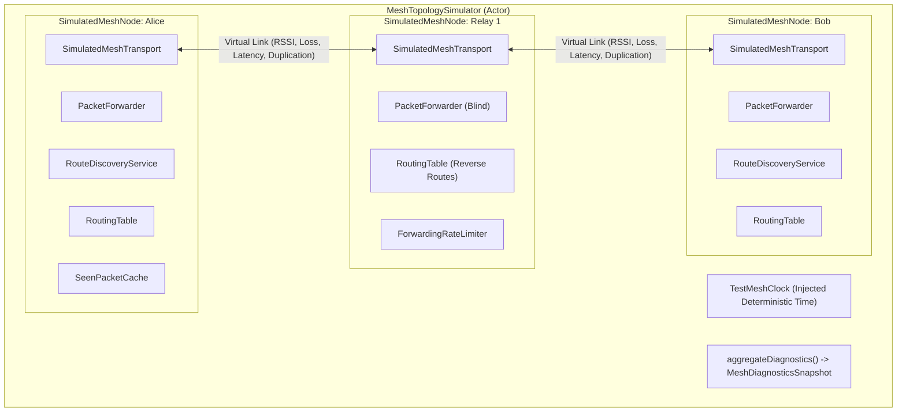

# TeeKum Phase 2 — Multi-Hop Mesh Network Test Plan

> **Document Version:** 1.0  
> **Status:** AUTHORITATIVE TEST PLAN  
> **Author:** Agent 6 (TeeKum Mesh Test & Diagnostics Engineer)  
> **Target Scope:** Phase 2 Ad-Hoc Multi-Hop Mesh Architecture & Diagnostics  
> **Zero Cloud Dependency:** Verified strictly offline without cellular, internet, or backend servers.

---

## 1. Executive Summary & Mission

The Phase 2 Multi-Hop Mesh Network enables festival and concert attendees to maintain situational awareness, locate group members, and broadcast emergency SOS alerts over ad-hoc peer-to-peer links without cellular infrastructure or internet access.

The mission of **Agent 6 (TeeKum Mesh Test & Diagnostics Engineer)** is:
> **Make mesh behavior observable, reproducible, and verifiable under realistic network failure models before expensive, logistically complex physical field testing.**

This document details:
1. The deterministic multi-node test harness architecture.
2. The simulation taxonomy distinguishing in-memory verified behaviors from physical radio requirements.
3. Test specifications for all 11 failure scenarios plus zero-knowledge diagnostics verification.
4. The multi-iPhone physical test matrix (2, 3, 4, and 5+ devices).
5. Operational telemetry counters and diagnostics collection contracts.

---

## 2. Test Infrastructure & Simulator Architecture

### 2.1 The Multi-Node Test Harness (`MeshTopologySimulator`)

Testing multi-hop mesh routing, rate limiting, and failure convergence on physical radios alone is insufficient because radio link parameters (path loss, packet loss, interference, node departures) cannot be easily scripted or repeated. 

TeeKum provides an actor-isolated, deterministic in-memory network simulator conforming to the authoritative `MeshTransport` and `PeerTransport` contracts:



### 2.2 Core Simulation Primitives

1. **`TestMeshClock`:** Supports millisecond-precision deterministic time advancement without relying on wall-clock `Task.sleep` or OS scheduling jitter.
2. **`SimulatedMeshTransport`:** Full conformance to `MeshTransport` and `PeerTransport`. Intercepts wire frames and models:
   - Configurable link signal strength (`rssi: Int8`).
   - Configurable transmission loss (`packetLossRatio: Double`).
   - Configurable link propagation delay (`latency: TimeInterval`).
   - Configurable frame duplication (`duplicationRatio: Double`).
   - Immediate link breakages (`disconnect`) and link restorations (`reconnect`).
3. **`SimulatedMeshNode`:** Self-contained protocol stack (transport, neighbor table, routing table, duplicate cache, rate limiter, packet forwarder, and route discovery engine).
4. **`MeshDiagnosticsCollector`:** Zero-knowledge metrics aggregation engine collecting the 7 required operational telemetry counters without ever storing GPS coordinates or secret keys.

---

## 3. Simulation vs. Real Hardware Taxonomy

To maintain engineering integrity, we strictly delineate behaviors that can be proven via in-memory simulation from behaviors that fundamentally require physical radios and Apple platform execution.

> [!CAUTION]
> **Boundary Principle:** Never label simulated multi-hop success as physical-device mesh success. Simulated tests verify protocol correctness, boundary enforcement, and cryptographic validity. Physical testing verifies Apple Wireless Direct Link (AWDL) radio timing, RF channel contention, antenna orientation, and iOS background lifecycle suspensions.

| Operational Dimension | In-Memory Simulator | Physical iPhone Testing | Rationale |
| :--- | :--- | :--- | :--- |
| **56-Byte Datagram Layout** | **Fully Verified** | Baseline Tested | Serialization, big-endian alignment, and field boundaries are deterministic bitwise logic. |
| **AEAD Cryptography & Auth Tags** | **Fully Verified** | Baseline Tested | ChaCha20-Poly1305 sealing, verification, and tamper detection execute identically on simulated and physical CPUs. |
| **AODV Route Discovery Logic** | **Fully Verified** | Topology Verified | RREQ/RREP state machines, reverse route consumption, and sequence number monotonicity are purely algorithmic. |
| **8-Hop Limit & Bounded Flooding** | **Fully Verified** | Requires Field Test | Simulator proves `hopCount >= hopLimit` drop logic; physical radios must verify RF channel saturation during flooding. |
| **Token Bucket Rate Limiting** | **Fully Verified** | Requires Field Test | Proves 2 pkts/sec ordinary and 4 pkts/sec SOS budget enforcement under deterministic arrival rates. |
| **LRU Duplicate Cache & Monotonicity**| **Fully Verified** | Baseline Tested | 1,024-entry capacity, 5-minute sliding TTL, and multi-path suppression execute identically. |
| **Intermediate Relay ACK vs Friend ACK**| **Fully Verified** | Baseline Tested | Proves honest UI progression (`RELAY_ACK` vs `DELIVERED_TO_FRIEND`). |
| **AWDL Link Establishment Latency** | *Simulated Model* | **Requires Hardware** | Wi-Fi Direct / AWDL frequency hopping, sync frame exchange, and channel negotiation (typically 1.2s - 3.8s) require real hardware radios. |
| **Crowded RF Packet Collision & Loss**| *Simulated Ratio* | **Requires Hardware** | Real concert venues experience severe 2.4 GHz / 5 GHz ISM band congestion from thousands of attendee smartphones. |
| **iOS Process Suspension (Background)**| *Simulated State* | **Requires Hardware** | Apple limits background execution. Verifying that Live Activities, CoreLocation opportunistic wakes, and Network.framework keep sockets alive requires physical iOS execution. |
| **Battery Draw & Thermal Throttling** | *Simulated Flag* | **Requires Hardware** | Actual milliamp-hour consumption during continuous AWDL scanning and relaying must be measured on physical batteries. |

---

## 4. Failure Scenarios & Verification Specifications

The test infrastructure establishes whether the Phase 2 mesh behaves correctly and honestly across all 11 core network failure scenarios:

### Failure Scenario 1: One Relay Disappears Mid-Route
- **Topology:** Alice -> Relay 1 -> Relay 2 -> Bob (with standby alternate path Alice -> Relay 3 -> Relay 2 -> Bob).
- **Failure Trigger:** Relay 1 disconnects / powers down mid-route while Alice holds an active route.
- **Expected Behavior:** 
  1. Next-hop transmission to Relay 1 throws socket error / unreachability.
  2. Alice's `RoutingTable` and `NeighborTable` register link failure.
  3. Dependent routes are invalidated (`totalRoutesInvalidated` increments).
  4. Alice re-initiates discovery; path converges onto Relay 3 -> Relay 2 -> Bob.
  5. Data transmission resumes without user disruption or group state corruption.

### Failure Scenario 2: Two Routes Compete for Same Destination
- **Topology:**
  - Route A (Short): Alice -> ShortRelay -> Bob (2 hops, metric = 2).
  - Route B (Long): Alice -> LongRelay1 -> LongRelay2 -> Bob (3 hops, metric = 3).
- **Failure Trigger:** Route advertisements or route responses arrive from both paths simultaneously or out of order.
- **Expected Behavior:**
  1. Routing engine selects the lower hop-count path (2 hops).
  2. If an advertisement with a newer sequence number arrives, it replaces the existing route regardless of length.
  3. If an advertisement with an older sequence number arrives, it is strictly rejected (sequence monotonicity).

### Failure Scenario 3: Route Discovery Floods Duplicate Requests
- **Topology:** Diamond mesh or closed ring topology with multiple redundant inter-relay links.
- **Failure Trigger:** Alice broadcasts an RREQ (`ROUTE_REQ`) to discover Bob. Intermediate relays forward the request, causing redundant copies to converge on downstream nodes.
- **Expected Behavior:**
  1. First RREQ arriving at intermediate node records reverse route and is forwarded.
  2. Subsequent RREQs bearing the same `(originatorInitials, discoveryNonce)` are caught by `seenRREQs` and dropped (`droppedDuplicate`).
  3. RREQ is never echoed back to the originating neighbor (loop prevention).
  4. Rate limiter caps broadcast flooding at 2 pkts/sec.

### Failure Scenario 4: Message Arrives via Multiple Paths
- **Topology:** Diamond topology: Alice broadcasts an emergency SOS or location ping; Relay 1 and Relay 2 both forward copies to Bob.
- **Failure Trigger:** Bob receives duplicate 56-byte datagrams through different physical links at slightly different times.
- **Expected Behavior:**
  1. First arriving datagram is decrypted, validated, and processed (e.g. triggers single audible emergency alert).
  2. Second arriving datagram is identified by 7-byte `PacketKey` in `SeenPacketCache` or `seenSOSEventIds`.
  3. Duplicate is dropped immediately; `duplicatesSuppressed` counter increments.
  4. Recipient sounds the siren exactly once; zero duplicate alerts or state churn.

### Failure Scenario 5: All Available Routes Fail
- **Topology:** Alice -> Relay 1 -> Bob.
- **Failure Trigger:** Relay 1 drops offline, leaving Bob completely partitioned from Alice.
- **Expected Behavior:**
  1. Alice initiates route discovery.
  2. Discovery timer expires after bounded timeout (1.5s - 2.0s).
  3. Engine throws `RouteDiscoveryFailure.timeout` or `.destinationUnreachable`.
  4. SOS delivery state transitions honestly to `.searchingPeers` or `.failed`.
  5. UI never implies false delivery. Discovery failure counter increments.

### Failure Scenario 6: Attacker Sends Malformed Packets & Security Rejections
- **Attack Vectors:**
  1. Truncated wire frames (< 56 bytes) or oversized frames (> 56 bytes).
  2. Unsupported protocol version (e.g. Version 4 in Byte 0).
  3. Tampered hop bounds (`hopLimit == 0` or `hopLimit > 15`).
  4. Hop limit exhaustion (`hopCount >= hopLimit`).
  5. Forged Poly1305 MAC tag (tampered ciphertext or tampered AAD envelope).
  6. Tampered session key (packet sealed with attacker's key).
  7. Replayed timestamp (> 5m future or ancient past).
- **Expected Behavior:**
  1. All 7 attack vectors rejected deterministically at the outer envelope or crypto gate.
  2. Malformed or security failure drop counters increment.
  3. Local session state undergoes zero modification; memory bounds remain intact.

### Failure Scenario 7: Recipient is Offline (Honest Relay ACK)
- **Topology:** Alice -> Relay 1 -> Bob (Bob is powered off or out of range).
- **Failure Trigger:** Alice sends emergency SOS. Relay 1 receives and forwards the packet, returning an intermediate `ACKStatus.relayedByMeshHop`.
- **Expected Behavior:**
  1. Alice receives intermediary acknowledgment; UI transitions to `relayedAck` (Orange warning).
  2. Because Bob is offline, Bob never produces a cryptographic friend acknowledgment.
  3. Alice retries up to maximum retry limit (3 attempts) and halts.
  4. UI strictly avoids transitioning to `deliveredToFriend` (Green confirmation).

### Failure Scenario 8: Relay Opts Out During Forwarding
- **Topology:** Relay 1 has queued stranger packets in its 32-packet outbox ring buffer.
- **Failure Trigger:** Relay 1 user toggles Communal Relay participation to **OFF** in Settings, or 30-minute timed session expires.
- **Expected Behavior:**
  1. Outbox relay queue is cleared immediately (`clearRelayQueue()`).
  2. Subsequent incoming stranger packets are dropped with `.dropPolicyDisabled`.
  3. Own-group communications continue normally without radio disruption.

### Failure Scenario 9: Battery Crosses Survival Threshold
- **Topology:** Active stranger relay node experiencing battery depletion.
- **Failure Trigger:** Battery level drops below 20% (0.19) or iOS Low Power Mode is activated.
- **Expected Behavior:**
  1. Festival Survival Mode activates immediately.
  2. Relay status transitions to `pausedSurvivalBattery` or `pausedLowPowerMode`.
  3. Incoming stranger packets return `.dropPolicyDisabled` with `.batteryThrottled` drop event.
  4. Power-saving is preserved for the owner's emergency use.

### Failure Scenario 10: App Suspension or Terminated Session
- **Failure Trigger:** User leaves the session or iOS triggers session teardown.
- **Expected Behavior:**
  1. 256-bit symmetric session keys permanently zeroized and purged from Keychain.
  2. In-flight route discoveries cancelled.
  3. Routing table wiped clean (`removeAll()`).
  4. Active radio listeners and browser connections stopped cleanly.
  5. Zero data residue remains in memory for subsequent sessions.

### Failure Scenario 11: Acknowledgements Delayed or Lost
- **Topology:** Alice <-> Bob over lossy link.
- **Failure Trigger:** Alice transmits SOS. Bob receives and emits an authenticated ACK, but the ACK is dropped due to simulated RF packet loss.
- **Expected Behavior:**
  1. Alice's ACK wait timer expires (1.5s).
  2. Bounded retry mechanism re-transmits SOS (attempt 2).
  3. Bob receives duplicate SOS; deduplicates siren feedback, but re-emits delivery ACK.
  4. Second ACK arrives; Alice transitions to `deliveredToFriend`.

### Failure Scenario 12: Diagnostics Zero-Knowledge Privacy Compliance
- **Requirement:** Ensure diagnostics avoid sensitive location payloads and secret keys.
- **Expected Behavior:**
  1. `MeshDiagnosticsSnapshot` statically and runtime exports `containsLocationData == false` and `containsCryptographicKeys == false`.
  2. No latitude, longitude, altitude, or personal trails are recorded.
  3. Secret 256-bit keys are never displayed; only 4-byte session fingerprints are surfaced for pairing verification.

---

## 5. Operational Telemetry & Diagnostic Counters

Agent 6 enforces the collection and aggregation of 7 required operational counters across all mesh nodes via `MeshDiagnosticsCollector` and `DiagnosticsView`:

```swift
public struct MeshDiagnosticsSnapshot: Sendable, Equatable {
    // 1. Forwarding attempts
    public var forwardingAttempts: Int
    public var forwardingSuccesses: Int
    public var forwardingFailures: Int
    
    // 2. Packets dropped (by reason)
    public var totalPacketsDropped: Int
    public var droppedRateLimit: Int
    public var droppedHopLimit: Int
    public var droppedQueueSaturation: Int
    public var droppedPolicyDisabled: Int
    public var droppedBatterySurvival: Int
    public var droppedMalformed: Int
    public var droppedSecurityFailed: Int
    public var droppedSimulatedLoss: Int
    
    // 3. Duplicates suppressed
    public var duplicatesSuppressed: Int
    
    // 4. Route discoveries
    public var routeDiscoveriesInitiated: Int
    public var routeDiscoveriesSucceeded: Int
    public var routeDiscoveriesFailed: Int
    
    // 5. Route failures / invalidation events
    public var routeFailuresOrInvalidations: Int
    
    // 6. Hop count telemetry
    public var maxHopCountObserved: UInt8
    public var hopCountHistogram: [UInt8: Int]
    public var averageHopCount: Double
    
    // 7. Queue saturation & memory bounds
    public var queueSaturationDrops: Int
    public var urgentQueueDepth: Int
    public var relayQueueDepth: Int
}
```

---

## 6. Real-Device Physical Test Matrix

To bridge the gap between simulation and real iPhones, this matrix outlines physical verification stages from 2 to 5+ devices:

### Phase A: 2 Physical Devices (Baseline Radio Verification)
- **Devices:** iPhone A (Sender), iPhone B (Receiver).
- **Physical Layout:** Line-of-sight outdoor field, 10m to 40m separation.
- **Focus:** AWDL direct peer discovery, Bonjour TXT peering, 56-byte wire codec, and 1-hop SOS siren triggering.
- **Acceptance Criteria:** Sockets connect within 4 seconds; ping RTT < 80ms; SOS sounds within 500ms of button hold.

### Phase B: 3 Physical Devices (Linear 2-Hop Relay Verification)
- **Devices:** iPhone A (Distressed), iPhone B (Stranger Relay), iPhone C (Friend Recipient).
- **Physical Layout:** iPhone A and iPhone C separated by > 75 meters (no direct radio link). iPhone B positioned halfway (35m from each).
- **Focus:** Blind forwarding over stranger relay without group key; Poly1305 MAC tag preservation; return ACK routing; honest `RELAY_ACK` -> `DELIVERED_TO_FRIEND` progression.
- **Acceptance Criteria:** iPhone C sounds siren; iPhone B never decrypts payload; iPhone A confirms delivery in < 3.0s.

### Phase C: 4 Physical Devices (Diamond Multi-Path & Competing Routes)
- **Devices:** iPhone A (Sender), iPhone R1 (Relay 1), iPhone R2 (Relay 2), iPhone C (Recipient).
- **Physical Layout:** Diamond formation where iPhone A links to R1 and R2; R1 and R2 both link to C; A and C have no direct link.
- **Focus:** Multi-path duplicate suppression; competing route convergence; AODV shorter-hop preference.
- **Acceptance Criteria:** iPhone C receives duplicate packets through R1 and R2; exactly one alert is triggered; duplicate suppression counter increments on iPhone C HUD.

### Phase D: 5+ Physical Devices (Dense Festival Cluster & Bounded Flooding)
- **Devices:** 5 to 8 physical iPhones arranged in a multi-hop mesh cluster.
- **Physical Layout:** Staggered outdoor positions with overlapping RF envelopes.
- **Focus:** Bounded flooding termination; maximum 8-hop enforcement; 2 pkts/sec rate limiting under broadcast storms; Festival Survival Mode when one relay drops below 20% battery.
- **Acceptance Criteria:** Flooding terminates within 8 hops; zero broadcast storms; stranger relaying halts on low-battery phone without collapsing the surrounding mesh.

---

## 7. Verification Execution Commands

To execute tests on iOS Simulator or connected devices:

```bash
# 1. Run full automated test suite (all 12 failure tests + all subsystem suites)
xcrun simctl launch --console-pty <DEVICE_UUID> com.academy.teekum.TeeKum-Prototype -runAllTests

# 2. Run dedicated Phase 2 Mesh Failure & Convergence suite
xcrun simctl launch --console-pty <DEVICE_UUID> com.academy.teekum.TeeKum-Prototype -runMeshFailureTests

# 3. Run directly from Diagnostics HUD
Tap "Run Mesh Failure Suite (Agent 6)" in the in-app Diagnostics HUD
```
