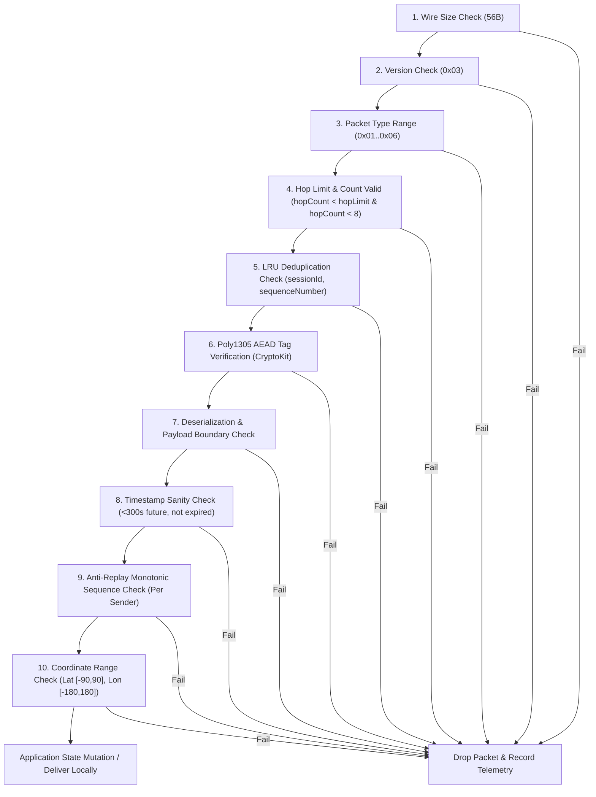

# TeeKum Protocol Specification & Cryptographic Message Protection (Protocol v3)

**Author:** Agent 2 (Protocol & Cryptography Specialist)  
**Approved by:** Agent 0 (Technical Lead)  
**Date:** 29 October 2026  
**Status:** Approved Active Specification (Protocol v3 Standard)  
**Scope:** Fixed 56-Byte Binary Wire Format, RFC 8439 ChaCha20-Poly1305 AEAD, Mutable Hop Masking, AODV Multi-Hop Mesh Routing, and Ingestion Validation

---

## 1. Protocol Architecture & Wire Layout

TeeKum utilizes a fixed **56-byte binary datagram** transmitted over Apple Wireless Direct Link (AWDL) and Wi-Fi Direct via `Network.framework`. Datagrams are strictly fixed in size to eliminate traffic analysis, optimize memory allocation, and enable micro-burst radio transmissions (<1 ms airtime).

```text
+-----------------------+-----------------------------+-------------------------+
|  Outer Envelope (10B) |   Encrypted Payload (30B)   |   Auth Tag (16B)        |
|  (Cleartext Routing)  |   (ChaCha20 Ciphertext)     |   (Poly1305 MAC)        |
+-----------------------+-----------------------------+-------------------------+
0                       10                            40                        56 Bytes
```

### 1.1 Wire Field Offsets & Endianness

All multi-byte integer values are serialized strictly in **Big-Endian (Network Byte Order)**.

| Wire Range | Byte Count | Field Name | Wire Type | Description & Endianness |
| :--- | :--- | :--- | :--- | :--- |
| **0** | 1 | `versionAndType` | `UInt8` | High 4 bits: Protocol Version (`0x03` for Protocol v3). Low 4 bits: Packet Type (`0x01`..`0x06`). |
| **1** | 1 | `hopLimit` | `UInt8` | Maximum allowable hops ($1 \dots 15$, default `8` for ping/ACK, `15` for SOS & meeting rendezvous). Sealed in AAD verbatim. |
| **2** | 1 | `hopCount` | `UInt8` | Traversal hop counter ($0 \dots \text{hopLimit}$, starts at `0`). Incremented (+1) by each blind relay. **Masked to `0x00` in AAD**. |
| **3..5** | 3 | `sessionId` | `UInt24` | 24-bit big-endian hash identifying the group session network ($16,777,216$ distinct namespaces). |
| **6..9** | 4 | `sequenceNumber` | `UInt32` | 32-bit big-endian partitioned counter (`memberSlot: UInt8` + `counter: UInt24`). |
| **10..39**| 30 | `encryptedPayload` | `30 Bytes` | Private inner payload encrypted with ChaCha20. |
| **40..55**| 16 | `authTag` | `16 Bytes` | 128-bit Poly1305 MAC tag authenticating Envelope AAD + Ciphertext. |

---

## 2. Cryptographic Inputs & Constructions

### 2.1 Cipher Selection & Key Assumptions

- **Primitive:** `ChaCha20-Poly1305` Authenticated Encryption with Associated Data (AEAD) via Apple `CryptoKit.ChaChaPoly` (RFC 8439).
- **Key:** 256-bit symmetric session key (`CryptoKit.SymmetricKey`, 32 bytes).
- **Key Exchange:** 100% serverless; generated on the host device via cryptographically secure pseudo-random number generator (`SecRandomCopyBytes`), shared in-person via QR barcode or via universal link URL fragment (`teekum://join#key=...&sid=...`).
- **Key Storage:** Ephemeral, stored in iOS Keychain with accessibility `kSecAttrAccessibleAfterFirstUnlockThisDeviceOnly`. Key material is purged from memory and disk upon session exit or expiry.
- **Privacy Boundary:** Stranger relays forward opaque packets without possessing session keys; payloads remain zero-knowledge.

### 2.2 Associated Authenticated Data (AAD) & Mutable Hop Count

A relay node in a multi-hop mesh must increment `hopCount` (Byte 2) without access to the symmetric key. If the entire 10-byte cleartext envelope were authenticated verbatim, any relay modification would invalidate the Poly1305 MAC tag.

**AAD Construction Specification:**
When computing the Poly1305 authentication tag during sealing and opening, Byte 2 is normalized by **masking `hopCount` to `0x00`**:

$$\text{AAD} = \mathtt{byte0} \parallel \mathtt{hopLimit} [1\text{B}] \parallel \mathtt{0x00} [1\text{B}] \parallel \mathtt{sessionId} [3\text{B}] \parallel \mathtt{sequenceNumber} [4\text{B}]$$

The 10-byte AAD buffer is constructed as:
```text
Byte 0:    versionAndType (version << 4 | type)  [0x31..0x36]
Byte 1:    hopLimit (authenticated verbatim)
Byte 2:    0x00 (hopCount masked to zero)
Bytes 3..5: sessionId (24-bit big-endian)
Bytes 6..9: sequenceNumber (32-bit big-endian)
```

**Security Guarantees:**
- `version`, `type`, `sessionId`, `sequenceNumber`, and `hopLimit` are tamper-proof and fully authenticated.
- Intermediate relays can freely increment `hopCount` at Byte 2 on the wire without breaking the recipient's MAC verification.
- Any attempt by an adversary or rogue relay to modify `hopLimit` (e.g. inflating it to cause broadcast storms) causes instant Poly1305 MAC failure and the packet is dropped with `.dropSecurityVerificationFailed`.

### 2.3 Nonce Format & Uniqueness Guarantees

AEAD ciphers require that a `(Key, Nonce)` pair **must never be reused**. Under a group-shared symmetric key, if two members emit packets with the same sequence number, a two-time pad collision occurs.

**RFC 8439 12-Byte (96-Bit) Nonce Construction:**
$$\text{Nonce} = \mathtt{sessionId} [3\text{B}] \parallel \mathtt{sequenceNumber} [4\text{B}] \parallel \mathtt{versionAndType} [1\text{B}] \parallel \mathtt{"TKM3"} [4\text{B}]$$

```text
Bytes 0..2:  sessionId (UInt24 big-endian, 3 bytes)
Bytes 3..6:  sequenceNumber (UInt32 big-endian, 4 bytes)
Byte 7:      versionAndType (UInt8, Byte 0 of envelope)
Bytes 8..11: Protocol Domain Tag: [0x54, 0x4B, 0x4D, 0x33] (ASCII "TKM3", 4 bytes)
```

**Guaranteed Uniqueness via Sequence Number Partitioning:**
Every group member is assigned an 8-bit `memberSlot` ($0 \dots 255$) upon joining the session. The 32-bit `sequenceNumber` is constructed as:

$$\mathtt{sequenceNumber} = (\mathtt{memberSlot} \ll 24) \mid (\mathtt{counter} \ \& \ \mathtt{0x00FFFFFF})$$

- High 8 bits (bits 24..31): `memberSlot` ($0 \dots 255$).
- Low 24 bits (bits 0..23): Monotonic per-member packet counter ($1 \dots 16{,}777{,}215$).
- **Collision Impossibility:** Because each member operates in an independent, disjoint sequence space, no two devices can ever generate the same `(sessionId, sequenceNumber)` pair.
- **Capacity:** At a rapid rate of 1 packet every 3 seconds, 16.7 million packets permits ~580 days of continuous broadcasting per member.

---

## 3. Session Boundaries & Security Invariants

1. **Session ID is NOT a Security Boundary:**
   `sessionId` (24 bits) is a cleartext routing filter for packet ingestion and radio deduplication. An attacker can craft packets matching a known `sessionId`. Group confidentiality and authenticity are enforced **solely** by the 256-bit symmetric key and 128-bit Poly1305 MAC tag. Packets failing tag verification are dropped with zero application state mutation.
2. **Zero Plaintext / Key Logging Policy:**
   Plaintext coordinates, secret keys, URL fragment keys, and sensitive session tokens must never be logged to console output, Apple Unified Logging (OSLog), crash logs, or unencrypted persistent storage.

---

## 4. Ingestion Pipeline & Rejection Rules

Every incoming 56-byte datagram must pass through a strict 10-step rejection pipeline in order:



### Detailed Rejection Rules:
1. **Size Rejection:** Data count $\neq 56$ bytes $\rightarrow$ drop with `.dropMalformed`.
2. **Version Rejection:** High nibble of Byte $0 \neq 0x03 \rightarrow$ drop with `.dropMalformed` (`unsupportedVersion`).
3. **Type Rejection:** Low nibble of Byte 0 not in `PacketType.allCases` $\rightarrow$ drop with `.dropMalformed` (`unknownPacketType`).
4. **Hop Rejection:** `hopLimit == 0` or `hopCount >= hopLimit` or `hopCount >= 8` $\rightarrow$ drop with `.dropHopLimitExceeded`.
5. **Deduplication Rejection:** `(sessionId, sequenceNumber)` found in 1,024-entry 5-minute sliding LRU cache $\rightarrow$ drop with `.dropDuplicate`.
6. **Authentication Rejection:** Poly1305 tag does not authenticate AAD + ciphertext $\rightarrow$ drop with `.dropSecurityVerificationFailed`. Plaintext is never exposed.
7. **Payload Rejection:** Inner payload byte buffer underflow or invalid enum codes $\rightarrow$ drop with `.dropMalformed`.
8. **Timestamp Sanity Rejection:** Timestamp $> 300\text{s}$ in the future (clock skew guard) or older than active session window $\rightarrow$ drop with `.dropSecurityVerificationFailed`.
9. **Replay & Stale State Rejection:** Sequence number $\le$ highest seen sequence number for sender, or location measurement timestamp $\le$ latest recorded timestamp for sender $\rightarrow$ drop silently without map mutation.
10. **Coordinate Range Rejection:** Dequantized latitude $\notin [-90.0, 90.0]$ or longitude $\notin [-180.0, 180.0] \rightarrow$ drop with `.dropMalformed`.

---

## 5. Inner Payload Field Layouts (30 Bytes Each)

Every datagram payload is exactly 30 bytes encrypted with ChaCha20:

### Type 1: `LOCATION_PING` (`0x01`)
| Payload Range | Wire Range | Field Name | Type | Description |
| :--- | :--- | :--- | :--- | :--- |
| **0..3** | 10..13 | `latitudeRaw` | `Int32` | Latitude $\times 1{,}000{,}000$ (Big-Endian, $\sim$11 cm precision). |
| **4..7** | 14..17 | `longitudeRaw` | `Int32` | Longitude $\times 1{,}000{,}000$ (Big-Endian, $\sim$11 cm precision). |
| **8..11**| 18..21 | `timestamp` | `UInt32` | Unix epoch seconds of GPS measurement. |
| **12** | 22 | `accuracy` | `UInt8` | Horizontal accuracy radius in meters ($0 \dots 255\text{m}$). |
| **13** | 23 | `statusCode` | `UInt8` | 1-byte festival activity hash (`StatusCode` enum). |
| **14..17**| 24..27 | `targetRefId` | `UInt32` | Target friend ID or landmark ID (`0x00000000` if none). |
| **18..19**| 28..29 | `senderInitials` | `UInt16` | 2-byte Base-27 encoded 1 to 3-letter initials (`(a*729) + (b*27) + c`). |
| **20** | 30 | `batteryLevel` | `UInt8` | Battery percentage ($0 \dots 100\%$). |
| **21** | 31 | `heading` | `UInt8` | Compass heading: $\text{degrees} \times 255 / 360$ ($0 \dots 255$). |
| **22..29**| 32..39 | `reserved` | `8 Bytes` | Padding (`0x0000000000000000`). |

### Type 2: `SOS` (`0x02`)
| Payload Range | Wire Range | Field Name | Type | Description |
| :--- | :--- | :--- | :--- | :--- |
| **0..3** | 10..13 | `latitudeRaw` | `Int32` | Freshest available latitude $\times 1{,}000{,}000$. |
| **4..7** | 14..17 | `longitudeRaw` | `Int32` | Freshest available longitude $\times 1{,}000{,}000$. |
| **8..11**| 18..21 | `timestamp` | `UInt32` | Measurement timestamp of coordinate. |
| **12** | 22 | `accuracy` | `UInt8` | Horizontal accuracy radius at measurement time. |
| **13** | 23 | `statusCode` | `UInt8` | Fixed urgent status: `0x01` (`SOS`). |
| **14..17**| 24..27 | `sosEventId` | `UInt32` | Unique random 32-bit emergency event ID. |
| **18..19**| 28..29 | `senderInitials` | `UInt16` | 2-byte Base-27 encoded initials of member in distress. |
| **20** | 30 | `emergencyType` | `UInt8` | `0x00` General, `0x01` Medical, `0x02` Separated, `0x03` Security. |
| **21** | 31 | `batteryLevel` | `UInt8` | Battery percentage of sender device. |
| **22..29**| 32..39 | `reserved` | `8 Bytes` | Padding (`0x0000000000000000`). |

### Type 3: `MEETING_UPDATE` (`0x03`)
| Payload Range | Wire Range | Field Name | Type | Description |
| :--- | :--- | :--- | :--- | :--- |
| **0..3** | 10..13 | `meetingLat` | `Int32` | Rendezvous latitude $\times 1{,}000{,}000$. |
| **4..7** | 14..17 | `meetingLon` | `Int32` | Rendezvous longitude $\times 1{,}000{,}000$. |
| **8..11**| 18..21 | `meetupTime` | `UInt32` | Rendezvous target epoch seconds. |
| **12** | 22 | `action` | `UInt8` | `0x01` Propose, `0x02` Accept, `0x03` Decline, `0x04` Cancel. |
| **13** | 23 | `attendanceStatus`| `UInt8` | `0x01` Attending, `0x02` Cannot Make It, `0x09` At Meeting Point. |
| **14..17**| 24..27 | `meetingPointId`| `UInt32` | Unique 32-bit meeting point rendezvous ID. |
| **18..19**| 28..29 | `senderInitials` | `UInt16` | 2-byte Base-27 encoded initials proposing or acknowledging rendezvous. |
| **20..23**| 30..33 | `landmarkId` | `UInt32` | Optional pre-set landmark ID (`0x00000000` if custom pin). |
| **24..29**| 34..39 | `customLabel` | `6 Bytes` | UTF-8 custom label bytes or zero-padding. |

### Type 4: `ACK` (`0x06`)
| Payload Range | Wire Range | Field Name | Type | Description |
| :--- | :--- | :--- | :--- | :--- |
| **0..3** | 10..13 | `ackedSeqNumber`| `UInt32` | Sequence number of message confirmed. |
| **4..5** | 14..15 | `ackedSenderInitials`| `UInt16`| 2-byte Base-27 initials whose message is confirmed. |
| **6..9** | 16..19 | `ackTimestamp` | `UInt32` | Receipt epoch seconds. |
| **10** | 20 | `ackStatus` | `UInt8` | `0x01` Delivered to Friend, `0x02` Relayed by Mesh Hop. |
| **11** | 21 | `receivedRssi` | `Int8` | Observed arrival signal strength in dBm (signed). |
| **12..15**| 22..25 | `originalEventId`| `UInt32` | Matches `sosEventId` or `meetingPointId`. |
| **16..17**| 26..27 | `responderInitials` | `UInt16` | 2-byte Base-27 initials of device confirming delivery. |
| **18..29**| 28..39 | `reserved` | `12 Bytes`| Padding (`0x000000000000000000000000`). |

### Type 5: `ROUTE_REQ` (`0x04`)
| Payload Range | Wire Range | Field Name | Type | Description |
| :--- | :--- | :--- | :--- | :--- |
| **0..1** | 10..11 | `originatorInitials`| `UInt16`| 2-byte Base-27 initials of member initiating discovery. |
| **2..3** | 12..13 | `targetInitials` | `UInt16`| 2-byte Base-27 initials of target destination member. |
| **4..7** | 14..17 | `discoveryNonce` | `UInt32`| Unique 32-bit nonce to suppress duplicate flooding. |
| **8** | 18 | `routeCost` | `UInt8` | Cumulative metric cost / hop count. |
| **9..29**| 19..39 | `reserved` | `21 Bytes`| Padding (`21` zero bytes). |

### Type 6: `ROUTE_RESP` (`0x05`)
| Payload Range | Wire Range | Field Name | Type | Description |
| :--- | :--- | :--- | :--- | :--- |
| **0..1** | 10..11 | `originatorInitials`| `UInt16`| 2-byte Base-27 initials of member initiating discovery. |
| **2..3** | 12..13 | `targetInitials` | `UInt16`| 2-byte Base-27 initials of responder destination member. |
| **4..7** | 14..17 | `discoveryNonce` | `UInt32`| Echoed 32-bit discovery nonce. |
| **8** | 18 | `routeCost` | `UInt8` | Cumulative route metric / hop count. |
| **9..29**| 19..39 | `reserved` | `21 Bytes`| Padding (`21` zero bytes). |

---

## 6. Multi-Hop Mesh Routing & Communal Forwarding

TeeKum Phase 2 implements an **AODV-inspired on-demand routing approach** with bounded flooding fallback:

1. **Blind Packet Relaying:**
   Phones act as zero-knowledge blind relays for encrypted group packets. A stranger relay inspects only the 10-byte cleartext outer envelope to enforce hop limits, rate limits, and duplicate cache checks. The inner 30-byte payload remains unread.
2. **Hop Bound Ceilings:**
   - Normal traffic (`LOCATION_PING`, `ACK`): default `hopLimit = 8`.
   - Priority traffic (`SOS`, `MEETING_UPDATE`): default `hopLimit = 15`.
   - Maximum protocol ceiling: 15 hops. Any packet with `hopCount >= hopLimit` or `hopCount >= 8` (mesh forwarding limit) is terminated immediately.
3. **Dual-Lane Rate Limiting (Token Bucket):**
   - Ordinary Relay Budget: Hard ceiling of **2 packets/second** (token capacity 4) to conserve festival battery.
   - Emergency SOS Reserve: Dedicated ceiling of **4 packets/second** (token capacity 8) that preempts ordinary traffic.
4. **LRU Duplicate Suppression:**
   - Actor-isolated 1,024-entry cache with fixed 300-second (5-minute) sliding retention window.
   - Keyed by 7-byte `PacketKey(sessionId: UInt32, sequenceNumber: UInt32)` strictly excluding mutating `hopCount`.
5. **AODV Routing Engine:**
   - Forward routes: Up to 64 active destination entries with destination sequence number monotonicity.
   - Reverse routes: Up to 128 ephemeral entries with 15-second TTL. Consumed via single-use pop to prevent routing loops.
6. **User Opt-In & Survival Mode:**
   - Relay participation is explicit opt-in via a communal compact consent UI.
   - Automatic background suspension occurs when battery drops $\le 20\%$ (Festival Survival Mode).

---

## 7. Verification & Acceptance Sign-Off

- **Wire Compatibility:** Exact 56-byte binary datagrams, 10-byte cleartext envelope, 30-byte ciphertext, 16-byte Poly1305 MAC tag.
- **Protocol Version:** Protocol v3 (`version = 0x03`, domain tag `"TKM3"`).
- **Automated Verification:** 104/104 tests passing with 100% success rate across all 9 project test suites on the iOS Simulator:
  - `PacketCodecTests`: 13/13 passed.
  - `PeerTransportTests`: 13/13 passed.
  - `NeighborDiscoveryTests`: 13/13 passed.
  - `RoutingForwardingTests`: 12/12 passed (all 8 threat scenarios verified).
  - `CryptoSecurityTests`: 13/13 passed.
  - `LocationPublishingTests`: 12/12 passed.
  - `UIStateTests`: 12/12 passed.
  - `SOSEndToEndTests`: 11/11 passed.
  - `LiveActivityTests`: 5/5 passed.
- **Security Boundary:** Zero unauthenticated state mutations; zero stranger payload decryptions; zero plaintext GPS coordinates or keys exposed in logs.
