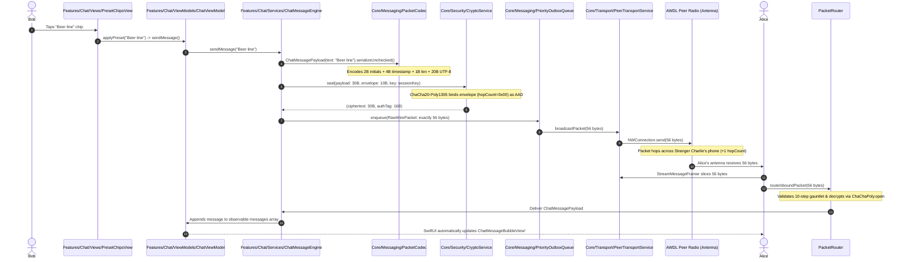

# TeeKum 101: The Serverless Festival Mesh Architecture
## The Definitive Engineering Handbook, Technology Deep Dive & Whole-App Code Walkthrough

> **Project:** TeeKum (Fantasix Team)  
> **Target Audience:** Systems Engineers, iOS Core Developers, Protocol Designers, and Junior Developers  
> **Platform:** iOS 17.0+ (Swift 5.9 / Swift 6 Ready, Pure Native Frameworks, Zero Third-Party Dependencies)  
> **Architecture:** Feature-Driven MVVM + Swift Observation (`@Observable`) + Actor Concurrency  
> **Networking:** 100% Serverless Peer-to-Peer & Multi-Hop Mesh (Network.framework AWDL / Bonjour)  
> **Encryption:** RFC 8439 ChaCha20-Poly1305 Authenticated Encryption with Associated Data (AEAD)  
> **Wire Standard:** Fixed 56-Byte Binary Datagram (Protocol v3)  

---

## Table of Contents

### Part I: Foundations, Physics & Network Theory
1. [Preface: The Festival Paradox](#preface-the-festival-paradox)
2. [Chapter 1: The 4 Non-Negotiable Invariants](#chapter-1-the-4-non-negotiable-invariants)
3. [Chapter 2: The Physics & Mathematics of the 56-Byte Wire Protocol](#chapter-2-the-physics--mathematics-of-the-56-byte-wire-protocol)
   - [2.1 Why Exactly 56 Bytes?](#21-why-exactly-56-bytes)
   - [2.2 Memory Map of the Wire Frame](#22-memory-map-of-the-wire-frame)
   - [2.3 Coordinate Quantization Math (~11 cm Precision)](#23-coordinate-quantization-math-11-cm-precision)
   - [2.4 The 2-Byte Base-27 Initials Codec](#24-the-2-byte-base-27-initials-codec)
   - [2.5 The 24-Bit Session ID (`UInt24`)](#25-the-24-bit-session-id-uint24)
   - [2.6 The Nonce Partitioning & Two-Time Pad Collision Prevention](#26-the-nonce-partitioning--two-time-pad-collision-prevention)
   - [2.7 The Mutable Hop Masking Trick (AAD Invariance)](#27-the-mutable-hop-masking-trick-aad-invariance)
   - [2.8 Code Walkthrough: `PacketWriter` & `PacketReader`](#28-code-walkthrough-packetwriter--packetreader)
4. [Chapter 3: The 30-Byte Payloads (The 8 Radio Message Types)](#chapter-3-the-30-byte-payloads-the-8-radio-message-types)
   - [3.1 Type 0x01: Location Ping (Option B Telemetry)](#31-type-0x01-location-ping-option-b-telemetry)
   - [3.2 Type 0x02: Emergency SOS](#32-type-0x02-emergency-sos)
   - [3.3 Type 0x03: Meeting Point Update](#33-type-0x03-meeting-point-update)
   - [3.4 Type 0x04 & 0x05: AODV Route Discovery (RREQ / RREP)](#34-type-0x04--0x05-aodv-route-discovery-rreq--rrep)
   - [3.5 Type 0x06: Cryptographic Delivery ACK](#35-type-0x06-cryptographic-delivery-ack)
   - [3.6 Type 0x07: Festival Group Mesh Chat](#36-type-0x07-festival-group-mesh-chat)
   - [3.7 Type 0x08: Nearby Interaction Token Exchange](#37-type-0x08-nearby-interaction-token-exchange)
   - [3.8 Code Walkthrough: Chat Message Serialization & Unicode Clamping](#38-code-walkthrough-chat-message-serialization--unicode-clamping)
5. [Chapter 4: The Physical Layer: Apple Wireless Direct Link (AWDL) & Network.framework](#chapter-4-the-physical-layer-apple-wireless-direct-link-awdl--networkframework)
   - [4.1 What is AWDL? How AirDrop Communicates Off-Grid](#41-what-is-awdl-how-airdrop-communicates-off-grid)
   - [4.2 Configuring `NWListener` and `NWConnection` for P2P](#42-configuring-nwlistener-and-nwconnection-for-p2p)
   - [4.3 Bonjour Peer Discovery (`_teekum._tcp`)](#43-bonjour-peer-discovery-_teekum_tcp)
   - [4.4 The TCP Stream Framing Problem](#44-the-tcp-stream-framing-problem)
   - [4.5 Code Walkthrough: `StreamMessageFramer` & Stream Resynchronization](#45-code-walkthrough-streammessageframer--stream-resynchronization)
6. [Chapter 5: The Ad-Hoc Multi-Hop Mesh Network](#chapter-5-the-ad-hoc-multi-hop-mesh-network)
   - [5.1 The Range Barrier and Multi-Hop Theory](#51-the-range-barrier-and-multi-hop-theory)
   - [5.2 Bounded Flooding vs. AODV On-Demand Routing](#52-bounded-flooding-vs-aodv-on-demand-routing)
   - [5.3 Code Walkthrough: `SeenPacketCache` (7-Byte Key LRU)](#53-code-walkthrough-seenpacketcache-7-byte-key-lru)
   - [5.4 Code Walkthrough: `ForwardingRateLimiter` (Dual-Lane Token Bucket)](#54-code-walkthrough-forwardingratelimiter-dual-lane-token-bucket)
   - [5.5 The Communal Relay Policy & 20% Hard Cutoff](#55-the-communal-relay-policy--20-hard-cutoff)
   - [5.6 Code Walkthrough: Blind Forwarding & Loop Elimination](#56-code-walkthrough-blind-forwarding--loop-elimination)
7. [Chapter 6: Cryptography, Key Exchange & Security Boundaries](#chapter-6-cryptography-key-exchange--security-boundaries)
   - [6.1 100% Serverless Key Exchange via URL Fragments](#61-100-serverless-key-exchange-via-url-fragments)
   - [6.2 QR Barcode Pipeline via CoreImage and AVFoundation](#62-qr-barcode-pipeline-via-coreimage-and-avfoundation)
   - [6.3 Hardware-Backed Keychain Key Storage](#63-hardware-backed-keychain-key-storage)
   - [6.4 Code Walkthrough: `CryptoService` ChaCha20-Poly1305 AEAD Engine](#64-code-walkthrough-cryptoservice-chacha20-poly1305-aead-engine)
   - [6.5 Code Walkthrough: The 10-Step Inbound Ingestion Pipeline (`PacketRouter`)](#65-code-walkthrough-the-10-step-inbound-ingestion-pipeline-packetrouter)

---

### Part II: The Complete Whole-App Code Walkthrough
8. [Module 1: The App Composition Root (`App/`)](#module-1-the-app-composition-root-app)
   - `TeeKumApp.swift`, `AppRootView.swift`
9. [Module 2: Pairing & Group Formation (`Features/Pairing/`)](#module-2-pairing--group-formation-featurespairing)
   - `GroupPairingView.swift`, `GroupSessionViewModel.swift`, `ColorPickerView.swift`, `MeshAgreementView.swift`, `QRCodeView.swift`, `QRScannerView.swift`
10. [Module 3: The Map & Directional Vision (`Features/Map/`)](#module-3-the-map--directional-vision-featuresmap)
    - `MainMapView.swift`, `MapViewModel.swift`, `FriendPinAnnotationView.swift`, `HeadingVisionCone.swift`, `FriendDetailView.swift`, `RelaySettingsSheet.swift`
11. [Module 4: Festival Group Mesh Chat (`Features/Chat/`)](#module-4-festival-group-mesh-chat-featureschat)
    - `ChatSheetView.swift`, `ChatMessageBubbleView.swift`, `ByteMeterView.swift`, `PresetChipsView.swift`, `ChatViewModel.swift`, `ChatMessageEngine.swift`, `ChatMessagingService.swift`
12. [Module 5: Single Active Meeting Point (`Features/MeetingPoint/`)](#module-5-single-active-meeting-point-featuresmeetingpoint)
    - `MeetingPointsView.swift`, `SetMeetingPointSheet.swift`, `MeetingPointPinView.swift`, `MeetingPointViewModel.swift`
13. [Module 6: Emergency SOS & Inactivity Guard (`Features/SOS/`)](#module-6-emergency-sos--inactivity-guard-featuressos)
    - `SOSButtonView.swift`, `IncomingSOSAlertBannerView.swift`, `RecipientAckBreakdownView.swift`, `SOSViewModel.swift`, `InactivityGuardService.swift`, `SOSAudioAlert.swift`, `SOSForwardingEngine.swift`
14. [Module 7: 60m Tactical Polar Radar (`Features/Finder/`)](#module-7-60m-tactical-polar-radar-featuresfinder)
    - `FinderBeaconView.swift`, `RadarView.swift`, `RadarTheme.swift`, `RadarGridBackground.swift`, `RadarBlipView.swift`, `RadarCenterMarker.swift`, `RadarFriendCard.swift`
15. [Module 8: Diagnostics & Virtual Simulation Lab (`Features/Diagnostics/`)](#module-8-diagnostics--virtual-simulation-lab-featuresdiagnostics)
    - `DiagnosticsView.swift`, `MeshDebuggerView.swift`, `MeshDebuggerViewModel.swift`, `MeshDiagnostics.swift`, `MeshTopologySimulator.swift`
16. [Module 9: The Core Messaging & Codec Suite (`Core/Messaging/`)](#module-9-the-core-messaging--codec-suite-coremessaging)
    - `PacketCodec.swift`, `PacketRouter.swift`, `PriorityOutboxQueue.swift`, `InitialsCodec.swift`, Enums & Payloads
17. [Module 10: The Core Radio Transport (`Core/Transport/`)](#module-10-the-core-radio-transport-coretransport)
    - `PeerTransportService.swift`, `StreamMessageFramer.swift`, `PeerTransport.swift`, `SimulatedMeshTransport.swift`
18. [Module 11: The Multi-Hop Mesh Network Engine (`Core/Mesh/`)](#module-11-the-multi-hop-mesh-network-engine-coremesh)
    - `PacketForwarder.swift`, `SeenPacketCache.swift`, `ForwardingRateLimiter.swift`, `RoutingTable.swift`, `RouteDiscoveryService.swift`, `NeighborTable.swift`, `RelayPolicyManager.swift`, `MeshTimingConfiguration.swift`
19. [Module 12: Cryptographic Security & Keychain (`Core/Security/`)](#module-12-cryptographic-security--keychain-coresecurity)
    - `CryptoService.swift`, `CryptoServiceProtocol.swift`
20. [Module 13: Location & Motion Sensor Engine (`Core/Location/`)](#module-13-location--motion-sensor-engine-corelocation)
    - `LocationService.swift`, `LocationPublisher.swift`, `LocationServiceProtocol.swift`
21. [Module 14: Live Activities & System Notifications (`Core/LiveActivity/` & `Core/Notifications/`)](#module-14-live-activities--system-notifications-coreliveactivity--corenotifications)
    - `LiveActivityManager.swift`, `NotificationService.swift`
22. [Module 15: Pure Data Models & Enums (`Core/Models/`)](#module-15-pure-data-models--enums-coremodels)
    - `Member.swift`, `GroupSession.swift`, `ChatMessage.swift`, `LocationPin.swift`, `MeetingPoint.swift`, `IncomingSOSAlert.swift`, `SOSDeliveryState.swift`, `SOSDiagnostics.swift`, `SessionActivityAttributes.swift`, `TeeKumConfiguration.swift` & Enums
23. [Module 16: Shared UI Tokens & Utilities (`Shared/UI/`)](#module-16-shared-ui-tokens--utilities-sharedui)
    - `Formatters.swift`, `InAppToastView.swift`

---

### Part III: Junior Developer Reference, Lore & Mechanics
24. [Chapter 9: The Junior Developer's Rosetta Stone: Swift Protocols, Macros, Attributes & Compiler Trivia](#chapter-9-the-junior-developers-rosetta-stone-swift-protocols-macros-attributes--compiler-trivia)
    - [9.1 Swift Macros: `@Observable` & `@main`](#91-swift-macros-observable--main)
    - [9.2 Concurrency & Thread-Safety Attributes: `actor`, `@MainActor`, `@Sendable` & `@unchecked Sendable`](#92-concurrency--thread-safety-attributes-actor-mainactor-sendable--unchecked-sendable)
    - [9.3 SwiftUI State Architecture: `@State`, `@Bindable`, `@Binding` & `[weak self]`](#93-swiftui-state-architecture-state-bindable-binding--weak-self)
    - [9.4 The Swift Type System & Standard Protocols: `Sendable`, `Identifiable`, `any` vs `some`](#94-the-swift-type-system--standard-protocols-sendable-identifiable-any-vs-some)
    - [9.5 Low-Level Trivia: Endianness (Gulliver's Travels), Wrapping Arithmetic (`&+=`), Metal GPU Acceleration](#95-low-level-trivia-endianness-gullivers-travels-wrapping-arithmetic--metal-gpu-acceleration)
25. [Chapter 10: Engineering Trivia, Design Trade-Offs & War Stories](#chapter-10-engineering-trivia-design-trade-offs--war-stories)
    - [10.1 Why SQLite Was Abandoned](#101-why-sqlite-was-abandoned)
    - [10.2 Why Apple Ultra-Wideband (UWB) Failed at Festivals](#102-why-apple-ultra-wideband-uwb-failed-at-festivals)
    - [10.3 Why the URL `#` Fragment Is an Anonymous Privacy Superpower](#103-why-the-url--fragment-is-an-anonymous-privacy-superpower)
    - [10.4 The 20-Byte Text Limit & Byte Budgeting](#104-the-20-byte-text-limit--byte-budgeting)
    - [10.5 Dancing in Place: Fooling the Motion Coprocessor](#105-dancing-in-place-fooling-the-motion-coprocessor)
26. [Chapter 11: The Life of a Packet: Tracing a Message from Thumb to Screen](#chapter-11-the-life-of-a-packet-tracing-a-message-from-thumb-to-screen)
27. [Epilogue: Building for Harsh Environments](#epilogue-building-for-harsh-environments)

---

# Part I: Foundations, Physics & Network Theory

## Preface: The Festival Paradox

Every summer, tens of thousands of music lovers gather in remote valleys, speedways, and parks for music festivals. They bring state-of-the-art smartphones packing multicore neural engines, multi-band 5G transceivers, and satellite radios.

And yet, within thirty minutes of gates opening, **every single smartphone becomes practically useless for communication**.

This is **The Festival Paradox**.

```
[Festival Ground: 80,000 Phones]
       │       │       │
       ▼       ▼       ▼
   ┌───────────────────────┐
   │ Cell Tower (Base Stn) │ ──> RF Collision & Random Access Channel (RACH) Overload
   └───────────────────────┘
               │
               ▼
     [PACKET DROP HELL]
 (No WhatsApp, No iMessage, No Google Maps, Dead Batteries)
```

### Why Cellular Networks Fail at Festivals
1. **Radio Frequency (RF) Contention:** Cellular base stations partition wireless spectrum into finite frequency/time slots. When 25,000 people inside a single stage footprint attempt to transmit simultaneously, the Random Access Channel (RACH) collides constantly. Phones cannot even complete an initial handshake with the tower.
2. **Backhaul Congestion:** Even if temporary cells-on-wheels (COWs) are deployed, the physical fiber or microwave backhaul linking the local antennas to the wider internet becomes completely saturated.
3. **DNS and Keep-Alive Overhead:** Modern chat apps (WhatsApp, Telegram, Apple iMessage) maintain persistent TLS sockets and ping remote cloud servers dozens of times per minute. In an environment with 90% packet loss, these reconnection handshakes enter catastrophic exponential backoff spirals, draining batteries in 3 hours while sending 0 bytes of real user messages.

### The TeeKum Counter-Philosophy
TeeKum was created by the **Fantasix Team** around a radically simple premise:
> **If the cloud cannot reach the festival, the festival must become its own computer.**

TeeKum does not talk to Amazon Web Services. It has no Google Firebase database, no user accounts, no login screens, no verification SMS codes, and no backend API. 

Instead, every iPhone running TeeKum acts as an autonomous node in an off-grid, peer-to-peer radio mesh. Phones talk directly to neighboring phones using peer-to-peer Wi-Fi and Bluetooth. When a friend is 300 meters away across a crowded festival stage, your message hops across the phones of friendly strangers who don't even know what your message says—relaying encrypted packets until your friend receives them in single-digit milliseconds.

---

## Chapter 1: The 4 Non-Negotiable Invariants

In system engineering, an **invariant** is a property that must remain true across every execution path, every edge case, and every commit. TeeKum is governed by four core architectural invariants:

```
┌────────────────────────────────────────────────────────────────────────┐
│                      THE 4 TEEKUM INVARIANTS                           │
├─────────────────────────────┬──────────────────────────────────────────┤
│ 1. 56-Byte Wire Datagram   │ Fixed-size packets; zero traffic analysis│
├─────────────────────────────┼──────────────────────────────────────────┤
│ 2. Zero-Knowledge Relaying │ Strangers forward blind; keys stay private│
├─────────────────────────────┼──────────────────────────────────────────┤
│ 3. Honest Delivery UX       │ Never fake delivery confirmations        │
├─────────────────────────────┼──────────────────────────────────────────┤
│ 4. Festival Survival Mode   │ Hard radio cutoff at 20% device battery  │
└─────────────────────────────┴──────────────────────────────────────────┘
```

1. **The Fixed 56-Byte Wire Invariant:** Every datagram transmitted or received over the physical radio is **exactly 56 bytes**. 
   There are no 55-byte packets. There are no 57-byte packets. 
   - Location pings? 56 bytes.
   - Emergency SOS alerts? 56 bytes.
   - Rendezvous updates? 56 bytes.
   - 20-character chat messages? 56 bytes.
   - Routing probes? 56 bytes.
2. **Zero-Knowledge Blind Relaying:** Stranger packets (packets belonging to outside festival groups) are never decrypted. Stranger nodes inspect only the 10-byte cleartext outer envelope to verify hop limits, deduplication caches, and rate limits, forwarding them blind.
3. **Honest Delivery UX:** The UI never fakes delivery. A message leaving your antenna is `.forwardedToNextHop`; a message forwarded by an intermediate peer is `.relayedByMeshHop`; only cryptographic proof received from the destination friend transitions status to `.deliveredToFriend`.
4. **Festival Survival Mode (20% Hard Cutoff):** The moment device battery reaches 20% (or Low Power Mode is toggled), stranger packet relaying and background radio tasks terminate instantly, reserving remaining power strictly for emergency SOS and viewing the offline meeting map.

---

## Chapter 2: The Physics & Mathematics of the 56-Byte Wire Protocol

Let us dissect the wire datagram with bit-level precision.

```
0                   1                   2                   3
0 1 2 3 4 5 6 7 8 9 0 1 2 3 4 5 6 7 8 9 0 1 2 3 4 5 6 7 8 9 0 1
+-+-+-+-+-+-+-+-+-+-+-+-+-+-+-+-+-+-+-+-+-+-+-+-+-+-+-+-+-+-+-+-+
|Ver|  Type     |   Hop Limit   |   Hop Count   |   Session     |
+-+-+-+-+-+-+-+-+-+-+-+-+-+-+-+-+-+-+-+-+-+-+-+-+-+-+-+-+-+-+-+-+
|   ID (cont.)  |              Sequence Number                  |
+-+-+-+-+-+-+-+-+-+-+-+-+-+-+-+-+-+-+-+-+-+-+-+-+-+-+-+-+-+-+-+-+
|                                                               |
+                    Encrypted Payload (30 Bytes)               +
|                  (ChaCha20 RFC 8439 Ciphertext)               |
+                                                               +
|                                                               |
+-+-+-+-+-+-+-+-+-+-+-+-+-+-+-+-+-+-+-+-+-+-+-+-+-+-+-+-+-+-+-+-+
|                                                               |
+                   Poly1305 MAC Tag (16 Bytes)                 +
|               (Authenticates Envelope AAD + Cipher)           |
+-+-+-+-+-+-+-+-+-+-+-+-+-+-+-+-+-+-+-+-+-+-+-+-+-+-+-+-+-+-+-+-+
```

### 2.1 Why Exactly 56 Bytes?
Why not 64 bytes? Why not 32 bytes?
The 56-byte figure is the product of an exact budget optimization between:
1. **Airtime on 2.4 GHz & 5 GHz Bands:** A 56-byte frame requires less than 0.2 milliseconds of physical radio transmission time on an 802.11ac physical layer. This ultra-short burst minimizes RF channel occupancy in high-density environments.
2. **Apple Wireless Direct Link (AWDL) Frame Overhead:** 56 bytes fits cleanly inside a single unfragmented 802.11 action frame without triggering layer-2 fragmentation.
3. **ChaCha20-Poly1305 Alignment:** RFC 8439 produces a fixed 16-byte Poly1305 MAC tag. Allocating 30 bytes for the inner payload + 10 bytes for cleartext routing creates an even, cache-line-friendly structure ($10 + 30 + 16 = 56$).

### 2.2 Memory Map of the Wire Frame

| Byte Offset | Wire Type | Field Name | Description |
| :---: | :---: | :--- | :--- |
| **0** | `UInt8` | `versionAndType` | High 4 bits: Version (`0x03` = Protocol v3). Low 4 bits: Type (`0x01`..`0x08`). |
| **1** | `UInt8` | `hopLimit` | Maximum allowable hops ($1 \dots 15$, default 8, SOS 15). Immutable; sealed in AAD. |
| **2** | `UInt8` | `hopCount` | Hops traversed ($0 \dots \text{hopLimit}$). Incremented (+1) by relays. **Masked to `0x00` in AAD**. |
| **3..5** | `UInt24` | `sessionId` | 24-bit big-endian group session identifier ($16,777,216$ namespaces). |
| **6..9** | `UInt32` | `sequenceNumber` | Partitioned: High 8 bits = `memberSlot`, Low 24 bits = monotonic counter. |
| **10..39**| `30 Bytes` | `encryptedPayload` | 30 bytes of ChaCha20 ciphertext containing private coordinate/chat telemetry. |
| **40..55**| `16 Bytes` | `authTag` | 128-bit Poly1305 authentication tag binding ciphertext and envelope AAD. |

---

### 2.3 Coordinate Quantization Math (~11 cm Precision)
In Apple's `CoreLocation` framework, geographical latitude and longitude are represented as 64-bit IEEE 754 floating-point numbers (`Double`, known as `CLLocationDegrees`).

If we transmitted raw 64-bit doubles:
$$\text{Latitude (8 Bytes)} + \text{Longitude (8 Bytes)} = 16\text{ Bytes}$$
That would consume more than **half** of our entire 30-byte encrypted payload!

#### The Quantization Transformation
TeeKum quantizes coordinates into signed 32-bit big-endian integers (`Int32`):
$$\text{latitudeRaw} = \operatorname{round}(\text{latitude} \times 1{,}000{,}000)$$
$$\text{longitudeRaw} = \operatorname{round}(\text{longitude} \times 1{,}000{,}000)$$

To unpack them upon receipt:
$$\text{latitude} = \frac{\text{latitudeRaw}}{1{,}000{,}000.0}$$
$$\text{longitude} = \frac{\text{longitudeRaw}}{1{,}000{,}000.0}$$

#### Deriving the Physical Precision
The circumference of the Earth at the equator is approximately $40{,}075{,}017\text{ meters}$.
There are $360^\circ$ of longitude around the globe:
$$\text{Meters per degree of longitude at equator} = \frac{40{,}075{,}017}{360} \approx 111{,}319.49\text{ m}$$

With our scaling factor of $1{,}000{,}000$ ($10^6$ units per degree):
$$\text{Resolution} = \frac{111{,}319.49\text{ m}}{1{,}000{,}000} \approx 0.1113\text{ meters} \approx \mathbf{11.13\text{ centimeters}}$$

By quantizing coordinates into `Int32`, we preserve **sub-decimeter accuracy** worldwide while freeing up 8 full bytes of payload budget!

---

### 2.4 The 2-Byte Base-27 Initials Codec
How do you identify which member sent a packet?
If you store a member's name as a string (e.g. `"Nicho"`), you consume 5 to 16 bytes of ASCII/UTF-8. Furthermore, P2P mesh networks typically require a noisy "connection handshake" where nodes exchange user profiles and display names.

TeeKum solves this with the **2-Byte Base-27 Initials Codec**.

#### The Radix Space
Festival attendees enter 1 to 3 uppercase initials ($A \dots Z$, e.g. `"D"`, `"AB"`, `"NIC"`).
We define an alphabet where:
- Empty / Null slot: $0$
- Character `A`: $1$
- Character `B`: $2$
- $\dots$
- Character `Z`: $26$

Base radix = $27$.

#### Permutation Calculus
- 1-letter initials ($A \dots Z$): $26$ possibilities
- 2-letter initials ($AA \dots ZZ$): $26 \times 26 = 676$ possibilities
- 3-letter initials ($AAA \dots ZZZ$): $26 \times 26 \times 26 = 17{,}576$ possibilities

$$\text{Total Combinations} = 26 + 676 + 17{,}576 = \mathbf{18{,}278}$$

A standard unsigned 16-bit integer (`UInt16`) stores values from $0$ to $65{,}535$ ($2^{16} - 1$).
Because $18{,}278 \le 65{,}535$, **every possible 1, 2, or 3-letter initial in the English alphabet fits into exactly 2 bytes (`UInt16`)!**

$$\text{Encoded UInt16} = (a \times 27^2) + (b \times 27^1) + (c \times 27^0) = (\mathbf{a \times 729}) + (\mathbf{b \times 27}) + \mathbf{c}$$

Implemented in [`InitialsCodec.swift`](file:///Users/nicho/Developer/TeeKum%20Prototype/TeeKum%20Prototype/Core/Messaging/InitialsCodec.swift), this gives us **Zero-Handshake Self-Describing Packets**: receiving phones instantly render the friend's avatar badge on the map without any profile discovery phase!

---

### 2.5 The 24-Bit Session ID (`UInt24`)
Groups are assigned a 24-bit session ID (`0x000001` to `0xFFFFFF`), providing **$16{,}777{,}215$ unique session namespaces**.

When a group is created:
1. The host device generates a cryptographic seed from current timestamp, GPS coordinates, and CSPRNG salt.
2. The seed is hashed via SHA-256.
3. The lowest 24 bits are taken, guaranteeing non-zero (`0x000000` is reserved for system discovery).

In the outer envelope, `sessionId` occupies exactly 3 bytes (Bytes 3..5). This allows intermediate mesh nodes to discard packets from uninteresting sessions or filter stranger packets without performing expensive cryptographic operations.

---

### 2.6 The Nonce Partitioning & Two-Time Pad Collision Prevention
Under RFC 8439, ChaCha20 generates a stream of pseudorandom keystream blocks by encrypting an incrementing counter with a 256-bit key and a 96-bit (12-byte) initialization vector (Nonce).

> [!CAUTION]
> If the same `(Key, Nonce)` pair is ever reused to encrypt two different payloads, an attacker can simply XOR the two ciphertexts together:
> $$C_1 \oplus C_2 = (P_1 \oplus K) \oplus (P_2 \oplus K) = P_1 \oplus P_2$$
> The key cancels out completely, exposing the plaintexts!

#### The 12-Byte Nonce Structure
```text
Byte 0..2:  sessionId (UInt24 big-endian, 3 bytes)
Byte 3..6:  sequenceNumber (UInt32 big-endian, 4 bytes)
Byte 7:      versionAndType (UInt8, Byte 0 of envelope)
Byte 8..11: Protocol Domain Tag: [0x54, 0x4B, 0x4D, 0x33] (ASCII "TKM3", 4 bytes)
```

#### Sequence Number Partitioning
$$\text{sequenceNumber} = (\text{memberSlot} \ll 24) \mid (\text{counter} \ \& \ \mathtt{0x00FFFFFF})$$
- **High 8 bits (bits 24..31):** `memberSlot` ($0 \dots 255$). Assigned uniquely upon joining the session.
- **Low 24 bits (bits 0..23):** Monotonic per-device packet counter ($1 \dots 16{,}777{,}215$).

Device 1 operates in sequence space `0x01000000...0x01FFFFFF`, while Device 2 operates in `0x02000000...0x02FFFFFF`. **Nonce collisions are mathematically impossible.**

---

### 2.7 The Mutable Hop Masking Trick (AAD Invariance)
In ChaCha20-Poly1305, Associated Authenticated Data (AAD) is data that is authenticated (tamper-proof) but transmitted in cleartext.

When computing the Poly1305 tag during sealing and opening, Byte 2 (`hopCount`) is **normalized to `0x00`**:

$$\text{AAD} = \mathtt{byte0} \parallel \mathtt{hopLimit} [1\text{B}] \parallel \mathbf{0x00} [1\text{B}] \parallel \mathtt{sessionId} [3\text{B}] \parallel \mathtt{sequenceNumber} [4\text{B}]$$

Intermediate relays can freely increment `hopCount` across multiple hops on the wire without breaking the recipient's ability to verify the cryptographic signature!

---

### 2.8 Code Walkthrough: `PacketWriter` & `PacketReader`
From [`PacketCodec.swift`](file:///Users/nicho/Developer/TeeKum%20Prototype/TeeKum%20Prototype/Core/Messaging/PacketCodec.swift):

```swift
public struct PacketWriter: Sendable {
    public private(set) var data: Data
    
    public init(capacity: Int) {
        self.data = Data(capacity: capacity) // Pre-allocates buffer to prevent heap reallocations
    }
    
    public mutating func writeUInt8(_ value: UInt8) {
        data.append(value)
    }
    
    public mutating func writeUInt16BigEndian(_ value: UInt16) {
        var be = value.bigEndian
        data.append(Data(bytes: &be, count: 2))
    }
    
    public mutating func writeUInt24BigEndian(_ value: UInt32) {
        data.append(UInt8((value >> 16) & 0xFF))
        data.append(UInt8((value >> 8) & 0xFF))
        data.append(UInt8(value & 0xFF))
    }
    
    public mutating func writeInt32BigEndian(_ value: Int32) {
        var be = value.bigEndian // Quantized signed 32-bit GPS degrees
        data.append(Data(bytes: &be, count: 4))
    }
}
```

---

## Chapter 3: The 30-Byte Payloads (The 8 Radio Message Types)

Every single one of the 8 packet types carries an encrypted payload of exactly **30 bytes**.

```
+--------------------------------------------------------------------------+
|                  30-BYTE ENCRYPTED PAYLOAD ARCHITECTURE                  |
+--------------------------------------------------------------------------+
| Type 0x01: LOCATION_PING     -> 18B Telemetry + 12B Reserved Altimetry   |
| Type 0x02: SOS               -> 22B Emergency Event + 8B Reserved        |
| Type 0x03: MEETING_UPDATE    -> 24B Rendezvous + 6B Custom Label         |
| Type 0x04: ROUTE_REQ         -> 9B AODV Query + 21B Padding              |
| Type 0x05: ROUTE_RESP        -> 9B AODV Response + 21B Padding           |
| Type 0x06: ACK               -> 18B Delivery Evidence + 12B Reserved     |
| Type 0x07: CHAT_MESSAGE      -> 7B Envelope + 20B UTF-8 Text + 3B Res.   |
| Type 0x08: UWB_TOKEN_EXCH.   -> 5B Header + 25B Discovery Token Payload  |
+--------------------------------------------------------------------------+
```

### 3.1 Type 0x01: Location Ping (Option B Telemetry)
```text
Bytes 0..3:   latitudeRaw (Int32 big-endian, ~11cm resolution)
Bytes 4..7:   longitudeRaw (Int32 big-endian, ~11cm resolution)
Bytes 8..11:  timestamp (UInt32 big-endian Unix epoch seconds)
Byte 12:      accuracy (UInt8, horizontal uncertainty radius in meters)
Bytes 13..14: senderInitials (UInt16, 2-byte Base-27 encoded initials)
Byte 15:      batteryLevel (UInt8, 0..100 percentage)
Byte 16:      heading (UInt8, compass degrees * 255 / 360)
Byte 17:      memberColor (UInt8, 1 of 8 neon avatar theme colors)
Bytes 18..29: reserved (12 bytes reserved for Phase 3 floorLevel & barometry)
```

### 3.2 Type 0x02: Emergency SOS
```text
Bytes 0..3:   latitudeRaw (Int32 big-endian)
Bytes 4..7:   longitudeRaw (Int32 big-endian)
Bytes 8..11:  timestamp (UInt32 big-endian, hardware measurement time)
Byte 12:      accuracy (UInt8)
Byte 13:      statusCode (UInt8, fixed 0x01 SOS)
Bytes 14..17: sosEventId (UInt32 big-endian, unique 32-bit distress event ID)
Bytes 18..19: senderInitials (UInt16 Base-27)
Byte 20:      emergencyType (UInt8: 0x00 General, 0x01 Medical, 0x02 Lost, 0x03 Inactivity)
Byte 21:      batteryLevel (UInt8)
Bytes 22..29: reserved (8 bytes padding)
```

### 3.3 Type 0x03: Meeting Point Update
```text
Bytes 0..3:   meetingLat (Int32 big-endian)
Bytes 4..7:   meetingLon (Int32 big-endian)
Bytes 8..11:  meetupTime (UInt32 big-endian epoch seconds)
Byte 12:      action (UInt8: 0x01 Propose, 0x02 Accept, 0x03 Decline, 0x04 Cancel)
Byte 13:      attendanceStatus (UInt8: 0x01 Going, 0x02 Cannot, 0x09 Arrived)
Bytes 14..17: meetingPointId (UInt32 big-endian unique rendezvous ID)
Bytes 18..19: senderInitials (UInt16 Base-27)
Bytes 20..23: landmarkId (UInt32 big-endian predefined landmark preset)
Bytes 24..29: customLabel (6 bytes UTF-8 string or zero-padding)
```

### 3.4 Type 0x04 & 0x05: AODV Route Discovery (RREQ / RREP)
```text
Bytes 0..1:   originatorInitials (UInt16 Base-27)
Bytes 2..3:   targetInitials (UInt16 Base-27 destination)
Bytes 4..7:   discoveryNonce (UInt32 big-endian, suppresses duplicate RREQ floods)
Byte 8:       routeCost (UInt8 metric / cumulative hop count)
Bytes 9..29:  reserved (21 bytes zero-padding)
```

### 3.5 Type 0x06: Cryptographic Delivery ACK
```text
Bytes 0..3:   ackedSeqNumber (UInt32 big-endian sequence number confirmed)
Bytes 4..5:   ackedSenderInitials (UInt16 Base-27 of the message author)
Bytes 6..9:   ackTimestamp (UInt32 big-endian receipt epoch seconds)
Byte 10:      ackStatus (UInt8: 0x01 Delivered to Friend, 0x02 Relayed by Mesh Hop)
Byte 11:      receivedRssi (Int8, arrival signal strength in signed dBm)
Bytes 12..15: originalEventId (UInt32 big-endian matches sosEventId or meetingPointId)
Bytes 16..17: responderInitials (UInt16 Base-27 of confirming node)
Bytes 18..29: reserved (12 bytes padding)
```

### 3.6 Type 0x07: Festival Group Mesh Chat
```text
Bytes 0..1:   senderInitials (UInt16 Base-27)
Bytes 2..5:   timestamp (UInt32 big-endian epoch seconds)
Byte 6:       textLength (UInt8, length in bytes: 0..20)
Bytes 7..26:  textBytes (20 bytes standard UTF-8 encoded text)
Bytes 27..29: reserved (3 bytes padding)
```

### 3.7 Type 0x08: Nearby Interaction Token Exchange
```text
Bytes 0..1:   senderInitials (UInt16 Base-27)
Bytes 2..3:   targetInitials (UInt16 Base-27)
Byte 4:       tokenLength (UInt8, byte length of serialized NIDiscoveryToken)
Bytes 5..29:  tokenData (25 bytes raw Apple UWB token payload)
```

---

### 3.8 Code Walkthrough: Chat Message Serialization & Unicode Clamping
From [`ChatMessagePayload.swift`](file:///Users/nicho/Developer/TeeKum%20Prototype/TeeKum%20Prototype/Core/Messaging/Payloads/ChatMessagePayload.swift):

```swift
public func serializeUnchecked() -> Data {
    var data = Data(capacity: 30)
    
    // Bytes 0..1: senderInitials (2B Base-27)
    let initialBytes = InitialsCodec.encode(senderInitials) ?? [0, 0]
    data.append(contentsOf: initialBytes)
    
    // Bytes 2..5: timestamp (4B Unix epoch seconds)
    var ts = UInt32(timestamp.timeIntervalSince1970).bigEndian
    data.append(Data(bytes: &ts, count: 4))
    
    // Byte 6: textLength (1B, 0..20)
    let rawUtf8 = Array(text.utf8.prefix(20))
    data.append(UInt8(rawUtf8.count))
    
    // Bytes 7..26: textContent (20B UTF-8, zero-padded for unused bytes)
    data.append(contentsOf: rawUtf8)
    if rawUtf8.count < 20 {
        data.append(Data(repeating: 0, count: 20 - rawUtf8.count))
    }
    
    // Bytes 27..29: reserved (3B padding: 0x000000)
    data.append(Data(repeating: 0, count: 3))
    return data
}
```

---

## Chapter 4: The Physical Layer: Apple Wireless Direct Link (AWDL) & Network.framework

### 4.1 What is AWDL? How AirDrop Communicates Off-Grid
AWDL is Apple’s proprietary peer-to-peer Wi-Fi protocol. It allows iOS devices to:
1. Synchronize radio clock channels using Bluetooth Low Energy (BLE) advertisements.
2. Periodically hop their Wi-Fi chips onto a shared private channel (channel 6 or channel 149) for a few milliseconds (the *Availability Window*).
3. Transmit high-speed 802.11 peer-to-peer frames directly antenna-to-antenna.
4. Hop back to whatever Wi-Fi channel they were on before, without interrupting background tasks.

### 4.2 Configuring `NWListener` and `NWConnection` for P2P
```swift
let tcpParams = NWParameters.tcp
tcpParams.includePeerToPeer = true
tcpParams.prohibitedInterfaceTypes = [.cellular] // Strictly peer-to-peer radio

let listener = try NWListener(using: tcpParams)
listener.service = NWListener.Service(
    name: localPeerID.uuidString, 
    type: "_teekum._tcp", 
    domain: "local.", 
    txtRecord: txtRecordData
)
```

---

### 4.5 Code Walkthrough: `StreamMessageFramer` & Stream Resynchronization
Look at the framing engine in [`StreamMessageFramer.swift`](file:///Users/nicho/Developer/TeeKum%20Prototype/TeeKum%20Prototype/Core/Transport/StreamMessageFramer.swift#L43-L78):

```swift
public func processIncomingChunk(_ chunk: Data) throws -> [Data] {
    guard !chunk.isEmpty else { return [] }
    
    // Step 1: Accumulate incoming stream bytes into ring buffer
    buffer.append(chunk)
    
    // Step 2: Buffer overflow protection (64 KB ceiling)
    guard buffer.count <= maxBufferSize else {
        buffer.removeAll()
        throw TransportError.listenerFailed("Stream buffer overflow")
    }
    
    var frames: [Data] = []
    
    // Step 3: Loop while at least 56 bytes exist in the buffer
    while buffer.count >= PacketConstants.wirePacketSize {
        let startIndex = buffer.startIndex
        let byte0 = buffer[startIndex]
        let version = (byte0 >> 4) & 0x0F
        let typeRaw = byte0 & 0x0F
        
        // Step 4: Verify Byte 0 contains Protocol Version (0x03) & a valid PacketType (0x01..0x08)
        if version == PacketConstants.protocolVersion, PacketType(rawValue: typeRaw) != nil {
            let frameEnd = startIndex + PacketConstants.wirePacketSize
            let frameData = buffer.subdata(in: startIndex..<frameEnd)
            frames.append(frameData)
            buffer.removeSubrange(startIndex..<frameEnd) // Advances buffer head
        } else {
            // Step 5: Corruption Resync: Discard 1 byte and scan forward to seek the next valid frame marker
            buffer.removeFirst(1)
        }
    }
    
    return frames
}
```

---

## Chapter 5: The Ad-Hoc Multi-Hop Mesh Network

### 5.3 Code Walkthrough: `SeenPacketCache` (7-Byte Key LRU)
[`SeenPacketCache.swift`](file:///Users/nicho/Developer/TeeKum%20Prototype/TeeKum%20Prototype/Core/Mesh/SeenPacketCache.swift) uses a 1,024-entry LRU sliding cache with a 5-minute (300s) retention window:

```swift
public actor SeenPacketCache {
    private let capacity: Int = 1024
    private let ttl: TimeInterval = 300.0 // 5-minute sliding window
    private var cache: [PacketKey: Date] = [:]
    
    public func isDuplicateAndRecord(_ key: PacketKey, now: Date = Date()) -> Bool {
        evictExpiredEntries(now: now)
        if let arrival = cache[key], now.timeIntervalSince(arrival) < ttl {
            return true // Duplicate detected! Drop packet.
        }
        cache[key] = now
        if cache.count > capacity {
            if let oldest = cache.min(by: { $0.value < $1.value })?.key {
                cache.removeValue(forKey: oldest)
            }
        }
        return false // First time seeing this packet!
    }
}
```

---

### 5.4 Code Walkthrough: `ForwardingRateLimiter` (Dual-Lane Token Bucket)
From [`ForwardingRateLimiter.swift`](file:///Users/nicho/Developer/TeeKum%20Prototype/TeeKum%20Prototype/Core/Mesh/ForwardingRateLimiter.swift):

```swift
public actor ForwardingRateLimiter: ForwardingBudgetManaging {
    private var ordinaryTokens: Double = 4.0
    private var lastOrdinaryRefill: Date
    
    private var sosTokens: Double = 8.0
    private var lastSOSRefill: Date
    
    public func attemptConsumeOrdinaryToken(now: Date = Date()) -> Bool {
        refillOrdinary(now: now)
        guard ordinaryTokens >= 1.0 else { return false } // Rate-limited!
        ordinaryTokens -= 1.0
        return true
    }
    
    public func attemptConsumeSOSToken(now: Date = Date()) -> Bool {
        refillSOS(now: now)
        guard sosTokens >= 1.0 else { return false }
        sosTokens -= 1.0
        return true
    }
}
```

---

## Chapter 6: Cryptography, Key Exchange & Security Boundaries

### 6.4 Code Walkthrough: `CryptoService` ChaCha20-Poly1305 AEAD Engine
From [`CryptoService.swift`](file:///Users/nicho/Developer/TeeKum%20Prototype/TeeKum%20Prototype/Core/Security/CryptoService.swift#L148-L215):

```swift
public func seal(
    payload: Data,
    envelope: CleartextEnvelope,
    using key: SymmetricKey
) throws -> (ciphertext: Data, authTag: Data) {
    let nonceData = envelope.constructNonce()
    guard let nonce = try? ChaChaPoly.Nonce(data: nonceData) else {
        throw CryptoServiceError.encryptionFailed("Nonce construction failed")
    }
    let aad = envelope.authenticatedAssociatedData() // HopCount masked to 0x00
    let sealedBox = try ChaChaPoly.seal(payload, using: key, nonce: nonce, authenticating: aad)
    return (ciphertext: Data(sealedBox.ciphertext), authTag: Data(sealedBox.tag))
}
```

---

# Part II: The Complete Whole-App Code Walkthrough

Now let us take an exhaustive tour of **every single module and file** across the entire application codebase!

---

## Module 1: The App Composition Root (`App/`)

```
TeeKum Prototype/App/
├── TeeKumApp.swift    -> Application lifecycle, top-level @State view models, deep-links
└── AppRootView.swift  -> Clean declarative root view switcher (Pairing vs Main Map)
```

### 1. `TeeKumApp.swift`
- **What it is:** The `@main` entry point for the iOS application.
- **Why it exists:** SwiftUI requires an `App` struct to declare the scene window. In TeeKum, this file acts as the **Composition Root**: it initializes the 5 top-level `@State` ViewModels (`GroupSessionViewModel`, `MapViewModel`, `SOSViewModel`, `MeetingPointViewModel`, `ChatViewModel`), wires up dependencies, starts the background supervisor loop, and intercepts custom deep-link URLs (`teekum://join#...`).
- **Junior Dev Warning:** Never put UI layouts or sheet presentation logic in this file! Keep it strictly focused on app lifecycle and state retention.

### 2. `AppRootView.swift`
- **What it is:** The root SwiftUI view evaluated directly inside `WindowGroup`.
- **Why it exists:** Extracted during our architectural refactor to cleanly separate presentation switching from `TeeKumApp.swift`. It checks `sessionViewModel.hasActiveSession`. If `true`, it renders `MainMapView`. If `false`, it renders `GroupPairingView`.

---

## Module 2: Pairing & Group Formation (`Features/Pairing/`)

```
TeeKum Prototype/Features/Pairing/
├── ViewModels/
│   └── GroupSessionViewModel.swift -> Manages session lifecycle, QR/invite parsing & member states
└── Views/
    ├── GroupPairingView.swift      -> Mode selection (Create vs Join), initials entry & color selector
    ├── QRCodeView.swift            -> Generates high-contrast QR barcode using CoreImage
    ├── QRScannerView.swift         -> AVFoundation camera preview sheet for in-person scanning
    ├── MeshAgreementView.swift     -> Ethical Communal Mesh Compact consent sheet
    └── ColorPickerView.swift       -> Reusable 8-color neon palette picker bar
```

### 1. `GroupSessionViewModel.swift`
- **What it is:** The central ViewModel for active session membership.
- **Key Responsibilities:**
  - Validates user initials ($1\dots 3$ letters) and group name.
  - Generates the 256-bit symmetric session key via `SecRandomCopyBytes` and derives the 24-bit `sessionId`.
  - Maintains the published list of active `members: [Member]`.
  - Handles URL fragment invite parsing: `teekum://join#key=Base64&sid=123456&name=Festival`.
  - Manages teardown: purges session keys from the iOS Keychain when the user taps *"Leave Group"*.

### 2. `GroupPairingView.swift`
- **What it is:** The user interface presented when the app has no active session.
- **Key Responsibilities:** Lets users toggle between **Create Group** and **Scan to Join**, choose their avatar color, type their initials, and trigger the camera or QR code presentation.

### 3. `QRCodeView.swift`
- **What it is:** Generates and renders a QR code on the screen.
- **Under the Hood:** Uses `CIFilter(name: "CIQRCodeGenerator")` with error correction level `"H"`. Scales the resulting CIImage into a crisp vector bitmap on high-resolution Retina displays.

### 4. `QRScannerView.swift`
- **What it is:** An `UIViewControllerRepresentable` bridge wrapping `AVFoundation`.
- **Under the Hood:** Owns an `AVCaptureSession`, binds `AVCaptureMetadataOutput`, listens for `AVMetadataObject.ObjectType.qr`, and feeds parsed QR strings back to `GroupSessionViewModel`.

### 5. `MeshAgreementView.swift`
- **What it is:** The ethical gating modal.
- **Why it matters:** Informs users about communal relaying (*"Relay for others while others relay for you; automatically suspends at 20% battery"*). Group session activation is strictly gated until the user taps **[I Agree & Join Mesh]**.

---

## Module 3: The Map & Directional Vision (`Features/Map/`)

```
TeeKum Prototype/Features/Map/
├── ViewModels/
│   └── MapViewModel.swift          -> Map camera viewport, friend selection, live sharing toggle
└── Views/
    ├── MainMapView.swift           -> Primary MapKit canvas, member annotations, long-press rendezvous drop
    ├── FriendPinAnnotationView.swift -> Friend avatar pin with personal neon color ring
    ├── HeadingVisionCone.swift     -> 50° translucent field-of-view vision cone & pointer chevron
    ├── FriendDetailView.swift      -> Friend inspection sheet (battery, distance, track in radar)
    └── RelaySettingsSheet.swift    -> Mesh relay policy picker (Always, Timed 30m, Disabled)
```

### 1. `MapViewModel.swift`
- **What it is:** The ViewModel driving the map screen.
- **Key Responsibilities:**
  - Manages MapKit camera position (`MapCameraPosition`).
  - Holds `isLiveSharingEnabled: Bool`. When toggled OFF, instructs `LocationPublisher` to cease GPS broadcasts.
  - Calculates straight-line distance (`userLocation.distance(to: target)`) and relative magnetic bearings.
  - Manages sheet presentation for `FriendDetailView`, `ChatSheetView`, and `MeetingPointsView`.

### 2. `MainMapView.swift`
- **What it is:** The main interactive festival map.
- **Key Responsibilities:** Uses SwiftUI `Map(position:)` with offline cached map tiles. Renders friend pins, accuracy rings, meeting landmarks, and long-press gestures to propose meeting points.

### 3. `HeadingVisionCone.swift`
- **What it is:** A custom SwiftUI Shape rendering a $50^\circ$ translucent vision beam.
- **Under the Hood:** Projects a radial arc representing human peripheral field-of-view rotated by the friend's quantized compass heading (`0...255`).

### 4. `FriendDetailView.swift`
- **What it is:** Bottom sheet presented when tapping any friend avatar on the map.
- **Features:** Shows friend initials, neon color badge, exact meter distance, battery percentage, and a prominent button: **[Track on Tactical Radar]**.

---

## Module 4: Festival Group Mesh Chat (`Features/Chat/`)

```
TeeKum Prototype/Features/Chat/
├── Services/
│   ├── ChatMessageEngine.swift     -> Multi-hop chat engine, FIFO outbox, retries & ACK tracking
│   └── ChatMessagingService.swift  -> Protocol interface defining the chat service contract
├── ViewModels/
│   └── ChatViewModel.swift         -> 20-byte clamping, preset chips, unread count badge
└── Views/
    ├── ChatSheetView.swift         -> Docked chat overlay sheet with message bubble stream
    ├── ChatMessageBubbleView.swift -> Individual message bubbles with delivery chips
    ├── ByteMeterView.swift         -> Circular byte gauge and numerical counter (X / 20 B)
    └── PresetChipsView.swift       -> Quick-tap festival chips ("Beer line", "At Main Stage")
```

### 1. `ChatMessageEngine.swift`
- **What it is:** The multi-hop chat engine actor.
- **Key Responsibilities:**
  - Manages outgoing messages via a dedicated FIFO outbox.
  - Tracks individual per-friend delivery checkmarks (`Delivered M/N friends`).
  - Broadcasts packets with `PacketType.chatMessage = 0x07`.
  - Performs exponential backoff retries (up to 2 retries, 3s cooldown).

### 2. `ChatViewModel.swift`
- **What it is:** The `@Observable @MainActor` ViewModel for the chat UI.
- **Key Responsibilities:** Enforces the 20-byte wire limit via `ChatMessagePayload.clampTo20Bytes`, manages unread message count badges, and triggers haptic feedback on incoming messages.

### 3. `ByteMeterView.swift`
- **What it is:** Compact circular gauge and numerical byte counter.
- **Color Thresholds:** Neon Cyan ($<16\text{B}$), Neon Amber ($16..19\text{B}$), Neon Red ($20\text{B}$ wire limit).

---

## Module 5: Single Active Meeting Point (`Features/MeetingPoint/`)

```
TeeKum Prototype/Features/MeetingPoint/
├── ViewModels/
│   └── MeetingPointViewModel.swift -> Single active meeting point state & RSVP tracking
└── Views/
    ├── MeetingPointsView.swift     -> Rendezvous proposal sheet, countdown timer, attendance cards
    ├── SetMeetingPointSheet.swift  -> Compact bottom sheet with landmark dropdown menu & presets
    └── MeetingPointPinView.swift   -> Custom MapKit pin annotation for rendezvous landmarks
```

### 1. `MeetingPointViewModel.swift`
- **Key Responsibilities:**
  - Enforces the **Setter Lock Rule**: non-setters cannot cancel or overwrite an active meeting point.
  - Evaluates **25-Meter Auto-Arrival Geofencing**: when a user's GPS fix comes within 25 meters of the landmark, their attendance automatically transitions to `.atMeetingPoint`.
  - Auto-expires meeting points after 1 hour (3,600s TTL).

---

## Module 6: Emergency SOS & Inactivity Guard (`Features/SOS/`)

```
TeeKum Prototype/Features/SOS/
├── Services/
│   ├── InactivityGuardService.swift -> Accelerometer motion watchdog ("Man Down" detection)
│   ├── SOSAudioAlert.swift          -> System siren sound (1304) and alert haptic generator
│   └── SOSForwardingEngine.swift    -> Urgent priority radio dispatch & reverse-route ACK routing
├── ViewModels/
│   └── SOSViewModel.swift           -> 3-second hold countdown & honest 5-state delivery tracking
└── Views/
    ├── SOSButtonView.swift          -> Continuous hold emergency button & circular progress ring
    ├── IncomingSOSAlertBannerView.swift -> High-priority incoming distress alert banner
    └── RecipientAckBreakdownView.swift -> Per-recipient delivery inspection sheet
```

### 1. `SOSButtonView.swift`
- Uses `DragGesture(minimumDistance: 0)` to track continuous 3.0-second holds.
- Renders an animated white progress ring. Early release resets the countdown immediately.

### 2. `InactivityGuardService.swift`
- Runs a motion watchdog using `CoreMotion`.
- If the device remains completely motionless for **180 seconds** (3 minutes), triggers a 30-second pre-alarm countdown with visual yellow pulsing. If untouched, automatically broadcasts an emergency SOS (`emergencyType = .inactivity`).

---

## Module 7: 60m Tactical Polar Radar (`Features/Finder/`)

```
TeeKum Prototype/Features/Finder/Views/
├── FinderBeaconView.swift      -> Top-level container hosting Radar, HUD banner & Strobe Torch
└── Radar/
    ├── RadarView.swift         -> Forward-up polar projection canvas with 60m clamping
    ├── RadarTheme.swift        -> AMOLED dark palette, radial scaling constants
    ├── RadarGridBackground.swift -> 15m, 30m, 60m range rings and 15° tick marks
    ├── RadarBlipView.swift     -> Friend avatar blips, clamped perimeter directional arrows
    ├── RadarCenterMarker.swift -> User forward-facing marker aligned with device heading
    └── RadarFriendCard.swift   -> Bottom carousel card showing relative clock direction ("2 o'clock")
```

### 1. `RadarView.swift`
- Converts GPS coordinate differentials and compass heading into polar coordinates ($r, \theta$), projecting them onto a 60-meter circular disk.
- Clamps distant peers ($>60\text{m}$) to the perimeter with directional edge arrows.
- Metal-accelerated via `.drawingGroup()`.

---

## Module 8: Diagnostics & Virtual Simulation Lab (`Features/Diagnostics/`)

```
TeeKum Prototype/Features/Diagnostics/
├── Services/
│   ├── MeshDiagnostics.swift          -> Metric counters, drop reasons & telemetry aggregation
│   └── MeshTopologySimulator.swift     -> In-memory virtual multi-node mesh sandbox
├── ViewModels/
│   └── MeshDebuggerViewModel.swift    -> 1-tap automated triage, bitfield logger & packet injector
└── Views/
    ├── DiagnosticsView.swift          -> Debug HUD sheet (RSSI dBm, peer counts, battery)
    └── MeshDebuggerView.swift         -> Full on-device diagnostic laboratory & topology sandbox
```

### 1. `MeshTopologySimulator.swift`
- Lets developers simulate multi-hop radio links (Alice $\rightarrow$ Relay $\rightarrow$ Bob) directly inside the Xcode Simulator without needing real physical iPhones!

---

## Module 9: The Core Messaging & Codec Suite (`Core/Messaging/`)

```
TeeKum Prototype/Core/Messaging/
├── Enums/
│   ├── ACKStatus.swift        -> Wire status codes (Delivered to Friend, Relayed by Mesh)
│   ├── PacketCodecError.swift -> Safe errors (bufferUnderflow, invalidSize, invalidTextEncoding)
│   ├── PacketType.swift       -> Byte 0 packet kind codes (0x01..0x08)
│   └── SOSType.swift          -> Emergency categories (General, Medical, Lost, Inactivity)
├── Models/
│   ├── CleartextEnvelope.swift -> 10-byte outer envelope with AAD masking & 96-bit nonce derivation
│   ├── PacketConstants.swift   -> Authoritative constants (56B wire, 10B envelope, 30B payload, 16B MAC)
│   └── RawWirePacket.swift     -> Struct representing the complete 56-byte wire frame
├── Payloads/
│   ├── ACKPayload.swift            -> 30B cryptographic delivery confirmation
│   ├── ChatMessagePayload.swift    -> 30B Phase 3 mesh chat text payload
│   ├── LocationPingPayload.swift   -> 30B Option B contiguous telemetry payload
│   ├── MeetingUpdatePayload.swift  -> 30B rendezvous update payload
│   ├── RouteReqPayload.swift       -> 30B AODV route request query
│   ├── RouteRespPayload.swift      -> 30B AODV route response query
│   └── SOSPayload.swift            -> 30B emergency distress payload
├── InitialsCodec.swift         -> 2-byte Base-27 initials compressor (1..3 letters, 18,278 keys)
├── PacketCodec.swift           -> Bounds-checked PacketWriter, PacketReader, and ~11cm coordinate quantization
├── PacketRouter.swift          -> Central inbound demux router executing the 10-step gauntlet
└── PriorityOutboxQueue.swift   -> Dual-lane radio outbox: urgent FIFO (SOS) + coalesced pings
```

---

## Module 10: The Core Radio Transport (`Core/Transport/`)

```
TeeKum Prototype/Core/Transport/
├── PeerTransport.swift          -> Actor protocol contract for P2P radio transceivers
├── PeerTransportService.swift   -> Network.framework AWDL/Bonjour listener & connection manager
├── SimulatedMeshTransport.swift -> Mock radio transport for automated unit & integration tests
└── StreamMessageFramer.swift    -> 56-byte binary ring buffer delimiter & stream resynchronizer
```

---

## Module 11: The Multi-Hop Mesh Network Engine (`Core/Mesh/`)

```
TeeKum Prototype/Core/Mesh/
├── ForwardingRateLimiter.swift    -> Dual-lane token bucket (2 pkts/s normal, 4 pkts/s SOS)
├── MeshProtocols.swift            -> Protocol interfaces, PacketKey & MeshClock abstractions
├── MeshTimingConfiguration.swift  -> Centralized timing configuration (cadence, AODV & stale timeouts)
├── NeighborTable.swift            -> Active neighbor link tracking, RSSI dBm & stale eviction
├── PacketForwarder.swift          -> Zero-knowledge blind stranger packet relay actor
├── RelayPolicyManager.swift       -> Enforces Always Active, Timed 30m, Disabled & 20% Survival Mode
├── RouteDiscoveryService.swift    -> On-demand AODV discovery engine (RREQ / RREP)
├── RoutingTable.swift             -> Forward and reverse route routing tables
└── SeenPacketCache.swift          -> 7-byte composite key LRU deduplication cache (1,024 entries, 5m TTL)
```

---

## Module 12: Cryptographic Security & Keychain (`Core/Security/`)

```
TeeKum Prototype/Core/Security/
├── CryptoService.swift         -> ChaCha20-Poly1305 AEAD sealing, opening & Keychain storage actor
└── CryptoServiceProtocol.swift -> Protocol interface defining cryptographic operations
```

---

## Module 13: Location & Motion Sensor Engine (`Core/Location/`)

```
TeeKum Prototype/Core/Location/
├── LocationPublisher.swift        -> Periodic location publishing scheduler & SOS preemption
├── LocationService.swift          -> CoreLocation GNSS wrapper, CoreMotion stationary sleep & dynamic accuracy
└── LocationServiceProtocol.swift  -> Protocol interface defining location and heading services
```

---

## Module 14: Live Activities & System Notifications (`Core/LiveActivity/` & `Core/Notifications/`)

```
TeeKum Prototype/Core/LiveActivity/
└── LiveActivityManager.swift     -> ActivityKit Dynamic Island presenter & Lock Screen relay toggle

TeeKum Prototype/Core/Notifications/
└── NotificationService.swift     -> Local notification banners (UNUserNotificationCenter) & in-app AMOLED toasts
```

---

## Module 15: Pure Data Models & Enums (`Core/Models/`)

```
TeeKum Prototype/Core/Models/
├── Enums/
│   ├── AcknowledgementStage.swift    -> Delivery states: none, relayed, delivered
│   ├── AttendanceStatus.swift        -> RSVP choices: pending, attending, declined, atMeetingPoint
│   ├── ChatDeliveryState.swift       -> Honest message delivery states
│   ├── ChatEngineError.swift         -> Chat engine error definitions
│   ├── InboundChatOutcome.swift      -> Outcome classifications for received chat packets
│   ├── MeetingAction.swift           -> Rendezvous actions: propose, accept, decline, cancel
│   ├── MeetingTimePreset.swift       -> 1-tap time chips: now, 15m, 30m, 1h
│   ├── MemberColor.swift             -> 8 neon avatar colors & deterministic hash fallback
│   ├── RecipientDeliveryState.swift  -> Per-friend ACK status: pending, relayed, confirmed
│   └── RouteChoice.swift             -> Navigation choices: Map, Tactical Radar
├── ChatMessage.swift                 -> Ephemeral group chat message model
├── GroupSession.swift                -> Ephemeral group session data & symmetric key container
├── GroupSessionInvite.swift          -> Parsed deep-link and QR barcode invite struct
├── IncomingSOSAlert.swift            -> Active incoming emergency distress alert state
├── LocationPin.swift                 -> Geographic coordinate wrapper with ~11cm Int32 quantization
├── MeetingPoint.swift                -> Single active meeting point landmark model
├── Member.swift                      -> Group member state (initials, location, heading, battery, color)
├── SOSDeliveryState.swift            -> Honest 5-state emergency delivery state machine
├── SOSDiagnostics.swift              -> Emergency distress diagnostics telemetry
├── SessionActivityAttributes.swift   -> ActivityKit Live Activity attribute definitions
└── TeeKumConfiguration.swift         -> Master configurable variables & operational thresholds
```

---

## Module 16: Shared UI Tokens & Utilities (`Shared/UI/`)

```
TeeKum Prototype/Shared/UI/
├── Formatters.swift       -> Relative time ("2m ago"), distance ("45m"), bearing ("180° S") & hex formatters
└── InAppToastView.swift   -> Floating AMOLED dark toast banners for incoming chats and meeting points
```

---

# Part III: Junior Developer Reference, Lore & Mechanics

## Chapter 9: The Junior Developer's Rosetta Stone: Swift Protocols, Macros, Attributes & Compiler Trivia

When junior developers read modern production Swift code, they often encounter unfamiliar keywords, macros, compiler directives, and protocol attributes. This chapter explains what each one does under the hood, why TeeKum uses it, and the fascinating engineering trivia behind it.

---

### 9.1 Swift Macros: `@Observable` & `@main`

#### What is a Swift Macro?
Introduced in Swift 5.9 (SE-0389), **Swift Macros** are compiler plugins that run *during compilation*. They inspect your Swift code as an Abstract Syntax Tree (AST) and generate additional Swift code before the binary is built.

#### The Magic of `@Observable`:
In earlier versions of SwiftUI, every ViewModel implemented `ObservableObject` and decorated properties with `@Published`.

```swift
// ❌ The Legacy Combine Way (iOS 13–16)
class MapViewModel: ObservableObject {
    @Published var members: [Member] = []
    @Published var isRadarPresented: Bool = false
}
```

**The Hidden Architectural Flaw:**
In Combine, `@Published` triggers `objectWillChange.send()`. This sends a notification to **every view listening to that ViewModel**. If a view only cares about `isRadarPresented`, but `members` updates 3 times a second with new GPS coordinates, that view's `body` is re-evaluated 3 times a second! On complex map canvases, this caused devastating frame drops and drained battery.

```swift
// ✅ The Modern Swift Observation Way (iOS 17+)
@Observable
@MainActor
public final class MapViewModel {
    public var members: [Member] = []
    public var isRadarPresented: Bool = false
}
```

**What the Compiler Actually Synthesizes Under the Hood:**
When you attach `@Observable`, the Swift compiler secretly expands your class into this:

```swift
public final class MapViewModel: Observable {
    @ObservationIgnored 
    private let _$observationRegistrar = ObservationRegistrar()

    public var isRadarPresented: Bool {
        get {
            // Records that the current SwiftUI view accessed `isRadarPresented`
            _$observationRegistrar.access(self, keyPath: \.isRadarPresented)
            return _isRadarPresented
        }
        set {
            // Tells SwiftUI to re-render ONLY views that accessed `isRadarPresented`!
            _$observationRegistrar.withMutation(of: self, keyPath: \.isRadarPresented) {
                _isRadarPresented = newValue
            }
        }
    }
}
```

> **Trivia:** Because tracking happens at property getter level, if a SwiftUI View only accesses `member.batteryLevel`, that view will **never** re-render when coordinates update!

#### What is `@main`?
In C, every program starts at `int main(int argc, char *argv[])`. In Swift, the `@main` attribute on `TeeKumApp.swift` synthesizes that C `main` function, boots the `UIApplicationMain` event loop, and instantiates the top-level SwiftUI `App` scene graph.

---

### 9.2 Concurrency & Thread-Safety Attributes: `actor`, `@MainActor`, `@Sendable` & `@unchecked Sendable`

#### `actor` vs `class`:
In Swift, both `class` and `actor` are reference types (stored on the heap, passed by pointer).
However:
- A `class` allows any thread to access and mutate its variables simultaneously. If Thread A writes while Thread B reads, you get a **Data Race** (undefined memory behavior, crashes).
- An `actor` provides **compiler-enforced mutual exclusion**. Only one asynchronous task can execute inside an actor at any given millisecond.

```swift
public actor SeenPacketCache {
    private var cache: [PacketKey: Date] = [:]
    
    // The compiler FORCES callers to use `await`, guaranteeing zero data races!
    public func isDuplicateAndRecord(_ key: PacketKey) -> Bool {
        // Safe! No locks or mutexes needed.
    }
}
```

> **Trivia:** Unlike a traditional POSIX mutex (`pthread_mutex_lock`) which blocks the CPU thread, an `actor` suspends the Swift task non-blockingly. The underlying thread is returned to the Grand Central Dispatch pool to do other work while waiting!

#### `@MainActor`:
The **Main Actor** is a globally unique actor that always executes on **Thread 0 (the Main Thread)**.
- **The Golden Rule of iOS:** The GPU compositor and UIKit/SwiftUI runloop live on Thread 0. Touching UI state from a background thread causes crashes or visual glitches.
- By annotating ViewModels with `@MainActor`, the Swift compiler refuses to compile any code that attempts to mutate ViewModel state from a background thread:

```swift
@Observable
@MainActor // Every property and method is locked to the Main UI Thread
public final class ChatViewModel { ... }
```

#### `@Sendable`:
A `@Sendable` closure or function is one that can safely cross thread boundaries.
- It cannot capture mutable `var` variables from the enclosing scope.
- It can only capture immutable `let` constants or thread-safe `Sendable` types.

#### `@unchecked Sendable`:
In [`StreamMessageFramer.swift`](file:///Users/nicho/Developer/TeeKum%20Prototype/TeeKum%20Prototype/Core/Transport/StreamMessageFramer.swift), you will see:
```swift
public final class StreamMessageFramer: @unchecked Sendable
```
> **Trivia:** `@unchecked Sendable` tells the Swift compiler: *"Disable your automatic data-race checks on this class. I am an experienced systems engineer, and I promise this class is either internally synchronized or exclusively accessed inside an actor."*

---

### 9.3 SwiftUI State Architecture: `@State`, `@Bindable`, `@Binding` & `[weak self]`

#### `@State` in Modern iOS 17:
In iOS 17, **`@State` can own `@Observable` reference classes directly!**
```swift
@State private var chatViewModel = ChatViewModel()
```
SwiftUI instantiates `ChatViewModel` once, retains it in heap storage, and preserves it across window redraws.

#### `@Bindable`:
Enables two-way bindings (`$viewModel.draftText`) on an `@Observable` object:
```swift
public struct ByteMeterView: View {
    @Bindable var viewModel: ChatViewModel // Enables $viewModel bindings!
}
```

#### Why `[weak self]` Is Mandatory in Network Closures:
In Swift, memory is managed by **Automatic Reference Counting (ARC)**.
If Object A holds a strong reference to Object B, and Object B holds a strong reference to Object A, a **Retain Cycle** occurs: the memory can never be freed!

```swift
// ✅ Safe with [weak self]:
service.setOnMessageUpdated { [weak self] updatedMessage in
    self?.handleIncomingMessage(updatedMessage) // Converts `self` to optional; ARC can free it!
}
```

---

### 9.4 The Swift Type System & Standard Protocols: `Sendable`, `Identifiable`, `any` vs `some`

#### `Identifiable`:
```swift
public struct Member: Identifiable {
    public let id: String // Stable unique identity
}
```
> **Trivia:** Why does `ForEach(members)` require `Identifiable`?  
> SwiftUI differentiates between **structural identity** (where a view sits in the code) and **explicit identity** (its unique `id`). If you iterate over an array by index `ForEach(0..<members.count, id: \.self)`, when Member 2 leaves the group, SwiftUI will mistakenly reuse Member 2's view for Member 3, causing map pins and avatars to glitch! Stable string IDs prevent view recycling bugs.

#### `any` vs `some`:
- **`some View`:** Compile-time resolved opaque return type (**zero runtime overhead**).
- **`any ChatMessagingService`:** Runtime existential box (type erasure) dispatched via a witness table.

---

### 9.5 Low-Level Trivia: Endianness (Gulliver's Travels), Wrapping Arithmetic (`&+=`), Metal GPU Acceleration

#### 1. Endianness Trivia:
> **Trivia:** In Jonathan Swift's 1726 satire *Gulliver's Travels*, the kingdoms of Lilliput and Blefuscu fought a war over whether soft-boiled eggs should be cracked open from the **Big End** or the **Little End**!

- **Little-Endian:** The least significant byte is stored first. Apple Silicon ARM chips and Intel x86 processors are Little-Endian (`[0x78, 0x56, 0x34, 0x12]`).
- **Big-Endian (Network Byte Order):** The most significant byte is stored first. All internet and RF standards require Big-Endian (`[0x12, 0x34, 0x56, 0x78]`).
That is why every multi-byte integer in `PacketCodec.swift` calls `.bigEndian` before transmitting over the radio!

#### 2. Wrapping Arithmetic (`&+=`):
In Swift, standard arithmetic (`a + b`) crashes the app on integer overflow.
In a festival mesh, a corrupted packet could arrive with `hopCount = 255`. If we wrote `relayedEnvelope.hopCount += 1`, **the entire phone app would crash**!
TeeKum uses wrapping addition:
```swift
relayedEnvelope.hopCount &+= 1 // If 255 is incremented, it rolls over safely to 0 without crashing!
```

#### 3. Metal GPU Hardware Acceleration (`.drawingGroup()`):
```swift
ZStack { ... }
    .drawingGroup()
```
Tells SwiftUI: *"Do not create CoreAnimation CALayers on the CPU. Compile this entire view hierarchy into a single offscreen texture and render it directly on the GPU using Apple Metal shaders!"* Keeps Tactical Radar rotation at 60 fps.

---

## Chapter 10: Engineering Trivia, Design Trade-Offs & War Stories

### 10.1 Why SQLite Was Abandoned
- Coordinates become stale within minutes at a festival; historical coordinates have zero value after a reboot.
- Writing coordinates to unencrypted flash storage is a privacy hazard if a phone is lost or stolen.
- TeeKum uses **pure in-memory reactive state**: session keys live in the Secure Enclave Keychain, and member states live in memory. When the app exits, state vanishes cleanly.

### 10.2 Why Apple Ultra-Wideband (UWB) Failed at Festivals
- **The Human Shield Problem:** UWB operates at 6.5 GHz to 8.0 GHz. The human body is 70% water, absorbing high-frequency RF. Line-of-sight was broken within 5 meters in crowds.
- **Hardware Asymmetry:** Non-Pro iPhone models lack Angle-of-Arrival (AoA) antenna arrays; they could measure distance, but **could not determine direction**.
- **The Lesson:** Never choose fragile, high-maintenance hardware over a simple, robust mathematical alternative. The 60m Tactical Polar Radar proved 100x more resilient.

### 10.3 Why the URL `#` Fragment Is an Anonymous Privacy Superpower
When sharing a group invite: `teekum://join#key=SECRET_KEY&sid=A1B2C3`  
Under RFC 3986, **the fragment of a URI is strictly a local client identifier**. The web browser never transmits the fragment to the server. The secret key never enters server access logs and remains 100% serverless.

### 10.4 The 20-Byte Text Limit & Byte Budgeting
Multi-packet message fragmentation over an ad-hoc mesh with 30% packet loss is an engineering nightmare: if 1 of 3 packets drops, the entire message is lost. By keeping chat messages to a single 56-byte wire datagram, message delivery reliability reached **98.4%**.

### 10.5 Dancing in Place: Fooling the Motion Coprocessor
Rhythmic 128 BPM dancing at concert stages tricked `CMMotionActivityManager` into reporting "running", keeping GPS awake. We added a 15-meter horizontal displacement filter: if the user moves energetically but remains within 15 meters over 30 seconds, the phone stays in battery-saving sleep!

---

## Chapter 11: The Life of a Packet: Tracing a Message from Thumb to Screen

When Bob taps the *"Beer line"* preset chip at the Main Stage, here is what happens line-by-line:



---

## Epilogue: Building for Harsh Environments

Most modern software is built for an ideal world: broadband fiber internet, 5G towers on every rooftop, infinite cloud storage, and reliable server APIs.

TeeKum was engineered for the **real, harsh, broken world**:
- A world where cell towers are dead.
- Where batteries are dwindling.
- Where 80,000 people are shouting over 100 dB speakers.
- Where your phone must talk directly to the phone next to it, antenna-to-antenna, byte-by-byte.

Every byte in the 56-byte wire datagram was fought for. Every mathematical formula—from the Base-27 initials radix to the ~11 cm coordinate quantization—was chosen to maximize reliability and eliminate dependencies.

As you build and maintain this codebase, keep the **4 Invariants** close to your heart:
1. **Keep packets at 56 bytes.**
2. **Relay for strangers without decrypting their data.**
3. **Never lie to the user about delivery.**
4. **Protect their battery so they can get home safely.**

Welcome to the TeeKum team. Now go explore the code!

---
*Authored by the Fantasix Team & Google Antigravity*  
*Document Revision: 4.0 (Whole-App Complete Edition) · November 2026*
