# TeeKum

**Technical Requirements · Fantasix Team**
**Last updated:** 4 November 2026  
**Status:** Phase 3 Completed & Fully Verified (18 automated test suites, 220 passing tests, 100% pass rate). Festival Group Mesh Chat, Inactivity Guard, Tactical Multi-Peer Radar, and Nearby Interaction integrated.

---

## 1. Project Overview

**App name:** TeeKum  
**Team name:** Fantasix  
**Team members:** Adiat (Developer), Daffa (Developer), Hasan (Developer), Nicho (Developer), Ayu (Designer), Ivanna (Designer)
**Platform and minimum version:** iOS 17+  
**UI framework:** SwiftUI (Modern Swift Observation `@Observable`, Pure MVVM)  

**Description:**  
TeeKum is an offline-first iOS app designed to help friends locate one another in crowded concerts, music festivals, and large venues where cellular data or internet access is weak or unavailable. Users form private groups, share their real-time coordinates, chat across the mesh, view friends on an offline map, establish meeting points, and navigate directly toward a selected person.

The system is designed to be completely serverless (*100% serverless*). Devices communicate directly peer-to-peer (Phase 1 MVP) via Apple Wireless Direct Link (AWDL) and Wi-Fi Direct using `Network.framework`. Devices also opportunistically relay encrypted packets across an ad-hoc multi-hop mesh network for fellow festival attendees (Phase 2). Relay participation is entirely opt-in, and privacy is strictly guaranteed through end-to-end authenticated encryption (zero-knowledge relaying).

### 1.1 Scope and Product Decisions

- **100% Serverless:** No cloud backend, external databases, or user accounts are required. Groups are formed either offline (via QR barcodes) or online (via URL share links) with symmetric encryption keys embedded directly inside the URL fragment.
- **Pure Location Telemetry & Mesh Chat:** Periodic location updates transmit coordinates, battery, heading, and personal member color contiguously (Option B with 12 bytes reserved). Status updates, intentions, and rendezvous requests are communicated through the new **Festival Group Mesh Chat** (`ChatMessagePayload`, Type `0x07`) with quick-tap preset chips, completely retiring legacy canned status codes.
- **SOS Is Exceptional:** The SOS emergency button requires a 3-second continuous press-and-hold to prevent accidental triggers while dancing. SOS packets are dispatched immediately through an urgent priority path, preempting normal queues, and receive maximum forwarding priority.
- **User-Controlled Live Sharing:** Users maintain complete control via a *Live Sharing* toggle on the map screen. When OFF, GPS polling and broadcasting are paused to preserve battery and privacy while watching performances. When ON, updates are broadcast every 3–5 seconds while moving, or 15–30 seconds while stationary.
- **Single Active Meeting Point & Setter Lock Rule:** A group has strictly one active meeting point at any given time to eliminate confusion. When a member sets a meeting point, another member cannot set a new meeting point before the setter unsets (cancels) it or it auto-expires (1-hour TTL). Non-setters cannot cancel the meeting point; their interactions are strictly RSVP (*"I'll be there"*, *"Can't make it"*, *"Arrived"*).
- **Festival Tactical Radar & Directional Transition:** Long-range and crowd-level navigation features a 60m forward-up polar tactical radar disk (`RadarView`) showing all group members simultaneously with perimeter distance clamping, which automatically transitions to Ultra-Wideband (Nearby Interaction U1/U2) precision radar upon approaching within ~5–8 meters.
- **Visual Strobe Beacon:** A 1-tap button turns the screen into a high-visibility, high-contrast flashing neon torch to hold above dark, dense crowds.
- **Communal Mesh Compact (Phase 2):** Group membership is gated behind an ethical community agreement (*"Join the Mesh: Relay for others while others relay for you. Battery-protected; shuts off at 20%"*). Participating devices forward multi-hop encrypted packets for group members and blindly relay encrypted packets for outside festival attendees. Relaying is strictly zero-knowledge (only 10-byte cleartext envelope inspected; payloads remain ChaCha20-Poly1305 encrypted), rate-capped at $\le 2$ pkts/sec with 1,024-entry LRU deduplication, and automatically suspends at 20% battery.
- **Dynamic Adaptive Accuracy Profile (Option B):** Dynamically scales CoreLocation GNSS receiver accuracy: engages `kCLLocationAccuracyBestForNavigation` (dual-frequency L1/L5 GPS) and zero heading filter while Tactical Radar is active, dropping back to `kCLLocationAccuracyHundredMeters` when stationary or in Survival Mode.
- **Festival Survival Mode:** When device battery drops below 20% or enters Low Power Mode, the app automatically suspends stranger mesh relaying, terminates background execution, and throttles GPS sampling to reserve battery strictly for emergency SOS and viewing the offline meeting map.
- **On-Device Diagnostics & Simulation Lab:** Integrated Debug HUD (`DiagnosticsView`) and Mesh Debugger (`MeshDebuggerView`) with 1-tap automated triage, live 56-byte packet stream inspection, packet injector, and virtual multi-node topology sandbox.
- **Radical Simplicity:** Engineered with a pure MVVM architecture without Coordinators (no MVVM+C) and built with 100% native Apple frameworks (zero third-party dependencies).

### 1.2 Approved Review Decisions

| Decision | Agreed Behavior |
| :--- | :--- |
| **D1 — 100% Serverless Group Pairing** | Groups are formed without cloud servers. A shareable link (`teekum://join#key=Base64Key&sid=%06X&name=GroupName`) carries the 256-bit symmetric encryption key and 24-bit session ID in the URL fragment for online sharing (iMessage/WhatsApp), while an on-screen QR barcode renders the exact same URL string for offline camera scanning at the venue. |
| **D2 — User-Controlled Live Sharing Toggle** | Location broadcasting only occurs when the user enables the *Live Sharing* toggle. When relaxing or watching a show, users turn sharing off to preserve privacy and battery. Emergency SOS alerts broadcast immediately regardless of toggle state. |
| **D3 — Single Active Meeting Point (Dynamic Rendezvous)** | Exactly one active rendezvous spot is permitted per group at a time. Location naming is dynamic based on proposer initials and scheduled meetup time/countdown (e.g. *"DNA's Meetup • 10:30 PM (in 15m)"*). Proposers select meetup time via 1-tap quick presets (*"Right Now"*, *"In 15m"*, *"In 30m"*, *"In 1h"*) or custom clock picker, choosing between current GPS or long-pressing the map. Includes 25m auto-arrival geofencing and automatic 1-hour expiration. Friends confirm with 1-tap responses (*"I'll be there"*, *"Arrived"*, or *"Can't make it"*). |
| **D4 — Continuous Directional Finding & Tactical Radar** | Group navigation utilizes a forward-up 60m polar tactical radar (`RadarView`) rotating with compass heading, clamping distant peers (>60m) to the outer boundary with directional arrows and distance tags. Within ~5–8 meters, the interface smoothly transitions to centimeter-accurate Nearby Interaction (UWB) radar, paired with a 1-tap flashing Screen Strobe beacon. |
| **D5 — Communal Relay Policy, Live Activity & Background Execution** | **Phase 1 MVP:** Live Activity (`ActivityKit`) displays session status, active meeting point, connected peer count, and emergency SOS alerts across Dynamic Island and Lock Screen, keeping background sockets alive via `showsBackgroundLocationIndicator = true`.<br>**Phase 2 Mesh Participation (Approved via /grill-me):** Three user-controlled participation modes: **Always Active** (relays while battery $\ge 20\%$), **Timed 30 Min** (relays for 30 minutes, then auto-pauses), and **Disabled** (relay OFF). Accessible in-app and directly from Lock Screen Live Activity controls. Relaying is strictly zero-knowledge (only 10-byte cleartext header inspected; payloads remain ChaCha20 encrypted), rate-capped at $\le 2$ pkts/sec for ordinary traffic with 1,024-entry LRU deduplication, and automatically terminates at 20% battery or Low Power Mode (Festival Survival Mode). |
| **D6 — Festival Survival Mode (Hard 20% Cutoff)** | Automatic critical battery detection. When battery reaches 20% (or Low Power Mode), stranger mesh relaying and background sessions are instantly terminated, reducing CoreLocation sampling to once every 1–2 minutes or on-demand, reserving remaining power strictly for SOS and meeting maps. |
| **D7 — 56-Byte Binary Packet Wire Protocol, 24-Bit Session ID & Coordinate Quantization** | CoreLocation `Double` (`CLLocationDegrees`) coordinates are quantized into big-endian signed 32-bit integers `Int32` (`degrees * 1_000_000`) for ~11 cm resolution. Wire packets are fixed at **56 bytes** (10B cleartext envelope + 30B encrypted payload + 16B Poly1305 authentication tag). Group session ID is 24 bits (`UInt24`, 3 bytes, `0x000001...0xFFFFFF`, 16.7M combinations) derived via SHA-256 over timestamp, GPS coordinates, and CSPRNG salt. 96-bit AEAD Nonce: 3B `sessionId` + 4B `sequenceNumber` + 1B `versionAndType` + 4B domain tag `"TKM2"`. |
| **D8 — 2-Byte Base-27 1-to-3 Letter Sender Initials & Serverless QR Group Formation** | Ephemeral member identification inside the 30-byte encrypted payload is compressed from 4 bytes down to exactly 2 bytes (`UInt16`) using base-27 radix encoding of 1 to 3 uppercase letters ($A \dots Z$, e.g. "D", "AB", "DNA", total $18,278 \le 65,535$). Every packet is self-describing, rendering member avatars instantly on the receiving map/radar and completely eliminating runtime P2P radio handshakes. Group formation and 256-bit key exchange are handled serverless via CoreImage QR barcode generation and AVFoundation camera scanning. |
| **D9 — Phase 2 Multi-Hop Mesh Architecture & Protocol Decisions (Approved via /grill-me)** | Formalized consensus across the Phase 2 multi-hop mesh design tree:<br>1. **Dedicated Hop Control:** 1B `hopLimit` (immutable, sealed in AAD, max 8 hops) + 1B `hopCount` (mutable, masked to `0x00` in AAD).<br>2. **Compact 7-Byte Deduplication Key:** `(sessionId: 3B, sequenceNumber: 4B)` stored in a 1,024-entry LRU cache with 5-minute (300s) retention window.<br>3. **Hybrid Routing Strategy:** Immediate bounded flooding (max 8 hops) for emergency SOS and location pings; reverse-route unicast for ACKs; on-demand AODV (RREQ/RREP) for directed queries.<br>4. **Communal Peer Discovery:** Single service `_teekum._tcp` with TXT `relay: 1/0` flag. Group peers always peer; stranger nodes peer only when relaying is enabled.<br>5. **Dual-Lane Rate Limiter:** 2 pkts/sec ordinary relay budget (capacity 4 tokens); dedicated high-priority SOS lane (burst up to 4 pkts/sec) that preempts ordinary pings.<br>6. **5-State Delivery Semantics:** `acceptedLocally` $\rightarrow$ `forwardedToNextHop` $\rightarrow$ `relayedByMeshHop` $\rightarrow$ `deliveredToFriend` $\rightarrow$ `deliveryTimedOut`. Retries exhausting after relay preserve `Relayed by Mesh (Friend Unconfirmed)`.<br>7. **3-Tier Verification Matrix:** Deterministic unit/integration suite with `TestMeshClock` and simulated 3-node in-memory mesh; live Debug HUD; formal 3-device physical test protocol (Alice $\rightarrow$ Relay $\rightarrow$ Bob). |
| **D10 — Phase 3 Apple Watch Haptic Companion Extension** | Position the Apple Watch strictly as a tethered companion extension (`WatchConnectivity` / `WCSession`) to the host iPhone, explicitly rejecting standalone mesh node execution to preserve watch battery life and respect watchOS ad-hoc networking boundaries. Primary responsibilities: (1) high-intensity Taptic Engine wrist haptic patterns (`WKHapticType.failure` / `.stop`) for emergency SOS alerts in 100+ dB concert environments, (2) discrete 3-second wrist SOS triggers, (3) heads-up compass navigation with bearing haptics and meter distance readouts, (4) 1-tap meeting point attendance confirmations, and (5) watchOS Smart Stack mirroring of active Lock Screen Live Activities. Coordinate streaming over Bluetooth LE is strictly gated to active on-screen watch navigation sessions. |
| **D11 — Phase 3 Micro-Navigation AR Spotter Lens & UWB Scoping** | MapKit (`MainMapView`) remains the mandatory primary navigation surface for glanceability, full-group orientation, and low power consumption. Scopes ARKit/RealityKit and Apple Nearby Interaction (UWB via U1/U2 chips) strictly as an optional, secondary "Spotter Lens" inside `FinderBeaconView` for close-range finding (<30m) with an aggressive 30-second sleep timeout and automatic fallback to 2D compass bearing under low-light or strobe conditions (`ARCamera.TrackingState.limited`). |
| **D12 — Phase 3 Multi-Floor Venue Intelligence & Differential Barometry** | Standardizes vertical localization for multi-story venues (arenas, stadiums, exhibition convention centers) without cloud or Apple IMDF dependencies. Carves 3 bytes from inner payload reserved padding (`floorLevel: Int8` at Byte 22 + `barometricPressure: UInt16` at Bytes 23..24, centi-hPa $\approx 8\text{cm}$ resolution) to preserve the fixed 56-byte datagram size. Resolves peer-to-peer vertical separation using peer barometric differentials ($\Delta h \approx 8.43 \times \Delta P$). Powers 2D Map floor switcher filtering, vertical elevation arrows in `FinderBeaconView` to eliminate false 0m arrivals, and true 3D vertical elevation rendering in the AR camera overlay. |
| **D13 — Festival Tactical Radar & Forward-Up Polar Projection** | Multi-peer navigation surface (`RadarView`) mapping member polar coordinates (relative distance and angle to forward heading) onto a 60m tactical disk with concentric 15m, 30m, and 60m range rings and 15° perimeter ticks. Clamps friends $>60\text{m}$ to the perimeter with directional edge arrows and distance tags. Provides dual blip/carousel card selection, drawing luminous cyan guide lines and showing relative clock direction (*"Ahead"*, *"2 o'clock"*). |
| **D14 — Dynamic Adaptive CoreLocation Accuracy Engine (Option B)** | Hardware GNSS accuracy engine (`applyDynamicAccuracy()`) that dynamically tunes CoreLocation receiver power: `kCLLocationAccuracyBestForNavigation` (dual-frequency L1/L5 GNSS bands) + 0° heading filter while Tactical Radar is active, `kCLLocationAccuracyBest` while moving in Map view, and `kCLLocationAccuracyHundredMeters` with distance filters (15m/25m) when stationary at a stage or in Survival Mode (<20% battery). |
| **D15 — One-to-Many Stale Peer Accelerated Cadence, Staggered AODV Probing & Response Burst** | Proactive recovery for group coordination in crowded venues: (1) accelerating broadcast cadence to 2.0s when any peer is unseen >30s, (2) triggering sequential AODV `ROUTE_REQ` probes spaced by 2.5s for stale peers (>45s unseen), (3) stale friend replying with `ROUTE_RESP` plus a 3-ping response burst (2.0s interval), and (4) 60s recovery timeout fallback to stationary cadence (20s) if missing >90s. |
| **D16 — Integrated On-Device Mesh Debugger & Virtual Simulation Lab** | Native on-device diagnostic and testing suite (`MeshDebuggerView`, `MeshDebuggerViewModel`) featuring 1-tap automated triage health check, live 56-byte packet stream logger and bitfield inspector, packet injection (valid/fault corrupted MAC), and virtual multi-node topology sandbox with real-time link breaking. |
| **D17 — Phase 3 Festival Group Mesh Chat & 20-Character Text Engine (Approved via /grill-me)** | Serverless, offline group chat channel (`PacketType.chatMessage = 0x07`) broadcast across the multi-hop mesh. Transmits concise messages up to 20 characters encoded directly as standard UTF-8/ASCII bytes (eliminating radix codec complexity and supporting full lowercase, uppercase, numbers, and standard punctuation). The 30-byte encrypted payload is cleanly structured as: 2B Base-27 sender initials + 4B Unix epoch timestamp + 1B text length ($0 \dots 20$) + 20B text content + 3B reserved padding. Transmitted via a dedicated FIFO outbox lane ahead of stranger relays (up to 2 retries, 3s cooldown). Employs individual per-person ACK tracking (`Delivered M/N` friends) utilizing existing `ACKPayload` (Type `0x06`). Embedded as a non-intrusive bottom sheet overlay on `MainMapView` (`ChatSheetView`) with quick-tap festival preset chips above keyboard ("Beer line", "At Main Stage", "Restroom", "Where are you?"). Strictly ephemeral (in-memory only, purged on exit) and auto-suspended at <20% battery (Festival Survival Mode). |
| **D18 — Phase 3 Peer Facing Direction & Live Map Orientation** | Real-time visualization of peer and local user compass heading on `MainMapView`. Telemetry heading (`0...255` UInt8 on wire) is reconstructed via `LocationPingPayload.headingDegrees` ($0.0^\circ \dots 359.9^\circ$). Friend map annotations feature `DirectionalHeadingIndicator`: a glowing $50^\circ$ translucent vision beam cone (`HeadingVisionCone`) and a crisp directional pointer chevron on the avatar rim rotated to match the friend's physical facing orientation. The friend detail sheet (`FriendDetailView`) renders exact compass bearing and cardinal direction (`180° (S)`). |
| **D19 — 360° Tactical Radar & Visual Strobe Torch (Decommissioned UWB)** | Replaced fragile Apple Ultra-Wideband (UWB) precision finding with a unified, resilient 360° Tactical Radar (`FinderBeaconView`, `RadarView`). Features dynamic 15m/30m/60m concentric range rings, real-time friend blips, relative distance, and clock-bearing guidance (e.g. `• 5 o'clock`) driven by dual-frequency GPS and device magnetometer heading. Includes the high-visibility neon screen strobe torch to visually locate friends in dense crowds. Hardware UWB (`NearbyInteraction.framework`) was decommissioned due to persistent iOS session suspensions and lack of Angle-of-Arrival directional hardware on base iPhone models. |

---

## 2. Technologies and Frameworks

This project utilizes **100% Native Apple Frameworks (Zero External Packages / Zero Backend)** to ensure maximum stability, minimal binary footprint, zero supply-chain vulnerabilities, and instant compilation times.

### 2.1 Technology Overview

| Technology | Type | Why we use it | Used in which component |
| :--- | :--- | :--- | :--- |
| **Network.framework** | Apple Framework | Sends and receives 56-byte binary datagrams peer-to-peer offline via AWDL (Wi-Fi Direct & Bluetooth) | `Services/PeerTransportService.swift` |
| **CoreLocation** | Apple Framework | Retrieves GPS coordinates (`CLLocationDegrees` as `Double`), magnetic compass heading, dynamic adaptive accuracy profile | `Services/LocationService.swift` |
| **CoreMotion** | Apple Framework | Detects physical movement (walking vs stationary) via motion coprocessor to sleep GPS and save ~70% battery | `Services/LocationService.swift` |
| **CryptoKit** | Apple Framework | Authenticated encryption (ChaCha20-Poly1305 / AES-256-GCM), symmetric key exchange, and tamper verification | `Services/CryptoService.swift` |
| **MapKit** | Apple Framework | Renders venue maps, friend pins, accuracy circles, and rendezvous points using cached offline map data | `Views/MainMapView.swift` |
| **Tactical Polar Radar** | Native SwiftUI Canvas / Math | Forward-up 60m polar radar disk, range rings (15m, 30m, 60m), 60m perimeter clamping & clock guidance | `Views/Components/Radar/RadarView.swift` |
| **ActivityKit** | Apple Framework | Presents persistent session status, friend proximity, and interactive communal relay approval on Lock Screen & Dynamic Island | `Views/DiagnosticsView.swift` & Widgets |
| **Security (Keychain)** | Apple Framework | Securely stores 256-bit group session encryption keys inside the iOS Keychain / Secure Enclave | `Services/CryptoService.swift` |
| **libsqlite3** | Native C Library | `[UNUSED / ABANDONED]` Ephemeral session recovery handled in-memory and via Keychain/UserDefaults; SQLite and `SessionStorageProtocol` purged during cleanup | Purged |
| **Mesh Diagnostics & Simulation** | Native Actor Suite | 1-tap triage health check, live 56-byte packet inspector, and in-memory multi-node virtual topology sandbox | `Views/MeshDebuggerView.swift` & `MeshTopologySimulator.swift` |

---

### 2.2 Technology Details

#### Network.framework (Peer-to-Peer Transport)

> *Reference Documentation:* See [docs/Phase 1/NETWORKING.md](Phase%201/NETWORKING.md) and [docs/knowledge_transfer/ARCHITECTURE.md](knowledge_transfer/ARCHITECTURE.md) for the complete networking architecture, protocol specifications, flow control pipelines, and connection lifecycle diagrams.

**What it is:**  
`Network.framework` is Apple's modern low-level networking library. In this application, `NWListener` and `NWConnection` are configured with peer-to-peer Bonjour (`includePeerToPeer: true`) to establish direct datagram connections over Apple Wireless Direct Link (AWDL) and Wi-Fi Direct. This is the exact underlying protocol powering Apple AirDrop, allowing 56-byte binary packets to transmit in single-digit milliseconds without cellular data or Wi-Fi routers.

**Setup required:**
- Add `NSLocalNetworkUsageDescription` to `Info.plist` (e.g., *"This app uses the local network to discover and connect with friends at concerts without internet"*).
- Add `NSBonjourServices` array to `Info.plist` declaring the custom service type (e.g., `_teekum._udp`).

**Methods / functions / classes we use:**

| Method / Function / Class | What it does | How we use it in our app | File |
| :--- | :--- | :--- | :--- |
| `NWListener` | Listens for inbound connections from nearby devices without a central server. | Operated by `PeerTransportService` to accept incoming peer links over AWDL. | `PeerTransportService.swift` |
| `NWConnection` | Manages a bi-directional transmission channel to a specific peer. | Sends and receives 56-byte binary datagrams to neighboring devices. | `PeerTransportService.swift` |
| `NWParameters.peerToPeer` | Enables peer-to-peer radio transport options (AWDL and Wi-Fi Direct). | Configured on listeners and connections to operate offline without Wi-Fi routers. | `PeerTransportService.swift` |
| `NWBrowser` | Scans for nearby peers advertising the group's Bonjour service. | Discovers friend devices and eligible relays within a 30–50 meter radio range. | `PeerTransportService.swift` |
| `send(content:contentContext:isComplete:completion:)` | Transmits raw binary data across an active connection. | Enqueues encrypted 56-byte packets into the radio outbox queue. | `PeerTransportService.swift` |

**Code example from our project:**

```swift
import Foundation
import Network

actor PeerTransportService {
    private var listener: NWListener?
    private var activeConnections: [String: NWConnection] = [:]
    
    func startAdvertisingAndListening(serviceType: String) throws {
        let params = NWParameters.udp
        params.includePeerToPeer = true
        
        let listener = try NWListener(using: params)
        listener.service = NWListener.Service(name: UUID().uuidString, type: serviceType)
        listener.newConnectionHandler = { [weak self] newConn in
            Task { await self?.handleIncomingConnection(newConn) }
        }
        listener.start(queue: .global(qos: .userInitiated))
        self.listener = listener
    }
    
    func sendPacket(data: Data, to connection: NWConnection) async throws {
        guard data.count == 56 else { throw TransportError.invalidPacketSize }
        return try await withCheckedThrowingContinuation { continuation in
            connection.send(content: data, completion: .contentProcessed { error in
                if let error = error { continuation.resume(throwing: error) }
                else { continuation.resume() }
            })
        }
    }
    
    private func handleIncomingConnection(_ connection: NWConnection) {
        connection.start(queue: .global(qos: .userInitiated))
        receivePacket(from: connection)
    }
    
    private func receivePacket(from connection: NWConnection) {
        connection.receive(minimumIncompleteLength: 56, maximumLength: 56) { [weak self] content, _, _, error in
            if let data = content, data.count == 56 {
                Task { await self?.processInboundPacket(data) }
            }
            if error == nil { self?.receivePacket(from: connection) }
        }
    }
    
    private func processInboundPacket(_ data: Data) {
        // Dispatched to the 6-step Inbound Ingestion Pipeline
    }
}
```

---

#### CoreLocation

**What it is:**  
`CoreLocation` delivers device geographical coordinates (latitude, longitude, accuracy) and magnetic compass heading. Coordinates are represented natively as `CLLocationDegrees` (`Double`). In this application, `LocationService` manages adaptive battery sampling (every 3–5s while walking, 15–30s while stationary) and quantizes 64-bit `Double` coordinates into 32-bit `Int32` integers for binary transmission.

**Setup required:**
- Add `NSLocationWhenInUseUsageDescription` to `Info.plist`.
- Enable *Background Modes* (Location Updates) in Signing & Capabilities for emergency SOS navigation.

**Methods / functions / classes we use:**

| Method / Function / Class | What it does | How we use it in our app | File |
| :--- | :--- | :--- | :--- |
| `CLLocationManager` | Central controller for configuring and receiving location and heading updates. | Managed in `LocationService` to monitor GPS coordinates and compass orientation. | `LocationService.swift` |
| `CLLocationCoordinate2D` | Stores latitude and longitude as 64-bit `Double` (`CLLocationDegrees`). | Standard representation of device and peer positions on the map. | `LocationPin.swift` |
| `CLLocation.horizontalAccuracy` | Provides coordinate uncertainty radius in meters (`Double`). | Renders visual accuracy circles on the map and populates the packet accuracy byte. | `LocationService.swift` |
| `startUpdatingLocation()` | Initiates periodic GPS positioning callbacks. | Activated only when the *Live Sharing* master toggle is enabled. | `LocationService.swift` |
| `startUpdatingHeading()` | Initiates built-in magnetometer sensor callbacks. | Drives the 360° directional arrow during navigation toward a friend. | `LocationService.swift` |

---

#### CoreMotion

**What it is:**  
`CoreMotion` accesses data generated by the iPhone's low-power motion coprocessor, accelerometer, and gyroscope. In this application, `CMMotionActivityManager` detects whether the user is actively walking or stationary (e.g., standing still watching a band or dancing in place). By feeding this motion state into `LocationService`, the app automatically powers down or throttles the battery-hungry GPS receiver when the user is not moving, saving ~70% of GPS power consumption during long festival hours.

**Setup required:**
- Add `NSMotionUsageDescription` to `Info.plist` (e.g., *"This app monitors motion activity to power down GPS when you are stationary, conserving battery during long festival hours"*).
- Check `CMMotionActivityManager.isActivityAvailable()` at runtime before requesting updates.

**Methods / functions / classes we use:**

| Method / Function / Class | What it does | How we use it in our app | File |
| :--- | :--- | :--- | :--- |
| `CMMotionActivityManager` | Manages motion activity updates from the low-power motion coprocessor. | Monitored in `LocationService` to govern adaptive GPS sampling. | `LocationService.swift` |
| `CMMotionActivityManager.isActivityAvailable()` | Checks whether the current device supports motion activity tracking. | Verifies hardware motion capability before subscribing to activity updates. | `LocationService.swift` |
| `startActivityUpdates(to:withHandler:)` | Subscribes to live motion state changes on a background queue. | Delivers `CMMotionActivity` events (`stationary`, `walking`, `running`) to trigger GPS power-down. | `LocationService.swift` |
| `CMMotionActivity.stationary` | Boolean flag indicating whether the device is currently stationary. | When `true`, instructs `LocationService` to pause high-accuracy GPS and sleep. | `LocationService.swift` |
| `CMMotionActivity.confidence` | Rating (`low`, `medium`, `high`) of motion detection accuracy. | Filters out brief micro-movements to avoid false GPS wakeups. | `LocationService.swift` |

**Code example from our project:**

```swift
import CoreLocation
import CoreMotion
import Foundation

final class LocationSamplingPolicy {
    private let motionManager = CMMotionActivityManager()
    private let operationQueue = OperationQueue()
    private(set) var isStationary: Bool = false
    
    func startMotionMonitoring(onMotionStateChanged: @escaping (Bool) -> Void) {
        guard CMMotionActivityManager.isActivityAvailable() else { return }
        
        motionManager.startActivityUpdates(to: operationQueue) { [weak self] activity in
            guard let activity = activity, activity.confidence != .low else { return }
            let stationary = activity.stationary
            if self?.isStationary != stationary {
                self?.isStationary = stationary
                DispatchQueue.main.async {
                    onMotionStateChanged(stationary)
                }
            }
        }
    }
}
```

**Challenges or limits we found (optional):**
- **Dancing in Place:** At a concert, rhythmic dancing in place can occasionally be classified as walking; the sampling policy pairs motion activity with a small CoreLocation displacement filter to prevent false continuous GPS locks.
- **Classification Lag:** The motion coprocessor requires ~2–3 seconds of continuous motion to transition confidence from low to high; initial walking pings use a conservative 5-second fallback.

---

#### CryptoKit

**What it is:**  
`CryptoKit` is Apple's native hardware-accelerated cryptographic framework. In this application, `CryptoKit` provides authenticated symmetric encryption (ChaCha20-Poly1305 / AES-256-GCM) to seal the 30-byte inner payload with a 16-byte authentication tag, while binding the 10-byte cleartext outer envelope as Associated Authenticated Data (AAD) with `hopCount` masked to `0x00`.

**Setup required:**
- Import `CryptoKit`. No special `Info.plist` entries required.

**Methods / functions / classes we use:**

| Method / Function / Class | What it does | How we use it in our app | File |
| :--- | :--- | :--- | :--- |
| `SymmetricKey` | Represents a 256-bit symmetric key for a group session. | Generated on group creation and exchanged via URL fragment or QR barcode. | `CryptoService.swift` |
| `ChaChaPoly.seal(_:using:nonce:authenticating:)` | Encrypts payload and computes a 16-byte Poly1305 authentication tag over ciphertext and AAD. | Encrypts 30 bytes of private coordinates and binds the 10-byte outer envelope (hopCount masked to 0x00) as AAD. | `CryptoService.swift` |
| `ChaChaPoly.open(_:using:authenticating:)` | Decrypts ciphertext and verifies the Poly1305 tag against AAD. | Validates inbound packets; forged packets or altered envelope fields are dropped instantly. | `CryptoService.swift` |
| `ChaChaPoly.Nonce(data:)` | Creates a unique 96-bit initialization vector per packet. | Derived from 24-bit session ID (3B) + 32-bit sequence number (4B) + version/type (1B) + 4-byte domain tag "TKM3" (4B). | `CryptoService.swift` |

---

#### NearbyInteraction (Decommissioned)

**Status:** Decommissioned & Removed  
**Reason:** Ultra-Wideband (UWB) precision tracking via Apple's `NearbyInteraction.framework` proved fragile in festival environments due to frequent system session suspensions, hardware Angle-of-Arrival direction asymmetry on base iPhone models (which lack AoA antenna arrays), and transceiver stalls. The functionality has been completely transitioned to the resilient 360° Tactical Radar (`FinderBeaconView`, `RadarView`) combining dual-frequency GPS with device magnetometer heading and the high-visibility visual screen strobe torch.

---

#### MapKit

**What it is:**  
`MapKit` renders venue maps, friend pins, navigation paths, and festival landmarks. In this application, MapKit utilizes Apple's offline cached map capabilities (*MapKit Offline Map System*), ensuring base maps, streets, and venue footprints remain visible without cellular data.

**Setup required:**
- Import `MapKit`. Requires location authorization to display user location.

**Methods / functions / classes we use:**

| Method / Function / Class | What it does | How we use it in our app | File |
| :--- | :--- | :--- | :--- |
| `Map` (SwiftUI) | Declarative container for presenting camera viewports, overlays, and annotations. | Renders the primary festival map interface in `MainMapView`. | `MainMapView.swift` |
| `Annotation` | Displays custom interactive map pins at specified coordinates. | Renders friend avatars with personal neon color rings, facing orientation vision cones, and meeting point icons. | `MainMapView.swift` |
| `MapCircle` | Renders a geographic circle overlay with an explicit radius in meters. | Displays coordinate accuracy rings that fade as signals degrade in crowds. | `MainMapView.swift` |

---

#### ActivityKit

**What it is:**  
`ActivityKit` manages Live Activities presented across the iPhone Lock Screen, StandBy, and Dynamic Island. In this application, ActivityKit displays ongoing session status and friend proximity passively, and presents interactive prompts for *Communal Relay* approval when nearby peers require a mesh forwarding hop.

**Setup required:**
- Add `NSSupportsLiveActivities = YES` to `Info.plist`.
- Create a Widget Extension target containing an `ActivityConfiguration`.

**Methods / functions / classes we use:**

| Method / Function / Class | What it does | How we use it in our app | File |
| :--- | :--- | :--- | :--- |
| `ActivityAttributes` | Protocol defining static and dynamic properties of a Live Activity. | Encapsulates festival session data, group name, and relay approval states. | `RelayActivityAttributes.swift` |
| `LiveActivityIntent` | Protocol enabling interactive buttons directly on the Lock Screen (iOS 17+). | Powers **[Approve Relay]** and **[Decline]** actions without unlocking the device. | `RelayAppIntents.swift` |
| `Activity.request(...)` | Starts a Live Activity instance on Dynamic Island and Lock Screen. | Called upon creating or joining an active festival session. | `DiagnosticsView.swift` |

---

#### Security (Keychain Services)

**What it is:**  
The `Security` framework provides hardware-backed credential and key storage within the Secure Enclave. In this application, the 256-bit symmetric session key is stored in the iOS Keychain during active sessions, and is permanently purged when the user leaves the group or ends the session.

**Setup required:**
- Import `Security`.

**Methods / functions / classes we use:**

| Method / Function / Class | What it does | How we use it in our app | File |
| :--- | :--- | :--- | :--- |
| `SecItemAdd(_:_:)` | Stores a secret item in the iOS Keychain database. | Saves the symmetric session key extracted from a QR barcode or URL link. | `CryptoService.swift` |
| `SecItemCopyMatching(_:_:)` | Retrieves a secret item from the Keychain using query attributes. | Reads the symmetric key when decrypting incoming packets. | `CryptoService.swift` |
| `SecItemDelete(_:)` | Permanently deletes a secret item from the Keychain. | Purges session keys when the user taps *"Leave Group"* or the session expires. | `CryptoService.swift` |

---

#### libsqlite3 (Native SQLite)

**What it is:**  
`libsqlite3` is the native C database engine pre-installed on all iOS devices. In this application, SQLite is utilized strictly as an ephemeral crash-recovery store. If a user switches to the Camera app to record a 4K concert video and iOS temporarily suspends the app in the background, this snapshot ensures active group membership and member states are restored upon relaunch. The database is wiped clean upon session teardown.

**Setup required:**
- `import SQLite3` (built into iOS; zero third-party dependencies).

**Methods / functions / classes we use:**

| Method / Function / Class | What it does | How we use it in our app | File |
| :--- | :--- | :--- | :--- |
| `sqlite3_open_v2(...)` | Opens a connection to a local database file in the Application Support directory. | Initializes the ephemeral session SQLite storage. | `SessionStorage.swift` |
| `sqlite3_prepare_v2(...)` | Compiles an SQL query string into an efficient byte-code statement. | Prepares queries for updating member states and checking deduplication caches. | `SessionStorage.swift` |
| `sqlite3_step(...)` | Executes a compiled SQL statement. | Writes latest coordinate snapshots and reads recovery state. | `SessionStorage.swift` |
| `sqlite3_finalize(...)` | Finalizes a prepared statement and frees allocated memory. | Prevents memory leaks on background actor threads. | `SessionStorage.swift` |

---

## 3. Architecture

### 3.1 Architecture Name

**Architecture:** Pure MVVM (Model–View–ViewModel) built with modern Swift Observation (`@Observable`), designed with *Radical Simplicity* without Coordinators (no MVVM+C).

### 3.2 Why We Chose It

1. **Elimination of Boilerplate:** Avoids complicated Coordinator routing patterns. Navigation is handled natively by SwiftUI using `NavigationStack` and simple root-level state switching (`if hasActiveSession { MainMapView() } else { GroupPairingView() }`).
2. **Performance & Battery Efficiency:** Swift Observation (`@Observable`) updates views only when specific observed properties change. This prevents expensive view re-rendering and eliminates Combine `@Published` boilerplate.
3. **Clear Boundary Separation:**
   - **Views:** Declarative SwiftUI components with zero radio or cryptographic logic.
   - **ViewModels:** Manage screen state, formatting, and user actions.
   - **Services (Actors):** Manage asynchronous, thread-sensitive tasks (P2P radio, outbox queues, CryptoKit encryption, SQLite writes) safely using Swift `actor`s to eliminate data races.
4. **Single-Target Focus:** Dedicated 100% to a single iOS iPhone target to ensure radio stability in physical venues.

### 3.3 Architecture Diagram

```mermaid
flowchart TD
    subgraph Layer1 ["Layer 1: SwiftUI Presentation Views"]
        MainMap["MainMapView (Offline MapKit & Overlays)"]
        Radar["FinderBeaconView / RadarView (Tactical Polar Radar)"]
        Pairing["GroupPairingView (QR Barcode & Link Share)"]
        ChatSheet["ChatSheetView (Mesh Chat & Preset Chips)"]
        SOSBtn["SOSButtonView (3-Second Hold Trigger)"]
        MeetView["MeetingPointsView / SetMeetingPointSheet"]
        DiagHUD["DiagnosticsView (Debug HUD)"]
        MeshLab["MeshDebuggerView (On-Device Lab & Sandbox)"]
        LiveAct["ActivityKit / Lock Screen Dynamic Island Controls"]
    end

    subgraph Layer2 ["Layer 2: Observable ViewModels (@Observable)"]
        MapVM["MapViewModel"]
        SessionVM["GroupSessionViewModel"]
        MeetingVM["MeetingPointViewModel"]
        SOSVM["SOSViewModel"]
        ChatVM["ChatViewModel"]
        DebuggerVM["MeshDebuggerViewModel"]
    end

    subgraph Layer3 ["Layer 3: Multi-Hop Mesh Routing & Policy Engine (Actors)"]
        Forwarder["PacketForwarder (Blind Relaying & Validation)"]
        RateLimiter["ForwardingRateLimiter (Dual-Lane: 2 pkts/s normal, 4 pkts/s SOS)"]
        DupCache["SeenPacketCache (1,024 Entries, 7-Byte Key, 5m TTL)"]
        RouteTable["RoutingTable (AODV Forward/Reverse Paths)"]
        RouteDiscovery["RouteDiscoveryService (AODV RREQ/RREP & Burst Probing)"]
        PolicyMgr["RelayPolicyManager (Always / Timed 30m / Disabled / 20% Cutoff)"]
        NeighborMgr["NeighborTable (Active Peers, RSSI, Link Health & Eviction)"]
        TopoSim["MeshTopologySimulator (In-Memory Multi-Node Testing)"]
    end

    subgraph Layer4 ["Layer 4: Ingestion, Cryptography & Hardware Control (Actors)"]
        Crypto["CryptoService (ChaCha20-Poly1305 AEAD + Envelope AAD Binding)"]
        Outbox["PriorityOutboxQueue (Urgent FIFO Preemption + Location Coalescing)"]
        Framer["StreamMessageFramer (56-Byte Frame Framing & Corruption Resync)"]
        LocPublisher["LocationPublisher (Periodic Scheduler & Stale Recovery Burst)"]
        LocService["LocationService (CoreLocation & Dynamic Adaptive Accuracy Engine)"]
        Storage["SessionStorage (SQLite3 Ephemeral Crash Recovery Storage)"]
        AudioHaptic["SOSAudioAlert (Emergency Siren & Taptic Engine Feedback)"]
    end

    subgraph Layer5 ["Layer 5: Platform & Native Hardware Drivers (100% Apple)"]
        NetFramework["Network.framework (AWDL & Wi-Fi Direct: NWListener, NWBrowser, NWConnection)"]
        CoreLocation["CoreLocation (Dual-Frequency L1/L5 GNSS & Magnetometer Heading)"]
        CoreMotion["CoreMotion (CMMotionActivityManager Coprocessor Stationary Sleep)"]
        Keychain["Security.framework (Secure Enclave 256-Bit Symmetric Key Storage)"]
    end

    subgraph Layer6 ["Layer 6: Wire Standard (Fixed 56-Byte Datagram)"]
        Wire["56-Byte Wire Packet: [10B Cleartext Envelope] + [30B Encrypted Payload] + [16B Poly1305 Tag]"]
    end

    Layer1 --> Layer2
    Layer2 --> Layer3
    Layer3 --> Layer4
    Layer4 --> Layer5
    Layer4 --> Layer6
    Layer5 --> Layer6
```



#### 2-Byte Base-27 Initials Codec (Zero Handshake)
To eliminate out-of-band P2P connection handshakes while allowing flexible 1, 2, or 3-character member badges, member identity inside the 30-byte encrypted payload is encoded as 1 to 3 uppercase initial characters (`A`–`Z`, e.g. `"D"`, `"AB"`, `"NIC"`) compressed into exactly **2 bytes** (`UInt16`):
- **Combinations:**
  - 1 letter: $26$ combinations
  - 2 letters: $26 \times 26 = 676$ combinations
  - 3 letters: $26 \times 26 \times 26 = 17{,}576$ combinations
  - **Total combinations:** $26 + 676 + 17{,}576 = 18{,}278 \le 65{,}535$ ($2^{16}$).
- **Radix Formula ($1\dots 3 \text{ chars} \rightarrow 2 \text{ bytes}$):**
  $$\text{number} = (a \times 729) + (b \times 27) + c$$
  where $a = \text{ASCII}(c_0) - 64 \in [1 \dots 26]$, $b \in [0 \dots 26]$, and $c \in [0 \dots 26]$.
- **Zero Handshake:** Receiving nodes immediately render 3-letter badges on the map and radar without needing an initial P2P connection handshake or name negotiation phase. Relayed multi-hop packets from distant peers are immediately actionable upon cryptographic verification.

### 3.4 Components

| Component | What it does | What it must NOT do | Files / folders |
| :--- | :--- | :--- | :--- |
| **Models** | Pure Swift data models (`Member`, `LocationPin`, `MeetingPoint`, `ChatMessage`, `Packet`). | Must not import SwiftUI, execute radio calls, or run database queries. | `Models/` |
| **Views** | Declarative UI rendering (maps, compass needle, strobe beacon, 3-second SOS button). | Must not perform cryptographic operations, raw byte serialization, or direct SQLite queries. | `Views/` |
| **ViewModels** | Manage observable screen state (`@Observable`), format relative time, and trigger service actions. | Must not retain view references or open network sockets directly. | `ViewModels/` |
| **Services** | Manage platform subsystems (P2P radio, GPS sampling, CryptoKit encryption, Keychain & SQLite storage). | Must not manage screen navigation or present UI alerts directly. | `Services/` |

### 3.5 Folder Structure

```text
TeeKum Prototype/ (Root Repository)
├── TeeKum Prototype/                    // Primary iOS App Target
│   ├── App/
│   │   └── TeeKumApp.swift              // Entry point, root state switcher, supervisor loop & deep-link router
│   ├── Models/
│   │   ├── ChatMessage.swift            // Ephemeral group chat message & per-recipient delivery tracking
│   │   ├── Formatters.swift             // Relative time, distance, bearing, and packet hex formatters
│   │   ├── GroupSession.swift           // Ephemeral session model, QR / URL fragment link encoder
│   │   ├── InitialsCodec.swift          // 2-byte Base-27 initials compressor (1..3 chars A-Z, 18,278 keys)
│   │   ├── LocationPin.swift            // CoreLocation Coordinate (Double), accuracy, ~11cm Int32 quantization
│   │   ├── MeetingPoint.swift           // Single active rendezvous point model & PremadeMeetingLocation options
│   │   ├── Member.swift                 // Member identity, initials, lastSeen, isEmergency, battery, heading, stale helpers
│   │   ├── MemberColor.swift            // 1-byte personal color enum, 8 neon colors, deterministic hash fallback
│   │   ├── Packet.swift                 // 56-byte binary wire packet (Protocol v3), envelope, payloads, codecs
│   │   ├── SessionActivityAttributes.swift // ActivityKit Live Activity attributes for Lock Screen & Dynamic Island
│   │   ├── SOSDeliveryState.swift       // Honest UX delivery state machine
│   │   └── TeeKumConfiguration.swift    // Master single-source configurable variables & thresholds
│   ├── Views/
│   │   ├── MainMapView.swift            // MapKit view, friend pins, long-press rendezvous drop, Live Sharing toggle
│   │   ├── GroupPairingView.swift       // QR barcode display/scanner, URL share, clipboard paste, mesh compact gate
│   │   ├── SOSButtonView.swift          // 3-second hold emergency button & visual circular progress ring
│   │   ├── FinderBeaconView.swift       // Tactical Radar container, HUD banner, strobe torch & UWB transition
│   │   ├── MeetingPointsView.swift      // Meeting point proposal sheet, attendance cards, dropdown menu
│   │   ├── FriendDetailView.swift       // Friend inspection sheet (battery, distance, bearing, track in radar)
│   │   ├── DiagnosticsView.swift        // On-device Debug HUD sheet (live RSSI dBm, peer count, packet counters)
│   │   ├── MeshDebuggerView.swift       // Diagnostic lab, 1-tap triage, 56B packet inspector, injector & sandbox
│   │   └── Components/
│   │       ├── ByteMeterView.swift      // 20-byte text length indicator & character limiter
│   │       ├── ChatMessageBubbleView.swift // Inbound/outbound message bubble with delivery state chips
│   │       ├── ChatSheetView.swift      // Phase 3 docked chat overlay sheet, preset chips, message history
│   │       ├── ColorPickerView.swift    // Reusable 8-color neon palette bar & personal color picker sheet
│   │       ├── FriendPinAnnotationView.swift // MapKit friend pin annotation view with heading cone
│   │       ├── HeadingVisionCone.swift  // 50° field-of-view cone & directional pointer arrow for map view
│   │       ├── InAppToastView.swift     // AMOLED dark floating banner toast for incoming chats/meeting points
│   │       ├── IncomingSOSAlertBannerView.swift // High-priority incoming emergency distress alert banner
│   │       ├── MeetingPointPinView.swift // MapKit active rendezvous landmark pin annotation view
│   │       ├── MeshAgreementView.swift  // Communal Mesh Compact agreement consent modal
│   │       ├── PresetChipsView.swift    // 1-tap quick festival chat preset chips ("Beer line", "At Main Stage")
│   │       ├── QRCodeView.swift         // CoreImage CIFilter QR generator with ShareLink template
│   │       ├── QRScannerView.swift      // AVFoundation camera scanner with viewport overlay
│   │       ├── Radar/
│   │       │   ├── PrecisionFindingOverlay.swift // AirTag-style 3D directional arrow, centimeter readout, coaching hints
│   │       │   ├── RadarBlipView.swift  // Friend avatar blip, SOS pulse, clamped edge arrow
│   │       │   ├── RadarCenterMarker.swift // User position indicator aligned with forward device heading
│   │       │   ├── RadarFriendCard.swift // Bottom carousel card with clock direction ("Ahead", "2 o'clock")
│   │       │   ├── RadarGridBackground.swift // Radial gradient background, concentric rings (15m, 30m, 60m), ticks
│   │       │   ├── RadarTheme.swift     // AMOLED dark palette, radial scaling constants, polar-to-Cartesian math
│   │       │   └── RadarView.swift      // Forward-up polar projection, clamping at 60m, dual selection
│   │       ├── RecipientAckBreakdownView.swift // Per-recipient delivery inspection sheet
│   │       ├── RelaySettingsSheet.swift // Communal mesh relay mode picker (Always, Timed 30m, Disabled)
│   │       └── SetMeetingPointSheet.swift // Compact bottom sheet with curated location dropdown menu
│   ├── ViewModels/
│   │   ├── ChatViewModel.swift          // Phase 3 festival chat state, unread badge, cooldown, draft input
│   │   ├── GroupSessionViewModel.swift  // Group session lifecycle, QR/Link pairing, pendingInvite agreement
│   │   ├── MapViewModel.swift           // Map viewport state, friend pins, offline filtering, Live Sharing, radar
│   │   ├── MeetingPointViewModel.swift  // Single active meeting point state & attendance sync
│   │   ├── MeshDebuggerViewModel.swift  // Triage engine, live packet logging, injection, virtual mesh simulation
│   │   └── SOSViewModel.swift           // 3-second hold countdown & honest delivery status
│   ├── Services/
│   │   ├── ChatMessageEngine.swift      // Phase 3 multi-hop chat engine, FIFO outbox, retries & ACK tracking
│   │   ├── ChatMessagingService.swift   // Phase 3 chat messaging service protocol interface
│   │   ├── CryptoService.swift          // ChaChaPoly AEAD, AAD envelope binding & Keychain store (actor)
│   │   ├── CryptoServiceProtocol.swift  // Cryptographic service interface
│   │   ├── ForwardingRateLimiter.swift  // Dual-lane token bucket rate limiter (2 pkts/s ordinary, 4 pkts/s SOS)
│   │   ├── InactivityGuardService.swift // Man Down / Auto-SOS motion watchdog & 30s pre-alarm warning countdown
│   │   ├── LiveActivityManager.swift    // ActivityKit Live Activity presenter & Lock Screen relay intent handler
│   │   ├── LocationPublisher.swift      // Periodic publishing scheduler & SOS immediate preemption
│   │   ├── LocationService.swift        // CoreLocation wrapper, CoreMotion adaptive cadence & dynamic accuracy
│   │   ├── LocationServiceProtocol.swift // Location service contract & dynamic accuracy interface
│   │   ├── MeshDiagnostics.swift       // Phase 2 diagnostic metrics, counters & telemetry aggregation
│   │   ├── MeshProtocols.swift          // Phase 2 multi-hop mesh protocol interfaces, MeshClock & PacketKey
│   │   ├── MeshTimingConfiguration.swift // Centralized timing configuration for cadence, AODV & stale recovery
│   │   ├── MeshTopologySimulator.swift  // In-memory virtual mesh simulator (linear & star topologies, fault injection)
│   │   ├── NeighborTable.swift          // Phase 2 neighbor table actor, link RSSI tracking & eviction
│   │   ├── NotificationService.swift    // System local notifications (UNUserNotificationCenter) & in-app toasts
│   │   ├── PacketForwarder.swift        // Phase 2 blind zero-knowledge relay actor (8-hop ceiling, AAD invariant)
│   │   ├── PeerTransport.swift          // Authoritative actor protocol, state streams & diagnostics
│   │   ├── PeerTransportService.swift   // Network.framework P2P datagram actor (AWDL Bonjour _teekum._tcp)
│   │   ├── PriorityOutboxQueue.swift    // Dual-lane outbox: urgent FIFO (SOS/ACK/Meeting/UWB) + coalesced Location
│   │   ├── RelayPolicyManager.swift     // Phase 2 relay policy manager (Always Active, Timed 30m, Disabled, 20% cutoff)
│   │   ├── RouteDiscoveryService.swift  // Phase 2 on-demand AODV discovery engine (RREQ/RREP, target reached)
│   │   ├── RoutingTable.swift           // Phase 2 AODV routing table actor, forward/reverse path caching
│   │   ├── SOSAudioAlert.swift          // Emergency siren & haptic notification generator
│   │   ├── SOSForwardingEngine.swift    // Phase 2 multi-hop SOS immediate preemption & reverse-route ACK routing
│   │   ├── SeenPacketCache.swift        // 7-byte composite key LRU deduplication cache (1,024 entries, 5m TTL)
│   │   ├── SimulatedMeshTransport.swift // Virtual mock transport for deterministic testing & sandbox
│   │   └── StreamMessageFramer.swift    // 56-byte binary stream delimiter, chunk reconstruction, resynchronization
│   ├── Tests/
│   │   ├── ChatMessagingEngineTests.swift // 16 automated tests: ChatMessagePayload, outbox retries, delivery ACKs
│   │   ├── ChatUITests.swift            // 11 automated tests: Message bubbles, presets, byte limiting, badge counts
│   │   ├── CryptoSecurityTests.swift    // 13 automated tests: ChaChaPoly, AAD tamper, replays, Keychain
│   │   ├── InactivityGuardTests.swift   // 9 automated tests: stillness timer, 30s pre-alarm countdown, auto-SOS
│   │   ├── LiveActivityTests.swift      // 6 automated tests: ActivityKit lifecycle, dynamic island, lock screen toggle
│   │   ├── LocationPublishingTests.swift // 15 automated tests: Live Sharing, cadence, dynamic adaptive accuracy, peer heading
│   │   ├── MeshDebuggerTests.swift      // 10 automated tests: 1-tap triage, 56B packet inspector, injection, sandbox
│   │   ├── MeshFailureIntegrationTests.swift // 12 automated tests: link breakage, partitions, loops, corruption resync
│   │   ├── MultiHopSOSTests.swift       // 11 automated tests: Multi-hop flooding, hopCount increment, reverse ACK
│   │   ├── NeighborDiscoveryTests.swift // 13 automated tests: Bonjour _teekum._tcp peering, TXT relay flag, RSSI
│   │   ├── PacketCodecTests.swift       // 20 automated tests: 56-byte codec, MemberColor, InitialsCodec, Int32 quantization, bounds
│   │   ├── PeerTransportTests.swift     // 14 automated tests: 56B framer chunks, outbox priority, tie-breaking
│   │   ├── RelayPolicyTests.swift       // 12 automated tests: 3 modes, hard 20% cutoff, survival mode, Live Activity
│   │   ├── RouteDiscoveryTests.swift    // 14 automated tests: AODV RREQ/RREP, stale peer two-tier discovery, burst
│   │   ├── RoutingForwardingTests.swift // 12 automated tests: blind relay, 8-hop limit, rate limiting, deduplication
│   │   ├── SOSEndToEndTests.swift       // 11 automated tests: 3s hold, preemption, ACKs, duplicate sirens
│   │   └── UIStateTests.swift           // 14 automated tests: pairing, freshness, dropdown, radar projection, Setter Lock Rule
│   └── Assets.xcassets                  // App icons, accent colors & visual assets
├── TeeKumWidgets/                       // ActivityKit Widget Extension Target
│   ├── SessionActivityAttributes.swift  // Shared ActivityKit attributes contract
│   ├── SessionActivityWidget.swift      // Lock Screen & Dynamic Island widget configuration
│   ├── SessionLiveActivityView.swift    // Dynamic Island leading/trailing/expanded views
│   └── TeeKumWidgetBundle.swift         // Widget bundle entry point
├── Config/                              // Build & Security Configuration
│   ├── Info.plist                       // Main target permissions (AWDL, Location, Bonjour)
│   └── Widgets-Info.plist               // Widget extension configuration
├── docs/                                // Comprehensive System Documentation
│   ├── TechnicalRequirements.md         // Technical system requirements specification
│   ├── agent.md                         // Master agent instructions and product principles
│   ├── DEVELOPMENT_LOG.md               // Chronological development log, agent changes & verification records
│   ├── Phase 1/                         // Historical Phase 1 specifications, networking report & test checklists
│   │   ├── NETWORKING.md
│   │   ├── P2P_TRANSPORT_REPORT.md
│   │   ├── PAYLOAD_GUIDE.md
│   │   ├── PHASE_1_DEVELOPMENT_REPORT.md
│   │   ├── PHYSICAL_DEVICE_SOS_VALIDATION.md
│   │   ├── PHYSICAL_DEVICE_TEST_CHECKLIST.md
│   │   ├── POC_ACCEPTANCE_REPORT.md
│   │   └── POC_IMPLEMENTATION_PLAN.md
│   └── Phase 2/                         // Phase 2 specifications (Architecture, Protocols, Acceptance Report, Tests)
│       ├── BATTERY_AND_BACKGROUND_POLICY.md
│       ├── PAYLOAD_GUIDE.md
│       ├── PHASE2_ACCEPTANCE_REPORT.md
│       ├── PHASE2_ARCHITECTURE.md
│       ├── PHASE2_PROTOCOL_DECISIONS.md
│       ├── PHASE2_SECURITY_SPECIFICATION.md
│       ├── PHASE2_TEST_PLAN.md
│       ├── PHASE2_TEST_RESULTS.md
│       ├── PHYSICAL_DEVICE_MESH_TRANSPORT_TEST.md
│       ├── PHYSICAL_DEVICE_SOS_MULTIHOP_TEST.md
│       ├── PROTOCOL_SPECIFICATION.md
│       └── ROUTING_DESIGN_AND_LIMITATIONS.md
└── Screenshot/                          // Visual UI verification captures & UX references
```

---

## 4. Unit Testing Strategy

TeeKum employs a comprehensive, multi-layer testing strategy designed for offline-first, peer-to-peer radio resilience. Because physical radio attenuation cannot be fully emulated in unit tests, testing is partitioned into **Automated Unit & Integration Test Suites** (100% executable on simulator/CI and on-device via `runAllTests()`) and **Physical Multi-Device Field Protocols** (on real iPhones).

### 4.1 Automated Test Suites (18 Suites, 220 Passing Tests)

The automated test harness comprises 18 suites in `TeeKum Prototype/Tests/`, providing 100% pass rate verification across all core, multi-hop, chat, and sensor subsystems:

| Suite | File | Test Cases | Scope & Verification Coverage |
| :--- | :--- | :---: | :--- |
| **Packet Codec Tests** | `PacketCodecTests.swift` | 20 | 56-byte wire layout enforcement, 10-byte cleartext envelope big-endian serialization/deserialization, 2-byte Base-27 Initials Codec ($A \dots Z$, $18,278 \le 65,535$), Int32 coordinate quantization error (<11 cm), boundary coordinates ($-90^\circ, +90^\circ, -180^\circ, +180^\circ$), payload codecs (`LocationPing`, `SOS`, `MeetingUpdate`, `ACK`, Phase 2 `RouteReq`/`RouteResp`, Phase 3 `ChatMessage`, `UWBTokenExchange`), and serverless URL fragment invite generation/parsing. |
| **Cryptographic Security Tests** | `CryptoSecurityTests.swift` | 13 | ChaCha20-Poly1305 AEAD sealing and opening, tampered ciphertext rejection (zero plaintext leakage), tampered authentication tag rejection, cleartext envelope AAD tampering rejection (version, type, hopLimit, sessionId, sequenceNumber), mutable hopCount invariance (intermediary relays increment hopCount without tag invalidation), wrong key rejection, nonce uniqueness across members via sequence number partitioning, 5-minute sliding LRU duplicate packet rejection, anti-replay monotonic sequence enforcement, stale location state replacement prevention, future timestamp clock skew guard (>300s), and iOS Keychain storage lifecycle & permanent teardown purge. |
| **Peer Transport Tests** | `PeerTransportTests.swift` | 14 | `StreamMessageFramer` 56-byte frame delimiter, chunk fragmentation and partial read assembly, back-to-back datagram batching, corruption resynchronization over corrupted bytes, 64 KB buffer capacity protection, `PriorityOutboxQueue` urgent FIFO preemption (SOS cuts ahead of pings), single-slot location ping coalescing, bounded retry budgets with exponential backoff, hex peer ID tie-breaking, zero-handshake immediate framing, and `TransportDiagnostics` telemetry integrity. |
| **Location & Dynamic Accuracy Tests** | `LocationPublishingTests.swift` | 15 | Live Sharing master switch (ON permits pings, OFF completely halts broadcasting), pure location telemetry broadcasting (Option B contiguous packing), monotonic coordinate integrity, UI exposure of location age and accuracy, SOS immediate location acquisition without waiting for interval, adaptive cadence selection (3–5s moving, 15–30s stationary, 60s Survival Mode), stale peer cadence acceleration to 2.0s, response burst pings (3 pings @ 2.0s), peer facing compass heading vision cone reconstruction, and dynamic adaptive accuracy engine (`kCLLocationAccuracyBestForNavigation` dual-frequency GPS on radar, scaled down when stationary or survival mode). |
| **SOS End-to-End Tests** | `SOSEndToEndTests.swift` | 11 | 3-second continuous hold gesture state machine and early release cancellation, immediate dispatch independent of Live Sharing toggle and normal ping intervals, true hardware timestamp preservation (no false freshness), urgent queue preemption, honest delivery state machine progression (`acceptedLocally` $\rightarrow$ `forwardedToNextHop` $\rightarrow$ `relayedByMeshHop` $\rightarrow$ `deliveredToFriend`), bounded retries (3 attempts), unauthorized stranger and rogue packet rejection, duplicate suppression (no repeated audible sirens or duplicate alert banners), simulated two-device roundtrip, and empty peer list handling (`SEARCHING_PEERS`). |
| **Multi-Hop SOS Tests** | `MultiHopSOSTests.swift` | 11 | Immediate SOS preemption through multi-hop mesh, multi-hop bounded flooding (max 8 hops), blind intermediate relay hopCount mutation (+1 per hop), reverse-route ACK routing, honest 5-state delivery machine progression across multiple hops, and duplicate suppression preventing repeat sirens. |
| **UI & Tactical Radar Tests** | `UIStateTests.swift` | 14 | Group pairing lifecycle (creation, invite parsing, Communal Mesh Compact agreement gating, teardown), location freshness badges (*"Last seen Xm ago"*), Live Sharing toggle transitions, SOS countdown progress and cancellation, honest delivery state presentation, friend straight-line distance and magnetic forward bearing calculations, single active meeting point proposal with `PremadeMeetingLocation` dropdown menu selection, Meeting Point Setter Lock Rule (non-setter block, unauthorized mesh proposal/cancel rejection, setter update/unset lifecycle), and Tactical Radar forward-up polar projection, 60m perimeter clamping with directional arrows, Cartesian coordinate conversion, and dual blip/carousel card selection. |
| **Routing & Blind Relay Tests** | `RoutingForwardingTests.swift` | 12 | `PacketForwarder` blind relaying without decrypting payload, `hopCount` incrementation, `hopLimit` boundary enforcement (max 8 hops), 7-byte composite key `(sessionId, sequenceNumber)` LRU deduplication cache, dual-lane rate limiting (2 pkts/s ordinary traffic, 4 pkts/s SOS burst), and AAD invariance under relay mutation. |
| **Route Discovery Tests** | `RouteDiscoveryTests.swift` | 14 | AODV on-demand path discovery (`ROUTE_REQ` / `ROUTE_RESP`), reverse path establishment, forward route caching, route TTL expiration (30s–60s forward, 15s reverse), link breakage invalidation and rediscovery, two-tier stale peer route discovery (>45s unseen), one-to-many multi-peer staggered sequential probing (2.5s interval), and target reached callback with response burst dispatch. |
| **Neighbor Discovery Tests** | `NeighborDiscoveryTests.swift` | 13 | `NeighborTable` neighbor management actor, Bonjour discovery over `_teekum._tcp` with TXT `relay: 1/0` flag, peer connection tie-breaking, moving average RSSI signal tracking (dBm), link quality weighting, two-stage stale neighbor eviction, and open neighbor peering policy. |
| **Relay Policy Tests** | `RelayPolicyTests.swift` | 12 | `RelayPolicyManager` policy enforcement across all 3 modes (Always Active, Timed 30 Min with auto-pause countdown, Disabled), Festival Survival Mode hard cutoff (<20% battery or Low Power Mode), immediate suspension of stranger packet forwarding, and Live Activity background execution coordination. |
| **Live Activity Tests** | `LiveActivityTests.swift` | 6 | `ActivityKit` Live Activity presentation lifecycle across Lock Screen and Dynamic Island, session name and direct peer count presentation, active meeting point distance updates, emergency SOS alert presentation, and Lock Screen communal relay toggle Intent handling. |
| **Mesh Failure Integration Tests** | `MeshFailureIntegrationTests.swift` | 12 | In-memory simulated multi-node mesh topologies (`MeshTopologySimulator`), linear 2-hop, 3-hop, and 4-hop packet forwarding, star topology relay, split-brain network partition and recovery, circular routing loop prevention, packet corruption resynchronization, and intermediate node failure recovery. |
| **Mesh Debugger Tests** | `MeshDebuggerTests.swift` | 10 | On-device 1-tap automated triage health check (Bluetooth, Location, Battery, Session, CryptoKit), live 56-byte packet stream capture and bitfield inspection, packet type filtering, packet injection (valid pings, SOS, ACKs), fault injection (corrupted Poly1305 MAC tags, sequence replays), virtual topology sandbox link fault toggling, and diagnostic report export. |
| **Chat Messaging Engine Tests** | `ChatMessagingEngineTests.swift` | 16 | Phase 3 multi-hop chat engine, 20-byte UTF-8 payload serialization, FIFO outbox, exponential backoff retries, per-recipient ACK delivery states (`sent` $\rightarrow$ `relayed` $\rightarrow$ `delivered`), duplicate message suppression, and unread badge counters. |
| **Chat UI & Byte Meter Tests** | `ChatUITests.swift` | 11 | Phase 3 docked chat overlay sheet (`ChatSheetView`), message bubbles, preset chips, real-time `ByteMeterView` 20-byte clamp on typing and pasting, and unread badge count tracking. |
| **Inactivity Guard Tests** | `InactivityGuardTests.swift` | 9 | Opt-in motion stillness watchdog, 180s inactivity trigger, 30-second silent pre-alarm countdown with visual pulse, touch/motion cancellation, manual "I'M OK" button dismissal, auto-SOS dispatch (`SOSType.inactivity`), and friend device alert banner. |
| **TOTAL** | **17 TEST SUITES** | **213** | **100% PASS RATE ACROSS ALL AUTOMATED SUBSYSTEMS** |

### 4.2 Test Execution Command & Verification

Automated tests are verified via `xcodebuild`:

```bash
# Full project compilation & build verification
xcodebuild -scheme "TeeKum Prototype" \
  -destination "generic/platform=iOS Simulator" \
  -derivedDataPath .derivedData build \
  CODE_SIGNING_ALLOWED=NO
```

### 4.3 Physical Multi-Device Testing Protocols

Physical testing procedures are executed on iPhones disconnected from Wi-Fi routers and cellular data:
- [`docs/Phase 1/PHYSICAL_DEVICE_TEST_CHECKLIST.md`](Phase%201/PHYSICAL_DEVICE_TEST_CHECKLIST.md) — 7-step location, status, and battery field verification.
- [`docs/Phase 1/PHYSICAL_DEVICE_SOS_VALIDATION.md`](Phase%201/PHYSICAL_DEVICE_SOS_VALIDATION.md) — 7-step Emergency SOS, siren audio, and rogue datagram rejection field verification.
- [`docs/Phase 2/PHYSICAL_DEVICE_SOS_MULTIHOP_TEST.md`](Phase%202/PHYSICAL_DEVICE_SOS_MULTIHOP_TEST.md) — Multi-hop blind relaying and SOS preemption verification across 3 devices.
- [`docs/phase3/PHYSICAL_DEVICE_CHAT_VALIDATION.md`](phase3/PHYSICAL_DEVICE_CHAT_VALIDATION.md) — Phase 3 mesh chat, preset chips, and delivery ACK validation.

---

## 5. Git Workflow

Development is restricted to **four branch types**: `main`, `develop`, `prod`, and `feat/*`.

### 5.1 Branches

| Branch | Purpose | Who can push directly? | Protected? |
| :--- | :--- | :--- | :--- |
| `main` | Stable release candidate, fully integrated and tested. | None (PR only). | Protected. |
| `develop` | Active integration branch for combining and testing features. | None (PR only). | Protected. |
| `prod` | Final production release code tagged for distribution. | Designated Release PIC. | Protected. |
| `feat/*` | Feature development branch branched off `develop`. | Feature developer. | Unprotected. |

### 5.2 Branch Diagram

```text
develop → feat/feature-name → PR to develop → PR to main → PR to prod
```

### 5.3 Merging Rules

| Merge | When does it happen? | Who does it? | What must be true first? |
| :--- | :--- | :--- | :--- |
| `feat/*` → `develop` | Feature is complete and verified locally. | PR owner. | Code review approved and local tests pass without errors. |
| `develop` → `main` | Milestone features are verified as a stable release candidate. | Integration PIC. | Full offline peer-to-peer verification succeeds on physical devices. |
| `main` → `prod` | Final build is verified for release. | Release PIC. | Release certificates signed and final acceptance criteria met. |

### 5.4 Step by Step: How One Feature Moves Through Our Workflow

1. Developer creates a branch `feat/feature-name` from the latest `develop`.
2. Implements focused, modular changes.
3. Opens a Pull Request (PR) to `develop` detailing changes and verification evidence.
4. Reviewer reviews code; developer addresses feedback before merging.
5. Stable features are promoted from `develop` to `main` via PRs.
6. Release-ready builds from `main` are merged into `prod`.

### 5.5 Naming and Commit Conventions

**Branch naming:** `feat/feature-name`, lowercase with hyphens (*kebab-case*).  
**Commit message format:** `type: short description` or `type(scope): short description`.  

| Type | Usage | Example |
| :--- | :--- | :--- |
| `feat:` | New application feature or behavior. | `feat(radio): add network.framework p2p transport` |
| `fix:` | Bug fix or corrected behavior. | `fix(packet): correct int32 coordinate quantization` |
| `docs:` | Documentation updates. | `docs: update technical requirements wire protocol` |
| `refactor:`| Code restructuring without visual or functional changes. | `refactor(crypto): isolate keychain storage actor` |
| `chore:` | Repository maintenance, build settings, or `.gitignore`. | `chore: update xcode build settings` |
| `test:` | Adding or improving tests. | `test(packet): add 56-byte codec roundtrip tests` |

---

## 6. Project Timeline & Phase Status

### Phase 1 — Direct Offline MVP (Status: Completed & Verified)
- [x] Architecture & Blind Spot verification via `/grill-me`.
-   [x] Technical stack alignment (Pure MVVM, 0 external dependencies, physical testing).
-   [x] Complete User Story & Screen Journey verification.
-   [x] 56-Byte Binary Packet Wire Protocol (Protocol v2/v3) & Network.framework P2P specification.
-   [x] Serverless Group Creation (Shareable Link & In-Person QR Barcode).
-   [x] Direct Apple Peer-to-Peer transport service (`PeerTransportService`).
-   [x] Live Sharing toggle & smart adaptive location publisher (3–5s moving, 15–30s stationary).
-   [x] MapKit offline preview with friend pins, accuracy rings, and status pills.
-   [x] Pure location telemetry broadcasting with Option B contiguous packing (status system fully retired in favor of Phase 3 Group Mesh Chat).
-   [x] Single Active Meeting Point creation & one-tap attendance sync with `PremadeMeetingLocation` dropdown.
-   [x] Directed navigation: 360° Compass Arrow -> Seamless Ultra-Wideband Radar transition.
-   [x] 1-Tap Screen Strobe Beacon for visual crowd finding.
-   [x] 3-Second Hold SOS trigger with immediate delivery feedback.
-   [x] On-Device Debug HUD Sheet (`DiagnosticsView.swift`).
-   [x] Festival Survival Mode (<20% battery throttling).
-   [x] 6 automated unit & end-to-end test suites (67 passing tests, 100% pass rate).
-   [x] Phase 1 Development Report published in [`docs/Phase 1/PHASE_1_DEVELOPMENT_REPORT.md`](Phase%201/PHASE_1_DEVELOPMENT_REPORT.md).

### Phase 2 — Multi-Hop Offline Mesh & Communal Relay (Status: Completed & Verified)
- [x] **Pre-Development Architectural Alignment:** Full `/grill-me` review with Product Owner resolving all 8 core decisions (`docs/Phase 2/PHASE2_PROTOCOL_DECISIONS.md`).
- [x] **Master Architecture Specification:** Published [`docs/Phase 2/PHASE2_ARCHITECTURE.md`](Phase%202/PHASE2_ARCHITECTURE.md).
- [x] **Shared Swift Protocols:** Implemented and compiled [`Services/MeshProtocols.swift`](../TeeKum%20Prototype/Services/MeshProtocols.swift) (`MeshClock`, `PacketKey`, `NeighborManaging`, `RoutingTableManaging`, `PacketForwarding`, `ForwardingBudgetManaging`, `RelayPolicyManaging`, `SOSForwardingManaging`, `RelayDiagnosticsProviding`).
- [x] **Milestone 2.1 (Protocol & Rate Limiting):** 56-byte wire layout codec (10B envelope, 30B payload, 16B MAC), 7-byte `PacketKey`, 1,024-entry LRU duplicate cache (5-minute TTL), and dual-lane `ForwardingRateLimiter` (2 pkts/sec ordinary, 4 pkts/sec SOS).
- [x] **Milestone 2.2 (Open Neighbor Peering):** `NeighborTable.swift` actor, RSSI link tracking, and `PeerTransportService` Bonjour discovery over `_teekum._tcp` with TXT `relay: 1/0` flag.
- [x] **Milestone 2.3 (AODV Routing Engine & Blind Forwarding):** `RoutingTable.swift` with forward/reverse route setup, `PacketForwarder.swift` blind relaying with `hopCount` increment and 8-hop limit, and bounded flooding fallback.
- [x] **Milestone 2.4 (Communal Relay Policy & Live Activity):** `RelayPolicyManager.swift` enforcing 3 modes (`Always Active`, `Timed 30m`, `Disabled`), hard 20% battery cutoff, and interactive Lock Screen Live Activity controls.
- [x] **Milestone 2.5 (Multi-Hop SOS & Physical Validation):** Immediate SOS preemption, multi-hop ACK return routing, 5-stage honest delivery state machine (`acceptedLocally` -> `forwardedToNextHop` -> `relayedByMeshHop` -> `deliveredToFriend`), and 3-device physical verification protocol (`docs/Phase 2/PHYSICAL_DEVICE_SOS_MULTIHOP_TEST.md`).
- [x] **Milestone 2.6 (On-Device Mesh Debugger & Diagnostic Lab):** `MeshDebuggerView.swift`, `MeshDebuggerViewModel.swift`, 1-tap automated triage, live 56-byte packet stream inspector, and virtual multi-node topology sandbox (`MeshDebuggerTests.swift`).
- [x] **Milestone 2.7 (One-to-Many Stale Peer Recovery & Response Burst):** `MeshTimingConfiguration.swift`, 2.0s accelerated publishing upon staleness (>30s), staggered sequential AODV `ROUTE_REQ` probes (>45s, 2.5s interval), and 3-ping response burst at 2.0s interval.
- [x] **Milestone 2.8 (Festival Tactical Radar & Polar Projection):** Forward-up 60m polar tactical radar (`RadarView.swift`, `RadarGridBackground.swift`, `RadarBlipView.swift`, `RadarFriendCard.swift`, `RadarTheme.swift`, `RadarCenterMarker.swift`), 60m perimeter clamping with directional arrows, and dual selection.
- [x] **Milestone 2.9 (Dynamic Adaptive CoreLocation Accuracy Engine - Option B):** `applyDynamicAccuracy()` tuning GNSS receiver power: `kCLLocationAccuracyBestForNavigation` (dual-frequency L1/L5 GPS) + 0° heading filter when Tactical Radar is active; power scaled down when stationary or <20% battery.
- [x] **Milestone 2.10 (UI Layout Priority Protection):** Top bar survival mode squishing bugfix via `.fixedSize(horizontal: true, vertical: false)` and `.layoutPriority(2)`.
- [x] **Official Acceptance Report:** Formally audited and published in [`docs/Phase 2/PHASE2_ACCEPTANCE_REPORT.md`](Phase%202/PHASE2_ACCEPTANCE_REPORT.md) with 100% test pass rate across 14 test suites (168 tests).

### Phase 3 — Venue Intelligence & Polish (Status: Scoped for Future Development)
1. **Apple Watch Haptic Companion Extension (`TeeKumWatch`, Decision D10):**
   - Tethered companion communicating over `WatchConnectivity` (`WCSession`).
   - Distinctive Taptic Engine SOS haptic patterns to overcome 100+ dB concert audio masking.
   - Wrist-based SOS emergency trigger with 3-second hold.
   - Compass-style bearing arrow with directional facing haptic pulses and meter distance badge.
   - 1-tap meeting point confirmations ("On my way" / "Can't make it") via `updateApplicationContext`.
   - Native integration with existing `TeeKumWidgets` Live Activity attributes in watchOS Smart Stack.
2. **Micro-Navigation AR Spotter Lens & UWB Precision Radar (Decision D11):**
   - Retains 2D MapKit (`MainMapView`) as the authoritative macro-view (30m to 1000m+).
   - AR camera overlay scoped strictly as an opt-in close-range helper inside `FinderBeaconView` (<30m) with 30s auto-timeout and low-light fallback.
   - **3D Vertical Elevation Positioning:** Visualizes relative vertical altitude ($\Delta h$) in RealityKit, projecting pins above/below the camera plane with vertical elevation line stems and ceiling/floor occlusion indicators for multi-tier concert venues.
   - Nearby Interaction (U1/U2 UWB) prioritized for sub-meter precision in dark/crowded venues without camera power drain.
3. **Multi-Floor & Multi-Story Venue Intelligence (Decision D12):**
   - Carves 3 bytes out of 8-byte reserved padding in `LocationPingPayload` and `SOSPayload`: `floorLevel: Int8` (Byte 22, range -128..+126, 0x7F=Auto/Unknown) and `barometricPressure: UInt16` (Bytes 23..24, centi-hPa $\approx 8\text{cm}$ resolution), keeping wire packets fixed at 56 bytes.
   - Computes peer-to-peer vertical separation via relative atmospheric pressure differentials ($\Delta h \approx 8.43 \times (P_{\text{local}} - P_{\text{remote}})$), completely offline without Apple IMDF or Wi-Fi beacon requirements.
   - Incorporates moving median pressure filtering to mitigate arena HVAC surges and elevator pressure fluctuations.
   - UI Floor Selector pill on `MainMapView` (`All`, `B1`, `L1`, `L2`, `L3`) dimming out-of-floor pins with altitude delta tags.
   - `FinderBeaconView` vertical elevation alerts preventing "0m false arrival" confusion when attendees are on different floors.
4. **Festival Group Mesh Chat & 20-Character Text Engine (Decision D17):**
   - **Wire Protocol & Packet Type:** Introduces `PacketType.chatMessage = 0x07`. Fits inside standard 56-byte multi-hop datagram (10B cleartext envelope + 30B encrypted payload + 16B Poly1305 MAC tag).
   - **30-Byte Payload Layout (Max 20 Characters UTF-8 / ASCII):**
     - Bytes 0..1: `senderInitials: UInt16` (2 bytes Base-27 encoded via `InitialsCodec`).
     - Bytes 2..5: `timestamp: UInt32` (4 bytes big-endian Unix epoch seconds).
     - Byte 6: `textLength: UInt8` (1 byte, exact string byte count $0 \dots 20$).
     - Bytes 7..26: `textContent: [UInt8]` (20 bytes standard UTF-8 / ASCII text, zero-padded for unused bytes). Supports lowercase (`a-z`), uppercase (`A-Z`), digits (`0-9`), space, and punctuation (`,`, `.`, `!`, `?`, `-`, `/`, `&`).
     - Bytes 27..29: `reserved: [UInt8]` (3 bytes reserved zero padding).
   - **Standard Direct UTF-8 / ASCII Encoding:** Eliminates radix codec complexity, decoding tables, and character set restrictions; uses direct Swift string byte mapping (`String(data:encoding: .utf8)`).
   - **Individual Per-Person Delivery Confirmation:** Group peers return `ACKPayload` (`0x06`) with `ackedSeqNumber` and `responderInitials`. Sender UI tracks unique acknowledgements displaying dynamic tally: *"Delivered 5/X"* (e.g. 5 of 8 group friends confirmed).
   - **Transmission Priority & Rate Limiting:** Enqueued in a dedicated FIFO outbox lane ahead of stranger relays with up to 2 retries and an enforced 3.0-second user cooldown to prevent radio saturation.
   - **User Interface Integration:** Non-intrusive bottom sheet (`ChatSheetView`) docked to `MainMapView` via a floating chat badge button. Includes 1-tap quick-reply preset chips above keyboard ("Beer line", "At Main Stage", "Restroom", "Where are you?") and a 20-character counter.
   - **Invariants & Battery:** Strictly ephemeral in-memory state (zero disk writes, auto-purged on group leave). Automatically suspended during Festival Survival Mode (<20% battery).
5. **Venue Vector Floorplans:** Custom offline vector overlays for stages, emergency medical tents, water stations, and restrooms.
