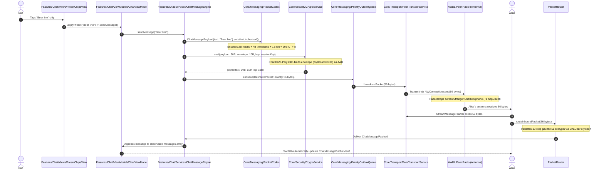

# TeeKum: The Complete Codebase Tour for Junior Developers
## A Beginner-Friendly, File-by-File & Feature-by-Feature Guide to the Entire App

> **Target Audience:** Junior iOS Developers, Interns, and Contributors joining the TeeKum project.  
> **Prerequisites:** Basic knowledge of Swift syntax (variables, functions, structs, classes). Zero prior mesh networking or cryptography experience required!  
> **Repository:** `TeeKum Prototype/` (Feature-Driven MVVM Architecture, 100% Native Apple Frameworks)  

---

## Table of Contents
1. [Welcome to TeeKum! (The 30,000-Foot View)](#1-welcome-to-teekum-the-30000-foot-view)
2. [The 3-Story Building Metaphor (Our Architecture)](#2-the-3-story-building-metaphor-our-architecture)
3. [App Boot Sequence: How the App Starts Up](#3-app-boot-sequence-how-the-app-starts-up)
4. [Touring the Features (Screen-by-Screen & Code-by-Code)](#4-touring-the-features-screen-by-screen--code-by-code)
   - [Feature 1: Pairing & Group Creation (`Features/Pairing`)](#feature-1-pairing--group-creation-featurespairing)
   - [Feature 2: The Main Map & Vision Cones (`Features/Map`)](#feature-2-the-main-map--vision-cones-featuresmap)
   - [Feature 3: Festival Group Mesh Chat (`Features/Chat`)](#feature-3-festival-group-mesh-chat-featureschat)
   - [Feature 4: Single Active Meeting Point (`Features/MeetingPoint`)](#feature-4-single-active-meeting-point-featuresmeetingpoint)
   - [Feature 5: Emergency SOS & Inactivity Guard (`Features/SOS`)](#feature-5-emergency-sos--inactivity-guard-featuressos)
   - [Feature 6: The 60m Tactical Polar Radar (`Features/Finder`)](#feature-6-the-60m-tactical-polar-radar-featuresfinder)
   - [Feature 7: Diagnostics HUD & Virtual Mesh Lab (`Features/Diagnostics`)](#feature-7-diagnostics-hud--virtual-mesh-lab-featuresdiagnostics)
5. [The Engine Room: The Core Infrastructure (`Core/`)](#5-the-engine-room-the-core-infrastructure-core)
   - [The Wire Protocol & Codecs (`Core/Messaging/`)](#the-wire-protocol--codecs-coremessaging)
   - [The Radio Transport (`Core/Transport/`)](#the-radio-transport-coretransport)
   - [The Multi-Hop Mesh Network (`Core/Mesh/`)](#the-multi-hop-mesh-network-coremesh)
   - [Security & Cryptography (`Core/Security/`)](#security--cryptography-coresecurity)
   - [Location & Motion Sensors (`Core/Location/`)](#location--motion-sensors-corelocation)
   - [Lock Screen & Live Activities (`Core/LiveActivity/`)](#lock-screen--live-activities-coreliveactivity)
6. [The Life of a Packet: Tracing a Message from Thumb to Screen](#6-the-life-of-a-packet-tracing-a-message-from-thumb-to-screen)
7. [The Junior Developer's Day 1 Survival Kit](#7-the-junior-developers-day-1-survival-kit)

---

## 1. Welcome to TeeKum! (The 30,000-Foot View)

Most iOS apps you have built or used follow a simple client-server pattern:
```
Your Phone  ─── (HTTPS Request via 5G) ───>  AWS Cloud Server  ───>  Database
```
If you turn off Wi-Fi and Cellular data on your phone, most apps display a red banner: *"No Internet Connection"*, and stop working completely.

**TeeKum is completely different.**
TeeKum was designed for massive music festivals (Coachella, Glastonbury, Tomorrowland) where 80,000 people gather in remote fields. Cell towers get overwhelmed within minutes, and traditional apps die.

TeeKum has **no servers, no cloud databases, and no login screens**. 
Instead, phones talk directly to neighboring phones using peer-to-peer Wi-Fi and Bluetooth. When your friend is far away across a crowded stage, your message hops across the phones of friendly strangers like a bucket brigade until your friend receives it!

---

## 2. The 3-Story Building Metaphor (Our Architecture)

To navigate the codebase without getting lost, imagine TeeKum as a **3-story building**:

```
┌─────────────────────────────────────────────────────────────┐
│  PENTHOUSE: The Views (SwiftUI Presentation)                │
│  Files: Features/*/Views/                                   │
│  "What the user sees and touches: Buttons, Maps, Radars"   │
├─────────────────────────────────────────────────────────────┤
│  MIDDLE FLOOR: The ViewModels (@Observable Logic)           │
│  Files: Features/*/ViewModels/                              │
│  "The screen's brain: Formats numbers, handles button taps" │
├─────────────────────────────────────────────────────────────┤
│  BASEMENT / ENGINE ROOM: Core Services (Swift Actors)       │
│  Files: Core/                                               │
│  "The heavy machines: Radio sockets, GPS, AES/ChaCha crypto"│
└─────────────────────────────────────────────────────────────┘
```

### The Golden Rule of Separation:
1. **Views NEVER touch network sockets or run encryption.** A view's only job is to draw pixels and notify its ViewModel when the user taps something.
2. **ViewModels NEVER touch radio bytes directly.** ViewModels hold screen state (`draftText`, `holdProgress`) and call Core Services.
3. **Core Services NEVER import SwiftUI.** They do the heavy lifting in background threads (Swift `actor`s) and publish clean data models back to the ViewModels.

---

## 3. App Boot Sequence: How the App Starts Up

When the user taps the TeeKum app icon on their iPhone home screen, where does execution start?

### Step 1: `TeeKumApp.swift` (The `@main` Entry Point)
File: [`App/TeeKumApp.swift`](file:///Users/nicho/Developer/TeeKum%20Prototype/TeeKum%20Prototype/App/TeeKumApp.swift)

In Swift, `@main` marks the starting point of the application:
```swift
@main
struct TeeKumApp: App {
    // 1. Create and retain top-level ViewModels in memory
    @State private var sessionViewModel = GroupSessionViewModel()
    @State private var mapViewModel = MapViewModel()
    @State private var sosViewModel = SOSViewModel()
    @State private var meetingPointViewModel = MeetingPointViewModel()
    @State private var chatViewModel = ChatViewModel()
    
    // 2. The Root Window
    var body: some Scene {
        WindowGroup {
            AppRootView(
                sessionViewModel: sessionViewModel,
                mapViewModel: mapViewModel,
                sosViewModel: sosViewModel,
                meetingPointViewModel: meetingPointViewModel,
                chatViewModel: chatViewModel
            )
        }
    }
}
```

> **Junior Dev Note:** In iOS 17, `@State` can own `@Observable` class objects! SwiftUI guarantees that these ViewModels will stay alive in memory for the entire life of the app.

---

### Step 2: `AppRootView.swift` (The Root Switcher)
File: [`App/AppRootView.swift`](file:///Users/nicho/Developer/TeeKum%20Prototype/TeeKum%20Prototype/App/AppRootView.swift)

Most apps use complex navigation routers. TeeKum uses **Radical Simplicity**:
```swift
public struct AppRootView: View {
    @Bindable var sessionViewModel: GroupSessionViewModel
    ...
    
    public var body: some View {
        Group {
            if sessionViewModel.hasActiveSession {
                // User is in an active festival group -> Show the Main Map!
                MainMapView(...)
            } else {
                // User has no active group -> Show the Pairing screen!
                GroupPairingView(...)
            }
        }
    }
}
```
If `hasActiveSession` is `true`, the user sees the Map. If they leave the group or it's their first time opening the app, they see the Pairing screen. That's it!

---

## 4. Touring the Features (Screen-by-Screen & Code-by-Code)

Let's walk through every user-facing feature in `Features/`.

---

### Feature 1: Pairing & Group Creation (`Features/Pairing`)

How do friends form a private encrypted group in the middle of a festival without internet?

```
Alice: Taps "Create Group" ──> Generates Key & Session ID ──> Displays QR Code
                                                                    │
Bob: Taps "Scan to Join" ──> Opens Camera (AVFoundation) ───────────┘
```

#### What happens in the code:
1. **Generating the Group Session:**
   In [`PairingViewModel.swift`](file:///Users/nicho/Developer/TeeKum%20Prototype/TeeKum%20Prototype/Features/Pairing/ViewModels/PairingViewModel.swift), the user enters their 1–3 letter initials (e.g. `"DNA"`) and a group name (e.g. `"Festival Squad"`).
   When they tap *Create Group*:
   - A random **256-bit symmetric encryption key** (32 random bytes) is generated using `SecRandomCopyBytes`.
   - A random **24-bit Session ID** (`UInt24`, e.g. `0xA1B2C3`) is generated.
   - The user selects one of 8 neon avatar colors from [`MemberColor.swift`](file:///Users/nicho/Developer/TeeKum%20Prototype/TeeKum%20Prototype/Core/Models/MemberColor.swift).

2. **Displaying the QR Barcode:**
   [`GroupQRCodeView.swift`](file:///Users/nicho/Developer/TeeKum%20Prototype/TeeKum%20Prototype/Features/Pairing/Views/GroupQRCodeView.swift) takes the invite string and feeds it to CoreImage's native `CIQRCodeGenerator` filter:
   ```swift
   let inviteURL = "teekum://join#key=\(base64Key)&sid=\(hexSessionId)&name=\(groupName)"
   ```
   > **Junior Dev Trivia:** Why is the key placed after the `#` hash fragment instead of a `?` query parameter?  
   > Because under web standards (RFC 3986), **browsers never send the `#` fragment to a web server**! If someone shares this invite link over iMessage or WhatsApp, the secret key stays strictly on the client devices and never leaks into web server logs.

3. **Scanning the Barcode:**
   [`QRScannerView.swift`](file:///Users/nicho/Developer/TeeKum%20Prototype/TeeKum%20Prototype/Features/Pairing/Views/QRScannerView.swift) spins up an `AVCaptureSession` using the device camera. When a QR code is detected, it parses the URL fragment, extracts the 256-bit key and 24-bit session ID, and saves the key safely into the **iOS Keychain**.

4. **The Communal Mesh Agreement:**
   Before activation, [`MeshAgreementView.swift`](file:///Users/nicho/Developer/TeeKum%20Prototype/TeeKum%20Prototype/Features/Pairing/Views/MeshAgreementView.swift) pops up. It presents the festival covenant: *"Relay for others while others relay for you. Battery-protected; shuts off at 20%"*. Once accepted, the session activates and `AppRootView` flips to `MainMapView`!

---

### Feature 2: The Main Map & Vision Cones (`Features/Map`)

File: [`Features/Map/Views/MainMapView.swift`](file:///Users/nicho/Developer/TeeKum%20Prototype/TeeKum%20Prototype/Features/Map/Views/MainMapView.swift)

This is the primary home screen of the app. It renders an offline Apple `MapKit` canvas.

```
       [MainMapView]
             │
 ┌───────────┴───────────┐
 ▼                       ▼
[FriendPinAnnotationView] [LiveSharingControlView]
 (Avatar + Neon Color)    (Master Privacy Toggle)
```

#### What happens in the code:
1. **Rendering Friends on the Map:**
   The map loops over `sessionViewModel.members`:
   ```swift
   Annotation(member.name, coordinate: member.coordinate) {
       FriendPinAnnotationView(member: member)
   }
   ```
2. **The 50° Heading Vision Cone:**
   In [`HeadingVisionCone.swift`](file:///Users/nicho/Developer/TeeKum%20Prototype/TeeKum%20Prototype/Features/Map/Views/HeadingVisionCone.swift), friend pins don't just show a circle; they show a **translucent glowing triangle** pointing in the physical direction the friend is facing!
   - Every location ping carries the friend's compass heading (`0...255`).
   - The view rotates the cone using SwiftUI's `.rotationEffect(.degrees(member.heading ?? 0))`.
3. **The Live Sharing Master Toggle:**
   [`LiveSharingControlView.swift`](file:///Users/nicho/Developer/TeeKum%20Prototype/TeeKum%20Prototype/Features/Map/Views/LiveSharingControlView.swift) gives the user 100% control over their privacy:
   - When **OFF**: GPS polling and radio broadcasts are completely shut down. You can watch the concert in peace without using battery.
   - When **ON**: The phone broadcasts location fixes periodically.
   - *Emergency Exception:* If you trigger an Emergency SOS, it broadcasts immediately even if Live Sharing is toggled OFF!

---

### Feature 3: Festival Group Mesh Chat (`Features/Chat`)

File: [`Features/Chat/Views/ChatSheetView.swift`](file:///Users/nicho/Developer/TeeKum%20Prototype/TeeKum%20Prototype/Features/Chat/Views/ChatSheetView.swift)

In early prototypes, TeeKum had canned 1-byte status buttons (*"At Bar"*, *"Restroom"*). But at real concerts, canned buttons were too rigid. In Phase 3, we replaced them with **Festival Group Mesh Chat**!

```
┌────────────────────────────────────────────────────────┐
│ [Beer line]  [At Main Stage]  [Restroom]  [On my way]  │ <- Preset Chips
├────────────────────────────────────────────────────────┤
│ Meet at sound booth                               18/20│ <- Dynamic Byte Meter
└────────────────────────────────────────────────────────┘
```

#### What happens in the code:
1. **The 20-Byte Wire Allocation:**
   Because all radio packets in TeeKum are fixed at 56 bytes, chat messages are allocated **exactly 20 bytes of UTF-8 text**.
2. **The Byte Limiter Engine:**
   In [`ByteMeterView.swift`](file:///Users/nicho/Developer/TeeKum%20Prototype/TeeKum%20Prototype/Features/Chat/Views/ByteMeterView.swift), as the user types, the UI measures `draftText.utf8.count`.
   - If you type standard letters (`A-Z`), each character is 1 byte.
   - But if you type an emoji (like 🍻), it consumes **4 UTF-8 bytes**!
   - `ChatMessagePayload.clampTo20Bytes` iterates character-by-character to ensure an emoji is never sliced in half.
3. **Preset Quick-Tap Chips:**
   [`PresetChipsView.swift`](file:///Users/nicho/Developer/TeeKum%20Prototype/TeeKum%20Prototype/Features/Chat/Views/PresetChipsView.swift) displays 1-tap chips (*"Beer line"*, *"At Main Stage"*, *"Restroom"*, *"Where are you?"*). Tapping one instantly sends it across the mesh without needing to type on a keyboard in a mosh pit.
4. **Honest Delivery Checkmarks:**
   In [`RecipientAckBreakdownView.swift`](file:///Users/nicho/Developer/TeeKum%20Prototype/TeeKum%20Prototype/Features/Chat/Views/RecipientAckBreakdownView.swift), messages show honest progress:
   - *"Sent to antenna"* $\rightarrow$ *"Relayed by Mesh"* $\rightarrow$ *"Delivered to 3/4 friends"* (cryptographic ACKs received from their devices).

---

### Feature 4: Single Active Meeting Point (`Features/MeetingPoint`)

File: [`Features/MeetingPoint/Views/MeetingPointsView.swift`](file:///Users/nicho/Developer/TeeKum%20Prototype/TeeKum%20Prototype/Features/MeetingPoint/Views/MeetingPointsView.swift)

When groups split up at a music festival, setting meeting points is notoriously chaotic: Member A texts *"Meet at Ferris wheel"*, Member B texts *"Meet at food tent"*, and nobody knows where to go.

TeeKum solves this with the **Single Active Meeting Point & Setter Lock Rule**:
1. **Strictly One Meeting Point:** A group can only have one active rendezvous landmark at any time.
2. **The Setter Lock Rule:** In [`MeetingPointViewModel.swift`](file:///Users/nicho/Developer/TeeKum%20Prototype/TeeKum%20Prototype/Features/MeetingPoint/ViewModels/MeetingPointViewModel.swift#L18-L35), if Member A proposes a meeting point, **only Member A can cancel or move it**. If Member B tries to create one, their phone rejects it.
3. **RSVP Responses:** Non-setters simply tap 1-touch responses:
   - *"I'll be there"* (`.attending`)
   - *"Can't make it"* (`.declined`)
   - *"Arrived"* (`.atMeetingPoint`)
4. **25-Meter Auto-Arrival:** When you walk within 25 meters of the landmark coordinates, `MeetingPointViewModel` automatically switches your status to *"Arrived"*, informing your friends without you having to pull your phone out!

---

### Feature 5: Emergency SOS & Inactivity Guard (`Features/SOS`)

File: [`Features/SOS/Views/SOSButtonView.swift`](file:///Users/nicho/Developer/TeeKum%20Prototype/TeeKum%20Prototype/Features/SOS/Views/SOSButtonView.swift)

In a crowd of 80,000 people, an emergency is high stakes.

```
[Touch Button] ──> Must hold for 3.0 continuous seconds ──> [TRIGGER SOS]
                     (Release early = CANCEL)
```

#### What happens in the code:
1. **The 3-Second Hold Gesture:**
   To prevent accidental triggers while dancing or jumping, tapping the SOS button does nothing. You must hold it continuously for 3.0 seconds.
   - An animated white progress circle fills clockwise.
   - Haptic feedback pulses every 50ms.
   - If you release your thumb at 2.9 seconds, it resets to zero immediately.
2. **Priority Preemption:**
   When triggered, the SOS packet jumps to the very front of [`PriorityOutboxQueue.swift`](file:///Users/nicho/Developer/TeeKum%20Prototype/TeeKum%20Prototype/Core/Messaging/PriorityOutboxQueue.swift), bumping normal location pings aside, and broadcasts immediately.
3. **The Inactivity Guard ("Man Down" Detection):**
   In [`InactivityGuardService.swift`](file:///Users/nicho/Developer/TeeKum%20Prototype/TeeKum%20Prototype/Features/SOS/Services/InactivityGuardService.swift), an opt-in motion watchdog monitors the iPhone accelerometer.
   - If the user remains completely motionless for **180 seconds** (3 minutes), the phone begins a **30-second silent pre-alarm countdown**.
   - The screen pulses yellow and displays an **[I'M OK]** button.
   - If the user moves the phone or taps the button, it cancels.
   - If 30 seconds pass without movement, the phone automatically broadcasts an **Emergency Distress SOS** (`emergencyType = .inactivity`), alerting friends that the user has collapsed or fainted!

---

### Feature 6: The 60m Tactical Polar Radar (`Features/Finder`)

File: [`Features/Finder/Views/Radar/RadarView.swift`](file:///Users/nicho/Developer/TeeKum%20Prototype/TeeKum%20Prototype/Features/Finder/Views/Radar/RadarView.swift)

How do you find your friend in pitch-black darkness when a 2D map doesn't give you a clear sense of orientation?

```
                     Ahead (0°)
                     ┌───▲───┐
                  15m│   │   │
                     │  (•)  │ <- Friend Blip
                  30m│       │
      9 o'clock ─────┼───+───┼───── 3 o'clock
                  60m│       │
                     │       │
                     └───▼───┘
                    Behind (180°)
```

#### What happens in the code:
1. **Forward-Up Polar Projection:**
   The radar disk rotates dynamically with your iPhone compass heading. "Screen Up" is always the physical direction you are looking!
2. **The Trigonometry Math ($r, \theta \rightarrow x, y$):**
   ```swift
   let relativeAngle = (absoluteBearing - userHeading + 360.0).truncatingRemainder(dividingBy: 360.0)
   let rad = relativeAngle * .pi / 180.0
   let dx = sin(rad) * blipRadius
   let dy = -cos(rad) * blipRadius
   ```
3. **60-Meter Boundary Clamping:**
   If a friend is 150 meters away, they don't disappear from the screen. They are clamped to the outer rim of the 60m circle with a directional chevron and distance tag (`150m ↗`).
4. **Metal GPU Acceleration (`.drawingGroup()`):**
   Rotating 30 views 60 times a second on the CPU causes lag. Adding `.drawingGroup()` offloads rendering to the Apple Metal GPU, keeping the radar butter-smooth at 60 fps!
5. **The Neon Screen Strobe Torch:**
   Tapping the strobe button rapidly flashes the iPhone OLED screen between neon cyan and black at 8 Hz. You hold your phone high above the crowd, creating an unmistakable visual beacon!

---

### Feature 7: Diagnostics HUD & Virtual Mesh Lab (`Features/Diagnostics`)

File: [`Features/Diagnostics/Views/MeshDebuggerView.swift`](file:///Users/nicho/Developer/TeeKum%20Prototype/TeeKum%20Prototype/Features/Diagnostics/Views/MeshDebuggerView.swift)

How do you test a 5-node multi-hop mesh when you only have one iPhone or you are running the Xcode Simulator?

TeeKum includes a built-in **Virtual Mesh Simulation Lab**:
- [`MeshTopologySimulator.swift`](file:///Users/nicho/Developer/TeeKum%20Prototype/TeeKum%20Prototype/Core/Mesh/MeshTopologySimulator.swift) simulates virtual in-memory peer nodes (Alice, Bob, Relay 1, Relay 2).
- You can break links, simulate network partitions, inject corrupted packets, and watch the AODV routing engine heal paths in real time on your screen!

---

## 5. The Engine Room: The Core Infrastructure (`Core/`)

Now let's descend into the basement: `Core/`. This is where low-level networking, cryptography, and hardware drivers live.

---

### The Wire Protocol & Codecs (`Core/Messaging/`)

1. **`PacketCodec.swift`:**
   - Pre-allocates fixed byte buffers using `PacketWriter` and `PacketReader`.
   - **Quantization Math:** Quantizes 64-bit `Double` GPS coordinates into 32-bit `Int32` integers (`degrees * 1_000_000`), giving **~11 cm precision** worldwide while saving 8 bytes of radio budget.
2. **`InitialsCodec.swift`:**
   - Compresses 1 to 3 uppercase letters ($A \dots Z$) into a single 2-byte `UInt16` via Base-27 radix math ($18,278 \le 65,535$). Every packet is self-describing!
3. **`PacketRouter.swift`:**
   - The central demuxing traffic cop. When 56 bytes arrive from the radio, it runs them through a strict 10-step gauntlet: checking wire size, protocol version `0x03`, hop limits, duplicate caches, and Poly1305 MAC tags before delivering the payload to the matching ViewModel.

---

### The Radio Transport (`Core/Transport/`)

1. **`PeerTransportService.swift`:**
   - Wraps Apple's `Network.framework`.
   - Starts an `NWListener` with `includePeerToPeer: true` and advertises the Bonjour service `_teekum._tcp`.
   - Uses Apple Wireless Direct Link (AWDL) to communicate directly antenna-to-antenna without Wi-Fi routers.
2. **`StreamMessageFramer.swift`:**
   - TCP is a streaming byte protocol, not a packet protocol. Incoming data might arrive in 20-byte chunks or 112-byte conglutinated chunks.
   - `StreamMessageFramer` acts as a 56-byte ring buffer delimiter, slicing out complete packets and scanning forward across corrupted bytes to resynchronize the stream.

---

### The Multi-Hop Mesh Network (`Core/Mesh/`)

1. **`PacketForwarder.swift`:**
   - Implements **Zero-Knowledge Blind Relaying**. Foreign packets belonging to strangers are never decrypted; only the 10-byte cleartext envelope is checked, and the packet is forwarded blind.
2. **`SeenPacketCache.swift`:**
   - A 1,024-entry LRU sliding cache with a 5-minute retention window keyed on `(sessionId: 3B) || (sequenceNumber: 4B)`. Discards duplicate packets to prevent infinite broadcast loops.
3. **`ForwardingRateLimiter.swift`:**
   - A dual-lane token bucket: caps ordinary stranger relaying to **2 packets/second** to preserve battery, with a dedicated **4 packets/second** lane for emergency SOS.
4. **`RelayPolicyManager.swift`:**
   - Enforces the **20% Hard Cutoff**: if battery drops below 20% or enters Low Power Mode, stranger relaying terminates instantly.

---

### Security & Cryptography (`Core/Security/`)

1. **`CryptoService.swift`:**
   - Hardware-accelerated RFC 8439 **ChaCha20-Poly1305 AEAD**.
   - Seals 30-byte payloads using the group's 256-bit symmetric key.
   - **The Nonce:** 96-bit vector derived from `sessionId` (3B) + partitioned `sequenceNumber` (4B) + `versionAndType` (1B) + `"TKM3"` (4B). Mathematically eliminates Two-Time Pad collisions.
   - **The AAD Masking Trick:** Masks `hopCount` (Byte 2) to `0x00` in the authentication tag so intermediate relays can increment hops without breaking cryptographic signatures!
2. **Keychain Key Storage:**
   - Symmetric keys are stored in the iOS Keychain with `kSecAttrAccessibleAfterFirstUnlockThisDeviceOnly`. Keys are completely wiped from disk when leaving the group.

---

### Location & Motion Sensors (`Core/Location/`)

1. **`LocationService.swift`:**
   - **CoreMotion Sleep:** Uses `CMMotionActivityManager` to detect when the user is stationary at a stage. Drops GPS accuracy to 100 meters, saving **~70% of GPS battery**!
   - **Dual-Frequency L1/L5 Boost:** When Tactical Radar is opened, automatically engages `kCLLocationAccuracyBestForNavigation` (dual-frequency GPS) and zero heading filter for razor-sharp compass navigation.

---

### Lock Screen & Live Activities (`Core/LiveActivity/`)

1. **`LiveActivityManager.swift`:**
   - Manages Apple `ActivityKit` widgets.
   - Renders active session status and distance to the meeting point on the **Dynamic Island** and **Lock Screen**.
   - Includes interactive buttons directly on the Lock Screen to toggle Communal Relay without unlocking the phone.

---

## 6. The Life of a Packet: Tracing a Message from Thumb to Screen

To understand how the entire codebase connects, follow what happens when **Bob taps the *"Beer line"* preset chip**:



---

## 7. The Junior Developer's Day 1 Survival Kit

When you start modifying this codebase, keep these **5 Golden Rules** in your pocket:

1. **Never Change the 56-Byte Size:** Every packet over the radio must be exactly 56 bytes. If you need new payload fields, carve them out of the `reserved` padding bytes!
2. **Never Put Crypto in Views:** Views are for SwiftUI layout. Cryptography belongs in `Core/Security/CryptoService.swift`.
3. **Always Use `[weak self]` in Long-Lived Closures:** If you listen to a network stream or timer, use `[weak self]` to avoid leaking ViewModels in memory.
4. **Use `@MainActor` on ViewModels:** Ensure UI state updates are locked to the main thread.
5. **Run the Automated Tests Before Committing:**
   ```bash
   # Run all 18 test suites (208 tests) on simulator:
   xcrun simctl launch --console booted com.academy.teekum.TeeKum-Prototype -runAllTests -exitAfterTests
   ```

Welcome to the TeeKum team! You are now ready to build off-grid, serverless mesh software. Have fun exploring the code!
