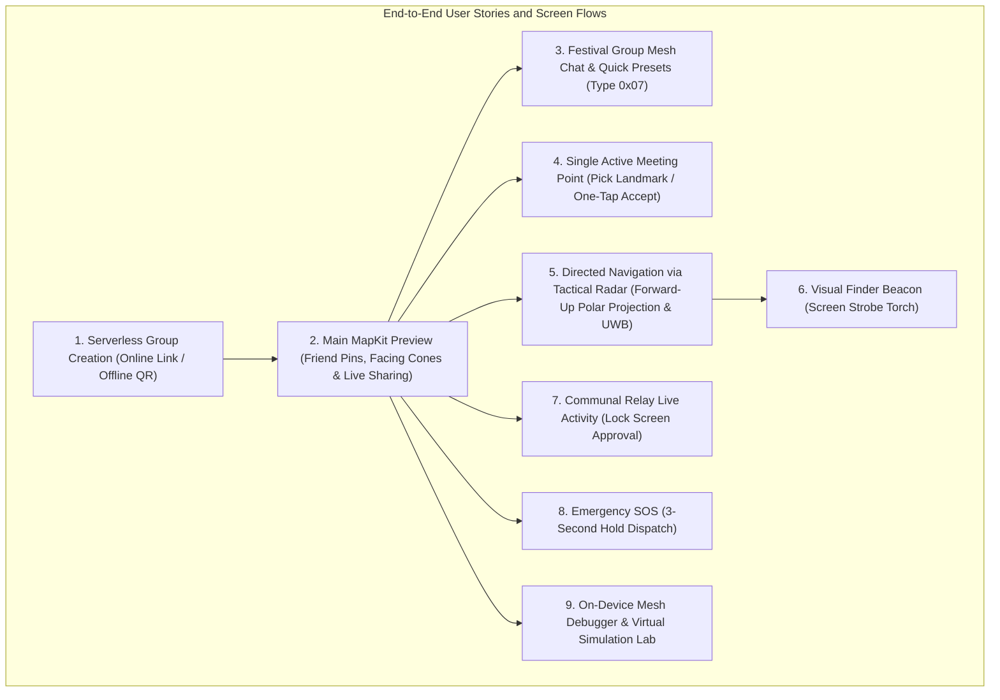

# Master Agent Instructions --- Offline Concert-Finding Mesh App

> **Purpose:** This document is the source of truth for AI coding agents
> and developers working on the iOS app. Follow it before making
> architectural or implementation decisions. When requirements conflict,
> prioritize user safety, security, iOS platform rules, and the explicit
> product requirements in this file.
> 
> *Companion Documents:*
> - [Feature Requirements Document (docs/product/FEATURE_REQUIREMENTS.md)](product/FEATURE_REQUIREMENTS.md)
> - [User Stories Specification (docs/product/USER_STORIES.md)](product/USER_STORIES.md)
> - [Product Backlog (docs/product/PRODUCT_BACKLOG.md)](product/PRODUCT_BACKLOG.md)
> - [Product Decisions & ADRs (docs/product/PRODUCT_DECISIONS.md)](product/PRODUCT_DECISIONS.md)
> - [Technical Requirements Document (docs/TechnicalRequirements.md)](TechnicalRequirements.md)
> - [Knowledge Transfer Master Guide (docs/knowledge_transfer/README.md)](knowledge_transfer/README.md)
> - [Handoff Checklist & Verification Protocol (docs/knowledge_transfer/HANDOFF_CHECKLIST.md)](knowledge_transfer/HANDOFF_CHECKLIST.md)
> - [Phase 1 Development Report (docs/Phase 1/PHASE_1_DEVELOPMENT_REPORT.md)](Phase%201/PHASE_1_DEVELOPMENT_REPORT.md)
> - [Phase 2 Multi-Hop Mesh Architecture (docs/Phase 2/PHASE2_ARCHITECTURE.md)](Phase%202/PHASE2_ARCHITECTURE.md)
> - [Phase 2 Protocol Decisions & Consensus (docs/Phase 2/PHASE2_PROTOCOL_DECISIONS.md)](Phase%202/PHASE2_PROTOCOL_DECISIONS.md)
> - [Phase 2 Final Acceptance Report (docs/Phase 2/PHASE2_ACCEPTANCE_REPORT.md)](Phase%202/PHASE2_ACCEPTANCE_REPORT.md)
> - [Networking Architecture & Wire Protocol (docs/Phase 1/NETWORKING.md)](Phase%201/NETWORKING.md)
> - [56-Byte Wire Protocol & Payload Developer Guide (docs/Phase 2/PAYLOAD_GUIDE.md)](Phase%202/PAYLOAD_GUIDE.md)
> - [Phase 3 Group Mesh Chat Architecture (docs/phase3/CHAT_ARCHITECTURE.md)](phase3/CHAT_ARCHITECTURE.md)
> - [Phase 3 56-Byte Wire Protocol & Payload Developer Guide (docs/phase3/PAYLOAD_GUIDE.md)](phase3/PAYLOAD_GUIDE.md)
> - [Development Log (docs/DEVELOPMENT_LOG.md)](DEVELOPMENT_LOG.md)
> 
> *Last Verified via /grill-me:* 2026-11-04 (Inactivity Guard "Man Down" Auto-SOS Type 0x04, InactivityGuardService, Pre-Alarm 30s Silent Warning Countdown, Centralized Master Configuration TeeKumConfiguration.swift, Phase 3 Group Mesh Chat Type 0x07, Nearby Interaction Simulation Fallback, Setter Lock Rule, 18 Test Suites / 220 Tests Confirmed)

---

## 1. Product Summary & Vision

Build an **offline-first iOS app for finding friends at crowded concerts, festivals, and venues**. Users form a group, share their latest location, chat across the mesh, see other members on a map, choose meeting points, and navigate toward a selected person.

The system is designed for venues with weak or unavailable internet. Participating phones communicate directly (Phase 1 MVP) and opportunistically relay encrypted packets for other users in a multi-hop mesh (Phase 2). Relay participation is explicit and opt-in.

### 1.1 The 5 Environmental Realities of Festival Crowds
1. **Extreme Cellular Saturation:** Tens of thousands of devices trigger LTE/5G RACH exhaustion. While phones display full bars, TCP/IP uplink bandwidth plummets to 0 kbps.
2. **"Human Wall" RF Absorption:** The human body consists of ~70% water, absorbing 2.4 GHz and 5 GHz ISM signals. Direct AWDL reach shrinks from 50m in open parks down to 10–15m in dense crowds.
3. **Deafening Ambient Noise (95–110 dB SPL):** Adjacent to stage speaker arrays, standard system notification chimes and ringers are inaudible. Life-safety alerts require acoustic sirens and continuous high-intensity haptic vibration loops.
4. **Darkness & Visual Disorientation:** Identical silhouettes, disorienting flashing lights, and lack of street landmarks make spotting a friend 10m away nearly impossible without active directional and visual aids.
5. **Severe Battery Anxiety:** Attendees rely on their phones for ticketing, photos, and rides home. GPS and radios must be heavily duty-cycled to achieve $<3\% \dots 5\%$ battery drain per hour.

### 1.2 Target Users, Personas & Primary Usage Scenarios
- **Music Festival & Concert Attendees:** Groups of 2 to 8 friends at multi-day music festivals (EDC, Coachella, Glastonbury) splitting up across stages, restrooms, food trucks, and campsites.
- **Stadium Sports & Arena Fans:** Attendees navigating massive 60,000+ seat sporting arenas and tailgate zones where cellular towers overload during halftime.
- **Outdoor Wilderness Adventurers:** Backpackers and hikers exploring national parks or wilderness trails beyond commercial cellular coverage.
- **Primary Usage Scenarios:**
  1. *Pre-Event Serverless Pairing:* Host generates a 256-bit key; friends scan an offline QR code or open a universal link.
  2. *Macro Map Monitoring:* Attendees check friends' locations, facing vision cones, and battery levels on an AMOLED true-black map.
  3. *Single Meeting Point Rendezvous:* Proposer sets a rendezvous spot under the **Setter Lock Rule**, locking out conflicting edits while friends confirm attendance with 1-tap RSVPs.
  4. *Tactical Polar Radar Navigation:* Separated attendee navigates through dense crowds using a 60m forward-up polar radar disk rotating with compass heading.
  5. *Close-Range Finding & Strobe:* At $<8\text{m}$, Apple Nearby Interaction (UWB) engages with 3D directional arrow guidance, paired with a 1-tap screen strobe torch.
  6. *Festival Group Mesh Chat:* One-handed communication using quick preset chips (*"Beer line"*, *"Lost"*), transmitting 20-byte UTF-8 packets with honest delivery ACKs.
  7. *Life-Safety Emergency & Auto-SOS:* 3-second hold manual SOS trigger or autonomous "Man Down" stillness watchdog broadcasts across 15 hops to summon help.

### 1.3 Product Principles (The 11 Invariants)

1.  **Offline-first:** Core group coordination must never require a cloud
    server during an active offline session.
2.  **Pure Location Telemetry:** Ordinary periodic updates carry the sender's
    latest available coordinates and sensor telemetry (battery, heading, color).
    Chat messages and status presets are transmitted independently via multi-hop mesh chat.
3.  **SOS is exceptional:** SOS is sent immediately, independently of
    the normal location-ping interval, and receives high-priority
    bounded forwarding.
4.  **Battery-aware:** Avoid unnecessary GPS work, peer discovery,
    connection churn, retransmissions, and duplicate forwarding.
5.  **Privacy by design:** Collect and retain as little location data as
    practical. Never expose group payload contents to unrelated relay
    phones. Session state is strictly ephemeral.
6.  **Honest UX:** Show location age, reported accuracy, and delivery
    state. Never imply a stale location is current or that an SOS
    reached its destination when only a nearby relay received it.
7.  **iOS-realistic:** Never assume unrestricted background execution or
    continuous background mesh relaying. Screen-on for active navigation;
    hybrid background wakeups for emergency SOS.
8.  **Security before packet minimization:** Never weaken cryptography
    or replay protection just to fit a 56-byte packet.
9.  **User-controlled live sharing:** Location broadcasting is governed by
    an explicit "Live Sharing" master toggle (active when navigating or
    finding friends, paused when resting/watching shows). SOS is unconditional.
10. **Verified-only emergency scope:** Group coordination and emergency SOS alerts
    require authenticated group membership (established via in-person QR key exchange
    or pre-shared serverless link). Rogue stranger packets are dropped cryptographically.
11. **Radical Simplicity:** Keep the architecture dead-simple (pure MVVM without coordinators,
    zero external dependencies, and standard Apple frameworks).

---

## 2. Core Product Requirements & User Stories

> **Authoritative Specifications Reference:**
> - [Feature Requirements Document (docs/product/FEATURE_REQUIREMENTS.md)](product/FEATURE_REQUIREMENTS.md): Complete functional and non-functional specifications.
> - [User Stories Specification (docs/product/USER_STORIES.md)](product/USER_STORIES.md): Full 42-story inventory with measurable Given/When/Then acceptance criteria and edge cases.
> - [Product Backlog (docs/product/PRODUCT_BACKLOG.md)](product/PRODUCT_BACKLOG.md): Prioritized roadmap, sprint backlogs, dependencies, and blockers.
> - [Product Decisions & ADRs (docs/product/PRODUCT_DECISIONS.md)](product/PRODUCT_DECISIONS.md): Architectural decision records (D01–D22) and unresolved decision register (PD-01–PD-06).

### 2.1 Group Sessions & Pairing (100% Serverless)

-   **Zero-Backend Group Formation:** Users create and join groups both offline and online
    without requiring any cloud database, user accounts, or backend servers.
-   **Serverless Shareable Invite Link (Online):** When friends are at home or in the car
    with internet, the host taps "Share Invite Link". The app generates a universal link
    (e.g., `teekum://join#key=Base64Key&name=Group`) packing the session details and
    symmetric encryption key directly into the URL fragment. Tapping the link in iMessage
    or WhatsApp opens the app and joins immediately.
-   **In-Person QR Barcode (Offline):** At the festival with zero reception, the host
    displays a QR barcode encoding the exact same serverless URL string. Friends scan it
    with their camera on-site to exchange the key in seconds.
-   **Short-Lived & Ephemeral:** Sessions expire after the event.
-   **Session Teardown & Ephemeral Cleanup:** When a member leaves or the session ends,
    all session tracking, encryption keys, and cached relay data are wiped immediately
    from memory and local storage. No persistent tracking history is retained.

### 2.2 Location and Mesh Telemetry Behavior

-   **Latest Local State:** The app maintains the latest locally available location,
    its measurement timestamp, and reported accuracy.
-   **User-Controlled "Live Sharing" Toggle:**
    -   When **ON**: The app actively publishes periodic location pings while
        the user is walking or navigating.
    -   When **OFF**: Location publishing is paused (saving battery and respecting
        privacy while watching a performance).
    -   **SOS Override**: Triggering SOS broadcasts immediately regardless of the
        Live Sharing toggle state.
-   **Normal Location Ping (Pure Telemetry):** Carries sender coordinates, measurement
    timestamp, accuracy, battery level, facing heading (0..360°), and personal member color.
    Status codes are completely removed from location wire frames (Option B).
-   **Independent Group Mesh Chat & Status Presets:** Status updates, intentions, and
    messages are transmitted independently as dedicated 20-byte mesh chat packets
    (`Type 0x07`), ensuring location pings never overwrite chat messages.
-   **SOS Emergency Trigger:**
    -   **3-Second Hold:** Users must press and hold the SOS button for 3 seconds
        to trigger, preventing accidental pocket taps while dancing.
    -   **Immediate Dispatch:** Transmit an SOS event immediately without waiting
        for a location ping or a fresh GPS fix. Uses freshest valid coordinate.
    -   **Honest Delivery Feedback:** Display distinct states: `LOCAL_SENDING`,
        `RELAY_ACK`, `DELIVERED_TO_FRIEND`, or `SEARCHING_PEERS`.
-   **No False Freshness:** Normal pings must not imply stale coordinates are fresh.
    Relays must never alter or refresh the original location measurement timestamp.
-   **Disconnected State:** Keep only the relevant latest state rather than queuing
    obsolete past pings.

### 2.3 Festival Group Mesh Chat & Quick-Tap Preset Chips

The legacy canned status system (`StatusCode`, `UserStatus`, and horizontal `StatusPickerView`) has been fully retired in favor of the **Festival Group Mesh Chat** (`ChatMessagePayload`, `Type 0x07`):
- Transmits compact 20-byte UTF-8 messages across the multi-hop mesh.
- Features quick-tap preset chips for instant one-handed communication in dense festival crowds:
  - *"Beer line"*
  - *"At Main Stage"*
  - *"Restroom"*
  - *"Where are you?"*
  - *"On my way"*
  - *"Lost"*
- Delivery acknowledgements (`Type 0x06`) provide transparent per-recipient confirmation (*"Sent"*, *"Relayed"*, *"Delivered to 3/3"*).

---

### 2.4 Detailed User Stories & Feature Specifications



#### User Story 1: Group Formation (Serverless Online & Offline)
- **Goal:** Form a private group with zero internet at the venue or pre-share before arriving.
- **Online Flow:** Host opens app -> taps "Create Group" -> taps "Share Invite Link" -> sends via iMessage/WhatsApp. Friends tap link -> app opens, extracts key from URL hash, and joins instantly.
- **Offline Flow:** Host opens app -> displays on-screen QR barcode. Friends tap "Join Group" -> camera scans barcode -> key imported to Keychain -> joined.
- **Security:** Group key never touches a cloud server. Only users with the key can decrypt locations or send verified alerts.

#### User Story 2: Main Map View & Live Sharing
- **Goal:** See all group members on the venue map.
- **UI:** MapKit preview rendering friend pins with initials/avatars, personal neon color rings, and facing orientation vision cones.
- **Live Sharing Toggle:** Prominent toggle on map (`Live Sharing: ON/OFF`). When OFF, GPS is paused to save battery; when ON, updates broadcast every 3–5 seconds.
- **Honest UX:** Friends out of direct radio range appear as faded pins with badges: *"Last seen 4 mins ago near Stage B"*.

#### User Story 3: Directed Navigation via Festival Tactical Radar & Forward-Up Polar Projection
- **Goal:** Track, orient, and navigate through a dense festival crowd directly toward friends with a multi-peer tactical radar view.
- **No Approval Needed:** Navigating to a verified group member is automatic and friction-free.
- **Forward-Up Polar Projection (`RadarView`):** Renders all group members simultaneously on a high-contrast 60m polar tactical disk with concentric range rings (15m, 30m, 60m), 24 angle ticks in 15° increments, and a luminous cyan user forward marker. Dynamically rotates with device compass heading (`CLLocationDirection`) so "Up" on screen is always the physical direction the user is facing in the crowd.
- **60M Perimeter Clamping:** Friends separated by $>60\text{m}$ remain visible at the outer boundary clamped to their relative bearing, tagged with an outward-pointing arrow and metric distance badge (e.g., *"142m"*), guaranteeing users never lose spatial awareness of separated members.
- **Dual Selection Interaction:** Users can tap any blip directly on the radar or swipe the bottom friend card carousel to inspect a member. Highlighting a friend draws a glowing cyan targeting line, updates the HUD banner with relative clock guidance (*"Ahead"*, *"2 o'clock"*), and shows live battery and distance.
- **Dynamic Adaptive Accuracy Profile (Option B):** Opening the tactical radar immediately activates `kCLLocationAccuracyBestForNavigation` (dual-frequency L1/L5 GNSS bands on modern iPhones) and zero heading filter (`kCLHeadingFilterNone`) via `applyDynamicAccuracy()`, dropping back to battery-conserving modes upon exit.
- **Close-Range Transition (<8 meters):** Smoothly and automatically transitions into Apple Nearby Interaction (Ultra-Wideband U1/U2) precision radar, pointing with centimeter accuracy ("3.2m at 2 o'clock").
- **Visual Strobe Beacon:** 1-tap crowd torch button turns the screen into a high-visibility flashing neon strobe to wave above dark crowds.

#### User Story 4: Single Active Meeting Point & Setter Lock Rule
- **Goal:** Synchronize a single group rendezvous spot without conflicting overwrites.
- **Single Active Rule:** Only **ONE** active meeting point exists for the group at any given time.
- **Setter Lock Rule:** When a member sets a meeting point, another person cannot set or change the meeting point before the original setter unsets (cancels) it or it auto-expires (1-hour cutoff).
  - **Setter Privileges:** The setter can update the meetup time/location and can unset (cancel) the meeting point.
  - **Non-Setter Constraints:** While an active rendezvous is set, non-setters are locked out from setting new meeting points. Map long-press alerts with haptic warning and locked toast (*"Only [Setter] can unset or change the active rendezvous"*). Proposal sheets display lock status with disabled broadcast buttons. Inbound mesh proposals or cancellations from non-setters are rejected by the protocol engine (`applyInboundUpdate`).
  - **Attendance Confirmation:** Friends tap **"I'll be there"**, **"Can't make it"**, or auto-arrive within 25m, syncing attendance in real time.

#### User Story 5: Festival Group Mesh Chat & Quick Preset Chips
- **Goal:** Rapidly communicate status, location hints, or rendezvous intentions with friends across the festival mesh.
- **UI:** Docked bottom chat overlay sheet (`ChatSheetView`) with quick-tap preset chips (*"Beer line"*, *"At Main Stage"*, *"Restroom"*, *"On my way"*, *"Lost"*), 20-byte text input with real-time `ByteMeterView`, and per-recipient delivery tracking chips (`Sent`, `Relayed`, `Delivered`).
- **Interaction:** Tapping any preset chip or typing a short custom message dispatches a 56-byte ChaCha20-encrypted packet (`Type 0x07`) over multi-hop mesh with FIFO outbox retry management and dedicated hop limit budget (`chatHopLimit`).

#### User Story 6: MapKit Venue Preview
- **Goal:** Navigate venue geography offline.
- **Implementation:** Uses Apple MapKit's offline cached map system. Custom vector venue floorplans are planned for future development.

#### User Story 7: Live Activity Companion & Communal Mesh Compact Agreement Gating
- **Goal:** Monitor group status from the Lock Screen / Dynamic Island, maintain background pocket execution, and enforce ethical mesh participation.
- **Communal Mesh Compact Gating (`MeshAgreementView`):** Group creation, QR scanning, URL invite joining, and deep link launches are strictly gated behind an explicit agreement modal (*"Join the Mesh: Relay for others while others relay for you. Battery-protected; shuts off at 20%"*). The session key is never imported and peer discovery/advertising never starts until the user explicitly accepts the compact.
- **Phase 1 Companion:** Active Session Live Activity (`ActivityKit`) displays session name, connected direct peers, active meeting point distance, and emergency SOS alerts on the Dynamic Island and Lock Screen, keeping background sockets (`NWListener`) alive via Apple's official location status indicator (`showsBackgroundLocationIndicator = true`).
- **Phase 2 Communal Mesh Compact Relay:** Once joined, member devices automatically forward multi-hop packets for their own group and blindly relay encrypted packets for nearby festival attendees. Relaying is strictly zero-knowledge, rate-limited to 2 pkts/sec, and automatically suspended at 20% battery (Festival Survival Mode).

#### User Story 8: Emergency SOS
- **Goal:** Instantly summon friends during an emergency.
- **Interaction:** Press and hold SOS button for 3 full seconds (visual progress ring fills). Prevents misfires while dancing.
- **Dispatch:** Bypasses normal ping intervals and dispatches immediately with maximum queue priority.
- **Alert:** Friend devices play a distinct audible alert, trigger strong haptic vibration, and display honest delivery acknowledgements (`LOCAL_SENDING`, `DELIVERED_TO_FRIEND`).

#### User Story 9: On-Device Mesh Debugger & Virtual Simulation Lab
- **Goal:** Inspect live radio traffic, diagnose routing anomalies, inject test packets, and simulate multi-node mesh topologies directly on physical devices at the venue.
- **1-Tap Triage Health Check:** Automatically audits Bluetooth/AWDL state, CoreLocation authorization, battery level/Survival Mode, group session validity, and CryptoKit encryption readiness with clear Pass/Warn/Fail badges.
- **Live 56-Byte Packet Stream & Inspector:** Captures all inbound, outbound, and relayed datagrams, filters by packet type (SOS, Ping, ACK, Route, Dropped), and provides an interactive breakdown of the 10-byte cleartext envelope, 30-byte payload, and 16-byte Poly1305 MAC tag.
- **Packet Injector:** Transmits synthetic valid pings, emergency SOS alerts, ACKs, or fault injections (corrupted Poly1305 MAC tags, sequence replays) to verify radio pipelines.
- **Virtual Topology Sandbox:** Simulates linear and star mesh topologies (Alice $\leftrightarrow$ Relay $\leftrightarrow$ Bob) in memory, toggling link breakage, node failures, and battery drops to verify multi-hop routing convergence.

---

## 3. Recommended Technology Stack

Use **100% native Apple frameworks (Zero External Dependencies)** to guarantee stability,
tiny binary size, zero supply-chain risk, and instant build times.

-   **Language:** Swift (Swift 5.9+ / Swift 6 modern concurrency).
-   **UI & State:** SwiftUI with Modern Swift Observation (`@Observable`) in simple **MVVM**.
    -   **No Coordinators (No MVVM+C):** Navigation is handled natively with SwiftUI
        `NavigationStack` or simple state switching (`if hasActiveSession { MainMapView() } else { GroupPairingView() }`).
-   **Platform Target:** Modern iOS (iOS 17+ / latest iOS platform capabilities).
-   **Location:** Core Location (`CLLocationCoordinate2D`, `CLLocationDegrees` as `Double`).
-   **Local Persistence:** Ephemeral in-memory actor state backed by iOS Keychain Services for keys and UserDefaults session restoration flags (Decision D22). Wiped on leave.
-   **Cryptography:** CryptoKit (AES-256-GCM / ChaChaPoly authenticated encryption).
-   **Secret Storage:** iOS Keychain Services.
-   **Peer Transport Abstraction:** Modular `PeerTransport` interface.
    -   **Primary Adapter:** Apple's modern `Network.framework` P2P (`NWListener` & `NWConnection`
        with Bonjour `includePeerToPeer: true` operating over AWDL / Wi-Fi Direct and BLE).
-   **Close-Range Direction & Finding ("Last 10 Meters"):**
    -   **Festival Tactical Radar (`RadarView`):** Forward-up 60m polar radar disk, perimeter clamping, and dynamic adaptive GNSS accuracy.
    -   **Nearby Interaction (Ultra-Wideband U1/U2):** High-precision directional arrow (<8 meters).
    -   **Visual Screen Strobe Beacon:** High-contrast full-screen flashing neon beacon to hold up in crowds.
-   **Maps & Venue Navigation:** MapKit Offline Map System (using downloaded/cached offline regions).
-   **Live Presentations:** ActivityKit (Dynamic Island / Lock Screen Live Activity with communal relay controls).
-   **Observability & Diagnostics:**
    -   Built-in On-Device Diagnostics Sheet (Debug HUD) showing live RSSI (dBm), connected peers, GPS accuracy, and packet delivery logs.
    -   Integrated On-Device Mesh Debugger & Diagnostic Lab (`MeshDebuggerView`) with 1-tap automated triage, live 56-byte packet inspector, synthetic/fault packet injector, and virtual multi-node topology sandbox.
-   **Testing:** Automated multi-layer test suite (18 suites, 220 passing tests) + Physical Device Testing on real iPhones in wireless environments.

---

## 4. Simplified Architecture (Pure MVVM --- As Simple As Possible)

Keep the architecture dead-simple and approachable. Avoid complex multi-tier coordinators,
redundant abstraction layers, or over-engineered design patterns.

### System Architecture Diagram

```mermaid
flowchart TD
    subgraph Layer1 ["Layer 1: SwiftUI Presentation Views"]
        MainMap["MainMapView (Offline MapKit & Overlays)"]
        Radar["FinderBeaconView / RadarView (Tactical Polar Radar)"]
        Pairing["GroupPairingView (QR Barcode & Link Share)"]
        ChatSheet["ChatSheetView (Mesh Chat & Preset Chips)"]
        SOSBtn["SOSButtonView (3-Second Hold Trigger)"]
        MeetView["MeetingPointsView / SetMeetingPointSheet"]
        DiagHUD["DiagnosticsView (Debug HUD)"]
        MeshLab["MeshDebuggerView (On-Device Lab & Sandbox)"]
        LiveAct["ActivityKit / Lock Screen Dynamic Island Controls"]
    end

    subgraph Layer2 ["Layer 2: Observable ViewModels (@Observable)"]
        MapVM["MapViewModel"]
        SessionVM["GroupSessionViewModel"]
        MeetingVM["MeetingPointViewModel"]
        SOSVM["SOSViewModel"]
        ChatVM["ChatViewModel"]
        DebuggerVM["MeshDebuggerViewModel"]
    end

    subgraph Layer3 ["Layer 3: Multi-Hop Mesh Routing & Policy Engine (Actors)"]
        Forwarder["PacketForwarder (Blind Relaying & Validation)"]
        RateLimiter["ForwardingRateLimiter (Dual-Lane: 2 pkts/s normal, 4 pkts/s SOS)"]
        DupCache["SeenPacketCache (1,024 Entries, 7-Byte Key, 5m TTL)"]
        RouteTable["RoutingTable (AODV Forward/Reverse Paths)"]
        RouteDiscovery["RouteDiscoveryService (AODV RREQ/RREP & Burst Probing)"]
        PolicyMgr["RelayPolicyManager (Always / Timed 30m / Disabled / 20% Cutoff)"]
        NeighborMgr["NeighborTable (Active Peers, RSSI, Link Health & Eviction)"]
        TopoSim["MeshTopologySimulator (In-Memory Multi-Node Testing)"]
    end

    subgraph Layer4 ["Layer 4: Ingestion, Cryptography & Hardware Control (Actors)"]
        Crypto["CryptoService (ChaCha20-Poly1305 AEAD + Envelope AAD Binding)"]
        Outbox["PriorityOutboxQueue (Urgent FIFO Preemption + Location Coalescing)"]
        Framer["StreamMessageFramer (56-Byte Frame Framing & Corruption Resync)"]
        LocPublisher["LocationPublisher (Periodic Scheduler & Stale Recovery Burst)"]
        LocService["LocationService (CoreLocation & Dynamic Adaptive Accuracy Engine)"]
        Storage["Session & Keychain (Ephemeral In-Memory State & Hardware Keychain)"]
        AudioHaptic["SOSAudioAlert (Emergency Siren & Taptic Engine Feedback)"]
    end

    subgraph Layer5 ["Layer 5: Platform & Native Hardware Drivers (100% Apple)"]
        NetFramework["Network.framework (AWDL & Wi-Fi Direct: NWListener, NWBrowser, NWConnection)"]
        CoreLocation["CoreLocation (Dual-Frequency L1/L5 GNSS & Magnetometer Heading)"]
        CoreMotion["CoreMotion (CMMotionActivityManager Coprocessor Stationary Sleep)"]
        Keychain["Security.framework (Secure Enclave 256-Bit Symmetric Key Storage)"]
    end

    subgraph Layer6 ["Layer 6: Wire Standard (Fixed 56-Byte Datagram)"]
        Wire["56-Byte Wire Packet: [10B Cleartext Envelope] + [30B Encrypted Payload] + [16B Poly1305 Tag]"]
    end

    Layer1 --> Layer2
    Layer2 --> Layer3
    Layer3 --> Layer4
    Layer4 --> Layer5
    Layer4 --> Layer6
    Layer5 --> Layer6
```



### Folder Structure

```text
TeeKum Prototype/ (Root Repository)
├── TeeKum Prototype/                    // Primary iOS App Target
│   ├── App/
│   │   └── TeeKumApp.swift              // Entry point, root state switcher, supervisor loop & deep-link router
│   ├── Models/
│   │   ├── ChatMessage.swift            // Ephemeral group chat message & per-recipient delivery tracking
│   │   ├── Formatters.swift             // Relative time, distance, bearing, and packet hex formatters
│   │   ├── GroupSession.swift           // Ephemeral session model, QR / URL fragment link encoder
│   │   ├── InitialsCodec.swift          // 2-byte Base-27 initials compressor (1..3 chars A-Z, 18,278 keys)
│   │   ├── LocationPin.swift            // CoreLocation Coordinate (Double), accuracy, ~11cm Int32 quantization
│   │   ├── MeetingPoint.swift           // Single active rendezvous point model & PremadeMeetingLocation options
│   │   ├── Member.swift                 // Member identity, initials, lastSeen, isEmergency, battery, heading, stale helpers
│   │   ├── MemberColor.swift            // 1-byte personal color enum, 8 neon colors, deterministic hash fallback
│   │   ├── Packet.swift                 // 56-byte binary wire packet (Protocol v3), envelope, payloads, codecs
│   │   ├── SessionActivityAttributes.swift // ActivityKit Live Activity attributes for Lock Screen & Dynamic Island
│   │   ├── SOSDeliveryState.swift       // Honest UX delivery state machine
│   │   └── TeeKumConfiguration.swift    // Master single-source configurable variables & thresholds
│   ├── Views/
│   │   ├── MainMapView.swift            // MapKit view, friend pins, long-press rendezvous drop, Live Sharing toggle
│   │   ├── GroupPairingView.swift       // QR barcode display/scanner, URL share, clipboard paste, mesh compact gate
│   │   ├── SOSButtonView.swift          // 3-second hold emergency button & visual circular progress ring
│   │   ├── FinderBeaconView.swift       // Tactical Radar container, HUD banner, strobe torch & UWB transition
│   │   ├── MeetingPointsView.swift      // Meeting point proposal sheet, attendance cards, dropdown menu
│   │   ├── FriendDetailView.swift       // Friend inspection sheet (battery, distance, bearing, track in radar)
│   │   ├── DiagnosticsView.swift        // On-device Debug HUD sheet (live RSSI dBm, peer count, packet counters)
│   │   ├── MeshDebuggerView.swift       // Diagnostic lab, 1-tap triage, 56B packet inspector, injector & sandbox
│   │   └── Components/
│   │       ├── ByteMeterView.swift      // 20-byte text length indicator & character limiter
│   │       ├── ChatMessageBubbleView.swift // Inbound/outbound message bubble with delivery state chips
│   │       ├── ChatSheetView.swift      // Phase 3 docked chat overlay sheet, preset chips, message history
│   │       ├── ColorPickerView.swift    // Reusable 8-color neon palette bar & personal color picker sheet
│   │       ├── FriendPinAnnotationView.swift // MapKit friend pin annotation view with heading cone
│   │       ├── HeadingVisionCone.swift  // 50° field-of-view cone & directional pointer arrow for map view
│   │       ├── InAppToastView.swift     // AMOLED dark floating banner toast for incoming chats/meeting points
│   │       ├── IncomingSOSAlertBannerView.swift // High-priority incoming emergency distress alert banner
│   │       ├── MeetingPointPinView.swift // MapKit active rendezvous landmark pin annotation view
│   │       ├── MeshAgreementView.swift  // Communal Mesh Compact agreement consent modal
│   │       ├── PresetChipsView.swift    // 1-tap quick festival chat preset chips ("Beer line", "At Main Stage")
│   │       ├── QRCodeView.swift         // CoreImage CIFilter QR generator with ShareLink template
│   │       ├── QRScannerView.swift      // AVFoundation camera scanner with viewport overlay
│   │       ├── Radar/
│   │       │   ├── PrecisionFindingOverlay.swift // AirTag-style 3D directional arrow, centimeter readout, coaching hints
│   │       │   ├── RadarBlipView.swift  // Friend avatar blip, SOS pulse, clamped edge arrow
│   │       │   ├── RadarCenterMarker.swift // User position indicator aligned with forward device heading
│   │       │   ├── RadarFriendCard.swift // Bottom carousel card with clock direction ("Ahead", "2 o'clock")
│   │       │   ├── RadarGridBackground.swift // Radial gradient background, concentric rings (15m, 30m, 60m), ticks
│   │       │   ├── RadarTheme.swift     // AMOLED dark palette, radial scaling constants, polar-to-Cartesian math
│   │       │   └── RadarView.swift      // Forward-up polar projection, clamping at 60m, dual selection
│   │       ├── RecipientAckBreakdownView.swift // Per-recipient delivery inspection sheet
│   │       ├── RelaySettingsSheet.swift // Communal mesh relay mode picker (Always, Timed 30m, Disabled)
│   │       └── SetMeetingPointSheet.swift // Compact bottom sheet with curated location dropdown menu
│   ├── ViewModels/
│   │   ├── ChatViewModel.swift          // Phase 3 festival chat state, unread badge, cooldown, draft input
│   │   ├── GroupSessionViewModel.swift  // Group session lifecycle, QR/Link pairing, pendingInvite agreement
│   │   ├── MapViewModel.swift           // Map viewport state, friend pins, offline filtering, Live Sharing, radar
│   │   ├── MeetingPointViewModel.swift  // Single active meeting point state & attendance sync
│   │   ├── MeshDebuggerViewModel.swift  // Triage engine, live packet logging, injection, virtual mesh simulation
│   │   └── SOSViewModel.swift           // 3-second hold countdown & honest delivery status
│   ├── Services/
│   │   ├── ChatMessageEngine.swift      // Phase 3 multi-hop chat engine, FIFO outbox, retries & ACK tracking
│   │   ├── ChatMessagingService.swift   // Phase 3 chat messaging service protocol interface
│   │   ├── CryptoService.swift          // ChaChaPoly AEAD, AAD envelope binding & Keychain store (actor)
│   │   ├── CryptoServiceProtocol.swift  // Cryptographic service interface
│   │   ├── ForwardingRateLimiter.swift  // Dual-lane token bucket rate limiter (2 pkts/s ordinary, 4 pkts/s SOS)
│   │   ├── InactivityGuardService.swift // Man Down / Auto-SOS motion watchdog & 30s pre-alarm warning countdown
│   │   ├── LiveActivityManager.swift    // ActivityKit Live Activity presenter & Lock Screen relay intent handler
│   │   ├── LocationPublisher.swift      // Periodic publishing scheduler & SOS immediate preemption
│   │   ├── LocationService.swift        // CoreLocation wrapper, CoreMotion adaptive cadence & dynamic accuracy
│   │   ├── LocationServiceProtocol.swift // Location service contract & dynamic accuracy interface
│   │   ├── MeshDiagnostics.swift       // Phase 2 diagnostic metrics, counters & telemetry aggregation
│   │   ├── MeshProtocols.swift          // Phase 2 multi-hop mesh protocol interfaces, MeshClock & PacketKey
│   │   ├── MeshTimingConfiguration.swift // Centralized timing configuration for cadence, AODV & stale recovery
│   │   ├── MeshTopologySimulator.swift  // In-memory virtual mesh simulator (linear & star topologies, fault injection)
│   │   ├── NeighborTable.swift          // Phase 2 neighbor table actor, link RSSI tracking & eviction
│   │   ├── NotificationService.swift    // System local notifications (UNUserNotificationCenter) & in-app toasts
│   │   ├── PacketForwarder.swift        // Phase 2 blind zero-knowledge relay actor (8-hop ceiling, AAD invariant)
│   │   ├── PeerTransport.swift          // Authoritative actor protocol, state streams & diagnostics
│   │   ├── PeerTransportService.swift   // Network.framework P2P datagram actor (AWDL Bonjour _teekum._tcp)
│   │   ├── PriorityOutboxQueue.swift    // Dual-lane outbox: urgent FIFO (SOS/ACK/Meeting/UWB) + coalesced Location
│   │   ├── RelayPolicyManager.swift     // Phase 2 relay policy manager (Always Active, Timed 30m, Disabled, 20% cutoff)
│   │   ├── RouteDiscoveryService.swift  // Phase 2 on-demand AODV discovery engine (RREQ/RREP, target reached)
│   │   ├── RoutingTable.swift           // Phase 2 AODV routing table actor, forward/reverse path caching
│   │   ├── SOSAudioAlert.swift          // Emergency siren & haptic notification generator
│   │   ├── SOSForwardingEngine.swift    // Phase 2 multi-hop SOS immediate preemption & reverse-route ACK routing
│   │   ├── SeenPacketCache.swift        // 7-byte composite key LRU deduplication cache (1,024 entries, 5m TTL)
│   │   ├── SimulatedMeshTransport.swift // Virtual mock transport for deterministic testing & sandbox
│   │   └── StreamMessageFramer.swift    // 56-byte binary stream delimiter, chunk reconstruction, resynchronization
│   ├── Tests/
│   │   ├── ChatMessagingEngineTests.swift // 16 automated tests: ChatMessagePayload, outbox retries, delivery ACKs
│   │   ├── ChatUITests.swift            // 11 automated tests: Message bubbles, presets, byte limiting, badge counts
│   │   ├── CryptoSecurityTests.swift    // 13 automated tests: ChaChaPoly, AAD tamper, replays, Keychain
│   │   ├── InactivityGuardTests.swift   // 9 automated tests: stillness timer, 30s pre-alarm countdown, auto-SOS
│   │   ├── LiveActivityTests.swift      // 6 automated tests: ActivityKit lifecycle, dynamic island, lock screen toggle
│   │   ├── LocationPublishingTests.swift // 15 automated tests: Live Sharing, cadence, dynamic adaptive accuracy, peer heading
│   │   ├── MeshDebuggerTests.swift      // 10 automated tests: 1-tap triage, 56B packet inspector, injection, sandbox
│   │   ├── MeshFailureIntegrationTests.swift // 12 automated tests: link breakage, partitions, loops, corruption resync
│   │   ├── MultiHopSOSTests.swift       // 11 automated tests: Multi-hop flooding, hopCount increment, reverse ACK
│   │   ├── NeighborDiscoveryTests.swift // 13 automated tests: Bonjour _teekum._tcp peering, TXT relay flag, RSSI
│   │   ├── PacketCodecTests.swift       // 20 automated tests: 56-byte codec, MemberColor, InitialsCodec, Int32 quantization, bounds
│   │   ├── PeerTransportTests.swift     // 14 automated tests: 56B framer chunks, outbox priority, tie-breaking
│   │   ├── RelayPolicyTests.swift       // 12 automated tests: 3 modes, hard 20% cutoff, survival mode, Live Activity
│   │   ├── RouteDiscoveryTests.swift    // 14 automated tests: AODV RREQ/RREP, stale peer two-tier discovery, burst
│   │   ├── RoutingForwardingTests.swift // 12 automated tests: blind relay, 8-hop limit, rate limiting, deduplication
│   │   ├── SOSEndToEndTests.swift       // 11 automated tests: 3s hold, preemption, ACKs, duplicate sirens
│   │   └── UIStateTests.swift           // 14 automated tests: pairing, freshness, dropdown, radar projection, Setter Lock Rule
│   └── Assets.xcassets                  // App icons, accent colors & visual assets
├── TeeKumWidgets/                       // ActivityKit Widget Extension Target
│   ├── SessionActivityAttributes.swift  // Shared ActivityKit attributes contract
│   ├── SessionActivityWidget.swift      // Lock Screen & Dynamic Island widget configuration
│   ├── SessionLiveActivityView.swift    // Dynamic Island leading/trailing/expanded views
│   └── TeeKumWidgetBundle.swift         // Widget bundle entry point
├── Config/                              // Build & Security Configuration
│   ├── Info.plist                       // Main target permissions (AWDL, Location, Bonjour)
│   └── Widgets-Info.plist               // Widget extension configuration
├── docs/                                // Comprehensive System Documentation
│   ├── TechnicalRequirements.md         // Technical system requirements specification
│   ├── agent.md                         // Master agent instructions and product principles
│   ├── DEVELOPMENT_LOG.md               // Chronological development log, agent changes & verification records
│   ├── Phase 1/                         // Historical Phase 1 specifications, networking report & test checklists
│   │   ├── NETWORKING.md
│   │   ├── P2P_TRANSPORT_REPORT.md
│   │   ├── PAYLOAD_GUIDE.md
│   │   ├── PHASE_1_DEVELOPMENT_REPORT.md
│   │   ├── PHYSICAL_DEVICE_SOS_VALIDATION.md
│   │   ├── PHYSICAL_DEVICE_TEST_CHECKLIST.md
│   │   ├── POC_ACCEPTANCE_REPORT.md
│   │   └── POC_IMPLEMENTATION_PLAN.md
│   └── Phase 2/                         // Phase 2 specifications (Architecture, Protocols, Acceptance Report, Tests)
│       ├── BATTERY_AND_BACKGROUND_POLICY.md
│       ├── PAYLOAD_GUIDE.md
│       ├── PHASE2_ACCEPTANCE_REPORT.md
│       ├── PHASE2_ARCHITECTURE.md
│       ├── PHASE2_PROTOCOL_DECISIONS.md
│       ├── PHASE2_SECURITY_SPECIFICATION.md
│       ├── PHASE2_TEST_PLAN.md
│       ├── PHASE2_TEST_RESULTS.md
│       ├── PHYSICAL_DEVICE_MESH_TRANSPORT_TEST.md
│       ├── PHYSICAL_DEVICE_SOS_MULTIHOP_TEST.md
│       ├── PROTOCOL_SPECIFICATION.md
│       └── ROUTING_DESIGN_AND_LIMITATIONS.md
└── Screenshot/                          // Visual UI verification captures & UX references
```

### Architectural Rules

-   **Pure MVVM:** Views observe ViewModels (`@Observable`). ViewModels call Services. No Coordinators.
-   **Navigation:** Managed directly by SwiftUI (`NavigationStack` or simple state switches in `TeeKumApp.swift`).
-   **Thread Safety:** Services that handle asynchronous radio packets, encryption keys, and disk writes are Swift `actor`s (`actor PeerTransportService`, `actor SessionStorage`).
-   **Zero External Dependencies:** Every single file imports only official Apple frameworks.

---

## 5. Location Publisher and Battery Policy

Treat the app as a **periodic state publisher**, not a continuous coordinate stream.

### 5.1 The 4 Pillars of Festival Battery Conservation

1. **Motion-Aware GPS (CoreMotion Coprocessor):** The app monitors `CMMotionActivityManager`. When attendees are standing still watching a concert or dancing in place, CoreLocation GPS powers down or sleeps; when walking to find someone, high-accuracy GPS wakes up automatically. This saves ~70% of GPS battery.
2. **Micro-Burst Radio Duty-Cycling (AWDL / Wi-Fi Direct):** Packets transmit in <1 millisecond, allowing the radio baseband modem and CPU to immediately drop back into deep sleep (C-states). Normal pings fire every 3–5 seconds while moving, and 15–30 seconds while resting.
3. **Pure AMOLED Dark Mode (#000000 Pitch Black):** On iPhone OLED screens, black pixels consume 0 milliwatts. By default, maps and views use pure black backgrounds with high-contrast neon accents, saving ~35% display power outdoors.
4. **Hard 20% Cutoff (Festival Survival Mode):** The moment device battery drops to 20% (or Low Power Mode), stranger mesh relaying is immediately terminated to preserve remaining battery for SOS alerts and viewing the offline meeting map.

### 5.2 Approximate Power Draw & Usage Breakdown (8-Hour Festival Budget)

Target battery budget: **~3% to 5% per hour**.

| Operational State | Subsystems Running | Power Draw | Hourly Battery Drain |
| :--- | :--- | :--- | :--- |
| **Pocket / Show Watching** *(Idle state, ~80% of festival)* | Screen OFF, GPS asleep via CoreMotion, radio in micro-burst sleep tick (15–30s). | ~10 mA | **~0.3% to 0.5% / hour** *(Negligible)* |
| **Active Navigating** *(Finding a friend, ~20% of festival)* | Screen ON (AMOLED dark mode), GPS active (3–5s), compass heading, UWB radar within 8m. | ~220 mA | **~6% to 7% / hour** *(Only while actively navigating)* |
| **Communal Mesh Relaying** *(When enabled by user)* | Forwarding packets for strangers (capped at 2 packets/second). | ~15 mA | **~0.5% / hour** *(Auto-stops at 20% battery)* |

**Realistic 8-Hour Festival Estimate:**
- 6.5 Hours in pocket watching performances: `~2.5%`
- 1.5 Hours active screen navigation & meetups: `~10.0%`
- Communal relaying (when approved): `~2.5%`
- **Total Expected App Battery Consumption over 8 Hours: ~15% to 18%** (leaves plenty of power for 4K concert videos and rides home).

### 5.3 Smart Adaptive Cadence (When Live Sharing is ON)

-   **Moving / Navigating:** Ping every **3–5 seconds**.
-   **Stationary / Resting:** Drop to every **15–30 seconds**.
-   **Ordinary Status Change:** Update local state immediately; publish with next normal ping.
-   **SOS:** Dispatch immediately through the urgent path.
-   **Disconnected:** Retain latest useful state; back off retries with jitter.

### 5.4 Festival Survival Mode (<20% Battery)

-   Automatically detect device battery level < 20% or system Low Power Mode.
-   **Hard Relay Cutoff:** Instantly terminate all stranger packet forwarding.
-   **Throttle GPS:** Drop location checks to once every 1–2 minutes or on-demand only.
-   **Preserve Core Safety:** Reserve remaining battery strictly for SOS alerts and viewing offline meeting points.

### 5.5 Dynamic Adaptive CoreLocation Accuracy Engine (Option B)

TeeKum utilizes a dynamic hardware accuracy tuning engine (`applyDynamicAccuracy()` in `LocationService.swift`) that scales CoreLocation GNSS receiver power and sensor filters based on user activity and battery level:

| Operational Mode | Trigger / Condition | CoreLocation `desiredAccuracy` | `distanceFilter` | `headingFilter` | Hardware Effect |
| :--- | :--- | :--- | :--- | :--- | :--- |
| **Tactical Radar Active** | User viewing `FinderBeaconView` / `RadarView` | `kCLLocationAccuracyBestForNavigation` | `kCLDistanceFilterNone` (0m) | `kCLHeadingFilterNone` (0°) | Engages dual-frequency L1 + L5 GNSS bands on modern iPhones with continuous magnetometer callbacks for sub-meter crowd guidance. |
| **Survival Mode** | Battery < 20% or Low Power Mode | `kCLLocationAccuracyHundredMeters` | 25.0 meters | 5.0° | Disables high-accuracy satellite tracking, cuts power consumption to baseline (~10 mA). |
| **Stationary at Stage** | Stationary state detected via CoreMotion | `kCLLocationAccuracyHundredMeters` | 15.0 meters | 3.0° | Drops GPS power by ~70% while attendees stand still watching a band or dancing in place. |
| **Moving in Map** | Walking between stages / viewing `MainMapView` | `kCLLocationAccuracyBest` | `kCLDistanceFilterNone` | 1.0° | Standard high-accuracy GPS for map orientation without continuous dual-frequency drain. |

### 5.6 One-to-Many Stale Peer Accelerated Cadence, Staggered AODV Probing & Response Burst

When coordinating groups in crowded festival environments where certain friends move behind physical obstacles, TeeKum implements a two-tier proactive recovery policy:

1. **Stage 1 — Accelerated Broadcasting (>30s Staleness):**
   - If any group member has not been heard from for >30 seconds (`stalePeerThreshold`), local cadence immediately accelerates to **2.0 seconds** (`staleRecoveryInterval`).
   - Floods location pings across local single-hop neighbors to wake sleeping relays and refresh intermediate link states.
2. **Stage 2 — Targeted AODV Route Requests (>45s Staleness):**
   - After 15 seconds of accelerated broadcasting without peer recovery (total 45s unseen), the supervisor loop triggers targeted `ROUTE_REQ` probes via `RouteDiscoveryService`.
   - **Multi-Peer Staggered Probing:** In groups where multiple members are stale simultaneously, requests are sorted by longest unseen and spaced by **2.5 seconds** (`staleRouteReqStaggerInterval`) to prevent radio congestion and adhere to the 2 pkts/sec rate limiter.
   - A 10-second cooldown per target prevents duplicate probing.
3. **Stage 3 — Stale Peer Response Burst:**
   - When the stale member receives a `ROUTE_REQ` targeting them, their node dispatches a `ROUTE_RESP` and immediately fires an emergency **response burst** of 3 location pings (`staleResponseBurstCount`) spaced by **2.0 seconds** (`staleResponseBurstInterval`).
   - Relays flood these burst pings across the mesh, refreshing all group members' maps simultaneously.
4. **Timeout & Backoff (>90s Staleness):**
   - Active accelerated probing is capped at 60 seconds (`staleRecoveryTimeout`). If the peer remains out of range beyond 90 seconds, the node falls back to normal stationary cadence (20s) to preserve battery.

---

## 6. Message and Packet Protocol (56-Byte Wire Specification, Protocol v2)

The app utilizes a **Fixed 56-Byte Secure Binary Wire Format** transmitted over Apple's
`Network.framework` P2P datagram connections.

```text
+-----------------------+-----------------------------+-------------------------+
|  Outer Envelope (10B) |   Encrypted Payload (30B)   |   Auth Tag (16B)        |
|  (Cleartext Routing)  |   (Zero-Knowledge Cipher)   |   (Poly1305 / AES-GCM)  |
+-----------------------+-----------------------------+-------------------------+
0                       10                            40                        56 Bytes
```

### 6.1 Binary Layout & CoreLocation Data Type Mapping

| Byte Range | Field Name | Wire Type | Swift / CoreLocation Type | Description & Endianness |
| :--- | :--- | :--- | :--- | :--- |
| **0** | `versionAndType` | `UInt8` | `(UInt8, PacketType)` | High 4 bits = Version (`0x3` for Protocol v3), Low 4 bits = Type (`0x1` Ping, `0x2` SOS, `0x3` Meeting, `0x4` RouteReq, `0x5` RouteResp, `0x6` ACK, `0x7` Chat, `0x8` UWB). |
| **1** | `hopLimit` | `UInt8` | `UInt8` | Maximum forwarding hop budget ($1\dots 15$, default 8 for pings, 8 for SOS, 1 for UWB). Authenticated in AAD. |
| **2** | `hopCount` | `UInt8` | `UInt8` | Traversal hop counter ($0\dots \text{hopLimit}$, starts at `0`). Mutated per relay hop; masked to `0x00` in AAD. |
| **3..5** | `sessionId` | `UInt24` | `UInt32` | 24-bit big-endian hash identifying the group session network (`0x000001...0xFFFFFF`). |
| **6..9** | `sequenceNumber` | `UInt32` | `UInt32` | Big-endian partitioned counter: 8-bit `memberSlot` (high) + 24-bit counter (low) for replay protection & duplicate cache key. |
| **10..13** | `latitudeRaw` | `Int32` | `CLLocationDegrees` (`Double`) | Signed 32-bit big-endian integer. Conversion: `Int32((latitude * 1_000_000).rounded())` (~11cm precision). |
| **14..17** | `longitudeRaw` | `Int32` | `CLLocationDegrees` (`Double`) | Signed 32-bit big-endian integer. Conversion: `Int32((longitude * 1_000_000).rounded())` (~11cm precision). |
| **18..21** | `timestamp` | `UInt32` | `Date` | Big-endian Unix epoch seconds (`UInt32(date.timeIntervalSince1970)`). Fixed measurement time. |
| **22** | `accuracy` | `UInt8` | `CLLocationAccuracy` (`Double`) | Horizontal accuracy radius in meters (`UInt8(min(255, max(0, accuracy.rounded())))`). |
| **23..24** | `senderInitials` | `UInt16` | `String` (1 to 3 Chars A-Z) | 2-byte Base-27 encoded 1 to 3-letter initials (formula: `(a*729) + (b*27) + c`). Eliminates radio handshake. |
| **25** | `batteryLevel` | `UInt8` | `Float` | Sender battery percentage (`0` to `100`%). |
| **26** | `heading` | `UInt8` | `CLLocationDirection` (`Double`) | Compass heading quantized to 0..255 (1.4° precision). Drives directional cones. |
| **27** | `colorCode` | `UInt8` | `MemberColor` (`enum: UInt8`) | 1-byte personal neon color code (`0x00` unset/hash, `0x01`..`0x08` palette). |
| **28..39** | `reserved` | `12 Bytes` | `Data` | Reserved contiguous block for floorLevel & barometric altimetry (zero padding). |
| **40..55** | `authTag` | `16 Bytes` | `Data` (CryptoKit Tag) | 128-bit Poly1305 / AES-GCM authentication tag verifying payload + envelope AAD. |

#### 6.1.1 2-Byte Base-27 Initials Codec & Serverless QR Group Pairing

To eliminate out-of-band P2P connection handshakes while allowing flexible member identification, member identity inside the 30-byte encrypted payload is encoded as 1 to 3 uppercase initial characters (`A`–`Z`, e.g. `"D"`, `"AB"`, `"DNA"`) compressed into exactly **2 bytes** (`UInt16`). Group formation uses serverless QR barcode generation/scanning where the host's 256-bit symmetric key and 16-bit `sessionId` are exchanged offline, completely eliminating any runtime radio handshake for member discovery.

- **Mathematical Proof:**
  - 1 letter: $26$ combinations
  - 2 letters: $26 \times 26 = 676$ combinations
  - 3 letters: $26 \times 26 \times 26 = 17{,}576$ combinations
  - **Total combinations:** $26 + 676 + 17{,}576 = 18{,}278 \le 65{,}535$ ($2^{16}$).
  - All 18,278 possible 1 to 3-letter initials fit cleanly inside 2 bytes (`UInt16`).

- **Encoding Algorithm ($1\dots 3 \text{ chars} \rightarrow 2 \text{ bytes}$):**
  1. Map characters $c_0, c_1, c_2$ to integers $a, b, c$:
     - $a = \text{ASCII}(c_0) - 64 \in [1 \dots 26]$
     - $b = \text{length} \ge 2 ? (\text{ASCII}(c_1) - 64) : 0 \in [0 \dots 26]$
     - $c = \text{length} \ge 3 ? (\text{ASCII}(c_2) - 64) : 0 \in [0 \dots 26]$
  2. Compute base-27 positional integer:
     $$\text{number} = (a \times 729) + (b \times 27) + c$$
  3. Split into 2 big-endian bytes:
     $$\text{highByte} = \lfloor \text{number} / 256 \rfloor, \quad \text{lowByte} = \text{number} \bmod 256$$

- **Decoding Algorithm ($2 \text{ bytes} \rightarrow 1\dots 3 \text{ chars}$):**
  1. Recombine: $\text{number} = (\text{highByte} \times 256) + \text{lowByte}$. Validate $729 \le \text{number} \le 19{,}682$.
  2. Extract positional symbols:
     $$a = \lfloor \text{number} / 729 \rfloor, \quad b = \lfloor (\text{number} \bmod 729) / 27 \rfloor, \quad c = \text{number} \bmod 27$$
  3. Validate $1 \le a \le 26, 0 \le b \le 26, 0 \le c \le 26$ and $\neg(b = 0 \land c > 0)$.
  4. Convert back to ASCII: $c_0 = \text{char}(a + 64)$, append $\text{char}(b + 64)$ if $b > 0$, append $\text{char}(c + 64)$ if $c > 0$.
  2. Extract indices:
     $$a = \lfloor \text{number} / 676 \rfloor, \quad b = \lfloor (\text{number} \bmod 676) / 26 \rfloor, \quad c = \text{number} \bmod 26$$
  3. Map back to ASCII characters: $a + 65, b + 65, c + 65$.

- **Zero-Handshake Architecture:**
  Because 2-byte initials travel inside every authenticated payload, receiving nodes display the member's 3-letter badge immediately on the map and radar without needing an initial P2P connection handshake or name negotiation phase. Relayed packets from multi-hop peers are immediately actionable.

#### 24-Bit Session ID & Nonce Derivation Model
- **Derivation Algorithm:** The 24-bit `sessionId` is derived by taking the first 3 bytes (big-endian) of `SHA256(timestamp || latitude || longitude || randomSalt)`. Latitude and longitude are sampled at creation time via `LocationServiceProvider`.
- **GPS Unavailable Fallback:** If location services are disabled or no GPS fix is available, fallback computes `SHA256(timestamp || randomSalt)`.
- **Sentinel Rule:** `0x000000` is strictly reserved as an invalid/unassigned sentinel. If hashing produces `0x000000`, the value is bumped to `0x000001`.
- **12-Byte (96-Bit) AEAD Nonce Construction:**
  - `Bytes 0..2`: `sessionId` (3 bytes, `UInt24` big-endian)
  - `Bytes 3..6`: `sequenceNumber` (4 bytes, `UInt32` big-endian)
  - `Byte 7`: `versionAndType` (1 byte, envelope Byte 0)
  - `Bytes 8..11`: 4-byte protocol domain tag `"TKM2"` (`[0x54, 0x4B, 0x4D, 0x32]`)
- **Serverless Invite URL & QR Code:**
  - `teekum://join#key=<Base64Key>&sid=%06X&name=<PercentEncodedName>`
  - Keychain Key Account: `session_0x%06X`

#### Why Int32 Quantization for CoreLocation `Double`?
- **Swift / Model Layer:** The app models coordinates strictly using standard Apple `CLLocationCoordinate2D` where `latitude` and `longitude` are native 64-bit IEEE 754 `Double` (`CLLocationDegrees`).
- **Wire Layer:** Encoding `Double` directly takes 16 bytes (8 bytes each). By multiplying by `1,000,000` and serializing as a signed 32-bit integer (`Int32`), we achieve **0.000001° resolution (~11 centimeters)** worldwide while saving 8 entire bytes on the radio packet.
- **Conversion Safety:**
  ```swift
  // Encoding: Double -> Int32
  let rawLat = Int32((coordinate.latitude * 1_000_000.0).rounded())
  let latBytes = rawLat.bigEndian

  // Decoding: Int32 -> Double
  let latitude = Double(Int32(bigEndian: latBytes)) / 1_000_000.0
  ```

---

### 6.2 Exact Wire Layout for Each Package Type

Every packet is strictly **56 bytes** total. Below are the exact byte layouts for each message type.

#### Type 1: `0x01` — `LOCATION_PING` (Normal Location & Sensor Telemetry — Option B)
*Sent every 3–5 seconds while moving, or 15–30 seconds while stationary. In Phase 3 (Option B), status codes are removed from the wire and telemetry is contiguously packed, leaving 12 bytes reserved at the tail for vertical floor and barometry.*

| Byte Range | Field Name | Wire Type | Swift / CoreLocation Type | Description & Endianness |
| :--- | :--- | :--- | :--- | :--- |
| **0** | `versionAndType` | `UInt8` | `(UInt8, PacketType)` | `0x31` (High nibble = Version `3`, Low nibble = Type `1`). |
| **1** | `hopLimit` | `UInt8` | `UInt8` | Forwarding budget ($1 \dots 15$, default 8 hops). Authenticated in AAD. |
| **2** | `hopCount` | `UInt8` | `UInt8` | Traversal hops ($0 \dots \text{hopLimit}$, starts at `0`). Mutated per relay; masked to `0x00` in AAD. |
| **3..5** | `sessionId` | `UInt24` | `UInt32` | 24-bit big-endian group session identifier (`0x000001...0xFFFFFF`). |
| **6..9** | `sequenceNumber` | `UInt32` | `UInt32` | Big-endian counter (memberSlot + counter) for replay rejection & duplicate cache. |
| **10..13** | `latitudeRaw` | `Int32` | `CLLocationDegrees` (`Double`) | Signed 32-bit big-endian: `Int32((latitude * 1_000_000).rounded())` (~11cm res). |
| **14..17** | `longitudeRaw` | `Int32` | `CLLocationDegrees` (`Double`) | Signed 32-bit big-endian: `Int32((longitude * 1_000_000).rounded())` (~11cm res). |
| **18..21** | `timestamp` | `UInt32` | `Date` | Big-endian Unix epoch seconds (`UInt32(date.timeIntervalSince1970)`). |
| **22** | `accuracy` | `UInt8` | `CLLocationAccuracy` (`Double`) | Horizontal accuracy radius in meters (`0` to `255`m). |
| **23..24** | `senderInitials` | `UInt16` | `String` (1..3 Chars A-Z) | Big-endian 2-byte Base-27 encoded initials of transmitting member via `InitialsCodec`. |
| **25** | `batteryLevel` | `UInt8` | `Float` | Sender battery percentage (`0` to `100`%). |
| **26** | `heading` | `UInt8` | `CLLocationDirection` (`Double`) | Compass heading (`0–255` representing 0–360°, `degrees * 255 / 360`). Reconstructed into degrees via `headingDegrees` ($0.0^\circ \dots 359.9^\circ$), driving the live map `DirectionalHeadingIndicator` pointer and $50^\circ$ vision beam cone. |
| **27** | `colorCode` | `UInt8` | `MemberColor` (`enum: UInt8`) | 1-byte personal neon color code (`0x00` unset/hash, `0x01`..`0x08` palette). |
| **28..39** | `reserved` | `12 Bytes` | `Data` | Reserved for future expansion & floor/barometry (padded with 12 zero bytes). |
| **40..55** | `authTag` | `16 Bytes`| `Data` (CryptoKit Tag) | 128-bit Poly1305 MAC tag sealing payload + envelope AAD. |

#### Type 2: `0x02` — `SOS` (Urgent Emergency Alert)
*Sent immediately upon 3-second hold. Preempts all queues and transmits with bounded retries.*

| Byte Range | Field Name | Wire Type | Swift / CoreLocation Type | Description & Endianness |
| :--- | :--- | :--- | :--- | :--- |
| **0** | `versionAndType` | `UInt8` | `(UInt8, PacketType)` | `0x22` (High nibble = Version `2`, Low nibble = Type `2`). |
| **1** | `hopLimit` | `UInt8` | `UInt8` | Forwarding budget ($1 \dots 8$, max 8 hops). Authenticated in AAD. |
| **2** | `hopCount` | `UInt8` | `UInt8` | Traversal hops ($0 \dots \text{hopLimit}$, starts at `0`). Mutated per relay; masked to `0x00` in AAD. |
| **3..5** | `sessionId` | `UInt24` | `UInt32` | 24-bit big-endian group session identifier. |
| **6..9** | `sequenceNumber` | `UInt32` | `UInt32` | Big-endian sequence counter. |
| **10..13** | `latitudeRaw` | `Int32` | `CLLocationDegrees` (`Double`) | Freshest available latitude (`Double * 1_000_000`, signed 32-bit big-endian). |
| **14..17** | `longitudeRaw` | `Int32` | `CLLocationDegrees` (`Double`) | Freshest available longitude (`Double * 1_000_000`, signed 32-bit big-endian). |
| **18..21** | `timestamp` | `UInt32` | `Date` | Measurement timestamp of that coordinate (epoch seconds). |
| **22** | `accuracy` | `UInt8` | `CLLocationAccuracy` (`Double`) | Accuracy radius in meters at measurement time. |
| **23** | `fixedSOSCode` | `UInt8` | `UInt8` | Fixed urgent status marker: `0x01` (`SOS`). |
| **24..27** | `sosEventId` | `UInt32` | `UInt32` | Unique random 32-bit event ID (used to deduplicate multi-hop copies). |
| **28..29** | `senderInitials` | `UInt16` | `String` (3 Chars A-Z) | Big-endian 2-byte Base-27 encoded initials of member in distress. |
| **30** | `emergencyType` | `UInt8` | `SOSType` (`enum: UInt8`) | `0x01` Medical, `0x02` Lost/Separated, `0x03` Harassment/Security, `0x00` General. |
| **31** | `batteryLevel` | `UInt8` | `Float` | Current battery % of sender's phone (`0` to `100`%). |
| **32** | `colorCode` | `UInt8` | `MemberColor` (`enum: UInt8`) | 1-byte personal neon color code (`0x00` unset/hash, `0x01`..`0x08` palette). |
| **33..39** | `reserved` | `7 Bytes` | `Data` | Reserved padding (`0x00000000000000`). |
| **40..55** | `authTag` | `16 Bytes`| `Data` (CryptoKit Tag) | 128-bit MAC tag verifying group signature (prevents stranger fake alarms). |

#### Type 3: `0x03` — `MEETING_UPDATE` (Dynamic Rendezvous, Time & Attendance — Redesigned)
*Sent when proposing, accepting ("I'll be there"), auto-arriving, or cancelling a single active rendezvous. Location naming has been redesigned to be dynamic (proposer initials + target time & countdown). Features 25m auto-arrival geofencing and automatic 1-hour expiration.*

| Byte Range | Field Name | Wire Type | Swift / CoreLocation Type | Description & Endianness |
| :--- | :--- | :--- | :--- | :--- |
| **0** | `versionAndType` | `UInt8` | `(UInt8, PacketType)` | `0x33` (High nibble = Protocol Version `3`, Low nibble = Type `3`). |
| **1** | `hopLimit` | `UInt8` | `UInt8` | Higher TTL for rendezvous broadcast: 15 hops (`PacketConstants.meetingPointHopLimit`). Authenticated in AAD. |
| **2** | `hopCount` | `UInt8` | `UInt8` | Traversal hops ($0 \dots \text{hopLimit}$, starts at `0`). Masked to `0x00` in AAD. |
| **3..5** | `sessionId` | `UInt24` | `UInt32` | 24-bit big-endian group session ID. |
| **6..9** | `sequenceNumber` | `UInt32` | `UInt32` | Big-endian sequence counter. |
| **10..13** | `meetingLat` | `Int32` | `CLLocationDegrees` (`Double`) | Rendezvous spot latitude (`Double * 1_000_000`, signed 32-bit big-endian). |
| **14..17** | `meetingLon` | `Int32` | `CLLocationDegrees` (`Double`) | Rendezvous spot longitude (`Double * 1_000_000`, signed 32-bit big-endian). |
| **18..21** | `meetupTime` | `UInt32` | `Date` | Scheduled rendezvous arrival time (Unix epoch seconds). |
| **22..25** | `createdAt` | `UInt32` | `Date` | Rendezvous proposal creation time (Unix epoch seconds). |
| **26** | `meetingAction` | `UInt8` | `MeetingAction` (`enum: UInt8`) | `0x01` Propose, `0x02` Accept ("I'll be there"), `0x03` Decline, `0x04` Cancel. |
| **27** | `attendanceStatus`| `UInt8` | `AttendanceStatus` (`enum: UInt8`) | `0x01` Attending, `0x02` Can't Make It, `0x09` At Meeting Point ("Arrived"). |
| **28..31** | `meetingPointId`| `UInt32` | `UInt32` | Unique 32-bit ID for this rendezvous instance. |
| **32..33** | `senderInitials` | `UInt16` | `String` (1 to 3 Chars A-Z) | Big-endian 2-byte Base-27 encoded initials of member proposing/updating. |
| **34** | `arrivalRadiusMeters` | `UInt8` | `Double` | Geofence radius for automatic arrival detection in meters (default `25`). |
| **35** | `flags` | `UInt8` | `UInt8` | Bit 0: `isRightNow`, Bit 1: `anchorToProposerGPS`, Bits 2..7 reserved. |
| **36..39** | `reserved` | `4 Bytes` | `Data` | Padding for future protocol revisions (`0x00000000`). |
| **40..55** | `authTag` | `16 Bytes`| `Data` (CryptoKit Tag) | 128-bit Poly1305 / AES-GCM MAC tag. |

#### Type 4: `0x06` — `ACK` (Receipt Confirmation)
*Sent to confirm delivery of an SOS alert, a targeted status, or a rendezvous update.*

| Byte Range | Field Name | Wire Type | Swift / CoreLocation Type | Description & Endianness |
| :--- | :--- | :--- | :--- | :--- |
| **0** | `versionAndType` | `UInt8` | `(UInt8, PacketType)` | `0x26` (High nibble = Version `2`, Low nibble = Type `6`). |
| **1** | `hopLimit` | `UInt8` | `UInt8` | Forwarding budget ($1 \dots 8$, max 8 hops). Authenticated in AAD. |
| **2** | `hopCount` | `UInt8` | `UInt8` | Traversal hops ($0 \dots \text{hopLimit}$, starts at `0`). Masked to `0x00` in AAD. |
| **3..5** | `sessionId` | `UInt24` | `UInt32` | 24-bit big-endian group session ID. |
| **6..9** | `sequenceNumber` | `UInt32` | `UInt32` | Big-endian sequence counter. |
| **10..13** | `ackedSeqNumber`| `UInt32` | `UInt32` | The exact sequence number of the message being acknowledged. |
| **14..15** | `ackedSenderInitials` | `UInt16` | `String` (3 Chars A-Z) | 2-byte Base-27 encoded initials of the sender whose message is confirmed. |
| **16..19** | `ackTimestamp` | `UInt32` | `Date` | Timestamp when the receiver got the message (epoch seconds). |
| **20** | `ackStatus` | `UInt8` | `ACKStatus` (`enum: UInt8`) | `0x01` Delivered to Intended Recipient, `0x02` Relayed by Mesh Hop. |
| **21** | `receivedRssi` | `Int8` | `Int8` | Signal strength in dBm observed on arrival (e.g., `-65` dBm). |
| **22..25** | `originalEventId`| `UInt32` | `UInt32` | Original event ID (matching `sosEventId` or `meetingPointId`). |
| **26..27** | `responderInitials` | `UInt16` | `String` (3 Chars A-Z) | 2-byte Base-27 encoded initials of device confirming receipt. |
| **28..39** | `reserved` | `12 Bytes`| `Data` | Padding (`0x000000000000000000000000`). |
| **40..55** | `authTag` | `16 Bytes`| `Data` (CryptoKit Tag) | 128-bit Poly1305 / AES-GCM MAC tag. |

#### Types 5 & 6: `0x04` / `0x05` — `ROUTE_REQ` & `ROUTE_RESP` (Phase 2 Mesh Discovery)
*Used in Phase 2 for on-demand AODV route discovery when finding multi-hop paths across large venues.*

| Byte Range | Field Name | Wire Type | Swift / CoreLocation Type | Description & Endianness |
| :--- | :--- | :--- | :--- | :--- |
| **0** | `versionAndType` | `UInt8` | `(UInt8, PacketType)` | `0x24` (`ROUTE_REQ`) or `0x25` (`ROUTE_RESP`). |
| **1** | `hopLimit` | `UInt8` | `UInt8` | Forwarding budget ($1 \dots 8$, max 8 hops). Authenticated in AAD. |
| **2** | `hopCount` | `UInt8` | `UInt8` | Traversal hops ($0 \dots \text{hopLimit}$, starts at `0`). Masked to `0x00` in AAD. |
| **3..5** | `sessionId` | `UInt24` | `UInt32` | 24-bit big-endian group session ID. |
| **6..9** | `sequenceNumber` | `UInt32` | `UInt32` | Big-endian sequence counter. |
| **10..11** | `originatorInitials` | `UInt16` | `String` (3 Chars A-Z) | 2-byte Base-27 encoded initials of member seeking route. |
| **12..13** | `targetInitials` | `UInt16` | `String` (3 Chars A-Z) | 2-byte Base-27 encoded initials of destination friend sought. |
| **14..17** | `discoveryNonce`| `UInt32` | `UInt32` | Unique random nonce to suppress duplicate route broadcasts. |
| **18** | `routeCost` | `UInt8` | `UInt8` | Cumulative path cost / metric (hop count + link quality penalty). |
| **19..39** | `reserved` | `21 Bytes`| `Data` | Reserved routing metadata / path tracking. |
| **40..55** | `authTag` | `16 Bytes`| `Data` (CryptoKit Tag) | 128-bit MAC tag verifying legitimate group member request. |

#### Type 7: `0x07` — `CHAT_MESSAGE` (Phase 3 Festival Group Mesh Chat & Independent Status)
*Broadcast across the multi-hop mesh to transmit direct 20-byte UTF-8 chat messages and quick-tap status presets.*

| Byte Range | Field Name | Wire Type | Swift / CoreLocation Type | Description & Endianness |
| :--- | :--- | :--- | :--- | :--- |
| **0** | `versionAndType` | `UInt8` | `(UInt8, PacketType)` | `0x37` (High nibble = Version `3`, Low nibble = Type `7`). |
| **1** | `hopLimit` | `UInt8` | `UInt8` | Forwarding budget ($1 \dots 15$, default 8 hops). Authenticated in AAD. |
| **2** | `hopCount` | `UInt8` | `UInt8` | Traversal hops ($0 \dots \text{hopLimit}$, starts at `0`). Mutated per relay; masked to `0x00` in AAD. |
| **3..5** | `sessionId` | `UInt24` | `UInt32` | 24-bit big-endian group session ID. |
| **6..9** | `sequenceNumber` | `UInt32` | `UInt32` | Big-endian sequence counter. |
| **10..11** | `senderInitials` | `UInt16` | `String` (1..3 Chars A-Z) | Big-endian 2-byte Base-27 encoded initials of transmitting member via `InitialsCodec`. |
| **12..15** | `timestamp` | `UInt32` | `Date` | Big-endian Unix epoch seconds (`UInt32(date.timeIntervalSince1970)`). |
| **16** | `textLength` | `UInt8` | `UInt8` | Exact UTF-8 byte count of message text ($0 \dots 20$). |
| **17..36** | `textContent` | `20 Bytes` | `String` / `[UInt8]` | Direct UTF-8 encoded text bytes (zero-padded for unused bytes). |
| **37..39** | `reserved` | `3 Bytes` | `Data` | Reserved zero padding (`0x000000`). |
| **40..55** | `authTag` | `16 Bytes`| `Data` (CryptoKit Tag) | 128-bit Poly1305 MAC tag sealing payload + envelope AAD. |

#### Type 8: `0x08` — `UWB_TOKEN_EXCHANGE` (Ultra-Wideband Precision Finding Handshake)
*Transmitted strictly direct peer-to-peer (hopLimit = 1, never relayed) to exchange Apple Nearby Interaction tokens (`NIDiscoveryToken`) for centimeter-accurate AirTag-style directional navigation.*

| Byte Range | Field Name | Wire Type | Swift Type | Description & Endianness |
| :--- | :--- | :--- | :--- | :--- |
| **0** | `versionAndType` | `UInt8` | `(UInt8, PacketType)` | `0x38` (High nibble = Version `3`, Low nibble = Type `8`). |
| **1** | `hopLimit` | `UInt8` | `UInt8` | Fixed at `1` (`uwbHopLimit = 1`). Never forwarded over multi-hop mesh. |
| **2** | `hopCount` | `UInt8` | `UInt8` | Fixed at `0`. |
| **3..5** | `sessionId` | `UInt24` | `UInt32` | 24-bit big-endian group session ID. |
| **6..9** | `sequenceNumber` | `UInt32` | `UInt32` | Big-endian sequence counter. |
| **10** | `action` | `UInt8` | `UWBAction` (`enum: UInt8`) | `0x01` tokenRequest, `0x02` tokenResponse, `0x03` stopRanging. |
| **11** | `sequenceId` | `UInt8` | `UInt8` | Session handshake correlation identifier ($0 \dots 255$). |
| **12** | `fragmentIndex` | `UInt8` | `UInt8` | 0-based fragment sequence number ($0 \dots \text{totalFragments}-1$). |
| **13** | `totalFragments` | `UInt8` | `UInt8` | Total number of fragments in transfer ($1 \dots 16$, typically 12). |
| **14** | `dataLength` | `UInt8` | `UInt8` | Number of valid token bytes in this chunk ($1 \dots 25$). |
| **15..39** | `fragmentData` | `25 Bytes` | `[UInt8]` | Chunk of serialized `NIDiscoveryToken` (zero-padded). |
| **40..55** | `authTag` | `16 Bytes` | `Data` (CryptoKit Tag) | 128-bit Poly1305 MAC tag verifying group signature. |

---

### 6.3 Envelope & Relay Separation Architecture

- **Outer Envelope (Bytes 0–9):** Transmitted in the clear so stranger relays can inspect `hopLimit`, `hopCount`, `sessionId`, and `sequenceNumber` to forward packets and reject duplicates.
- **Inner Payload (Bytes 10–39):** Encrypted using the group's symmetric key. Unrelated relay nodes possess no group keys and see only opaque ciphertext.
- **Associated Authenticated Data (AAD):** The 10-byte outer envelope is injected as Associated Data into the cryptographic cipher with `hopCount` (Byte 2) masked to `0x00`:
  $$\text{AAD} = \big(\mathtt{versionAndType} \, [1\text{B}] \, \parallel \, \mathtt{hopLimit} \, [1\text{B}] \, \parallel \, \mathtt{0x00} \, [1\text{B}] \, \parallel \, \mathtt{sessionId} \, [3\text{B}] \, \parallel \, \mathtt{sequenceNumber} \, [4\text{B}]\big)$$
  If any rogue node tampers with `sessionId`, `sequenceNumber`, `hopLimit`, or payload bytes, the 16-byte Poly1305 authentication tag fails verification upon reception and the packet is immediately dropped.

---

### 6.4 Ingestion & Outbox Pipeline

1. **Coalescing Outbox:** The outbox queue keeps only the freshest normal location ping (superseded unsent pings are overwritten). Emergency SOS packets cut the line into the URGENT priority lane and transmit immediately with bounded retries.
2. **6-Step Inbound Filter:**
   1. *Size Check:* Ensure exactly 56 bytes.
   2. *Version Check:* Ensure `version == 0x02`.
   3. *Deduplication Check:* Drop if compact 7-byte key `(sessionId, sequenceNumber)` is in the 1,024-entry 5-minute LRU packet cache.
   4. *Crypto Verification:* Verify 16-byte auth tag using group key. Drop on failure.
   5. *Sequence & Timestamp Check:* Verify sequence number is fresh; do not overwrite newer member state with delayed coordinates.
   6. *UI & Siren Dispatch:* Update map pins and trigger audible/haptic alert if SOS.

---

## 7. Mesh Routing and Forwarding

Use a **Hybrid AODV-inspired on-demand routing approach** with bounded flooding fallback (finalized and approved via `/grill-me`).

-   **Phase 1 (Direct Offline MVP):** Direct peer-to-peer connections between group members with Live Activity & background location indicator. Uses 1-byte `hopMetadata` (`hopLimit: 4 bits` | `hopCount: 4 bits`, range 0..15).
-   **Phase 2 (Multi-Hop Stranger Mesh & Communal Relay):**
    -   Phones act as zero-knowledge blind relays for encrypted packets across group boundaries.
    -   Relay participation offers three user-controlled modes: **Always Active** (while battery $\ge 20\%$), **Timed 30 Min** (auto-pauses after 30 minutes), and **Disabled** (relay OFF). Accessible in-app and on Lock Screen Live Activity.
    -   Relay nodes **cannot** decrypt location, status, or identity payloads; they inspect only the 10-byte cleartext envelope.
    -   **Dedicated 2-Byte Hop Control:**
        1. `hopLimit: UInt8` (Byte 1): Immutable forwarding budget ($1\dots 8$, max 8 hops). Authenticated verbatim inside the ChaCha20-Poly1305 AAD to prevent rogue relays from inflating packet lifetime.
        2. `hopCount: UInt8` (Byte 2): Mutable traversal counter ($0\dots \text{hopLimit}$, starts at `0`). Incremented per relay. Masked to `0x00` during AAD authentication so intermediate nodes can mutate it without invalidating the 128-bit MAC tag.
    -   **Wire Standard (56 Bytes):** Fixed 56-byte wire format combining 10-byte cleartext envelope (`1B versionAndType` + `1B hopLimit` + `1B hopCount` + `3B sessionId` + `4B sequenceNumber`), 30-byte payload, and 16-byte Poly1305 auth tag.
    -   **Deduplication Key:** Compact 7-byte composite key `(sessionId: 3B, sequenceNumber: 4B)` stored in a 1,024-entry bounded LRU cache with a 5-minute (300s) retention window. Excludes mutable `hopCount` to maintain identical identity across all hops.
    -   **Communal Peer Discovery:** Single Bonjour service `_teekum._tcp` with TXT `relay: 1/0` flag. Group members with matching session ID always peer; stranger nodes peer only if relaying is enabled.
    -   **Relay Rate Limiting:** Dual-lane rate limiter:
        - Ordinary relay traffic capped at **2 packets/second** (token bucket: capacity 4 tokens, refill 2/sec).
        - Emergency SOS has a dedicated high-priority lane (burst up to **4 packets/second**) that preempts routine pings while protecting against denial-of-service battery drain.
    -   **Routing Strategy (Hybrid Model):**
        - Emergency SOS and routine location pings use immediate **bounded flooding** (max 8 hops, deduplicated). SOS never waits for route discovery.
        - ACKs follow established reverse routes unicast if known, or flood if unknown.
        - On-demand AODV (`ROUTE_REQ` / `ROUTE_RESP`) is used for directed point-to-point queries.
    -   **5-State Delivery Semantics:** `acceptedLocally` $\rightarrow$ `forwardedToNextHop` $\rightarrow$ `relayedByMeshHop` $\rightarrow$ `deliveredToFriend` $\rightarrow$ `deliveryTimedOut`. Retries exhausting after relay preserve `Relayed by Mesh (Friend Unconfirmed)`.
    -   **Automatic Suspension at 20% Battery:** Hard cutoff terminates all stranger relaying and background sessions at <20% battery or Low Power Mode (Festival Survival Mode).

---

## 8. Security and Privacy Requirements

-   **CryptoKit First:** Use standard AES-256-GCM or ChaCha20-Poly1305. Never build custom cryptographic primitives.
-   **Serverless Key Exchange:** Symmetric group keys are generated on-device and shared strictly via URL fragment link or offline QR barcode.
-   **Rogue SOS & Panic Protection:** Every SOS packet must carry a valid group signature. Stranger packets or unverified alerts cannot trigger audible sirens on a user's device.
-   **Zero-Knowledge Relaying:** Relays handle opaque bytes; mutable hop metadata is authenticated separately from encrypted payloads.
-   **Keychain Storage:** Key material is stored in iOS Keychain; never written to plaintext logs or files.
-   **Ephemeral Retention:** Only the latest location per friend is displayed. Historical tracks are not logged or stored. Session teardown purges all keys and cached frames.

---

## 9. Offline Maps and Navigation

-   **MapKit Offline System:** Leverage iOS offline map download capabilities for base street maps.
-   **Single Active Meeting Point:** Friends synchronize one group rendezvous spot; friends accept with one tap ("I'll be there").
-   **Proximity Reconnection:** When disconnected in crowds, the app navigates friends to the agreed meeting point and automatically resumes wireless link upon proximity.
-   **Honest Uncertainty Display:** In the presence of radio blockage or indoor GPS degradation, show faded pins with explicit time elapsed (*"Last seen 4m ago"*) and an accuracy radius circle. Never present a stale fix as live.
-   **"Last 10 Meters" Finder:**
    -   Nearby Interaction (UWB) provides directional guidance ("3 meters to your right").
    -   Screen Strobe Beacon turns the screen into a flashing neon torch to wave above the crowd.

---

## 10. iOS Platform Constraints & Background Strategy

-   **Active Background Session with Status Pill:**
    -   To keep communal mesh relaying alive while an iPhone is locked in a pocket without iOS freezing the app, the app runs an active background session with `showsBackgroundLocationIndicator = true`.
    -   This displays Apple's standard blue location arrow / Dynamic Island indicator, granting the app continuous background execution privileges so `NWListener` and `NWConnection` can receive and relay packets.
    -   **Battery Protection:** Even with background execution granted, GPS hardware remains asleep via `CoreMotion` when stationary. Sockets only wake up for <1ms per packet relay (capped at 2 pkts/sec).
    -   **Hard 20% Cutoff:** At 20% battery, the background session and status pill are automatically terminated.
-   **Hybrid Background Strategy:**
    -   **Foreground / Screen-On:** Full active navigation, compass pointing, and periodic location updates.
    -   **Locked / Pocket (Relay OFF):** App suspends normal GPS pings to preserve battery and respect iOS limits; wakes up only for urgent incoming SOS alerts.
    -   **Locked / Pocket (Relay ON):** Active background session maintains communal relaying for the festival crowd.
-   **Onboarding Permission Primers:**
    -   Show friendly, informative pre-permission screens *before* triggering Apple system dialogs for Bluetooth, Local Network, and Location, preventing accidental "Don't Allow" taps.
-   **Non-Intrusive Error Feedback:**
    -   Use subtle in-app status pills at the top of the map (*"Searching for friends..."*, *"GPS weak under roof"*); avoid modal popup alerts.

---

## 11. Testing and Observability

-   **Physical Device Testing Focus:** Testing is conducted on real physical iPhones with active Apple radios in real wireless environments.
-   **On-Device Debug HUD (`DiagnosticsView.swift`):**
    -   Inspect live radio signal strength (RSSI in dBm) for connected peers.
    -   View active peer count, packets sent/received/dropped.
    -   Inspect true CoreLocation GPS accuracy (± meters and measurement age).
    -   Inspect active cryptographic key fingerprint.
-   **On-Device Mesh Debugger & Diagnostic Lab (`MeshDebuggerView.swift`):**
    -   1-Tap Automated Triage Health Check verifying Bluetooth/AWDL, Location Services, Battery/Survival Mode, Group Session, and CryptoKit encryption status.
    -   Live 56-byte packet log capturing inbound, outbound, and relayed traffic with packet type filters (SOS, Ping, ACK, Route, Dropped).
    -   Packet injection suite for valid pings, emergency SOS alerts, ACKs, and fault injection (corrupted Poly1305 MAC tags, sequence replays).
    -   Virtual Mesh Topology Sandbox simulating 3-node and 4-node topologies with real-time link breaking and route convergence.
-   **Automated Unit & Integration Test Suites (18 Suites, 220 Passing Tests):**
    -   Deterministic, self-contained automated tests executable on Simulator and on-device via `runAllTests()`, verifying 56-byte codecs, CryptoKit AEAD, AODV route discovery, blind relaying, neighbor discovery, dual-lane rate limiting, 5-stage SOS delivery, tactical radar projection, failure recovery, 1-byte member color coding, Phase 3 group chat messaging engine, Phase 3 SwiftUI chat UI & ByteLimiter feed, Inactivity Guard Man Down auto-SOS, and Nearby Interaction UWB token exchange with simulation fallback.

---

## 12. Delivery Roadmap

### Phase 1 --- Direct Offline MVP (Simple MVVM)
-   [x] Architecture & Blind Spot verification via `/grill-me`.
-   [x] Technical stack alignment (Pure MVVM, 0 external dependencies, physical testing).
-   [x] Complete User Story & Screen Journey verification.
-   [x] 56-Byte Binary Packet Wire Protocol (Protocol v2/v3) & Network.framework P2P specification.
-   [x] Initialize clean Xcode project with simple MVVM structure (`Views`, `ViewModels`, `Models`, `Services`).
-   [x] Serverless Group Creation (Shareable Link & In-Person QR Barcode).
-   [x] Direct Apple Peer-to-Peer transport service (`PeerTransportService`).
-   [x] Live Sharing toggle & smart adaptive location publisher.
-   [x] MapKit offline preview with friend pins, accuracy rings, and status pills.
-   [x] Pure location telemetry broadcasting with Option B contiguous packing (status system fully retired in favor of Phase 3 Group Mesh Chat).
-   [x] Single Active Meeting Point creation & one-tap attendance sync.
-   [x] Directed navigation: 360° Compass Arrow -> Seamless Ultra-Wideband Radar transition.
-   [x] 1-Tap Screen Strobe Beacon for visual crowd finding.
-   [x] 3-Second Hold SOS trigger with immediate delivery feedback.
-   [x] On-Device Debug HUD Sheet (`DiagnosticsView.swift`).
-   [x] Festival Survival Mode (<20% battery throttling).

### Phase 2 --- Multi-Hop Mesh & Communal Relay (Status: Completed & Verified)
-   [x] Multi-Hop Mesh Architecture & Protocol Decisions via `/grill-me` ([docs/Phase 2/PHASE2_ARCHITECTURE.md](Phase%202/PHASE2_ARCHITECTURE.md), [docs/Phase 2/PHASE2_PROTOCOL_DECISIONS.md](Phase%202/PHASE2_PROTOCOL_DECISIONS.md)).
-   [x] Shared Swift Protocol Interfaces & Testable Clock ([TeeKum Prototype/Services/MeshProtocols.swift](../TeeKum%20Prototype/Services/MeshProtocols.swift)).
-   [x] **Milestone 2.1:** Protocol Codec, 56-Byte Wire Framer, Rate Limiter (2 pkts/s ordinary, 4 pkts/s SOS) & 7-Byte Deduplication Cache (1,024 entries, 5m TTL).
-   [x] **Milestone 2.2:** Open Neighbor Peering & Topology Management (`NeighborTable.swift`, Bonjour `_teekum._tcp` with TXT `relay: 1/0` flag).
-   [x] **Milestone 2.3:** AODV Routing Engine & Bounded Blind Forwarding (`RoutingTable.swift`, `PacketForwarder.swift`, max 8 hops ceiling).
-   [x] **Milestone 2.4:** Communal Relay Policy, Battery Guard (<20% cutoff) & Lock Screen Live Activity Controls (Always Active vs Timed 30m vs Disabled) ([docs/Phase 2/BATTERY_AND_BACKGROUND_POLICY.md](Phase%202/BATTERY_AND_BACKGROUND_POLICY.md)).
-   [x] **Milestone 2.5:** Multi-Hop SOS End-to-End Delivery, Multi-Hop ACKs & Physical Device Test Protocol ([docs/Phase 2/PHYSICAL_DEVICE_SOS_MULTIHOP_TEST.md](Phase%202/PHYSICAL_DEVICE_SOS_MULTIHOP_TEST.md)).
-   [x] **Milestone 2.6:** Integrated On-Device Mesh Debugger & Diagnostic Lab (`MeshDebuggerView.swift`, `MeshDebuggerViewModel.swift`, `MeshDebuggerTests.swift`).
-   [x] **Milestone 2.7:** One-to-Many Stale Peer Accelerated Cadence, Staggered AODV Probing & Response Burst Engine (`MeshTimingConfiguration.swift`, `triggerBurstPings`).
-   [x] **Milestone 2.8:** Festival Tactical Radar & Forward-Up Polar Projection (`RadarView.swift`, `RadarGridBackground.swift`, `RadarBlipView.swift`, `RadarFriendCard.swift`, `RadarTheme.swift`, `RadarCenterMarker.swift`, `FinderBeaconView.swift`).
-   [x] **Milestone 2.9:** Dynamic Adaptive CoreLocation Accuracy Engine (Option B: `kCLLocationAccuracyBestForNavigation` dual-frequency GPS when radar active, power scaling down when stationary or <20% battery).
-   [x] **Milestone 2.10:** UI Layout Priority Protection & Top Bar Squishing Resolution (`.fixedSize(horizontal: true, vertical: false)`, `.layoutPriority(2)`).
-   [x] **Final Integration & Acceptance:** Official Phase 2 Integration & Security Audit Report published ([docs/Phase 2/PHASE2_ACCEPTANCE_REPORT.md](Phase%202/PHASE2_ACCEPTANCE_REPORT.md)) with 100% test pass rate across 14 test suites (169 tests).

### Phase 3 --- Venue Intelligence & Polish
-   [ ] Custom venue event vector overlays (stages, medical, water stations).
-   [ ] **Festival Group Mesh Chat & 20-Character Text Engine (Decision D17):**
    -   [x] New packet type `PacketType.chatMessage = 0x07` fitting within 56-byte multi-hop datagram format.
    -   [x] 30-byte encrypted payload layout: `senderInitials: UInt16` (2B Base-27) + `timestamp: UInt32` (4B Unix epoch seconds) + `textLength: UInt8` (1B, $0 \dots 20$) + `textContent: [UInt8]` (20B UTF-8/ASCII bytes) + `reserved: [UInt8]` (3B padding) = 30 bytes.
    -   [x] Standard direct UTF-8 / ASCII encoding: supports lowercase, uppercase, digits, space, and standard punctuation without radix lookup tables or compression complexity.
    -   [x] Dedicated FIFO outbox transmission lane preempting stranger relays, 2 retries, and 3.0-second cooldown rate limit.
    -   [x] Individual per-person delivery acknowledgement (`ACKPayload` Type `0x06`) tracking and honest state machine (`locallyAccepted`, `forwardedToNextHop`, `relayedByMesh`, `deliveredToRecipient`, `deliveryTimedOut`).
    -   [x] Chat Messaging Engine (`ChatMessageEngine.swift`) and mesh integration with blind stranger relaying, replay suppression, and ACK progression tracking.
    -   [x] Map-docked floating chat bubble and bottom sheet message feed (`ChatSheetView`) preserving glanceable map context (Milestone 3.5).
    -   [x] Quick-tap festival preset chips above keyboard ("Beer line", "At Main Stage", "Restroom", "Where are you?") for high-speed typing in noisy crowds, with a 20-character counter (Milestone 3.5).
    -   [x] Strictly ephemeral in-memory message history (purged on session exit) with automatic shutoff at <20% battery (Festival Survival Mode).
-   [x] **Peer Facing Direction & Orientation on Map View (Decision D18):**
    -   [x] Wire-level compass heading reconstruction via `LocationPingPayload.headingDegrees` ($0.0^\circ \dots 359.9^\circ$) decoded from 1-byte wire `heading: UInt8`.
    -   [x] Dynamic `DirectionalHeadingIndicator` on `friendPinView` and `UserAnnotation` in `MainMapView.swift` rendering a soft glowing $50^\circ$ field-of-view vision cone (`HeadingVisionCone`) and a crisp directional pointer arrow (`arrowtriangle.up.fill`) on the avatar disk rim.
    -   [x] Telemetry row in `FriendDetailView.swift` showing live compass bearing and cardinal direction (`180° (S)`).
    -   [x] Unit test `testPeerHeadingDegreesAndOrientationVisualization` (`Test 15`) in `LocationPublishingTests.swift` validating quantization, reconstruction, and `Member.heading` propagation.
-   [ ] **Multi-Floor & Multi-Story Venue Intelligence (Decision D12):**
    -   [ ] Absorb 3 bytes into inner payload reserved padding: `floorLevel: Int8` (Byte 22, range -128..+126, 0x7F=Auto/Unknown) and `barometricPressure: UInt16` (Bytes 23..24, centi-hPa `(hPa - 800) * 100`, 0.01 hPa / ~8cm resolution), retaining 5 reserved bytes and 56-byte wire format.
    -   [ ] Peer-to-peer differential barometry via `CMAltimeter` ($\Delta h \approx 8.43 \times \Delta P$) providing sub-meter vertical separation between co-located phones without cloud/IMDF dependency.
    -   [ ] Moving median pressure filter to reject HVAC surges and elevator air pressure spikes.
    -   [ ] 2D Map floor switcher pill (`All`, `B1`, `L1`, `L2`, `L3`) on `MainMapView` with dimmed cross-floor pins and vertical floor delta badges.
    -   [ ] Vertical elevation warning in `FinderBeaconView` to prevent "0-meter arrival" confusion when friends are on different levels.
-   [ ] **Apple Watch Companion Extension (`TeeKumWatch`, Decision D10):**
    -   [ ] Tethered companion architecture via `WatchConnectivity` (`WCSession`), strictly rejecting standalone mesh node execution to protect watch battery and adhere to watchOS ad-hoc networking restrictions.
    -   [ ] High-intensity Taptic Engine wrist haptic patterns for incoming emergency SOS alerts to penetrate 100+ dB concert/festival noise.
    -   [ ] Discrete 3-second wrist SOS trigger transmitting through host iPhone outbox queue.
    -   [ ] Heads-up wrist compass navigation with facing haptic alignment and distance badges to selected friend.
    -   [ ] 1-tap meeting point RSVP cards ("On my way" / "Can't make it") synchronized via `updateApplicationContext`.
    -   [ ] watchOS Smart Stack integration leveraging existing `TeeKumWidgets` Live Activity attributes.
-   [ ] **Close-Range Micro-Navigation ("Spotter Lens", 3D Elevation & UWB Radar, Decision D11):**
    -   [ ] Preserve 2D MapKit (`MainMapView`) as primary macro-view; evaluate RealityKit/ARKit as an opt-in HUD inside `FinderBeaconView` (<30m range).
    -   [ ] **AR 3D Vertical Elevation Positioning:** Render floating 3D nametags at calculated relative height ($\Delta h$) for multi-tier arenas (mezzanine, balconies, bleachers) with visual vertical elevation stems and ceiling occlusion indicators ("Above on Level 2 — Take Stairs").
    -   [ ] Enforce 30-second camera/GPU auto-timeout to prevent battery drain and thermal throttling.
    -   [ ] Graceful fallback to 2D compass/heading when VIO tracking degrades under strobe or dark venue conditions (`ARCamera.TrackingState.limited`).
    -   [ ] Nearby Interaction (UWB via U1/U2) precision radar prioritized where hardware supports.

---

## 13. Non-Negotiable Summary

1.  Normal pings carry **pure geographic telemetry** (Option B contiguous packing with 12 bytes reserved).
2.  Status updates and intentions are transmitted independently via **Festival Group Mesh Chat** (`Type 0x07`).
3.  SOS is a **separate immediate, high-priority event** (3-second hold to trigger) and never waits for the normal interval.
4.  SOS is signed and authenticated; unauthenticated stranger SOS packets are rejected.
5.  Location broadcasting is governed by the **Live Sharing** user toggle.
6.  Battery is protected by **Smart Adaptive intervals** and automatic **Festival Survival Mode** at <20%.
7.  Session data is **strictly ephemeral**; all keys and locations are purged when the session ends.
8.  Never show a stale coordinate as a live position; show honest time badges and accuracy radii.
9.  Never compromise cryptography to hit a packet size target.
10. Architecture must remain **pure, simple MVVM** with **zero external dependencies**.
11. Group creation is **100% serverless** via URL fragment links and QR barcodes.
12. There is **only ONE active meeting point** at a time for the group. When a member sets a meeting point, another person cannot set the meeting point before the setter unsets it or it auto-expires.
13. Wire format is fixed at **56 bytes** (Protocol v2) with big-endian integer coordinates, 24-bit session ID, and full 16-byte authentication tags.
14. **Mandatory Development Logging:** Every agent or developer modifying the codebase MUST maintain and update the chronological log in [DEVELOPMENT_LOG.md](DEVELOPMENT_LOG.md). Every development task, feature addition, bug fix, architectural decision, and test verification must be logged to ensure seamless context handoff and traceability.

---

## 14. Field-Tested Realities & Blind Spot Mitigations

| # | Blind Spot | Real-World Risk | Confirmed Solution |
| :--- | :--- | :--- | :--- |
| **1** | **Phone in Pocket (iOS Sleep)** | iOS terminates background mesh scanning and sockets when the phone is locked. | **Active Background with Status Pill:** Uses Apple's official location indicator pill (`showsBackgroundLocationIndicator = true`) to keep mesh relay sockets running while locked in a pocket, with CoreMotion sleeping GPS when stationary. |
| **2** | **"Human Wall" Radio Blockage** | 40,000 human bodies absorb 2.4 GHz radio signals, shrinking range from 40m down to 10m. | **Honest UX:** Show faded pins with *"Last seen X mins ago"* and accuracy circles instead of vanishing. |
| **3** | **"Last 10 Meters" in Dark Crowd** | GPS accuracy is ±10m; users cannot identify which person in a dark crowd is their friend. | **Visual Strobe + UWB:** Directional arrow on screen + high-contrast flashing screen torch to hold in the air. |
| **4** | **Sparse Mesh (Cold Start)** | On day one, only 4 friends have the app; no stranger relays exist to bridge long distances. | **Pre-Set Meeting Points:** Agreed rendezvous spots on offline map; auto-reconnects when within range. |
| **5** | **Festival Battery Drain** | Video recording drains batteries to 15%; continuous mesh relays kill the phone completely. | **Festival Survival Mode (Hard 20% Cutoff):** Automatic shutoff at 20% battery; stops stranger relaying completely, saving battery for SOS and meeting maps. |
| **6** | **Unintentional Tracking** | Users don't want constant tracking while resting or watching a band. | **Live Sharing Master Toggle:** Turn ON to navigate/find friends; turn OFF to pause tracking. SOS always sends. |
| **7** | **Panic & Rogue SOS Spam** | Malicious nearby nodes could broadcast fake emergencies to cause a crowd surge. | **Verified Friend Signature:** Only friends who scanned the QR code in person hold the key to trigger emergency alerts. |
| **8** | **Accidental "Don't Allow" Tap** | Tapping "Don't Allow" on Apple's Bluetooth/Local Network popups permanently breaks offline connectivity. | **Pre-Permission Primers:** Friendly educational screens explaining the need for permissions before Apple dialogs appear. |

---

## 15. Agent Development & Mandatory "Log" Documentation Protocol

All AI coding agents, autonomous subagents, and human developers working on the TeeKum codebase are **strictly required** to maintain a continuous, structured development log in [`DEVELOPMENT_LOG.md`](DEVELOPMENT_LOG.md).

### 15.1 Purpose & Rationale

In multi-agent and iterative software development, session contexts reset and different agents handle successive tasks. The Development Log serves as:
1. **The Single Ledger of Truth:** An immutable, chronological record documenting *what* was implemented, *why* specific trade-offs were chosen, and *how* changes were validated.
2. **Seamless Agent Handover:** Any incoming agent or reviewer can read the latest log entries and immediately understand the project state, recent code modifications, open bugs, and next steps without costly reverse-engineering.
3. **Traceability & Verification:** Every code change is tied directly to verified test results (e.g., unit test passes, physical device tests, build status).

### 15.2 Mandatory Logging Triggers (When the Agent Must Log)

Agents MUST record an entry in `docs/DEVELOPMENT_LOG.md` under the following conditions:
- **Task Initiation / Planning:** When starting a new feature, major refactor, or phase milestone (recording planned scope and approach).
- **Task Completion:** Immediately upon completing code changes and verification, before declaring the task finished or concluding the session.
- **Bug Fixes & Troubleshooting:** When diagnosing and resolving unexpected defects or regressions, documenting the root cause, fix, and regression test results.
- **Architectural & Protocol Adjustments:** Any deviation or evolution of wire packet schemas, actor interfaces, or persistent data models.

### 15.3 Standard Log Entry Schema

Every entry in `docs/DEVELOPMENT_LOG.md` must follow this standardized Markdown format:

````markdown
### [YYYY-MM-DD HH:MM] — <Task / Feature / Fix Title>
- **Contributor / Agent:** <Agent Name / Model / Role>
- **Status:** <Planned | In Progress | Completed | Blocked>
- **Target Phase / Milestone:** <e.g., Phase 1 MVP | Phase 2 Multi-Hop Mesh | Bugfix>

#### 1. Objective & Scope
- Concise description of the request, user story, or problem addressed.

#### 2. Changes Made & Files Touched
- `<path/to/File.swift>`: Specific changes, classes/methods added or updated.
- `<path/to/Doc.md>`: Documentation updates or specifications adjusted.

#### 3. Key Decisions & Rationale
- Architectural or implementation choices made (e.g., actor isolation, memory management, protocol byte alignment).
- Trade-offs considered and why this approach was selected.

#### 4. Verification & Testing Performed
- Build results (e.g., `xcodebuild -scheme "TeeKum Prototype" ...` -> BUILD SUCCEEDED).
- Unit / integration test suite outcomes (e.g., `X tests executed, 0 failures`).
- Physical device test notes or simulated scenario verification (if applicable).

#### 5. Open Items & Next Steps
- Concrete items remaining for subsequent agents or developers to pick up.
````

### 15.4 Core Rules for Development Logging

1. **Never Skip Logging:** No code change, no matter how small (even a single bug fix or refactor), may be completed without an accompanying log entry.
2. **Reverse-Chronological Ordering:** Maintain entries in reverse-chronological order (newest entry at the top, immediately below the file header) so subsequent agents and reviewers see the latest progress instantly.
3. **Honest Verification Only:** Never log that a test passed or that a build succeeded without actually executing and validating it.
4. **Zero Secrets in Logs:** Strictly uphold Rule 8 (Security & Privacy): never record raw encryption keys, Keychain items, or real attendee coordinate logs in `DEVELOPMENT_LOG.md`.

---

## 16. Centralized Master Configuration Reference (`TeeKumConfiguration.swift`)

To streamline testing, benchmarking, and field tuning, all tuneable variables across every subsystem are centralized in a single Swift source file:
[`TeeKum Prototype/Models/TeeKumConfiguration.swift`](../TeeKum%20Prototype/Models/TeeKumConfiguration.swift).

Any developer or AI agent can modify parameters in this single file to immediately adjust network behavior, broadcast cadences, chat limits, SOS sensitivity, or radar visuals across the entire application without hunting across multiple services.

### 16.1 Network & Wire Protocol Parameters (`TeeKumConfiguration.Network`)

| Variable Name | Swift Type | Default Value | Recommended Range | Purpose & Architectural Description |
| :--- | :--- | :--- | :--- | :--- |
| `wirePacketSize` | `Int` | `56` | Fixed `56` | Strictly invariant 56-byte binary wire datagram format. |
| `cleartextEnvelopeSize`| `Int` | `10` | Fixed `10` | Cleartext routing envelope inspected by blind relays. |
| `encryptedPayloadSize` | `Int` | `30` | Fixed `30` | Zero-knowledge encrypted payload block. |
| `authTagSize` | `Int` | `16` | Fixed `16` | Poly1305 / AES-GCM 128-bit authentication tag. |
| `nonceSize` | `Int` | `12` | Fixed `12` | 96-bit cryptographic initialization vector. |
| `protocolVersion` | `UInt8` | `0x03` | Fixed `0x03` | Active wire protocol version. |
| `maxHopLimit` | `UInt8` | `15` | `1...15` | Absolute maximum hop limit ceiling permitted in the 4-bit nibble. |
| `defaultHopLimit` | `UInt8` | `8` | `4...12` | Hop limit budget for standard periodic Location Ping datagrams (`Type 0x01`). |
| **`chatHopLimit`** | `UInt8` | `8` | `3...12` | **Differentiated hop limit for Chat messages (`Type 0x07`) and Delivery ACKs (`Type 0x06`). Tune to restrict chat to immediate stage/camp radius or expand across entire venue.** |
| `uwbHopLimit` | `UInt8` | `1` | Fixed `1` | Strict direct-link 1-hop limit for Ultra-Wideband token exchange packets (`Type 0x08`). Never relayed. |
| `meetingPointHopLimit` | `UInt8` | `15` | `8...15` | High-reach hop limit for Group Rendezvous proposals and cancellations (`Type 0x03`). |
| `sosHopLimit` | `UInt8` | `15` | Fixed `15` | Maximum-urgency hop limit for Emergency SOS siren alerts (`Type 0x02`). |

### 16.2 Broadcast Cadence & Mesh Timing Parameters (`TeeKumConfiguration.Timing`)

| Variable Name | Swift Type | Default Value | Recommended Range | Purpose & Architectural Description |
| :--- | :--- | :--- | :--- | :--- |
| `locationMovingInterval` | `TimeInterval` | `4.0s` | `2.0s...6.0s` | Location publishing interval while attendee is actively moving. |
| `locationStationaryInterval`| `TimeInterval` | `20.0s`| `10.0s...30.0s`| Location publishing interval while attendee is stationary to conserve battery. |
| `distantPeerInterval` | `TimeInterval` | `2.0s` | `1.0s...3.0s` | Accelerated publishing interval triggered when links degrade or peers are distant. |
| `survivalInterval` | `TimeInterval` | `60.0s`| `45.0s...120.0s`| Throttled publishing interval in Festival Survival Mode (<20% battery). |
| `distantRSSIThreshold` | `Int8` | `-75 dBm`| `-85...-65 dBm`| RSSI threshold below which peer radio link triggers accelerated broadcast. |
| `distantDistanceThresholdMeters`| `Double` | `30.0m` | `20.0m...50.0m` | GPS distance threshold beyond which peer triggers distant cadence. |
| `stalePeerThreshold` | `TimeInterval` | `30.0s`| `20.0s...60.0s`| Inactivity duration before peer pin turns orange/stale on venue map. |
| `offlinePeerThreshold` | `TimeInterval` | `180.0s`| `120.0s...300.0s`| Inactivity duration before peer is treated as completely offline. |
| `neighborHeartbeatInterval`| `TimeInterval` | `2.0s` | `1.0s...4.0s` | Direct radio link heartbeat interval. |
| `neighborPruneThreshold` | `TimeInterval` | `6.0s` | `4.0s...12.0s` | Timeout before an unresponsive direct neighbor connection is pruned. |
| `routingTableTTL` | `TimeInterval` | `30.0s`| `15.0s...60.0s`| Validity duration for multi-hop AODV routing table entries. |
| `rreqRateLimitInterval` | `TimeInterval` | `10.0s`| `5.0s...20.0s` | Minimum cooldown between Route Discovery Requests (RREQ) to prevent storming. |
| `rreqRetryTimeout` | `TimeInterval` | `1.5s` | `1.0s...3.0s` | Timeout waiting for Route Reply (RREP) before retrying. |
| `rreqMaxRetries` | `Int` | `2` | `1...4` | Maximum automated route discovery attempts. |
| `ordinaryRelayRateLimit` | `Double` | `2.0 pkts/s`| `1.0...5.0` | Maximum token bucket forwarding rate for ordinary mesh traffic. |
| `ordinaryRelayBurstCapacity`| `Double` | `4.0 pkts` | `2.0...8.0` | Burst capacity for ordinary packet relay token bucket. |
| `urgentSOSRateLimit` | `Double` | `4.0 pkts/s`| `2.0...8.0` | Maximum token bucket forwarding rate for Emergency SOS alerts. |
| `seenPacketCacheCapacity` | `Int` | `1024` | `512...2048` | LRU duplicate suppression cache size for loop protection. |
| `outboxQueueCapacity` | `Int` | `64` | `32...128` | Capacity limit for priority outbox packet queue. |
| `outboxMaxRetries` | `Int` | `2` | `1...4` | Maximum retransmission attempts for outbox packets. |
| `outboxBackoffInitialDelay` | `TimeInterval` | `0.25s`| `0.1s...0.5s` | Initial backoff delay for outbox packet retries. |
| `outboxBackoffMultiplier` | `Double` | `2.0` | `1.5...3.0` | Exponential multiplier for consecutive outbox retry delays. |

### 16.3 Chat Messaging Parameters (`TeeKumConfiguration.Chat`)

| Variable Name | Swift Type | Default Value | Recommended Range | Purpose & Architectural Description |
| :--- | :--- | :--- | :--- | :--- |
| `maxHistory` | `Int` | `50` | `25...100` | Maximum chat messages kept in ephemeral RAM (zero disk persistence). |
| `cooldownDuration` | `TimeInterval` | `3.0s` | `1.0s...5.0s` | Enforced client-side anti-spam cooldown between outgoing messages. |
| `deliveryTimeout` | `TimeInterval` | `15.0s`| `10.0s...30.0s`| Multi-peer ACK window before unconfirmed friends transition to timed out. |
| `maxRetries` | `Int` | `2` | `1...3` | Automated radio retransmission attempts for unacknowledged messages. |
| `backoffInitialDelay` | `TimeInterval` | `0.5s` | `0.25s...1.0s`| Initial backoff delay before chat message retry #1. |
| `backoffMultiplier` | `Double` | `1.5` | `1.2...2.0` | Exponential backoff multiplier for chat retransmissions. |
| `maxPayloadBytes` | `Int` | `20` | Fixed `20` | Maximum UTF-8 byte boundary permitted per chat datagram. |

### 16.4 Emergency SOS & Inactivity Guard Parameters (`TeeKumConfiguration.SOS`)

| Variable Name | Swift Type | Default Value | Recommended Range | Purpose & Architectural Description |
| :--- | :--- | :--- | :--- | :--- |
| `holdDuration` | `TimeInterval` | `3.0s` | `2.0s...5.0s` | Continuous press-and-hold duration on SOS button required to fire alert. |
| `inactivityStillnessDuration` | `TimeInterval` | `180.0s` | `60.0s...300.0s` | Immobility duration (3m) of accelerometer stillness & zero screen touches before triggering pre-alarm countdown. |
| `inactivityWarningCountdown` | `TimeInterval` | `30.0s` | `15.0s...60.0s` | Pre-alarm silent haptic & visual warning countdown duration before broadcasting auto-SOS (`SOSType.inactivity = 0x04`). |
| `inactivityMotionThreshold` | `Double` | `0.15g` | `0.08g...0.30g` | Accelerometer vector variance threshold indicating physical movement or picking up the device. |

### 16.5 Group Rendezvous Parameters (`TeeKumConfiguration.Rendezvous`)

| Variable Name | Swift Type | Default Value | Recommended Range | Purpose & Architectural Description |
| :--- | :--- | :--- | :--- | :--- |
| `defaultArrivalRadiusMeters`| `Double` | `25.0m` | `15.0m...50.0m`| Proximity geofence radius for auto-marking member as "Arrived" (`.atMeetingPoint`). |
| `autoExpirationSeconds` | `TimeInterval` | `3600.0s`| `1800s...7200s`| Inactivity duration after scheduled meetup time before rendezvous auto-clears. |
| `presetMinutes` | `[Int]` | `[0, 15, 30, 60]`| Fixed | Standard 1-tap quick time preset chip offsets in minutes. |

### 16.6 Battery & Survival Mode Parameters (`TeeKumConfiguration.Battery`)

| Variable Name | Swift Type | Default Value | Recommended Range | Purpose & Architectural Description |
| :--- | :--- | :--- | :--- | :--- |
| `survivalThresholdPercent` | `UInt8` | `20%` | `15%...25%` | Battery percentage cutoff triggering Festival Survival Mode (relay paused). |
| `timedRelayDefaultDuration` | `TimeInterval` | `1800.0s`| `900s...3600s` | Default duration for Lock Screen Timed Relay mode (30 minutes). |

### 16.7 Tactical Radar & Directional Navigation (`TeeKumConfiguration.Navigation`)

| Variable Name | Swift Type | Default Value | Recommended Range | Purpose & Architectural Description |
| :--- | :--- | :--- | :--- | :--- |
| `tacticalRadarRangeMeters` | `Double` | `60.0m` | `40.0m...100.0m`| Outer polar perimeter distance clamped on tactical radar screen. |
| `uwbTransitionDistanceMeters`| `Double` | `6.0m` | `4.0m...10.0m` | Proximity range where tactical radar transitions into UWB precision radar. |
| `uwbMaxRangingDistanceMeters`| `Double` | `8.0m` | `5.0m...10.0m` | Maximum physical ranging distance of Apple U1/U2 Ultra-Wideband chips. |
| `uwbSessionTimeoutSeconds` | `TimeInterval` | `30.0s`| `15.0s...60.0s`| Inactivity timeout before an idle UWB ranging session is stopped to preserve battery. |
| `visionConeFOV` | `Double` | `50.0°` | `30.0°...70.0°` | Angular field of view for attendee facing orientation vision cones. |

---

## 17. Coding Conventions & Concurrency Standards

All developers and AI coding agents writing Swift code for TeeKum must strictly adhere to the following conventions:

### 17.1 Architectural & Concurrency Boundaries
- **Pure MVVM:** Views observe `@Observable` ViewModels (`@MainActor`). ViewModels call asynchronous Service/Actor methods via structured concurrency (`Task`, `await`).
- **Zero Coordinators:** Screen flow is driven directly by SwiftUI state switching (e.g. `if sessionVM.hasActiveSession { MainMapView() } else { GroupPairingView() }`).
- **Actor-Isolated Services:** Radio networking (`PeerTransportService`), cryptography (`CryptoService`), deduplication (`SeenPacketCache`), and route tables (`RoutingTable`) are Swift `actor`s. Never access their mutable state synchronously from `@MainActor`.
- **Thread-Safe State Bridging:** Use `AsyncStream` or `@MainActor` callbacks to publish updates from actors to view models. Avoid synchronous dispatch locks (`NSLock`, `DispatchQueue.sync`) inside actors.

### 17.2 Swift Language & Safety Rules
- **Zero External Dependencies:** Only import official Apple SDK frameworks (`Network`, `CoreLocation`, `CoreMotion`, `CryptoKit`, `MapKit`, `ActivityKit`, `AVFoundation`, `SwiftUI`). No SPM or CocoaPods.
- **Zero Force-Unwraps:** Force-unwrapping (`!`), forced casting (`as!`), and `try!` are strictly prohibited in production application code. Use `guard let`, `if let`, or default coalescing (`??`).
- **Immutability First:** Declare properties with `let` by default. Use `var` only when mutation is necessary.
- **Explicit Access Control:** Use `public`, `package`, `internal`, or `private` deliberately. Value models and codecs are value types (`struct` or `enum`).

### 17.3 Wire Codec & Protocol Conventions
- **Invariant 56-Byte Wire Size:** Every packet datagram must be exactly 56 bytes (`PacketConstants.wirePacketSize == 56`).
- **Big-Endian Serialization:** All multi-byte numeric fields (`UInt16`, `UInt24`, `UInt32`, `Int32`) must be serialized and deserialized using big-endian byte order (`bigEndian`).
- **Fixed Quantization Multipliers:** Geographic coordinates are quantized via $1{,}000{,}000.0$ (`Int32((coord * 1_000_000.0).rounded())`).
- **Reserved Padding Zero-Fill:** Any reserved or unused byte fields must be initialized to `0x00`.

---

## 18. Documentation Requirements & Epistemological Taxonomy

To prevent documentation rot, hallucinated feature statuses, and misleading specifications:

### 18.1 The 5-Tier Epistemological Taxonomy
Every technical assertion, status badge, or capability in TeeKum documentation must be tagged under the project's taxonomy:
1. **`[VERIFIED]`**: Empirically confirmed in production Swift code and validated by automated tests or physical device logs.
2. **`[DOCUMENTED]`**: Specified in design or requirements documents, but not yet implemented in the codebase.
3. **`[PLANNED]`**: Formally approved roadmap item scheduled for an upcoming sprint (e.g. Phase 4 Apple Watch).
4. **`[PROPOSED]`**: Conceptual proposal or research initiative under architectural evaluation.
5. **`[UNKNOWN]`**: Empirical unknown or unverified assumption requiring field testing.

### 18.2 Document Organization
- **Product Specifications:** Reside in [`docs/product/`](product/).
  - Requirements: [`FEATURE_REQUIREMENTS.md`](product/FEATURE_REQUIREMENTS.md)
  - User Stories: [`USER_STORIES.md`](product/USER_STORIES.md)
  - Backlog & Sizing: [`PRODUCT_BACKLOG.md`](product/PRODUCT_BACKLOG.md)
  - ADRs & Decisions: [`PRODUCT_DECISIONS.md`](product/PRODUCT_DECISIONS.md)
- **Knowledge Transfer:** Reside in [`docs/knowledge_transfer/`](knowledge_transfer/README.md).
- **File Links:** All documentation links must use valid relative links or clickable `file://` markdown URIs with line ranges.

---

## 19. Protected Architectural Decisions (The 8 Pillars)

The following 8 architectural invariants are strictly protected. They represent core system foundations and **CANNOT be modified, bypassed, or removed without formal human stakeholder review and approval**:

1. **100% Serverless & Offline-First Operation (Decision D01):** Core coordination operates without internet, cell towers, accounts, or cloud backends. Group pairing occurs serverless via QR barcodes or URL fragments (`#`).
2. **Invariant Fixed 56-Byte Datagram Format (Decision D07):** All over-the-air packets are strictly 56 bytes: 10B envelope + 30B payload + 16B Poly1305 MAC tag.
3. **Envelope AAD Masking & Blind Relaying (Decision D05 / D09):** Intermediate stranger relays inspect only cleartext routing headers. Byte 2 (`hopCount`) is masked to `0x00` during AAD MAC computation so relays can increment hops without invalidating cryptography.
4. **Setter Lock Rule for Single Active Rendezvous (Decision D03):** Exactly one active meeting point exists per group. Only the original proposer (Setter) can modify or cancel it. Non-setters are restricted to 1-tap RSVPs.
5. **Option B Pure Telemetry & Status Retirement (Decision D17):** Periodic location pings carry pure geographic telemetry (Option B) with 12 bytes reserved. Chat messages and status presets are transmitted independently via Group Mesh Chat (`Type 0x07`).
6. **Hard 20% Battery Cutoff / Festival Survival Mode (Decision D06):** At 20% battery or Low Power Mode, all stranger packet relaying, background socket listening, and non-essential GPS polling are immediately terminated.
7. **Pure MVVM & Zero External Dependencies (ADR-18):** 100% native Apple SDK frameworks; pure MVVM with SwiftUI `@Observable` and zero UIKit Coordinators.
8. **Ephemeral Session Teardown & Keychain Purge (Decision D01 / D22):** Session teardown deletes symmetric keys from Keychain (`SecItemDelete`) and wipes all RAM caches. Zero persistent location traces are stored.

---

## 20. Mandatory Rules for AI Coding Agents

Incoming AI coding agents working on TeeKum must strictly abide by the following operational directives:

1. **Mandatory Initial Reading:** Always read `agent.md`, `docs/DEVELOPMENT_LOG.md`, `docs/product/`, and `docs/knowledge_transfer/README.md` before making architectural or code changes.
2. **Pre-Implementation Code Inspection:** Always search the codebase for existing services, actors, models, and tests before writing new types. Do not invent duplicate services (e.g. outbox queues, timing configs).
3. **Zero Third-Party Packages:** Never add CocoaPods, Swift Package Manager dependencies, or external C libraries. Only official Apple SDKs are permitted.
4. **Preserve Packet Protocol Invariants:** Never alter the 56-byte wire datagram layout, envelope fields, or byte packing without human approval.
5. **No Silent Spec Inventions:** Never guess or invent wire opcodes, encryption keys, or behavioral rules. If a requirement is ambiguous, document the question in `docs/product/PRODUCT_DECISIONS.md`.
6. **Mandatory Development Logging:** Every agent session MUST prepend a structured entry to [`docs/DEVELOPMENT_LOG.md`](DEVELOPMENT_LOG.md) before concluding, detailing objectives, modified files, decisions, and verified test results.
7. **Honest Test Verification Only:** Never claim a test passed or build succeeded without actually executing `xcodebuild` or headless simulator tests and verifying 0 failures.
8. **Keep agent.md Concise & Maintainable:** Do not paste full user story catalogs or test logs into `agent.md`. Keep it focused on instructions and link to `docs/product/` and `docs/knowledge_transfer/`.
9. **Preserve Unresolved Decisions:** Keep unresolved architectural trade-offs explicitly tagged as `UNRESOLVED / REQUIRING APPROVAL`. Do not independently approve major product changes.
10. **Zero Secrets in Documentation:** Never record real encryption keys, attendee coordinates, or Keychain dumps in git-tracked logs or markdown files.
