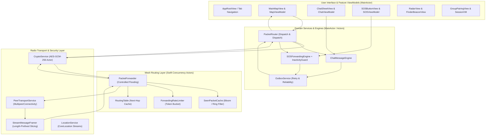

# TeeKum Code Handbook — Volume 00: Master Index & Architecture Blueprint

Welcome to the **TeeKum Code Handbook**. This series is an exhaustive, code-block by code-block technical breakdown of the entire TeeKum codebase. It is written specifically for junior iOS developers who want to master production-grade offline mesh networking, modern Swift concurrency (`actor`, `@MainActor`, `Sendable`), and high-performance SwiftUI architecture.

---

## 🗺️ Master Navigation Index

| Volume | Title | Scope & Subsystems | Target Files |
| :---: | :--- | :--- | :---: |
| **[00](file:///Users/nicho/Developer/TeeKum%20Prototype/docs/handbook/00_index_and_architecture.md)** | **Master Index & Architecture Blueprint** | Global architecture, data pipelines, reading paths | Master Guide |
| **[01](file:///Users/nicho/Developer/TeeKum%20Prototype/docs/handbook/01_app_lifecycle.md)** | **App Lifecycle & Root Navigation** | `@main`, dependency injection container, global overlays, toasts | 4 files |
| **[02](file:///Users/nicho/Developer/TeeKum%20Prototype/docs/handbook/02_models_and_wire_types.md)** | **Wire Protocol & Domain Models** | 56-byte wire packets, headers, flags, 7 payload models, sessions | 26 files |
| **[03](file:///Users/nicho/Developer/TeeKum%20Prototype/docs/handbook/03_transport_and_security.md)** | **Transport & Cryptography Engines** | MultipeerConnectivity, stream framing, AES-GCM-256 actor isolation | 6 files |
| **[04](file:///Users/nicho/Developer/TeeKum%20Prototype/docs/handbook/04_mesh_routing_engine.md)** | **Mesh Routing & Packet Forwarding** | Controlled flooding, reverse-path learning, rate limiters, neighbor tables | 9 files |
| **[05](file:///Users/nicho/Developer/TeeKum%20Prototype/docs/handbook/05_messaging_and_codecs.md)** | **Messaging Pipeline & Codecs** | Packet router, outbox reliability, binary byte serializers/deserializers | 15 files |
| **[06](file:///Users/nicho/Developer/TeeKum%20Prototype/docs/handbook/06_location_and_live_activity.md)** | **Location & Background Services** | CoreLocation async streams, compass heading, ActivityKit Dynamic Island | 5 files |
| **[07](file:///Users/nicho/Developer/TeeKum%20Prototype/docs/handbook/07_feature_sos.md)** | **Feature — SOS & Inactivity Guard** | Emergency alert broadcasting, audio synthesis, Dead Man's Switch | 7 files |
| **[08](file:///Users/nicho/Developer/TeeKum%20Prototype/docs/handbook/08_feature_chat.md)** | **Feature — Offline P2P Chat** | 30-byte text packing, byte meter, delivery ACK receipts, UI sheets | 7 files |
| **[09](file:///Users/nicho/Developer/TeeKum%20Prototype/docs/handbook/09_feature_map.md)** | **Feature — Main Map & Spatial Awareness** | MapKit SwiftUI integration, friend annotations, heading cones | 6 files |
| **[10](file:///Users/nicho/Developer/TeeKum%20Prototype/docs/handbook/10_feature_finder.md)** | **Feature — Precision Finder & Radar** | Polar coordinate projections, Metal `.drawingGroup()`, distance cards | 7 files |
| **[11](file:///Users/nicho/Developer/TeeKum%20Prototype/docs/handbook/11_feature_pairing_and_meeting.md)** | **Feature — Pairing & Meeting Points** | QR code rendezvous, ephemeral keys, shared meeting point beacons | 10 files |
| **[12](file:///Users/nicho/Developer/TeeKum%20Prototype/docs/handbook/12_feature_diagnostics.md)** | **Feature — Mesh Diagnostics & Simulation** | Real-time topology inspector, network simulator, packet loss tools | 5 files |
| **[13](file:///Users/nicho/Developer/TeeKum%20Prototype/docs/handbook/13_automated_testing_and_verification.md)** | **Automated Testing & Verification** | 18 test suites (208 tests), actor testing patterns, mock transports | 18 test suites |

---

## 🏛️ High-Level System Architecture

---

## 🧭 How to Read This Handbook Series

Depending on your engineering goal, follow one of these three reading tracks:

### Track A: The "Wire to UI" Bottom-Up Track (Recommended for Systems & Protocol Engineers)
1. Read **Volume 02 (Models & Wire Types)** to master the exact binary structure of the 56-byte packet.
2. Read **Volume 03 (Transport & Security)** to understand how Apple Wireless Direct Link (AWDL) and AES-GCM encryption operate.
3. Read **Volume 04 (Mesh Routing Engine)** to see how packets hop across intermediate nodes without internet.
4. Read **Volume 05 (Messaging & Codecs)** to see how raw bytes turn into strongly typed Swift events.
5. Finish with **Volumes 07–12** to see how features display that data to users.

### Track B: The "UI to Radio" Top-Down Track (Recommended for Frontend & Product Engineers)
1. Read **Volume 01 (App Lifecycle & Root Navigation)** to understand how dependencies are wired at startup.
2. Jump to your feature of interest: **Volume 07 (SOS)**, **Volume 08 (Chat)**, **Volume 09 (Map)**, or **Volume 10 (Radar)**.
3. Read the underlying engines and view models to see how UI gestures trigger background mesh broadcasts.

### Track C: The Verification & QA Track (Recommended for Test Engineers & Code Reviewers)
1. Read **Volume 13 (Automated Testing & Verification)** to understand the testing philosophy, mocks, and test helpers.
2. Cross-reference specific unit tests with their corresponding domain volumes.

---

## 📐 Universal Coding Patterns Used Throughout TeeKum

Every single line of code in TeeKum was engineered against four strict technical guidelines:

1. **Zero Unchecked Mutable State**: Every mutable shared resource is either isolated inside a Swift `actor` (e.g., [`CryptoService`](file:///Users/nicho/Developer/TeeKum%20Prototype/TeeKum/Core/Security/CryptoService.swift), [`SeenPacketCache`](file:///Users/nicho/Developer/TeeKum%20Prototype/TeeKum/Core/Mesh/SeenPacketCache.swift)) or pinned strictly to the `@MainActor` for UI binding.
2. **Deterministic Memory Management**: No strong reference cycles between parent views and services. Closures capturing `self` in long-lived async tasks or timer streams always specify `[weak self]`.
3. **Guaranteed Wire Bounds**: All outgoing payloads are strictly packed into at most 30 bytes, producing a 56-byte wire datagram that fits in a single unfragmented radio packet.
4. **Resilient Failure Fallbacks**: If GPS heading is unavailable, the UI gracefully degrades to Course (movement vector). If a direct peer is lost, the mesh falls back to multi-hop relay.

Proceed directly to **[Volume 01: App Lifecycle & Root Navigation](file:///Users/nicho/Developer/TeeKum%20Prototype/docs/handbook/01_app_lifecycle.md)**.
