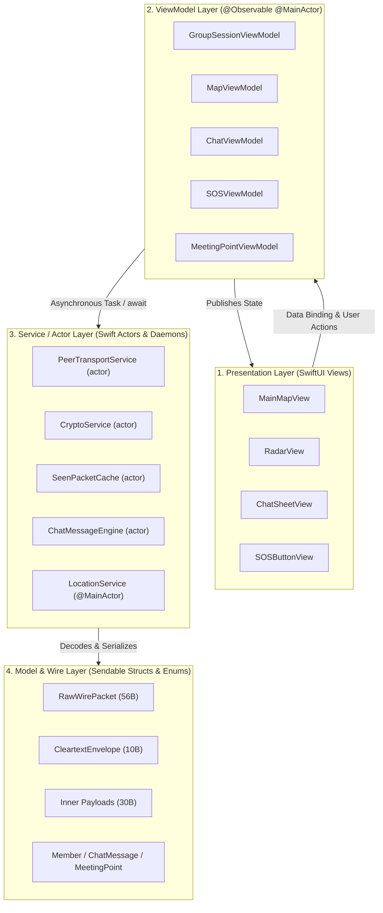

# TeeKum — Engineering Development Guidelines & Architectural Standards

> **Document Status:** Authoritative Development Guidelines & Architectural Standards `[VERIFIED]`  
> **Target Audience:** Systems Engineers, iOS Developers, and AI Autonomous Coding Agents `[VERIFIED]`  
> **Last Verified Date:** 2026-11-04 `[VERIFIED]`  
> **Applicable Targets:** `TeeKum Prototype` (iOS App Target), `TeeKumWidgets` (ActivityKit Extension Target) `[VERIFIED]`  
> **Test Baseline:** 18 Test Suites / 220 Unit & Integration Tests (100% Pass Rate) `[VERIFIED]`  
> **Governing Specifications:**
> - [Master Agent Instructions (docs/agent.md)](file:///Users/nicho/Developer/TeeKum%20Prototype/docs/agent.md) `[VERIFIED]`
> - [Technical Requirements Document (docs/TechnicalRequirements.md)](file:///Users/nicho/Developer/TeeKum%20Prototype/docs/TechnicalRequirements.md) `[VERIFIED]`
> - [Master Configuration Repository (TeeKumConfiguration.swift)](file:///Users/nicho/Developer/TeeKum%20Prototype/TeeKum%20Prototype/Models/TeeKumConfiguration.swift) `[VERIFIED]`
> - [Architectural Decision Records (ARCHITECTURAL_DECISIONS.md)](file:///Users/nicho/Developer/TeeKum%20Prototype/docs/knowledge_transfer/ARCHITECTURAL_DECISIONS.md) `[VERIFIED]`

---

## Technical Statement Classification & Standards Taxonomy

### 1. Epistemological Classification Taxonomy
Every technical assertion in this document is tagged according to the project's standardized five-tier taxonomy:
- **`[VERIFIED]`**: Confirmed by direct inspection of current source code and execution of automated regression suites `[VERIFIED]`.
- **`[DOCUMENTED]`**: Described in project architecture documents or specifications but not currently present in source code `[DOCUMENTED]`.
- **`[PLANNED]`**: Approved architectural capability scheduled for near-term implementation `[PLANNED]`.
- **`[PROPOSED]`**: Suggested architectural direction or optimization not yet formally approved `[PROPOSED]`.
- **`[UNKNOWN]`**: Behavior or property that cannot currently be established from code or documentation `[UNKNOWN]`.

### 2. Distinction Between Established and Recommended Conventions
To ensure clarity during implementation and code review, this document strictly differentiates between two classes of engineering rules:
- **ESTABLISHED CONVENTIONS:** Immutable, non-negotiable rules currently codified in source code, enforced by the Swift compiler, validated by automated test suites, or mandated by approved architectural invariants. Violating an established convention constitutes a regression and will block merging `[VERIFIED]`.
- **RECOMMENDED CONVENTIONS:** Professional best practices, architectural design patterns, and forward-looking guidelines recommended for codebase scalability, maintainability, and code hygiene, but not enforced by compiler errors or test failures `[DOCUMENTED]`.

---

## 1. Mandatory Repository Exploration & Pre-Implementation Inspection

> [!IMPORTANT]
> **MANDATORY INSTRUCTION FOR ALL DEVELOPERS AND AI AGENTS:**  
> Before creating any new service, view model, utility struct, enum, protocol, or abstraction, you **MUST** thoroughly inspect existing implementations in the repository `[VERIFIED]`.

### 1.1 The Pre-Implementation Inspection Rule
Creating duplicate abstractions, redundant service classes, or parallel configuration constants is strictly prohibited `[VERIFIED]`. In past iterations, well-intentioned changes inadvertently introduced architectural duplicates:
1. *Configuration Duplication:* `MeshTimingConfiguration` and `CadenceConfiguration` were created despite [`TeeKumConfiguration.Timing`](file:///Users/nicho/Developer/TeeKum%20Prototype/TeeKum%20Prototype/Models/TeeKumConfiguration.swift) existing as the single source of truth.
2. *Deduplication Cache Duplication:* An ad-hoc `Set<String>` (`relayedPacketCache`) was added to `TeeKumApp.swift`, bypassing the actor-isolated [`SeenPacketCache`](file:///Users/nicho/Developer/TeeKum%20Prototype/TeeKum%20Prototype/Services/SeenPacketCache.swift).
3. *Outbox Loop Duplication:* `SOSViewModel` reimplemented queue dispatch logic that was already encapsulated in [`SOSForwardingEngine`](file:///Users/nicho/Developer/TeeKum%20Prototype/TeeKum%20Prototype/Services/SOSForwardingEngine.swift).
4. *Abandoned Protocols:* `SessionStorageProtocol.swift` was authored for SQLite crash recovery but never implemented or wired to any caller.

### 1.2 Mandatory 4-Step Exploration Protocol
Before writing a single line of new production code:
1. **Search Existing Services:** Execute `git grep` or symbol search across [`TeeKum Prototype/Services/`](file:///Users/nicho/Developer/TeeKum%20Prototype/TeeKum%20Prototype/Services/) to confirm no existing actor or class already provides the required capability `[VERIFIED]`.
2. **Check Master Configuration:** Inspect [`TeeKumConfiguration.swift`](file:///Users/nicho/Developer/TeeKum%20Prototype/TeeKum%20Prototype/Models/TeeKumConfiguration.swift) before introducing any new timeout, threshold, buffer size, cadence interval, or hop limit `[VERIFIED]`.
3. **Inspect Models & Codecs:** Check [`TeeKum Prototype/Models/`](file:///Users/nicho/Developer/TeeKum%20Prototype/TeeKum%20Prototype/Models/) for existing payload layouts, coordinate quantizers, and radix codecs before creating new data structures `[VERIFIED]`.
4. **Review Test Harnesses:** Check [`TeeKum Prototype/Tests/`](file:///Users/nicho/Developer/TeeKum%20Prototype/TeeKum%20Prototype/Tests/) to examine existing test mocks (`SimulatedMeshTransport`, `TestMeshClock`) before building custom test fixtures `[VERIFIED]`.

---

## 2. General Swift Coding Conventions

TeeKum is authored in modern Swift (Swift 5.9 / Swift 6 language mode compatibility) targeting iOS 17.0+ `[VERIFIED]`.

### 2.1 Immutability by Default
- **Established Convention:** Declare all properties, parameters, and local variables as `let` unless local in-place mutation is strictly necessary `[VERIFIED]`.
- **Established Convention:** Domain models, packet representations, and coordinate structures must be immutable value types (`struct` or `enum`) conforming to `Sendable` `[VERIFIED]`.
- **Recommended Convention:** When modifying collection state or model properties, prefer returning a new instance with mutated fields over in-place mutation where practical.

### 2.2 Strong Typing & Zero-Tolerance for Unsafe Operators
- **Established Convention (Zero Force-Unwraps):** The force-unwrap operator `!` is strictly prohibited on optionals in production code `[VERIFIED]`. Use `guard let`, `if let`, optional chaining (`?.`), or explicit nil-coalescing (`??`) `[VERIFIED]`.
- **Established Convention (Zero Force-Casts):** Force-casting (`as!`) is strictly prohibited in production code `[VERIFIED]`. Use conditional type casting `as?` with defensive fallback handling `[VERIFIED]`.
- **Established Convention (Zero Unhandled Throws):** Using `try!` is forbidden in production code `[VERIFIED]`. All throwing operations (e.g. packet decoding, cryptographic sealing, JSON parsing) must be handled inside `do { try ... } catch { ... }` blocks or safely converted to an optional via `try?` where failure is non-fatal `[VERIFIED]`.
- **Established Convention:** Force-unwraps and `try!` are permissible **only** in unit test files where an unexpected failure must halt test execution immediately `[VERIFIED]`.

```swift
// [VERIFIED] Compliant Swift Optional & Error Handling in TeeKum
guard let rawPacket = try? RawWirePacket.fromWireData(inboundBuffer) else {
    logger.warning("Dropped malformed wire packet of size \(inboundBuffer.count) bytes")
    return
}

guard let member = members.first(where: { $0.id == rawPacket.envelope.senderSlot }) else {
    logger.debug("Received packet from unknown member slot \(rawPacket.envelope.senderSlot)")
    return
}
```

### 2.3 Explicit Access Control Discipline
- **Established Convention:** Every declaration must explicitly specify its access control modifier `[VERIFIED]`:
  - `public`: Required for models, wire codecs, configuration knobs, and service protocols consumed across multiple modules, targets, or test suites `[VERIFIED]`.
  - `internal`: Default for intra-module helpers, view models, and utility extensions `[VERIFIED]`.
  - `private` / `fileprivate`: Mandatory for all mutable state variables, encryption keys, raw network connections, and helper methods internal to a class or actor `[VERIFIED]`.
- **Recommended Convention:** Declare classes as `final` by default to prevent unintended subclassing and enable compiler devirtualization optimizations.

### 2.4 Zero External Dependencies Rule
- **Established Convention:** The codebase possesses **zero external third-party dependencies** (0 CocoaPods, 0 Carthage frameworks, 0 Swift Package Manager packages) `[VERIFIED]`.
- **Established Convention:** Every subsystem is implemented exclusively using official Apple native system frameworks:
  - `SwiftUI`: Declarative UI layout and state binding `[VERIFIED]`.
  - `Network.framework`: AWDL Bonjour discovery (`_teekum._tcp`), NWBrowser, NWListener, and NWConnection `[VERIFIED]`.
  - `CryptoKit`: Hardware-accelerated ChaCha20-Poly1305 AEAD symmetric authenticated encryption `[VERIFIED]`.
  - `CoreLocation`: Dual-frequency L1/L5 GNSS satellite positioning and heading callbacks `[VERIFIED]`.
  - `CoreMotion`: `CMMotionActivityManager` motion classification and `CMAltimeter` barometry `[VERIFIED]`.
  - `NearbyInteraction`: Ultra-Wideband (UWB) spatial ranging via Apple U1/U2 silicon `[VERIFIED]`.
  - `ActivityKit`: Dynamic Island and Lock Screen Live Activity background state updates `[VERIFIED]`.
  - `AVFoundation`: Low-latency emergency siren synthesis and QR barcode scanning `[VERIFIED]`.
  - `Security`: Ephemeral 256-bit symmetric session key storage in iOS Keychain `[VERIFIED]`.
- **Recommended Convention:** When evaluating a new capability, explore native system APIs first before proposing an external dependency. Introducing any third-party package requires formal architectural review and exception approval.

---

## 3. Swift and SwiftUI Conventions

### 3.1 Declarative View Architecture
- **Established Convention:** All user interface screens must be built using native declarative SwiftUI views `[VERIFIED]`. UIKit view controllers and coordinators (`UIViewController`, `UINavigationControllerDelegate`) are prohibited `[VERIFIED]`.
- **Established Convention:** View presentation and navigation flows are governed directly by SwiftUI state modifiers: `.sheet`, `.fullScreenCover`, and declarative `NavigationStack` path bindings `[VERIFIED]`.
- **Established Convention:** View bodies (`var body: some View`) must remain strictly computational and side-effect free. Views must never perform synchronous disk I/O, heavy cryptographic hashing, or packet serialization directly within body computation `[VERIFIED]`.
- **Recommended Convention:** Extract complex view hierarchies into small, reusable subviews to optimize SwiftUI view diffing performance and readability. Use `@ViewBuilder` for composable sub-elements.

### 3.2 Modern Swift Observation (`@Observable`)
- **Established Convention:** All ViewModels must use Swift 5.9+'s native `@Observable` macro `[VERIFIED]`.
- **Established Convention:** Legacy Combine paradigms (`ObservableObject`, `@Published`, `PassthroughSubject`, `Set<AnyCancellable>`) are prohibited in the presentation layer `[VERIFIED]`.
- **Established Convention:** All ViewModels must be decorated with `@MainActor` to guarantee that all UI property mutations occur synchronously on the main thread `[VERIFIED]`.

### 3.3 Visual Theme & Outdoor Concert Usability
- **Established Convention:** TeeKum enforces an AMOLED true-black theme (`#000000` background) across all screens `[VERIFIED]`. This maximizes outdoor battery efficiency on OLED displays and prevents visual eye-strain in dark festival grounds `[VERIFIED]`.
- **Established Convention:** UI accents utilize high-contrast neon colors to guarantee readability in dark concert environments and bright outdoor sunlight:
  - Cyan (`#00F0FF`): Primary interactive elements, radar grid, and active tracking paths `[VERIFIED]`.
  - Neon Green (`#39FF14`): Successful connection states, active live sharing, and verified delivery ACKs `[VERIFIED]`.
  - Neon Pink / Red (`#FF0055`): Urgent emergency SOS alerts, warnings, and error banners `[VERIFIED]`.
  - Amber / Yellow (`#FFD700`): Stale peers, waiting states, and unconfirmed relay hops `[VERIFIED]`.
- **Recommended Convention:** Design all interactive touch targets with a minimum dimension of $44 \times 44$ points to ensure effortless one-handed tapping in crowded, high-movement festival crowds.

---

## 4. MVVM Architectural Responsibilities

The codebase enforces a strict four-layer separation of concerns:



### 4.1 Views (SwiftUI)
- **Responsibilities:** Layout rendering, visual state styling, animation transitions, user gesture capture `[VERIFIED]`.
- **Restrictions:** Zero business logic; zero direct instantiation of radio sockets; zero cryptographic operations; zero direct access to database or Keychain `[VERIFIED]`.

### 4.2 ViewModels (`@Observable @MainActor`)
- **Responsibilities:** Transform domain entities into display-ready strings, colors, and formatters; capture user actions and delegate them to background services; manage local UI presentation state (sheets, dialogs, active tabs) `[VERIFIED]`.
- **Restrictions:** Must not maintain low-level radio sockets (`NWListener`/`NWConnection`); must not perform synchronous heavy computation; must not bypass actors when mutating shared state `[VERIFIED]`.

### 4.3 Services / Actors (Background Core)
- **Responsibilities:** Manage hardware sensors (`CoreLocation`, `CoreMotion`, `NearbyInteraction`), radio sockets (`Network.framework`), encryption/decryption pipelines (`CryptoKit`), packet queues, routing tables, and deduplication caches `[VERIFIED]`.
- **Restrictions:** Must not import SwiftUI; must not directly mutate UI presentation state; must operate within actor isolation or designated thread boundaries `[VERIFIED]`.

### 4.4 Models & Codecs (Pure Domain & Wire Standard)
- **Responsibilities:** Pure, immutable representation of wire datagrams, geographic fixes, rendezvous points, and chat messages; binary serialization and deserialization; coordinate quantization `[VERIFIED]`.
- **Restrictions:** Must be immutable value types (`struct` or `enum`); must strictly conform to `Sendable`; must contain zero business logic or network side effects `[VERIFIED]`.

---

## 5. Concurrency and Actor-Isolation Requirements

### 5.1 Architectural Thread Boundary Model
TeeKum operates in a multi-threaded, asynchronous real-time environment where radio socket callbacks, GNSS ticks, motion coprocessor updates, and user UI interactions occur concurrently `[VERIFIED]`.

- **`@MainActor` Domain:** All SwiftUI views, ViewModels, and sensor lifecycle managers (`LocationService`) reside on `@MainActor` `[VERIFIED]`.
- **Background `actor` Domain:** All services handling shared mutable state, radio buffers, cryptographic pipelines, and routing tables must be implemented as Swift `actor`s `[VERIFIED]`:
  - [`SeenPacketCache`](file:///Users/nicho/Developer/TeeKum%20Prototype/TeeKum%20Prototype/Services/SeenPacketCache.swift)
  - [`PeerTransportService`](file:///Users/nicho/Developer/TeeKum%20Prototype/TeeKum%20Prototype/Services/PeerTransportService.swift)
  - [`CryptoService`](file:///Users/nicho/Developer/TeeKum%20Prototype/TeeKum%20Prototype/Services/CryptoService.swift)
  - [`ChatMessageEngine`](file:///Users/nicho/Developer/TeeKum%20Prototype/TeeKum%20Prototype/Services/ChatMessageEngine.swift)
  - [`SOSForwardingEngine`](file:///Users/nicho/Developer/TeeKum%20Prototype/TeeKum%20Prototype/Services/SOSForwardingEngine.swift)
  - [`NeighborTable`](file:///Users/nicho/Developer/TeeKum%20Prototype/TeeKum%20Prototype/Services/NeighborTable.swift)
  - [`RoutingTable`](file:///Users/nicho/Developer/TeeKum%20Prototype/TeeKum%20Prototype/Services/RoutingTable.swift)
  - [`RouteDiscoveryService`](file:///Users/nicho/Developer/TeeKum%20Prototype/TeeKum%20Prototype/Services/RouteDiscoveryService.swift)
  - [`ForwardingRateLimiter`](file:///Users/nicho/Developer/TeeKum%20Prototype/TeeKum%20Prototype/Services/ForwardingRateLimiter.swift)
  - [`PacketForwarder`](file:///Users/nicho/Developer/TeeKum%20Prototype/TeeKum%20Prototype/Services/PacketForwarder.swift)
  - [`RelayPolicyManager`](file:///Users/nicho/Developer/TeeKum%20Prototype/TeeKum%20Prototype/Services/RelayPolicyManager.swift)

### 5.2 Concurrency Bridging via `SessionHolder`
- **Established Convention:** Accessing the active [`GroupSession`](file:///Users/nicho/Developer/TeeKum%20Prototype/TeeKum%20Prototype/Models/GroupSession.swift) across deep background actor boundaries without crossing asynchronous `await` hops is resolved cleanly through [`SessionHolder`](file:///Users/nicho/Developer/TeeKum%20Prototype/TeeKum%20Prototype/App/TeeKumApp.swift#L14-L34) `[VERIFIED]`.
- **Established Convention:** `SessionHolder` is declared as `public final class SessionHolder: @unchecked Sendable` and guarded internally by an `NSLock`, providing thread-safe synchronous getters and setters across background radio actors `[VERIFIED]`.

### 5.3 Pure Value Types and `Sendable` Conformance
- **Established Convention:** Every entity passing across actor boundaries or transmitted over the wire must conform strictly to `Sendable` `[VERIFIED]`.
- **Established Convention:** Using classes for data transfer objects or domain models is strictly prohibited; all models must be immutable `struct`s or `enum`s `[VERIFIED]`.

### 5.4 Structured Concurrency & Task Cancellation
- **Established Convention:** Never instantiate unmanaged detached tasks (`Task.detached`) `[VERIFIED]`.
- **Established Convention:** Always retain references to asynchronous lifecycle loops (`Task<Void, Never>?`) and explicitly cancel them upon view dismissal or session teardown via `.cancel()` `[VERIFIED]`.
- **Established Convention:** Long-running loops must periodically check `Task.isCancelled` to terminate promptly upon cancellation `[VERIFIED]`.

---

## 6. Error Handling Architecture

### 6.1 Strongly-Typed Error Enums
- **Established Convention:** All recoverable error conditions must be represented as strongly typed Swift `Error` enums `[VERIFIED]`:
  - `PacketCodecError`: Malformed sizes, invalid versions, coordinate out-of-bounds, radix encoding failures `[VERIFIED]`.
  - `CryptoError`: Key generation failures, Poly1305 MAC tag verification failures, Keychain access errors `[VERIFIED]`.
  - `TransportError`: Socket connection drops, AWDL interface unavailability, send timeouts `[VERIFIED]`.
  - `RouteDiscoveryError`: AODV discovery timeouts, unreachable destination peers `[VERIFIED]`.
  - `InactivityGuardError`: Accelerometer hardware unavailable, permission denied `[VERIFIED]`.

### 6.2 Defensive Radio Ingestion & Graceful Degradation
- **Established Convention:** Inbound radio packet parsing must be totally defensive. Corrupted, tampered, or oversized datagrams must be discarded cleanly with a diagnostic log entry, **never** crashing the host process `[VERIFIED]`.
- **Established Convention:** Silent failure (`catch {}` without logging or telemetry) is strictly prohibited in production code `[VERIFIED]`. All caught errors must either be surfaced to the user via UI state or logged via `Logger` / `MeshDiagnosticsCollector` `[VERIFIED]`.

---

## 7. Networking Rules

### 7.1 Native Apple Transport Only
- **Established Convention:** All peer-to-peer radio networking must use Apple's native `Network.framework` (`NWListener` and `NWConnection`) configured with `includePeerToPeer = true` under Bonjour service `_teekum._tcp` `[VERIFIED]`. Third-party networking libraries are prohibited `[VERIFIED]`.

### 7.2 Strict 56-Byte Datagram Discipline
- **Established Convention:** Every packet transmitted over the network is bit-for-bit **strictly 56 bytes** (`PacketConstants.wirePacketSize == 56`) `[VERIFIED]`. Any incoming buffer not equal to 56 bytes must be rejected immediately at the stream framer `[VERIFIED]`.

### 7.3 Zero-Knowledge Communal Forwarding
- **Established Convention:** Intermediate stranger relays must inspect only the 10-byte cleartext envelope. Relays treat the remaining 46 bytes as an opaque cryptographic payload and make zero attempts to decrypt or inspect content `[VERIFIED]`.
- **Established Convention:** Forwarding a stranger packet must never mutate local application state (no pin updates, no alarms, no logs) `[VERIFIED]`.

### 7.4 Traffic Shaping & Rate Limiting
- **Established Convention:** All outbound forwarding must pass through [`ForwardingRateLimiter`](file:///Users/nicho/Developer/TeeKum%20Prototype/TeeKum%20Prototype/Services/ForwardingRateLimiter.swift) `[VERIFIED]`:
  - Ordinary relay budget: capped at **2.0 packets/second** (token capacity 4.0) `[VERIFIED]`.
  - Urgent SOS reserve: capped at **4.0 packets/second** (token capacity 8.0) `[VERIFIED]`.
  - Location ping coalescing: newer GPS fixes immediately overwrite unsent older fixes in the queue `[VERIFIED]`.

### 7.5 Hop Limits & Flood Ceilings
- **Established Convention:** Packets must enforce strict hop limits based on packet type:
  - Routine location telemetry (`0x01`): max **8 hops** `[VERIFIED]`.
  - Emergency SOS (`0x02`): max **15 hops** `[VERIFIED]`.
  - Group rendezvous (`0x03`): max **15 hops** `[VERIFIED]`.
  - Route discovery (`0x04` / `0x05`): max **8 hops** `[VERIFIED]`.
  - Delivery ACKs (`0x06`): max **8 hops** `[VERIFIED]`.
  - Group mesh chat (`0x07`): max **8 hops** `[VERIFIED]`.
  - UWB token exchange (`0x08`): strictly **1 hop** (never relayed) `[VERIFIED]`.

---

## 8. Cryptographic Restrictions

### 8.1 First-Party `CryptoKit` Only
- **Established Convention:** All authenticated encryption must use Apple `CryptoKit.ChaChaPoly` (RFC 8439 ChaCha20-Poly1305) `[VERIFIED]`. Custom cryptographic primitives and third-party crypto libraries are strictly prohibited `[VERIFIED]`.

### 8.2 Nonce Derivation Mathematics
- **Established Convention:** 96-bit AEAD nonces must be derived deterministically via [`CleartextEnvelope.constructNonce()`](file:///Users/nicho/Developer/TeeKum%20Prototype/TeeKum%20Prototype/Models/Packet.swift#L301-L320) `[VERIFIED]`:
  $$\text{Nonce} = \mathtt{sessionId} \, [3\text{B}] \, \parallel \, \mathtt{sequenceNumber} \, [4\text{B}] \, \parallel \, \mathtt{versionAndType} \, [1\text{B}] \, \parallel \, \mathtt{"TKM3"} \, [4\text{B}]$$
- **Established Convention:** The 32-bit `sequenceNumber` must partition its high 8 bits to `memberSlot` ($0\dots 7$), mathematically guaranteeing disjoint nonce spaces across all group members `[VERIFIED]`.

### 8.3 Envelope AAD Masking Invariant
- **Established Convention:** Poly1305 authentication tags authenticate the 10-byte cleartext envelope as Additional Authenticated Data (AAD) `[VERIFIED]`. Because intermediate relays must increment `hopCount`, Byte 2 (`hopCount`) **MUST be masked to `0x00`** during both sealing and verification `[VERIFIED]`. Modifying any other envelope field invalidates the MAC and drops the packet `[VERIFIED]`.

### 8.4 Ephemeral Key Management
- **Established Convention:** The 256-bit symmetric key must be generated via `SecRandomCopyBytes`, stored ephemerally in Keychain with accessibility `kSecAttrAccessibleAfterFirstUnlockThisDeviceOnly`, and purged with zeroes upon session teardown `[VERIFIED]`.
- **Established Convention:** Never write cryptographic keys or plaintext payload contents to console logs, disk files, or git commits `[VERIFIED]`.

---

## 9. Protocol Compatibility Requirements

### 9.1 Active Standard: Protocol Version 3 (56 Bytes)
- **Established Convention:** The authoritative over-the-air standard is Protocol Version 3 `[VERIFIED]`. The high nibble of Byte 0 must equal `0x03` `[VERIFIED]`.

### 9.2 Big-Endian Wire Endianness
- **Established Convention:** All multi-byte integers (`UInt16`, `UInt24`, `UInt32`, `Int32`) must be written and read in big-endian network byte order (`.bigEndian`) `[VERIFIED]`.

### 9.3 Coordinate & Heading Quantization
- **Established Convention:** Coordinates must be quantized to signed 32-bit `Int32`:
  $$\text{Int32} = \operatorname{round}(\text{degrees} \times 1{,}000{,}000.0)$$
  providing ~11 cm worldwide resolution `[VERIFIED]`.
- **Established Convention:** Compass heading must be quantized to a single byte:
  $$\text{UInt8} = \operatorname{round}(\text{degrees} \times 255.0 / 360.0)$$
  providing $1.41^\circ$ resolution `[VERIFIED]`.

### 9.4 Reserved Field Invariant
- **Established Convention:** All reserved padding bytes (e.g. Bytes 18..29 in `LocationPingPayload`, Bytes 27..29 in `ChatMessagePayload`) must be written as zero (`0x00`) during serialization `[VERIFIED]`. This preserves forward compatibility for planned extensions (such as differential barometry altimetry) `[VERIFIED]`.

---

## 10. Testing Expectations & Quality Gates

### 10.1 Active Test Baseline
The project maintains a verified baseline of **18 test suites / 220 automated unit and integration tests with a 100% pass rate** `[VERIFIED]`.

| Suite # | Test Suite Name | File Location | Tests | Focus Area |
| :---: | :--- | :--- | :---: | :--- |
| **1** | `PacketCodecTests` | [`PacketCodecTests.swift`](file:///Users/nicho/Developer/TeeKum%20Prototype/TeeKum%20Prototype/Tests/PacketCodecTests.swift) | 20 | 56B format, endianness, quantization, bounds `[VERIFIED]` |
| **2** | `PeerTransportTests` | [`PeerTransportTests.swift`](file:///Users/nicho/Developer/TeeKum%20Prototype/TeeKum%20Prototype/Tests/PeerTransportTests.swift) | 14 | Slicing, framing, priority outbox scheduling `[VERIFIED]` |
| **3** | `NeighborDiscoveryTests` | [`NeighborDiscoveryTests.swift`](file:///Users/nicho/Developer/TeeKum%20Prototype/TeeKum%20Prototype/Tests/NeighborDiscoveryTests.swift) | 13 | Bonjour discovery, TXT records, RSSI tracking `[VERIFIED]` |
| **4** | `RoutingForwardingTests` | [`RoutingForwardingTests.swift`](file:///Users/nicho/Developer/TeeKum%20Prototype/TeeKum%20Prototype/Tests/RoutingForwardingTests.swift) | 12 | Blind relay, 8-hop ceiling, deduplication `[VERIFIED]` |
| **5** | `RouteDiscoveryTests` | [`RouteDiscoveryTests.swift`](file:///Users/nicho/Developer/TeeKum%20Prototype/TeeKum%20Prototype/Tests/RouteDiscoveryTests.swift) | 14 | AODV RREQ/RREP, stale probing, response burst `[VERIFIED]` |
| **6** | `CryptoSecurityTests` | [`CryptoSecurityTests.swift`](file:///Users/nicho/Developer/TeeKum%20Prototype/TeeKum%20Prototype/Tests/CryptoSecurityTests.swift) | 13 | ChaChaPoly, AAD tamper detection, nonce safety `[VERIFIED]` |
| **7** | `LocationPublishingTests`| [`LocationPublishingTests.swift`](file:///Users/nicho/Developer/TeeKum%20Prototype/TeeKum%20Prototype/Tests/LocationPublishingTests.swift) | 15 | Adaptive cadence, dynamic GNSS accuracy `[VERIFIED]` |
| **8** | `UIStateTests` | [`UIStateTests.swift`](file:///Users/nicho/Developer/TeeKum%20Prototype/TeeKum%20Prototype/Tests/UIStateTests.swift) | 14 | MVVM `@Observable` bindings, Setter Lock Rule `[VERIFIED]` |
| **9** | `SOSEndToEndTests` | [`SOSEndToEndTests.swift`](file:///Users/nicho/Developer/TeeKum%20Prototype/TeeKum%20Prototype/Tests/SOSEndToEndTests.swift) | 11 | 3-second hold, siren alerts, honest delivery states `[VERIFIED]` |
| **10** | `MultiHopSOSTests` | [`MultiHopSOSTests.swift`](file:///Users/nicho/Developer/TeeKum%20Prototype/TeeKum%20Prototype/Tests/MultiHopSOSTests.swift) | 11 | Multi-hop flood propagation, reverse ACKs `[VERIFIED]` |
| **11** | `LiveActivityTests` | [`LiveActivityTests.swift`](file:///Users/nicho/Developer/TeeKum%20Prototype/TeeKum%20Prototype/Tests/LiveActivityTests.swift) | 6 | ActivityKit companion lifecycle & intents `[VERIFIED]` |
| **12** | `RelayPolicyTests` | [`RelayPolicyTests.swift`](file:///Users/nicho/Developer/TeeKum%20Prototype/TeeKum%20Prototype/Tests/RelayPolicyTests.swift) | 12 | Relay modes, 20% survival cutoff, compact gating `[VERIFIED]` |
| **13** | `MeshFailureIntegrationTests` | [`MeshFailureIntegrationTests.swift`](file:///Users/nicho/Developer/TeeKum%20Prototype/TeeKum%20Prototype/Tests/MeshFailureIntegrationTests.swift) | 12 | Partitions, link flapping, stream resync `[VERIFIED]` |
| **14** | `MeshDebuggerTests` | [`MeshDebuggerTests.swift`](file:///Users/nicho/Developer/TeeKum%20Prototype/TeeKum%20Prototype/Tests/MeshDebuggerTests.swift) | 10 | Triage engine, packet injection, virtual lab `[VERIFIED]` |
| **15** | `ChatMessagingEngineTests`| [`ChatMessagingEngineTests.swift`](file:///Users/nicho/Developer/TeeKum%20Prototype/TeeKum%20Prototype/Tests/ChatMessagingEngineTests.swift) | 16 | 20B UTF-8 chat, FIFO outbox, delivery ACKs `[VERIFIED]` |
| **16** | `ChatUITests` | [`ChatUITests.swift`](file:///Users/nicho/Developer/TeeKum%20Prototype/TeeKum%20Prototype/Tests/ChatUITests.swift) | 11 | Message bubbles, presets, byte limiter, badges `[VERIFIED]` |
| **17** | `InactivityGuardTests` | [`InactivityGuardTests.swift`](file:///Users/nicho/Developer/TeeKum%20Prototype/TeeKum%20Prototype/Tests/InactivityGuardTests.swift) | 9 | Man Down auto-SOS, 180s stillness, 30s pre-alarm `[VERIFIED]` |
| **18** | `NearbyInteractionTests` | [`NearbyInteractionTests.swift`](file:///Users/nicho/Developer/TeeKum%20Prototype/TeeKum%20Prototype/Tests/NearbyInteractionTests.swift) | 7 | UWB tokens, 12 chunks, sensor simulation fallback `[VERIFIED]` |
| **TOTAL** | **18 TEST SUITES** | — | **220** | **100% PASS RATE, 0 REGRESSIONS** `[VERIFIED]` |

### 10.2 Automated Test Execution Command
- **Established Convention:** Regression suites are executed directly on the booted iOS Simulator via `simctl` `[VERIFIED]`:
  ```bash
  xcrun simctl launch --console booted com.academy.teekum.TeeKum-Prototype -runAllTests -exitAfterTests
  ```

### 10.3 Deterministic Testing & Injected Clocks
- **Established Convention:** Time-dependent services must accept an injected `MeshClock` protocol or `DateProvider` closure `[VERIFIED]`. Relying on non-deterministic `Task.sleep` or real-world clock delays in unit tests is strictly prohibited `[VERIFIED]`.

### 10.4 Mandatory Quality Gates
No code changes may be merged without satisfying all four gates `[VERIFIED]`:
1. **Compilation Gate:** Clean Xcode compilation across both `TeeKum Prototype` and `TeeKumWidgets` targets with 0 errors `[VERIFIED]`.
2. **Regression Gate:** 100% pass rate across all 18 automated test suites (220/220 passed) `[VERIFIED]`.
3. **Wire Protocol Gate:** Any modified packet must strictly preserve the 56-byte wire invariant `[VERIFIED]`.
4. **Logging Gate:** Accompanying entry recorded in `docs/DEVELOPMENT_LOG.md` `[VERIFIED]`.

---

## 11. Documentation Expectations

- **Established Convention:** All technical documentation must classify assertions using the standardized five-tier taxonomy (`[VERIFIED]`, `[DOCUMENTED]`, `[PLANNED]`, `[PROPOSED]`, `[UNKNOWN]`) `[VERIFIED]`.
- **Established Convention:** Every referenced source file, test suite, and document must use clickable markdown links with the `file://` scheme and line numbers (e.g. [`LocationService.swift`](file:///Users/nicho/Developer/TeeKum%20Prototype/TeeKum%20Prototype/Services/LocationService.swift#L10-L20)) `[VERIFIED]`.
- **Established Convention:** All public types, initializers, methods, and configuration parameters must include standard Swift documentation comments (`///`) describing parameters, return values, and failure modes `[VERIFIED]`.
- **Recommended Convention:** When adding a new capability, update the corresponding ADR in `docs/knowledge_transfer/ARCHITECTURAL_DECISIONS.md` and feature entry in `docs/knowledge_transfer/FEATURE_STATUS.md`.

---

## 12. Development Logging Requirements

In accordance with Section 15 of [`docs/agent.md`](file:///Users/nicho/Developer/TeeKum%20Prototype/docs/agent.md), maintaining the chronological development ledger in [`docs/DEVELOPMENT_LOG.md`](file:///Users/nicho/Developer/TeeKum%20Prototype/docs/DEVELOPMENT_LOG.md) is a **non-negotiable engineering protocol** `[VERIFIED]`.

### 12.1 Mandatory Logging Triggers
An entry must be added to `docs/DEVELOPMENT_LOG.md` whenever:
- A new feature, subsystem, or architecture is planned or completed `[VERIFIED]`.
- A bug, defect, or regression is resolved `[VERIFIED]`.
- A protocol, wire format, or configuration constant is modified `[VERIFIED]`.
- A refactoring pass or dead-code cleanup is executed `[VERIFIED]`.

### 12.2 Standard Log Entry Template
New entries must be prepended directly under the main title block in reverse-chronological order using this exact template:

````markdown
### [YYYY-MM-DD HH:MM] — <Task / Feature / Fix Title>
- **Contributor / Agent:** <Role / Agent ID>
- **Status:** <Planned | In Progress | Completed | Blocked>
- **Target Phase / Milestone:** <e.g., Phase 3 — Tactical Radar & UWB>

#### 1. Objective & Scope
- Concise summary of the user requirement, bug report, or engineering task.

#### 2. Changes Made & Files Touched
- `path/to/ModifiedFile.swift`: Specific classes, methods, or structs altered.
- `path/to/NewFile.swift`: Purpose and public API of new additions.

#### 3. Key Decisions & Rationale
- Architectural trade-offs, memory implications, concurrency boundaries, or protocol byte alignments.

#### 4. Verification & Testing Performed
- Specific test suites executed and verified pass counts (e.g., `18 test suites / 220 tests passed`).
- Simulator device UUID, build configuration, or physical device validation notes.

#### 5. Open Items & Next Steps
- Concrete next steps or follow-ups for subsequent agents.
````

---

## 13. Git & Change-Management Expectations

The project operates under a structured Git branching strategy defined in Section 5 of [`docs/TechnicalRequirements.md`](file:///Users/nicho/Developer/TeeKum%20Prototype/docs/TechnicalRequirements.md) `[VERIFIED]`:

### 13.1 Branching Model
Development is restricted to **four branch types**:
- `main`: Stable release candidate, fully integrated and tested. **Protected** (PR only) `[VERIFIED]`.
- `develop`: Active integration branch for combining and testing features. **Protected** (PR only) `[VERIFIED]`.
- `prod`: Final production release code tagged for distribution. **Protected** (Designated Release PIC only) `[VERIFIED]`.
- `feat/*`: Feature development branch branched off `develop`. **Unprotected** (Feature developer) `[VERIFIED]`.

```text
develop → feat/feature-name → PR to develop → PR to main → PR to prod
```

### 13.2 Branch Naming & Commit Message Standards
- **Established Convention (Branch Naming):** `feat/feature-name`, lowercase with hyphens (*kebab-case*, e.g. `feat/inactivity-guard-watchdog`) `[VERIFIED]`.
- **Established Convention (Commit Message Format):** Conventional Commits format `type(scope): short description` `[VERIFIED]`:
  - `feat(scope):`: New feature or behavior (e.g. `feat(chat): add 20-byte mesh chat payload`).
  - `fix(scope):`: Bug fix or corrected behavior (e.g. `fix(packet): correct int32 coordinate quantization`).
  - `docs(scope):`: Documentation updates (e.g. `docs(adr): document setter lock rule`).
  - `refactor(scope):`: Code restructuring without functional changes (e.g. `refactor(crypto): consolidate nonce derivation`).
  - `chore(scope):`: Maintenance, build settings, or project configuration (e.g. `chore(xcode): update derived data path`).
  - `test(scope):`: Adding or improving tests (e.g. `test(radar): add polar clamping regression tests`).

### 13.3 Pull Request Acceptance Checklist (12-Point Review)
Before opening or merging a PR, evaluate the changeset against this 12-point principal review matrix `[VERIFIED]`:
1. *Dead Code Elimination:* Confirmed zero orphaned symbols or unused imports `[VERIFIED]`.
2. *Symbol Safety:* Deprecations leave zero broken call sites `[VERIFIED]`.
3. *Consolidation Integrity:* Duplicated logic consolidated into single source of truth `[VERIFIED]`.
4. *MVVM Architecture:* Pure MVVM boundaries preserved (`@Observable @MainActor`) without coordinators `[VERIFIED]`.
5. *Networking Fidelity:* AWDL peering and blind stranger forwarding fully functional `[VERIFIED]`.
6. *56-Byte Wire Invariant:* Wire format maintains exactly 56 bytes bit-for-bit `[VERIFIED]`.
7. *Cryptographic Security:* ChaCha20-Poly1305 AEAD, masked AAD, and deterministic nonces intact `[VERIFIED]`.
8. *SOS Preemption:* SOS triggers via 3-second hold and preempts normal queues `[VERIFIED]`.
9. *Feature Integrity:* Radar, Group Mesh Chat, Inactivity Guard, and UWB token exchange intact `[VERIFIED]`.
10. *Project References:* `project.pbxproj` builds cleanly with zero missing files `[VERIFIED]`.
11. *Verified Regression Suite:* 100% pass rate across all 18 test suites (220/220 passed) `[VERIFIED]`.
12. *Documentation & Logging:* Fully logged in `DEVELOPMENT_LOG.md` and related specs `[VERIFIED]`.

---

## 14. Rules for Modifying Protected Architecture

### 14.1 Definition of Protected Areas & Invariants
The following eight subsystems and specifications are **STRICTLY PROTECTED** and represent non-negotiable architectural invariants `[VERIFIED]`:
1. **Fixed 56-Byte Wire Datagram Format:** Exactly 10B envelope + 30B ciphertext + 16B MAC tag `[VERIFIED]`.
2. **Cryptographic Primitives & Envelope AAD Hop Masking:** ChaCha20-Poly1305 AEAD with Byte 2 (`hopCount`) masked to `0x00` in AAD `[VERIFIED]`.
3. **2-Byte Base-27 Initials Codec:** Radix encoding packing 18,278 combinations into `UInt16` `[VERIFIED]`.
4. **Signed 32-Bit Coordinate Quantization:** Fixed multiplier $\times 1{,}000{,}000.0$ for ~11 cm spatial precision `[VERIFIED]`.
5. **Emergency SOS Delivery Guarantees:** 3-second hold trigger, urgent outbox preemption, and honest 5-state delivery UX `[VERIFIED]`.
6. **Festival Battery & Survival Policy:** Hard 20% cutoff terminating stranger relaying, stationary GPS power-down `[VERIFIED]`.
7. **Single Active Meeting Point Rule:** Authoritative Setter Lock rule (strictly one rendezvous spot) `[VERIFIED]`.
8. **Phase 3 Planned Infrastructure:** 12-byte contiguous reserved block (Bytes 18..29 in `LocationPingPayload`) reserved for differential barometry; tethered Apple Watch companion architecture (`WCSession`) `[VERIFIED]`.

### 14.2 Protected Architecture Change Protocol
Any modification to a protected area or invariant requires:
1. **Formal Architectural Review:** Documented trade-off analysis submitted for Senior Architect approval (e.g. `/grill-me` alignment session) `[VERIFIED]`.
2. **Wire Compatibility Plan:** If modifying over-the-air datagrams, provide a formal protocol version bump and migration strategy `[VERIFIED]`.
3. **Comprehensive Regression Proof:** All 18 automated test suites must be updated and pass with 100% success rate `[VERIFIED]`.
4. **ADR & Log Record:** An accompanying Architectural Decision Record must be added to `ARCHITECTURAL_DECISIONS.md`, and a detailed entry prepended to `DEVELOPMENT_LOG.md` `[VERIFIED]`.
