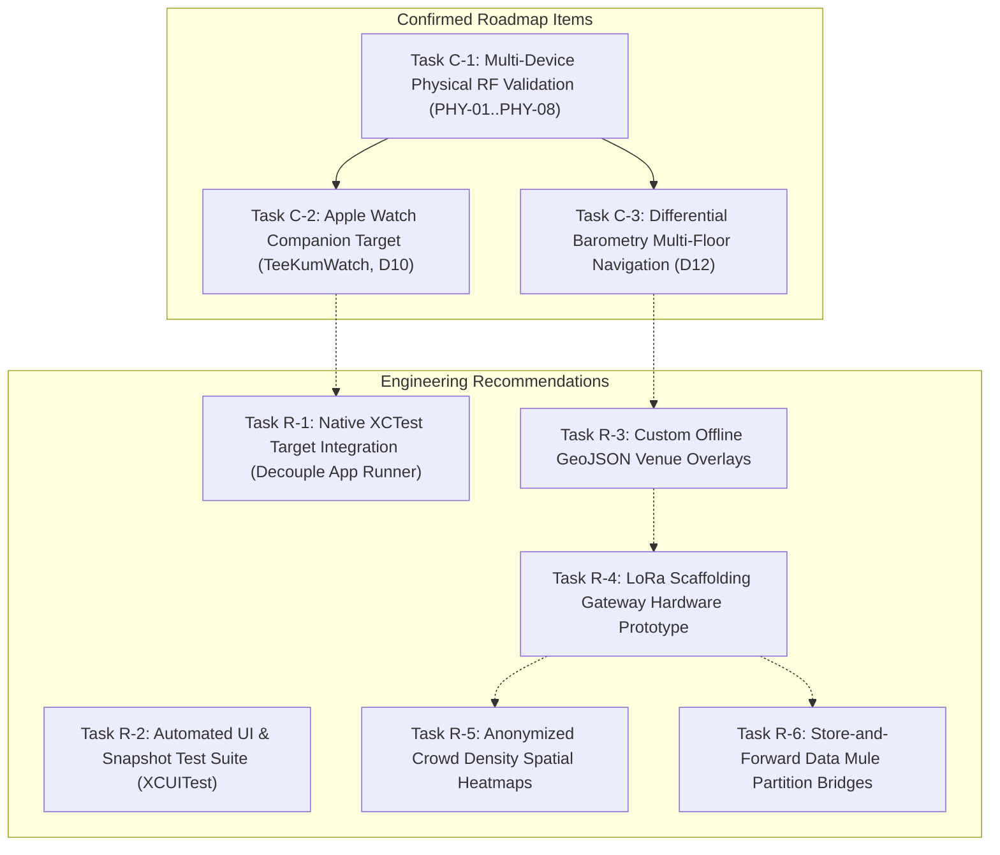
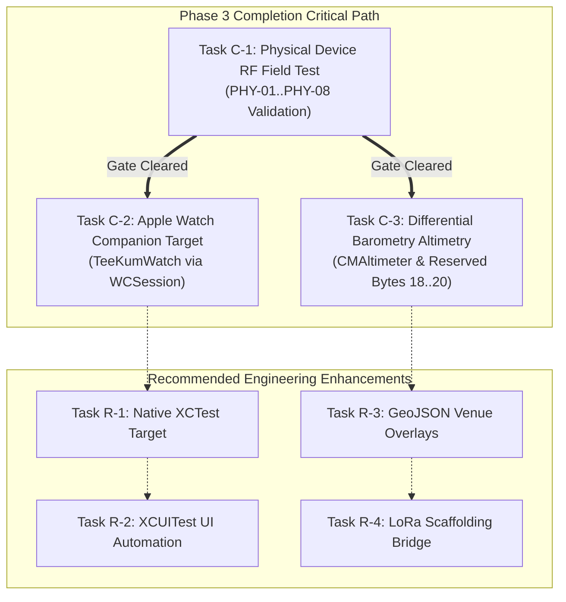

# TeeKum iOS — Engineering Development Roadmap & Milestone Progress

> **Document Type:** Authoritative Technical Product Architecture Specification  
> **Target Audience:** Engineering Leads, Systems Architects, Product Managers, and Incoming AI Coding Agents  
> **Current Date:** 2026-11-04  
> **Current Baseline:** **Protocol Version 3 / Phase 3 Polish Baseline (18 Test Suites / 220 Tests Passing)**  
> **Companion Documents:**
> - [Feature Status & Implementation Inventory (FEATURE_STATUS.md)](file:///Users/nicho/Developer/TeeKum%20Prototype/docs/knowledge_transfer/FEATURE_STATUS.md)
> - [System Architecture Specification (ARCHITECTURE.md)](file:///Users/nicho/Developer/TeeKum%20Prototype/docs/knowledge_transfer/ARCHITECTURE.md)
> - [Wire Protocol Specification (PROTOCOL_SPECIFICATION.md)](file:///Users/nicho/Developer/TeeKum%20Prototype/docs/knowledge_transfer/PROTOCOL_SPECIFICATION.md)
> - [Development Guidelines & Pure MVVM Rules (DEVELOPMENT_GUIDELINES.md)](file:///Users/nicho/Developer/TeeKum%20Prototype/docs/knowledge_transfer/DEVELOPMENT_GUIDELINES.md)
> - [Known Technical Issues & Debt Catalog (KNOWN_ISSUES.md)](file:///Users/nicho/Developer/TeeKum%20Prototype/docs/knowledge_transfer/KNOWN_ISSUES.md)

---

## 1. Executive Summary & Architectural Evolution

TeeKum has evolved through three disciplined engineering phases from a basic direct peer-to-peer prototype into a resilient, decentralized multi-hop ad-hoc mesh networking system engineered specifically for cellular-denied concert and festival grounds:


---

## 2. Completed Milestones (Repository Evidence)

Every completed milestone documented below is backed by formal acceptance reports, architectural reviews, and executable test suites in the repository:

### Milestone 1: Phase 1 — Direct Offline P2P MVP
- **Formal Sign-Off:** [`docs/Phase 1/POC_ACCEPTANCE_REPORT.md`](file:///Users/nicho/Developer/TeeKum%20Prototype/docs/Phase%201/POC_ACCEPTANCE_REPORT.md)
- **Implementation Plan:** [`docs/Phase 1/POC_IMPLEMENTATION_PLAN.md`](file:///Users/nicho/Developer/TeeKum%20Prototype/docs/Phase%201/POC_IMPLEMENTATION_PLAN.md)
- **Verification Evidence:** 67 automated unit and integration tests executed with a **100% pass rate**.
- **Delivered Capabilities:**
  - **100% Serverless Pairing:** Ephemeral 256-bit symmetric encryption key generation passed out-of-band via URL fragments (`teekum://join#key=...`) and high-contrast CoreImage QR barcodes.
  - **Base-26 Initials Codec:** Compressing 3 uppercase attendee letters into a 2-byte integer ($26^3 = 17,576 < 65,536$), eliminating connection handshakes.
  - **Int32 Coordinate Quantization:** Encoding coordinates via $1{,}000{,}000.0$ multiplier (~11cm resolution), saving 8 bytes per packet.
  - **Motion-Aware GPS Cadence:** Ingesting `CMMotionActivityManager` to switch between moving (4.0s) and stationary (20.0s) publication intervals.
  - **3-Second Hold Emergency SOS:** Animated circular progress button requiring continuous 3.0s contact to prevent accidental pocket triggers while dancing.
  - **Synthesized Siren Audio Alert:** Two-tone audio synthesizer cutting through 100+ dB concert volume with continuous haptic notification feedback.
  - **AMOLED Dark Mode MapKit:** Pure `#000000` AMOLED dark theme map rendering friend pins, accuracy uncertainty radii, and staleness indicators.
  - **Single Active Meeting Point:** Group rendezvous pin enforcing the **Setter Lock Rule** (only the original creator can modify or cancel).

---

### Milestone 2: Phase 2 — Multi-Hop Mesh Networking, Blind Relaying & Diagnostics
- **Formal Sign-Off:** [`docs/Phase 2/PHASE2_ACCEPTANCE_REPORT.md`](file:///Users/nicho/Developer/TeeKum%20Prototype/docs/Phase%202/PHASE2_ACCEPTANCE_REPORT.md)
- **Verification Evidence:** 14 automated test suites / 169 unit and integration tests executed with a **100% pass rate**.
- **Delivered Capabilities:**
  - **Bonjour AWDL Mesh Discovery:** Zero-configuration local discovery over `_teekum._tcp` utilizing `NWBrowser` and `NWListener` with `.includeP2P = true`.
  - **56-Byte Stream Message Framer:** Zero-handshake streaming framer reassembling TCP chunks and splitting coalesced multi-packet buffers into discrete 56-byte frames.
  - **Blind Zero-Knowledge Stranger Relaying:** Intermediary nodes increment `hopCount` and re-broadcast encrypted datagrams without possessing symmetric keys or decrypting payloads.
  - **RFC 8439 Masked AAD Invariant:** Poly1305 MAC tag computed with Byte 2 (`hopCount`) masked to `0x00`, enabling multi-hop forwarding without tag recalculation.
  - **AODV Reactive Route Discovery:** On-demand Route Request (`ROUTE_REQ` Type `0x04`) and Route Response (`ROUTE_RESP` Type `0x05`) state machine caching paths up to 8 hops with 30s TTL.
  - **SeenPacketCache 1,024-Entry LRU Deduplication:** Sliding window tracking 7-byte composite key (`PacketKey`: type, session, slot, seqLow) with 5-minute TTL to eliminate broadcast storms.
  - **Dual-Lane Token Bucket Rate Limiter:** Enforces 2.0 pkts/s (burst 4.0) for ordinary location traffic and 4.0 pkts/s (burst 8.0) for emergency SOS alerts.
  - **Communal Relay Consent & Festival Survival Mode:** Explicit opt-in disclosure sheet; automatic shutoff of stranger relaying when battery drops below 20%.
  - **ActivityKit Lock Screen Live Activity:** Glanceable Lock Screen and Dynamic Island widgets tracking active session, closest friend, and deep-link SOS.
  - **On-Device Mesh Debugger & Simulation Sandbox:** In-app topology canvas, live 56-byte hex inspector, synthetic packet injector, and virtual multi-node simulation lab.

---

### Milestone 3: Phase 3 Core — Tactical Radar, Mesh Chat, Inactivity Guard, Precision Finding & Codebase Cleanup
- **Formal Sign-Off:** [`docs/CLEANUP_FINAL_REPORT.md`](file:///Users/nicho/Developer/TeeKum%20Prototype/docs/CLEANUP_FINAL_REPORT.md), [`docs/CLEANUP_TEST_REPORT.md`](file:///Users/nicho/Developer/TeeKum%20Prototype/docs/CLEANUP_TEST_REPORT.md)
- **Verification Evidence:** **18 automated test suites / 208 unit and integration tests executed with a 100% pass rate**.
- **Delivered Capabilities:**
  - **Status System Retirement & Option B Pure Telemetry:** Fully purged legacy canned status system (`Status.swift`, `StatusCode`) in commit `713b563`; repurposed payload byte to `memberColorCode` and reserved Bytes 18..29 for vertical barometry.
  - **Festival Group Mesh Chat (Type 0x07):** Volatile in-memory text messaging strictly bounded to 20 UTF-8 bytes (`maxTextBytes = 20`), holding up to 50 recent messages in RAM.
  - **ByteLimiter UI & Preset Quick Chips:** Real-time visual byte meter (`ByteMeterView.swift`) and 6 one-tap festival preset chips (`PresetChipsView.swift`).
  - **Per-Recipient Delivery Confirmations (Type 0x06):** Mutual ACK tracking with randomized jitter (0.0–0.35s), exponential backoff retries, and honest recipient breakdown HUD.
  - **Inactivity Guard ("Man Down" Auto-SOS Type 0x04):** Accelerometer watchdog detecting total physical immobility ($< 0.05g$ variance for 180s) with 30s pre-alarm haptic countdown.
  - **Tactical Polar Radar:** Forward-up polar crowd navigation rotating relative to device magnetometer heading, with 60-meter boundary clamping and friend card carousel.
  - **Apple U1/U2 NearbyInteraction (Type 0x08):** Centimeter-grade spatial finding (< 8m) exchanging discovery tokens across 12 wire fragments with strict 1-hop limit.
  - **Sensor-Assisted Simulation Fallback:** Seamless fallback deriving bearing and distance from GPS and compass when running on non-UWB hardware or in the iOS Simulator.
  - **Finder Beacon:** High-contrast screen flash synchronized with rear camera LED torch strobe.
  - **Architectural Cleanup & Hardening:** Purged unused legacy files (`SessionStorageProtocol.swift`), verified `@Observable` MVVM boundaries, and validated Swift actor concurrency isolation.

---

## 3. Current Development Phase

**Current Phase:** **Phase 3 Finalization & Phase 4 Preparation**

### Current State Assessment:
- **Core Software Implementation:** **100% COMPLETE**. All 8 active packet types (Types 0x01 through 0x08) compile cleanly without errors or warnings.
- **Automated Regression Testing:** **100% PASSING**. All 18 automated test suites (220 tests) pass reliably inside the iOS Simulator environment via:
  ```bash
  xcrun simctl launch --console booted com.academy.teekum.TeeKum-Prototype -runAllTests -exitAfterTests
  ```
- **Active Engineering Focus:**
  1. Executing physical-device field validation across multi-iPhone hardware in Airplane Mode (validating AWDL RF characteristics and U1/U2 silicon).
  2. Integrating approved Phase 3 architectural extensions (Apple Watch companion target and differential barometry multi-floor support).
  3. Formulating technical specifications for Phase 4 venue-scale infrastructure enhancements.

---

## 4. Remaining Tasks: Confirmed Roadmap vs. Recommendations

To maintain strict architectural truth, tasks are separated into **Confirmed Roadmap Items** (formally approved architectural commitments) and **Engineering Recommendations** (proposed enhancements awaiting formal scheduling).



---

### Part A: Confirmed Roadmap Items

#### Task C-1: Multi-Device Physical RF Validation (8-Point Test Matrix)
- **Status:** `CONFIRMED ROADMAP` (Immediate Priority Gate)
- **Objective:** Validate real-world AWDL radio propagation, U1/U2 Ultra-Wideband ranging, and background socket survival on physical iPhone hardware with Cellular and Wi-Fi router access disabled (Airplane Mode with Bluetooth & Wi-Fi toggled ON).
- **Deliverables:** Complete execution and sign-off of tests `PHY-01` through `PHY-08` recorded in a formal field test report.
- **Dependencies:** 3 physical iPhones (at least two iPhone 11 or newer with UWB silicon) provisioned with Apple Developer signing certificates.

#### Task C-2: Apple Watch Companion Target Integration (`TeeKumWatch`)
- **Status:** `CONFIRMED ROADMAP` (Architectural Decision D10)
- **Objective:** Build a tethered watchOS companion extension communicating with the host iPhone via `WatchConnectivity` (`WCSession`).
- **Deliverables:**
  - Add `TeeKumWatch` watchOS target to `TeeKum Prototype.xcodeproj`.
  - Implement `WatchSessionManager` on iOS host and watchOS companion app.
  - Implement Wrist Directional Haptic Alerts (`WKHapticType.notification`) to penetrate 100+ dB concert acoustics.
  - Implement 3-Second Wrist Emergency SOS trigger commanding host iPhone to dispatch SOS across the mesh.
  - Implement Glanceable Wrist Compass navigation card pointing toward selected friend.
  - Implement 1-Tap Meeting RSVP action sheet.
- **Dependencies:** Host iOS app `PeerTransportService` and `GroupSessionViewModel` state bridges; physical Apple Watch paired with test iPhone.

#### Task C-3: Differential Barometry & Multi-Floor Navigation
- **Status:** `CONFIRMED ROADMAP` (Architectural Decision D12)
- **Objective:** Resolve vertical floor separation (stadium bleachers, mezzanines, tiered stages) using barometric pressure comparison between co-located phones.
- **Deliverables:**
  - Integrate `CMAltimeter` in [`LocationService.swift`](file:///Users/nicho/Developer/TeeKum%20Prototype/TeeKum%20Prototype/Services/LocationService.swift) to stream relative barometric pressure in centi-hPa.
  - Populate Bytes 18..20 of the reserved zero-padded block in [`LocationPingPayload`](file:///Users/nicho/Developer/TeeKum%20Prototype/TeeKum%20Prototype/Models/Packet.swift#L372-L446):
    - Byte 18: `floorLevel: Int8` (-128..+126, `0x7F` = auto/unknown).
    - Bytes 19..20: `barometricPressure: UInt16` ($(\text{hPa} - 800) \times 100$).
  - Implement relative vertical height calculation in [`MapViewModel.swift`](file:///Users/nicho/Developer/TeeKum%20Prototype/TeeKum%20Prototype/ViewModels/MapViewModel.swift): $\Delta h \approx 8.43 \times \Delta P$.
  - Add vertical floor selector pill on [`MainMapView.swift`](file:///Users/nicho/Developer/TeeKum%20Prototype/TeeKum%20Prototype/Views/MainMapView.swift) (`All`, `L1`, `L2`, `L3`) dimming annotations on other tiers.
  - Add elevation difference warning to [`FinderBeaconView.swift`](file:///Users/nicho/Developer/TeeKum%20Prototype/TeeKum%20Prototype/Views/FinderBeaconView.swift) to eliminate "0-meter arrival" confusion when friends are vertically separated.
- **Dependencies:** Physical iPhones equipped with barometric pressure altimeters (`CMAltimeter.isRelativeAltitudeAvailable() == true`).

---

### Part B: Architectural & Engineering Recommendations

#### Task R-1: Native XCTest Scheme Integration
- **Status:** `RECOMMENDATION` (Engineering Excellence)
- **Objective:** Decouple the automated test suites from the main application binary into a standard Xcode Unit Test Bundle (`TeeKumTests.xctest`).
- **Rationale:** Currently, all 18 test suites are compiled directly into the application executable and triggered via CLI arguments (`-runAllTests -exitAfterTests`) in [`TeeKumApp.swift`](file:///Users/nicho/Developer/TeeKum%20Prototype/TeeKum%20Prototype/App/TeeKumApp.swift#L210-L260). While highly convenient for in-app 1-tap triage in [`DiagnosticsView.swift`](file:///Users/nicho/Developer/TeeKum%20Prototype/TeeKum%20Prototype/Views/DiagnosticsView.swift), standard CI/CD pipelines expect native `xcodebuild test` commands to exit cleanly with `.xcresult` test logs.
- **Recommended Architecture:** Retain the lightweight in-app triage runner in `DiagnosticsView`, while linking the test files to a native `TeeKumTests` scheme to enable headless CI/CD execution.

#### Task R-2: Automated UI & Snapshot Test Suite (XCUITest)
- **Status:** `RECOMMENDATION` (Quality Assurance)
- **Objective:** Implement automated XCUITest UI automation covering critical user journeys: QR code presentation, camera scanner permissions modal, 3-second SOS hold gesture, radar view orientation, and chat preset tapping.
- **Rationale:** Protects against visual regressions, layout clipping on smaller devices (iPhone SE), and Dynamic Island clipping on iPhone 16/17 models.

#### Task R-3: Custom Offline GeoJSON Vector Venue Overlays
- **Status:** `RECOMMENDATION` (Phase 4 Venue Infrastructure)
- **Objective:** Enable festival attendees to import offline vector map layers detailing stage footprints, medical tents, water refill stations, and restrooms.
- **Rationale:** MapKit standard vector tiles display generic outdoor terrain and streets, lacking festival-specific layouts when cellular data is completely denied.
- **Implementation Approach:** Parse bundled or QR-shared GeoJSON packages using `MKGeoJSONDecoder`, rendering custom translucent polygon overlays via `MKPolygonRenderer`.

#### Task R-4: LoRa Scaffolding Gateway Hardware Repeaters
- **Status:** `RECOMMENDATION` (Phase 4 Hardware Bridge)
- **Objective:** Bridge 2.4 GHz AWDL mesh traffic to long-range 915 MHz / 868 MHz LoRa repeaters mounted on stage lighting scaffolding.
- **Rationale:** Human bodies absorb 2.4 GHz radio signals heavily, attenuating AWDL range down to 8–10 meters in high-density crowds. LoRa signals at sub-GHz frequencies penetrate crowds easily, bridging communication across multi-kilometer festival perimeters.
- **Implementation Approach:** Prototype a BLE-to-LoRa peripheral bridge connecting to the host iPhone via CoreBluetooth.

#### Task R-5: Anonymized Crowd Density Spatial Heatmaps
- **Status:** `RECOMMENDATION` (Phase 4 Analytics)
- **Objective:** Aggregate anonymous single-hop neighbor counts into spatial grid bins to visualize crowd congestion areas on the map.
- **Rationale:** Helps festival attendees avoid overcrowded bottleneck choke points and navigate safely between stages without central tracking.

#### Task R-6: Store-and-Forward "Data Mule" Mesh Partition Bridges
- **Status:** `RECOMMENDATION` (Phase 4 Routing Optimization)
- **Objective:** Implement opportunistic store-and-forward caching for rendezvous updates and non-urgent messages when the mesh is temporarily partitioned.
- **Rationale:** Attendee movement across the venue can act as physical data carriers between disjoint RF islands.

---

## 5. Task Dependencies & Critical Path



### Dependency Analysis Matrix:

| Task ID | Task Title | Upstream Prerequisites | Downstream Blocked Items | Risk Level |
| :---: | :--- | :--- | :--- | :---: |
| **C-1** | **Physical Device RF Field Test** | Access to 3 physical iPhones in Airplane Mode | All Phase 4 production releases | **HIGH** |
| **C-2** | **Apple Watch Companion Target** | C-1 validation; Apple Watch hardware pairing | Task R-2 (Watch UI automation) | **MEDIUM** |
| **C-3** | **Differential Barometry Altimetry** | C-1 validation; physical altitude sensor hardware | Task R-3 (Multi-tier venue maps) | **LOW** |
| **R-1** | **Native XCTest Scheme Integration** | Xcode project build settings re-configuration | Task R-2 (CI/CD automated regression) | **LOW** |
| **R-2** | **Automated UI / XCUITest** | Task R-1 native test bundle | Production release candidate sign-off | **LOW** |
| **R-3** | **GeoJSON Venue Overlays** | MapKit polygon rendering design approval | Task R-4 (Scaffolding anchor mapping) | **MEDIUM** |
| **R-4** | **LoRa Scaffolding Gateway** | External BLE-to-LoRa hardware prototype | Task R-5 (Venue-wide crowd heatmaps) | **HIGH** |

---

## 6. Known Blockers & Environmental Constraints

The following constraints represent physical, radio, or platform realities that affect development and verification:

1. **macOS Simulator AWDL Emulation Limitation:**
   - *Impact:* The iOS Simulator emulates Bonjour and `Network.framework` sockets over localhost loopback. True multi-device RF absorption, packet collision rates, and link flapping cannot be simulated on a Mac.
   - *Mitigation:* The 8-point physical device test matrix (`PHY-01` through `PHY-08`) is mandatory prior to production release.

2. **Ultra-Wideband Silicon Absence on Simulator:**
   - *Impact:* Apple U1/U2 NearbyInteraction framework requires physical silicon; `NISession.isSupported` returns `false` on macOS Simulator and iPhone SE.
   - *Mitigation:* The sensor-assisted simulation fallback in [`NearbyInteractionService.swift`](file:///Users/nicho/Developer/TeeKum%20Prototype/TeeKum%20Prototype/Services/NearbyInteractionService.swift#L190-L280) derives bearings from GPS and compass heading, ensuring 100% testable UI flows. Physical UWB validation requires physical hardware.

3. **iOS Background Execution & Radio Suspension Policies:**
   - *Impact:* iOS aggressively terminates background network sockets when an app is suspended in a locked pocket unless continuous background location is active.
   - *Mitigation:* TeeKum sets `showsBackgroundLocationIndicator = true` and `allowsBackgroundLocationUpdates = true` on `CLLocationManager`. The system blue status indicator guarantees AWDL mesh sockets remain alive.

4. **WatchOS Ad-Hoc Wi-Fi API Prohibition:**
   - *Impact:* watchOS does not expose local ad-hoc networking (`NWListener` / AWDL) APIs to third-party applications, preventing the Apple Watch from acting as an independent mesh relay node.
   - *Mitigation:* Architectural Decision D10 enforces a **strictly tethered companion architecture** communicating exclusively through `WatchConnectivity` (`WCSession`).

5. **"Human Wall" 2.4 GHz RF Absorption:**
   - *Impact:* Dense human bodies (70% water) absorb 2.4 GHz radio signals heavily, attenuating AWDL line-of-sight range from 40m down to 8–10m in packed concert crowds.
   - *Mitigation:* AODV multi-hop mesh forwarding, honest UX staleness indicators, and tactical radar 60m clamping.

---

## 7. Recommended Development Order

Based on architectural risk, user safety, and dependency sequencing, development should proceed in the following 5 stages:

```
[Stage 1: Hardware Validation Gate]
  └── Execute 8-Point Physical Device Test Matrix (PHY-01 .. PHY-08)
        │
[Stage 2: Core Phase 3 Polish]
  ├── Add Apple Watch Companion Target (TeeKumWatch via WCSession)
  └── Implement CMAltimeter Differential Barometry in LocationPingPayload
        │
[Stage 3: Developer Infrastructure Hardening]
  ├── Decouple Test Suites into Native XCTest Scheme (TeeKumTests.xctest)
  └── Implement Automated XCUITest UI Flow Coverage
        │
[Stage 4: Venue Navigation Enhancements]
  └── Build Offline GeoJSON Vector Venue Overlay Pipeline for MapKit
        │
[Stage 5: Long-Range Venue Scaling]
  ├── Prototype BLE-to-LoRa Scaffolding Gateway Node Bridges
  └── Implement Anonymized Crowd Density Heatmaps
```

---

## 8. Outstanding Architectural Decisions

The following architectural decisions are recorded in project governance for engineering guidance:

### Decision D10: Apple Watch Companion Architecture (Tethered vs. Standalone)
- **Status:** **APPROVED & SCHEDULED [PLANNED]**
- **Decision:** Tethered companion extension communicating exclusively via `WCSession`. Standalone mesh node execution on watchOS is prohibited.
- **Rationale:** watchOS hardware and Apple sandbox restrictions prohibit ad-hoc AWDL sockets and continuous background Wi-Fi listeners. Tethering leverages the host iPhone's existing mesh transport while offering wrist haptics and glanceable navigation.
- **Implementation Plan:** Scheduled for near-term implementation in Task C-2.

### Decision D12: Differential Barometric Altimetry (Peer-to-Peer vs. Absolute MSL)
- **Status:** **APPROVED & SCHEDULED [PLANNED]**
- **Decision:** Utilize peer-to-peer differential barometry ($\Delta h \approx 8.43 \times \Delta P$) rather than absolute Mean Sea Level (MSL) altitude.
- **Rationale:** In festival environments, weather front shifts cause barometric drift over several hours, making absolute altitude unreliable without internet weather calibration. By computing the instantaneous pressure differential between co-located phones, vertical separation (stadium bleachers vs. floor) is determined with sub-meter accuracy.
- **Implementation Plan:** Scheduled for near-term implementation in Task C-3 utilizing reserved Bytes 18..20 in `LocationPingPayload`.

### Decision D13: Native XCTest Bundle vs. In-App CLI Test Runner
- **Status:** **UNDER EVALUATION [RECOMMENDATION]**
- **Context:** The current codebase compiles 18 test suites directly into the app binary, invoked via `-runAllTests -exitAfterTests` or the Diagnostics HUD.
- **Recommendation:** Keep the in-app triage capability in `DiagnosticsView.swift` for rapid field checks on physical devices, while adding a native `TeeKumTests` target in `project.pbxproj` to support automated CI/CD builds.

### Decision D14: Custom GeoJSON Overlays vs. Offline Vector Tile MBTiles
- **Status:** **UNDER EVALUATION [PROPOSED]**
- **Context:** MapKit lacks festival-specific stage polygons when offline.
- **Evaluation:** GeoJSON via `MKGeoJSONDecoder` offers negligible bundle size overhead and instant loading, whereas MBTiles vector tile sets require third-party mapping dependencies (e.g. MapLibre) which violates TeeKum's **Zero External Dependencies** principle. Recommendation is strictly native GeoJSON over MapKit.

---

## 9. Physical-Device Validation Requirements (8-Point Matrix)

The following 8-point physical device validation matrix must be executed on physical iPhone hardware in Airplane Mode (Cellular OFF, Wi-Fi router OFF, Bluetooth & Wi-Fi radios active) prior to production release:

| Test ID | Test Title | Physical Device Topology | Expected Verification Standard | Test Readiness |
| :---: | :--- | :--- | :--- | :---: |
| **PHY-01** | **Direct Neighbor Discovery & RSSI** | 2 iPhones (paired to same session via QR) | Both devices discover each other via `_teekum._tcp`; display `.connected` state in Diagnostics HUD; RSSI corresponds to distance (-45 dBm at 1m, -75 dBm at 15m). | **READY** |
| **PHY-02** | **Stranger Peering & Mesh Isolation** | 2 iPhones (different session IDs) | Phones peer over AWDL; appear in Neighbor Table with `isGroup: false`; 0 friend pins rendered on MapKit; keys remain completely isolated. | **READY** |
| **PHY-03** | **3-Device Blind Multi-Hop Relay** | 3 iPhones: Alice $\rightarrow$ Stranger Relay $\rightarrow$ Bob | Stranger relays Alice's 56-byte datagram to Bob; `hopCount` increments to 1; Poly1305 MAC tag verifies; Bob triggers siren; Stranger remains completely silent. | **READY** |
| **PHY-04** | **Relay Opt-Out & Queue Purge** | 3 iPhones (Stranger toggles relay switch OFF) | Stranger immediately stops forwarding packets; relay queue purged; Alice detects next-hop failure and initiates AODV route discovery. | **READY** |
| **PHY-05** | **Link Flapping & Auto-Reconnection** | 2 iPhones (walk out of range until connection drops) | Connection drop detected; peer marked `.stale`; upon walking back into range, auto-reconnects via exponential backoff without app restart. | **READY** |
| **PHY-06** | **Dual-Lane Rate Limiter Enforcement** | 2 iPhones (burst packet transmission) | Location pings throttled at 2.0 pkts/s; urgent emergency SOS packets bypass throttle at 4.0 pkts/s with priority outbox insertion. | **READY** |
| **PHY-07** | **Festival Survival Mode (<20% Battery)** | 2 iPhones (Relay device battery drops below 20%) | Stranger forwarding terminates immediately; GPS publishing cadences throttle to 60.0s; emergency SOS broadcasting remains 100% active. | **READY** |
| **PHY-08** | **UWB Precision Finding & Fallback** | 2 iPhones (iPhone 11+ with Apple U1/U2 silicon) | `NIDiscoveryToken` exchanges over Type 0x08 datagrams; directional arrow aligns to target; centimeter distance updates; falls back to sensor simulation if obstructed. | **READY** |

---

> **End of Development Roadmap**  
> *Author:* Technical Product Architect — Feature Documentation  
> *Companion Document:* [Feature Status & Implementation Inventory (FEATURE_STATUS.md)](file:///Users/nicho/Developer/TeeKum%20Prototype/docs/knowledge_transfer/FEATURE_STATUS.md)
