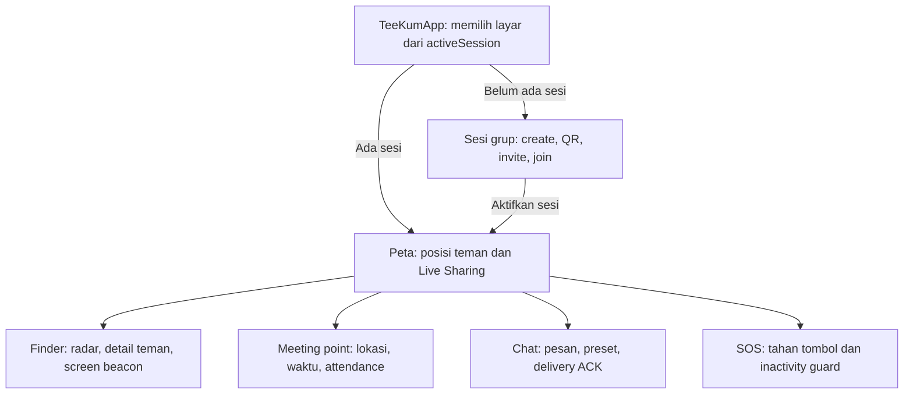
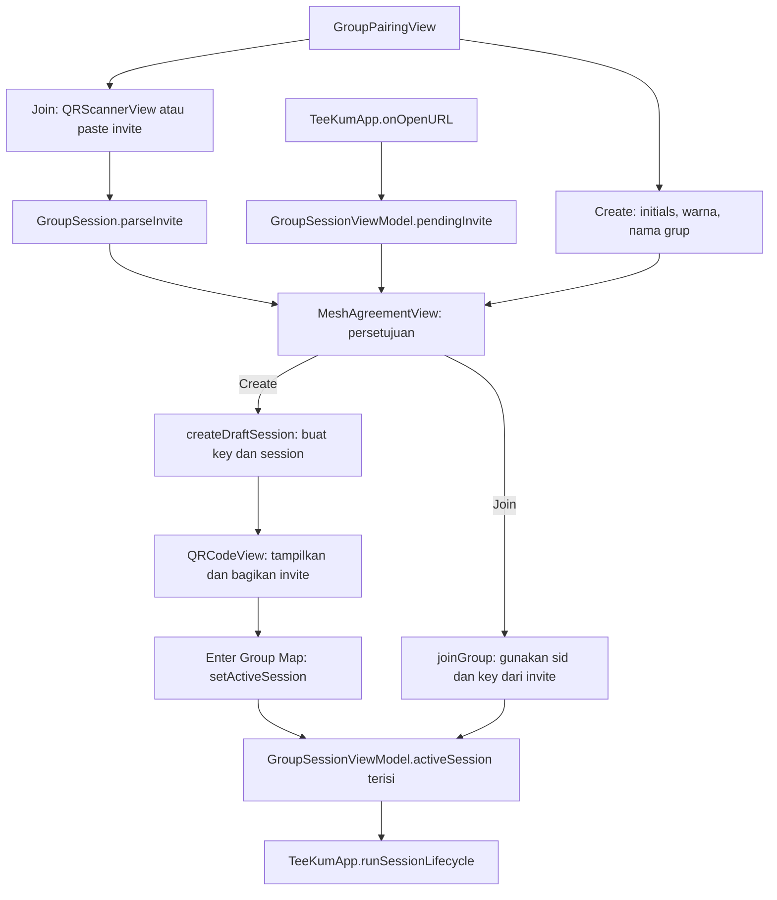
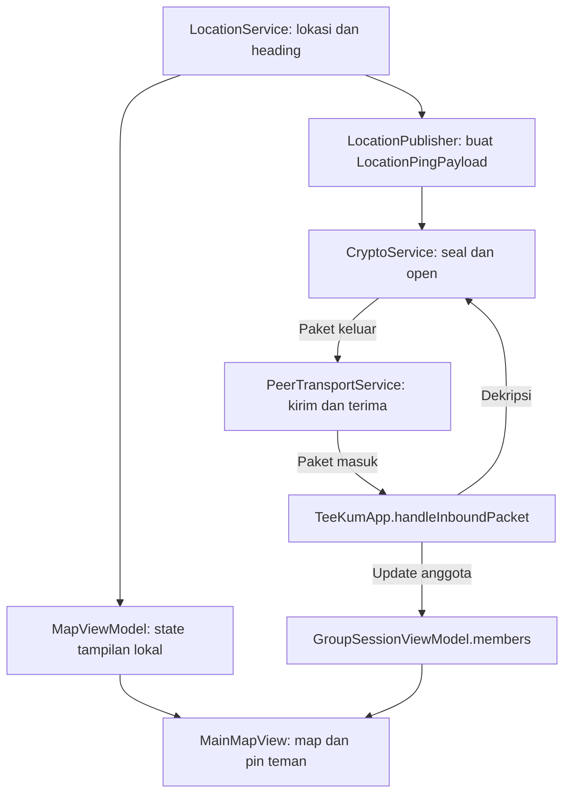
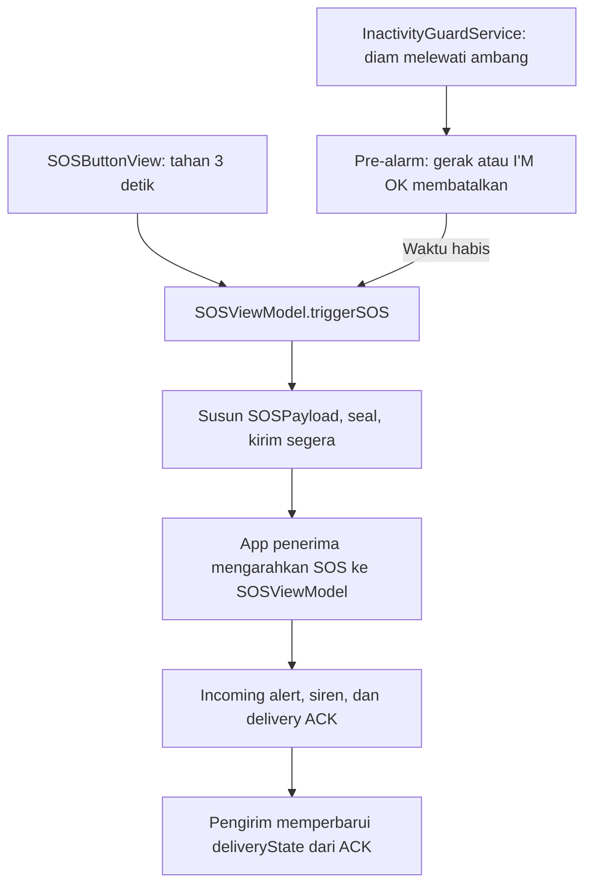

# TeeKum Prototype — Peta Fitur dan File untuk Tim

Tanggal pembacaan kode: **5 November 2026**. Baseline: `85d6eba60c4cd91de8a1412cf7e48fa5b96f168a` (`feat! : Removing nearby interaction system`).

Dokumen ini memetakan **implementasi prototype saat ini** sebagai bahan diskusi sebelum migrasi. Nama file di bawah adalah file yang sudah ada. Pengelompokan fitur merupakan cara membaca kode, bukan struktur folder baru yang sudah diterapkan.

Pemetaan dilakukan lewat pembacaan source, pemanggil, dependency injection, dan alur paket. Build, automated test, serta pengujian beberapa iPhone tidak dijalankan dalam pekerjaan dokumentasi ini. Keberadaan kode atau test tidak berarti perilaku perangkat sudah terbukti.

## 1. Gambaran untuk Tim

TeeKum membantu satu grup saling menemukan dan berkoordinasi saat koneksi internet sulit. Ada **enam kelompok fitur pengguna**, didukung transport mesh, keamanan, pengaturan relay, Live Activity, serta alat diagnostik.

Peta adalah layar penghubung. Saat pengguna membuka chat, radar, meeting point, atau SOS, fitur tersebut masih menggunakan sesi grup dan jaringan yang sama.

### Cara membaca lapisan

| Lapisan | Peran di prototype | Contoh |
| --- | --- | --- |
| View | Menampilkan UI, menerima gesture, membuka sheet; sebagian masih menyimpan state/alur fitur | `GroupPairingView`, `MainMapView`, `FinderBeaconView` |
| ViewModel | Menyimpan state dan aksi fitur; pembagian tanggung jawab belum seragam | `GroupSessionViewModel`, `ChatViewModel`, `SOSViewModel` |
| Service / engine | Sensor, kriptografi, pengiriman paket, routing, retry, dan integrasi sistem | `LocationService`, `CryptoService`, `ChatMessageEngine` |
| Model / codec | Bentuk data dan format kirim | `GroupSession`, `Member`, `Packet`, `InitialsCodec` |
| App wiring | Membuat instance, memasang dependency, memulai/menghentikan sesi, dan mendistribusikan paket masuk | `TeeKumApp` |

**Tidak semua fitur memiliki satu ViewModel dan satu service khusus.** Tidak ada `CreateGroupViewModel`, `JoinGroupViewModel`, `GroupSessionService`, atau `FinderViewModel` pada baseline ini. Jangan memasukkan nama tersebut ke peta implementasi lama seolah sudah tersedia.

## 2. Matriks Utama: Fitur Menyentuh File Apa?

Semua path pada tabel yang tidak menyebut root lain berada di dalam `TeeKum Prototype/`. Komponen UI berada di `Views/Components/`.

| Fitur | View dan komponen | ViewModel / pemilik state | Service dan integrasi | Model / kontrak |
| --- | --- | --- | --- | --- |
| Create, join, invite, restore, leave | `Views/GroupPairingView.swift`; `QRCodeView.swift`; `QRScannerView.swift`; `MeshAgreementView.swift`; QR sheet dan leave di `Views/MainMapView.swift` | `ViewModels/GroupSessionViewModel.swift`; draft/agreement juga memakai `@State` di View | Aktivasi dan teardown di `App/TeeKumApp.swift`; `UserDefaults` dipanggil langsung dari ViewModel; opt-in memakai `RelayPolicyManager.swift` | `Models/GroupSession.swift` termasuk `GroupSessionInvite`; `InitialsCodec.swift`; `MemberColor.swift`; `Config/Info.plist` untuk URL scheme |
| Peta dan lokasi teman | `Views/MainMapView.swift`; `FriendPinAnnotationView.swift`; `HeadingVisionCone.swift` | `ViewModels/MapViewModel.swift`; roster di `GroupSessionViewModel.swift` | `LocationService.swift`; `LocationPublisher.swift`; `LocationServiceProtocol.swift`; paket masuk ditangani App | `Member.swift`; `LocationPin.swift`; `Packet.swift` / `LocationPingPayload` |
| Detail teman, radar, screen beacon | `Views/FriendDetailView.swift`; `Views/FinderBeaconView.swift`; seluruh `Views/Components/Radar/` | Seleksi awal di `MapViewModel.swift`; target, heading lokal, dan strobe juga di `FinderBeaconView` | `LocationService.swift` / `LocationServiceProvider` untuk lokasi, heading, dan mode akurasi; pengiriman lokasi tetap memakai alur bersama | `Member.swift`; `LocationPin.swift`; `RadarTheme.swift` untuk tampilan radar |
| Meeting point | `Views/MeetingPointsView.swift`; `SetMeetingPointSheet.swift`; `MeetingPointPinView.swift`; long-press map di `MainMapView.swift` | `ViewModels/MeetingPointViewModel.swift` | ViewModel langsung menggunakan `CryptoServiceProvider` dan `PeerTransport`; App mengarahkan update masuk dan late-peer sync | `Models/MeetingPoint.swift`; `Packet.swift` / `MeetingUpdatePayload`, `MeetingAction` |
| Chat dan preset | `ChatSheetView.swift`; `ChatMessageBubbleView.swift`; `PresetChipsView.swift`; `ByteMeterView.swift`; `RecipientAckBreakdownView.swift` | `ViewModels/ChatViewModel.swift` | `ChatMessagingService.swift` adalah protocol; implementasinya `ChatMessageEngine.swift`; `NotificationService.swift`; App untuk dispatch masuk | `Models/ChatMessage.swift`; `Packet.swift` / `ChatMessagePayload`, `ACKPayload` |
| SOS manual dan auto-SOS | `Views/SOSButtonView.swift`; `IncomingSOSAlertBannerView.swift`; banner di `MainMapView.swift` | `ViewModels/SOSViewModel.swift` | `InactivityGuardService.swift`; `SOSAudioAlert.swift`; location, crypto, dan transport; App untuk menerima SOS/ACK | `Models/SOSDeliveryState.swift`; `Packet.swift` / `SOSPayload`, `SOSType`, `ACKPayload` |
| Relay dan penghematan daya | `RelaySettingsSheet.swift`; `MeshAgreementView.swift`; status di `MainMapView.swift` | View berinteraksi dengan actor `RelayPolicyManager`; tidak ada Relay ViewModel khusus | `RelayPolicyManager.swift`; `PeerTransportService.swift`; power state dari `LocationService.swift`; forwarding juga di App | `MeshProtocols.swift` / `RelayPolicyState`, `RelayParticipationMode`; `TeeKumConfiguration.swift` |
| Live Activity | `TeeKumWidgets/SessionLiveActivityView.swift`; `TeeKumWidgets/SessionActivityWidget.swift`; `TeeKumWidgets/TeeKumWidgetBundle.swift` | Pembaruan dirangkai di `TeeKumApp.updateLiveActivityTelemetry()` | `Services/LiveActivityManager.swift` | `Models/SessionActivityAttributes.swift` dan salinannya di `TeeKumWidgets/SessionActivityAttributes.swift`; `Config/Widgets-Info.plist` |
| Toast dan notifikasi | `InAppToastView.swift`; pemanggilan dari App dan `MainMapView.swift` | State toast di `NotificationService.shared` | `NotificationService.swift` | `InAppToast` didefinisikan di file service yang sama |
| Diagnostics dan Mesh Lab | `Views/DiagnosticsView.swift`; `Views/MeshDebuggerView.swift`; akses dari pairing dan map | `ViewModels/MeshDebuggerViewModel.swift`; Diagnostics juga membaca beberapa ViewModel utama | `MeshDiagnostics.swift`; `MeshTopologySimulator.swift`; `SimulatedMeshTransport.swift`; service jaringan yang diamati | `MeshProtocols.swift`, `Packet.swift`; beberapa model log didefinisikan di file debugger |

## 3. Bedah Create / Join: Contoh Pertama untuk Tim

### 3.1 Alur yang benar-benar dipakai UI

Jalur deep link di diagram berakhir ke agreement melalui observer di `GroupPairingView`. Jika pairing View sedang tidak ditampilkan karena sesi lain aktif, handler URL hanya mengisi `pendingInvite`; belum terlihat flow pergantian grup pada `MainMapView`.

### 3.2 Tanggung jawab setiap file

| File | Kerja konkretnya | Ikut diperiksa ketika… |
| --- | --- | --- |
| [GroupPairingView.swift](../../TeeKum%20Prototype/Views/GroupPairingView.swift) | Form initials/warna/nama; tab create/join; menyimpan draft; mengarahkan agreement; tombol masuk map | Urutan onboarding, validasi form, atau navigasi berubah |
| [GroupSessionViewModel.swift](../../TeeKum%20Prototype/ViewModels/GroupSessionViewModel.swift) | `createDraftSession`, `createGroup`, `joinGroup`, `setActiveSession`, `leaveGroup`; roster; restore dan persist session | Identitas, lifecycle, penyimpanan, atau cara bergabung berubah |
| [GroupSession.swift](../../TeeKum%20Prototype/Models/GroupSession.swift) | Model session dan invite; membentuk `teekum://join#...`; mengekstrak dan membaca invite | Format QR/link, session ID, key, atau kompatibilitas invite berubah |
| [QRCodeView.swift](../../TeeKum%20Prototype/Views/Components/QRCodeView.swift) | Menerima URL; membuat gambar QR memakai Core Image; menyediakan `ShareLink` | Tampilan QR atau cara membagikan undangan berubah |
| [QRScannerView.swift](../../TeeKum%20Prototype/Views/Components/QRScannerView.swift) | Permission kamera, scanner AVFoundation, input manual/fallback; mengirim string ke callback | Kamera, permission, atau cara memasukkan undangan berubah |
| [MeshAgreementView.swift](../../TeeKum%20Prototype/Views/Components/MeshAgreementView.swift) | Menampilkan persetujuan; callback agree/decline | Kebijakan consent dan relay berubah |
| [InitialsCodec.swift](../../TeeKum%20Prototype/Models/InitialsCodec.swift) dan [MemberColor.swift](../../TeeKum%20Prototype/Models/MemberColor.swift) | Sanitasi/encoding initials dan pilihan identitas warna | Format identitas anggota berubah; dampaknya juga ke payload dan roster |
| [TeeKumApp.swift](../../TeeKum%20Prototype/App/TeeKumApp.swift) | Memilih pairing/map; menerima URL; menyalakan semua subsystem setelah sesi aktif; teardown saat keluar | Join harus benar-benar mengaktifkan layanan atau leave harus membersihkannya |
| [MainMapView.swift](../../TeeKum%20Prototype/Views/MainMapView.swift) | QR untuk mengundang teman setelah grup aktif; leave confirmation | Invite untuk late joiner dan keluar grup berubah |
| [RelayPolicyManager.swift](../../TeeKum%20Prototype/Services/RelayPolicyManager.swift) | Menyimpan serta menerapkan pilihan relay | Persetujuan onboarding dihubungkan dengan radio relay |
| [Info.plist](../../Config/Info.plist) | Mendaftarkan URL scheme `teekum` | Scheme invite/deep link berubah |

### 3.3 Detail yang mudah terlewat

- **UI create menggunakan draft dahulu.** `createDraftSession()` belum mengisi `activeSession`. Host menampilkan QR, lalu menekan **Enter Group Map** untuk memanggil `setActiveSession()`. Method `createGroup()` tersedia, tetapi bukan method yang dipanggil jalur tombol create saat ini.
- **QR generator tidak membuat grup.** Ia hanya mengubah URL menjadi gambar. Scanner juga tidak bergabung sendiri: string hasil scan diparse oleh `GroupSession`, lalu pairing View memanggil ViewModel setelah agreement.
- **Join di sini mengimpor parameter sesi bersama.** `joinGroup()` membuat session lokal dengan ID/key dari invite dan `isHost: false`. Tidak ada request persetujuan host atau backend pada method ini. Roster diperbarui kemudian dari peer discovery dan paket masuk.
- **Invite memakai custom URL scheme `teekum://`.** Sebutan “universal link” di beberapa komentar tidak menunjukkan konfigurasi HTTPS Universal Links yang setara.
- **Persist session ada di ViewModel.** Seluruh `GroupSession` yang `Codable`, termasuk `symmetricKeyData`, diserialisasi ke `UserDefaults`. API Keychain tersedia di `CryptoService`, tetapi tidak dipanggil oleh jalur create/join/restore/leave ini.
- **Open Mesh masih memiliki sisa API.** `enterAutoMesh()` dan case `.autoMesh` tersedia, tetapi `PairingTab` hanya berisi `.create` dan `.join`, tanpa tombol aktif yang menetapkan action `.autoMesh` pada baseline ini.

## 4. Peta dan Live Sharing

**Perilaku:** pengguna melihat posisi sendiri, pin teman, arah hadap, status GPS, battery/survival mode, serta sakelar Live Sharing.

Diagram menunjukkan dependency/pengaliran data; bukan klaim seluruh operasi berlangsung sinkron.

| Bagian | File dan tanggung jawab |
| --- | --- |
| UI | [MainMapView.swift](../../TeeKum%20Prototype/Views/MainMapView.swift), [FriendPinAnnotationView.swift](../../TeeKum%20Prototype/Views/Components/FriendPinAnnotationView.swift), [HeadingVisionCone.swift](../../TeeKum%20Prototype/Views/Components/HeadingVisionCone.swift) |
| State | [MapViewModel.swift](../../TeeKum%20Prototype/ViewModels/MapViewModel.swift): Live Sharing, selected member, lokasi lokal, heading, status permission/GPS |
| Sensor dan cadence | [LocationService.swift](../../TeeKum%20Prototype/Services/LocationService.swift), [LocationServiceProtocol.swift](../../TeeKum%20Prototype/Services/LocationServiceProtocol.swift): Core Location, heading, pembaruan posisi, adaptasi akurasi/daya |
| Outbound | [LocationPublisher.swift](../../TeeKum%20Prototype/Services/LocationPublisher.swift): mendengarkan `publishedPings`, menyusun payload, mengenkripsi, broadcast |
| Inbound | `TeeKumApp.handleInboundPacket()` membaca `LocationPingPayload` lalu memanggil `sessionViewModel.updateMember()` |
| Model | [Member.swift](../../TeeKum%20Prototype/Models/Member.swift), [LocationPin.swift](../../TeeKum%20Prototype/Models/LocationPin.swift), [Packet.swift](../../TeeKum%20Prototype/Models/Packet.swift) |

**Dampak perubahan:** mengganti bentuk data lokasi bukan hanya mengganti pin UI. Periksa sensor, model lokal, codec payload, publisher, decoder App, radar, meeting arrival, SOS, serta Live Activity yang memakai data tersebut.

Catatan baseline: timestamp pengukuran dipertahankan di payload keluar, tetapi App mengisi `Member.lastSeen` dari `inbound.receivedAt`. Peer update juga bisa memperbaruinya. Karena itu, usia “terakhir terhubung” dan usia “koordinat terakhir diukur” belum disimpan terpisah pada `Member`.

## 5. Detail Teman, Radar, dan Screen Beacon

**Perilaku:** pilih pin teman, lihat detail, buka radar, pilih target melalui blip/card, lalu gunakan warna layar berkedip untuk membantu dikenali.

| Bagian | File dan tanggung jawab |
| --- | --- |
| Pemicu | `MainMapView`: membuka sheet detail dan full-screen Finder |
| Detail | [FriendDetailView.swift](../../TeeKum%20Prototype/Views/FriendDetailView.swift): informasi anggota, jarak/bearing, callback mulai navigasi |
| Layar Finder | [FinderBeaconView.swift](../../TeeKum%20Prototype/Views/FinderBeaconView.swift): target terpilih, heading lokal, HUD, carousel, timer/warna strobe |
| Render radar | [RadarView.swift](../../TeeKum%20Prototype/Views/Components/Radar/RadarView.swift): proyeksi jarak/bearing terhadap heading; clamp blip di tepi jangkauan tampilan |
| Komponen | [RadarBlipView.swift](../../TeeKum%20Prototype/Views/Components/Radar/RadarBlipView.swift), [RadarFriendCard.swift](../../TeeKum%20Prototype/Views/Components/Radar/RadarFriendCard.swift), [RadarGridBackground.swift](../../TeeKum%20Prototype/Views/Components/Radar/RadarGridBackground.swift), [RadarCenterMarker.swift](../../TeeKum%20Prototype/Views/Components/Radar/RadarCenterMarker.swift), [RadarTheme.swift](../../TeeKum%20Prototype/Views/Components/Radar/RadarTheme.swift) |
| Data | `MapViewModel`, `LocationServiceProvider`, `Member`, `LocationPin`; roster tetap berasal dari alur lokasi bersama |

**Batas implementasi:** radar saat ini dihitung dari koordinat dan heading, dengan tampilan standar 60 meter. Angka itu adalah skala visual, bukan jangkauan radio. Beacon adalah **layar berkedip**, bukan kontrol LED flashlight. Tidak ditemukan implementasi `NISession`/Nearby Interaction pada baseline setelah commit penghapusan tersebut. Parameter/sisa konfigurasi bernama precision/UWB tidak membuktikan ranging UWB aktif.

**Dampak migrasi:** perilaku penting masih ada di View, terutama seleksi target, heading callback, perhitungan radar, dan strobe task. Memindahkan `MapViewModel` saja belum memindahkan keseluruhan fitur Finder.

## 6. Meeting Point

**Perilaku:** satu titik kumpul aktif, waktu pertemuan, respons kehadiran, deteksi tiba, serta aturan hanya pembuat titik aktif yang dapat mengubah/membatalkannya.

| Bagian | File dan tanggung jawab |
| --- | --- |
| Pemilihan | `MainMapView` menangani long-press map; [SetMeetingPointSheet.swift](../../TeeKum%20Prototype/Views/Components/SetMeetingPointSheet.swift) menerima pilihan titik/waktu |
| Presentasi | [MeetingPointsView.swift](../../TeeKum%20Prototype/Views/MeetingPointsView.swift), [MeetingPointPinView.swift](../../TeeKum%20Prototype/Views/Components/MeetingPointPinView.swift) |
| State dan aturan | [MeetingPointViewModel.swift](../../TeeKum%20Prototype/ViewModels/MeetingPointViewModel.swift): `proposeMeetingPoint`, `respond`, `cancelMeetingPoint`, `checkArrival`, `checkExpiration`, `applyInboundUpdate` |
| Pengiriman | `MeetingPointViewModel.broadcastMeetingUpdate()` langsung membuat `MeetingUpdatePayload`, seal melalui crypto, lalu kirim lewat transport |
| Integrasi | App mengarahkan paket `.meetingUpdate`, mengirim notifikasi, dan memanggil `syncActiveMeetingPointToPeers()` saat peer tersambung; map memanggil `checkArrival()` saat lokasi berubah |
| Model | [MeetingPoint.swift](../../TeeKum%20Prototype/Models/MeetingPoint.swift); `MeetingUpdatePayload`, `MeetingAction`, dan attendance di model/codec terkait |

**Tidak ada `MeetingPointService` terpisah.** Aturan fitur dan penyusunan paket masih berada dalam ViewModel. Perubahan setter rule, arrival, atau attendance perlu dibaca bersama jalur paket masuk dan late-peer sync di App.

## 7. Chat dan Preset

**Perilaku:** kirim pesan pendek/preset, tampilkan unread count, cooldown, byte meter, dan status pengantaran per penerima.

| Bagian | File dan tanggung jawab |
| --- | --- |
| UI utama | [ChatSheetView.swift](../../TeeKum%20Prototype/Views/Components/ChatSheetView.swift), dipresentasikan dari `MainMapView` |
| Komponen | [ChatMessageBubbleView.swift](../../TeeKum%20Prototype/Views/Components/ChatMessageBubbleView.swift), [PresetChipsView.swift](../../TeeKum%20Prototype/Views/Components/PresetChipsView.swift), [ByteMeterView.swift](../../TeeKum%20Prototype/Views/Components/ByteMeterView.swift), [RecipientAckBreakdownView.swift](../../TeeKum%20Prototype/Views/Components/RecipientAckBreakdownView.swift) |
| State UI | [ChatViewModel.swift](../../TeeKum%20Prototype/ViewModels/ChatViewModel.swift): draft, pembatas UTF-8, messages, unread, cooldown, sheet state, dan battery gating |
| Kontrak | [ChatMessagingService.swift](../../TeeKum%20Prototype/Services/ChatMessagingService.swift): protocol actor yang digunakan ViewModel |
| Implementasi | [ChatMessageEngine.swift](../../TeeKum%20Prototype/Services/ChatMessageEngine.swift): encoding, encryption, broadcast, penyimpanan pesan dalam memori, ACK, retry, forwarding |
| Model dan integrasi | [ChatMessage.swift](../../TeeKum%20Prototype/Models/ChatMessage.swift); `ChatMessagePayload`/`ACKPayload` di `Packet.swift`; notifikasi oleh App melalui `NotificationService` |

Alur keluar: **ChatSheetView → ChatViewModel → ChatMessagingService / ChatMessageEngine → CryptoService → PeerTransportService**. Alur masuk: **transport → TeeKumApp → ChatMessageEngine → callback/stream → ChatViewModel → UI**.

Batas pesan adalah **20 byte UTF-8**, sehingga tidak selalu sama dengan 20 karakter. Riwayat dibatasi dalam memori; UI dan engine membatasi pengiriman saat survival mode. ACK berbagi tipe paket dengan SOS, jadi perubahan ACK perlu memeriksa kedua fitur.

## 8. SOS Manual dan Auto-SOS

| Bagian | File dan tanggung jawab |
| --- | --- |
| UI pemicu | [SOSButtonView.swift](../../TeeKum%20Prototype/Views/SOSButtonView.swift): gesture tahan, progress, kategori, delivery banner, toggle inactivity, pre-alarm |
| State dan pengiriman | [SOSViewModel.swift](../../TeeKum%20Prototype/ViewModels/SOSViewModel.swift): state machine, event ID, payload, dispatch segera, retry, proses SOS/ACK, dedup event, audio |
| Auto-SOS | [InactivityGuardService.swift](../../TeeKum%20Prototype/Services/InactivityGuardService.swift): Core Motion, timer stillness, warning countdown, callback ke `triggerSOS(.inactivity)` |
| Penerimaan | [IncomingSOSAlertBannerView.swift](../../TeeKum%20Prototype/Views/Components/IncomingSOSAlertBannerView.swift), banner/aksi map, [SOSAudioAlert.swift](../../TeeKum%20Prototype/Services/SOSAudioAlert.swift) |
| Model | [SOSDeliveryState.swift](../../TeeKum%20Prototype/Models/SOSDeliveryState.swift); `SOSPayload`, `SOSType`, `ACKPayload` di `Packet.swift` |
| Shared | Lokasi terbaru dari `LocationServiceProvider`, crypto, transport, forwarding App, dan pembaruan Live Activity |

SOS memiliki jalur pengiriman sendiri sehingga tidak menunggu interval ping biasa atau bergantung pada Live Sharing ON. `LocationPublisher.dispatchSOS()` juga tersedia, tetapi jalur tombol UI masuk melalui `SOSViewModel`, bukan method publisher tersebut.

`SOSForwardingEngine.swift` tersedia sebagai engine terpisah dan dipakai test, tetapi tidak diinstansiasi di `TeeKumApp`. Dependency `forwardingEngine`, routing, neighbor, dan rate limiter bersifat opsional pada SOS ViewModel; pemanggilan `configure()` di App belum memasangnya. Pisahkan pemahaman engine yang tersedia dari jalur yang benar-benar dijalankan aplikasi.

## 9. Infrastruktur Bersama: Dampaknya Lintas Fitur

| Area | File utama | Siapa yang terdampak |
| --- | --- | --- |
| Lifecycle dan dispatch | [TeeKumApp.swift](../../TeeKum%20Prototype/App/TeeKumApp.swift), termasuk `SessionHolder` dalam file yang sama | Semua fitur yang menggunakan sesi aktif; startup, shutdown, decoding, forwarding, roster, battery, dan Live Activity |
| Format paket | [Packet.swift](../../TeeKum%20Prototype/Models/Packet.swift) | Lokasi, meeting, chat, SOS, ACK, routing, debugger, dan kompatibilitas perangkat |
| Kriptografi | [CryptoService.swift](../../TeeKum%20Prototype/Services/CryptoService.swift), [CryptoServiceProtocol.swift](../../TeeKum%20Prototype/Services/CryptoServiceProtocol.swift) | Semua payload terenkripsi, nonce/AAD, serta API penyimpanan key |
| Transport nyata | [PeerTransportService.swift](../../TeeKum%20Prototype/Services/PeerTransportService.swift), [PeerTransport.swift](../../TeeKum%20Prototype/Services/PeerTransport.swift) | Discovery, koneksi, send/receive untuk semua fitur komunikasi |
| Framing dan antrean | [StreamMessageFramer.swift](../../TeeKum%20Prototype/Services/StreamMessageFramer.swift), [PriorityOutboxQueue.swift](../../TeeKum%20Prototype/Services/PriorityOutboxQueue.swift) | Pembacaan stream, prioritas paket, coalescing posisi, dan retry transport |
| Tetangga dan rute | [NeighborTable.swift](../../TeeKum%20Prototype/Services/NeighborTable.swift), [RoutingTable.swift](../../TeeKum%20Prototype/Services/RoutingTable.swift), [RouteDiscoveryService.swift](../../TeeKum%20Prototype/Services/RouteDiscoveryService.swift) | Peer discovery, stale-peer recovery, pencarian rute dan respons |
| Forwarding dan pembatas | [PacketForwarder.swift](../../TeeKum%20Prototype/Services/PacketForwarder.swift), [SOSForwardingEngine.swift](../../TeeKum%20Prototype/Services/SOSForwardingEngine.swift), [SeenPacketCache.swift](../../TeeKum%20Prototype/Services/SeenPacketCache.swift), [ForwardingRateLimiter.swift](../../TeeKum%20Prototype/Services/ForwardingRateLimiter.swift) | Mesh forwarding; cek wiring karena sebagian engine baru terlihat di simulator/test, sementara App memiliki forwarding sendiri |
| Relay policy | [RelayPolicyManager.swift](../../TeeKum%20Prototype/Services/RelayPolicyManager.swift), [RelaySettingsSheet.swift](../../TeeKum%20Prototype/Views/Components/RelaySettingsSheet.swift) | Persetujuan relay, mode aktif/timed/disabled, batas baterai, stranger forwarding |
| Kontrak mesh dan konfigurasi | [MeshProtocols.swift](../../TeeKum%20Prototype/Services/MeshProtocols.swift), [MeshTimingConfiguration.swift](../../TeeKum%20Prototype/Services/MeshTimingConfiguration.swift), [TeeKumConfiguration.swift](../../TeeKum%20Prototype/Models/TeeKumConfiguration.swift) | Interface antar-service, timing, TTL, ukuran paket, dan kebijakan lintas fitur |
| Toast/notifikasi | [NotificationService.swift](../../TeeKum%20Prototype/Services/NotificationService.swift), [InAppToastView.swift](../../TeeKum%20Prototype/Views/Components/InAppToastView.swift) | Notifikasi chat/meeting, feedback in-app |
| Live Activity | [LiveActivityManager.swift](../../TeeKum%20Prototype/Services/LiveActivityManager.swift), [SessionActivityAttributes.swift](../../TeeKum%20Prototype/Models/SessionActivityAttributes.swift), target `TeeKumWidgets` | Sesi, jumlah direct peer, meeting distance, SOS, relay, deep link |
| Format tampilan | [Formatters.swift](../../TeeKum%20Prototype/Models/Formatters.swift) | Label jarak, waktu, battery, dan helper tampilan terkait |

Transport yang diaktifkan App adalah Bonjour **`_teekum._tcp`** melalui `NWBrowser`, `NWListener`, `NWConnection`, dan `includePeerToPeer = true`. Ada dukungan cabang UDP pada service, tetapi itu bukan pilihan startup App saat ini. Tidak ditemukan implementasi transport Wi-Fi Aware atau Core Bluetooth pada source baseline ini.

Wire frame pada kode berukuran **56 byte: 10-byte envelope, 30-byte ciphertext, 16-byte authentication tag**. Ini ukuran frame aplikasi, bukan ukuran seluruh trafik jaringan atau BLE advertising. Session ID di model adalah `UInt16`, sedangkan slot serialisasi envelope memakai tiga byte; pembacaannya kembali memangkas menjadi 16 bit. Jangan mengubah representasi tersebut diam-diam dalam migrasi yang harus tetap berkomunikasi dengan prototype.

## 10. Diagnostics dan Simulator

| Alat | File | Kegunaan dan batas |
| --- | --- | --- |
| HUD | [DiagnosticsView.swift](../../TeeKum%20Prototype/Views/DiagnosticsView.swift) | Membaca telemetry session, location, SOS, relay, transport |
| Mesh Lab | [MeshDebuggerView.swift](../../TeeKum%20Prototype/Views/MeshDebuggerView.swift), [MeshDebuggerViewModel.swift](../../TeeKum%20Prototype/ViewModels/MeshDebuggerViewModel.swift) | Triage, inspeksi frame, packet/fault injection, simulator, ekspor report |
| Diagnostics model | [MeshDiagnostics.swift](../../TeeKum%20Prototype/Services/MeshDiagnostics.swift) | State dan telemetry pendukung |
| Virtual mesh | [MeshTopologySimulator.swift](../../TeeKum%20Prototype/Services/MeshTopologySimulator.swift), [SimulatedMeshTransport.swift](../../TeeKum%20Prototype/Services/SimulatedMeshTransport.swift) | Menguji topologi virtual; tidak membuktikan jangkauan radio atau background behavior iPhone |

`MeshTopologySimulator` menginstansiasi `PacketForwarder`. App utama justru memakai `relayMeshPacketIfNeeded()` dan `handleStrangerRelayPacket()`. Karena jalurnya berbeda, hasil simulator perlu dikaitkan kembali ke wiring aplikasi nyata.

## 11. Titik Perhatian Sebelum Migrasi

Daftar ini merupakan hasil pembacaan kode yang berkaitan dengan pemetaan fitur, bukan audit keamanan atau hasil pengujian runtime lengkap.

| Temuan source | Dampaknya untuk pembagian kerja |
| --- | --- |
| `TeeKumApp.swift` memuat lifecycle, dependency injection, inbound dispatch, forwarding, recovery, serta Live Activity | File ini perlu dibaca oleh pemilik semua fitur; migrasi folder View/ViewModel saja akan meninggalkan logika penting |
| `MainMapView` menghubungkan banyak sheet dan memiliki state navigasi lokal | Perubahan satu fitur dapat memengaruhi cara fitur lain dibuka; bedakan layar penghubung dari pemilik aturan bisnis |
| Penyimpanan session/key lewat `UserDefaults`, sementara API Keychain tidak terhubung ke jalur sesi | Sepakati kebijakan restore dan penghapusan data; jangan menganggap keamanan penyimpanan sudah mengikuti komentar lama |
| Nearby Interaction sudah dihapus; beberapa dokumen masih menyebut precision finding aktif | Scope awal migrasi perlu mengacu ke radar GPS/heading yang tersedia; UWB adalah pekerjaan terpisah jika dipilih lagi |
| `PacketForwarder` dan `SOSForwardingEngine` tidak menjadi jalur forwarding utama di App | Memindahkan engine saja belum memindahkan perilaku mesh yang dipakai UI |
| `ChatMessageEngine.handleInboundPacket()` dapat meneruskan chat, kemudian App juga memanggil `relayMeshPacketIfNeeded()` | Ada dua tempat yang berpotensi melakukan forwarding paket chat yang sama; tentukan pemiliknya dan verifikasi pengiriman ganda saat integrasi |
| `Member.lastSeen` memakai waktu terima/discovery, bukan field timestamp koordinat tersendiri | Label kesegaran lokasi dan keputusan recovery perlu membedakan waktu paket diterima dari waktu posisi diukur |
| Invite deep link disimpan sebagai `pendingInvite`, tetapi konsumennya berada di pairing View | Uji open-invite ketika grup lain sudah aktif; jalur pergantian sesi belum lengkap pada map |
| `EndSessionIntent` menghapus `com.teekum.activeGroupSession`, sementara session ViewModel memakai `com.teekum.activeSession` | Menutup Live Activity belum membuktikan sesi, radio, dan data aplikasi ikut berakhir; periksa jalur intent versus leave di map |
| Identitas roster menggunakan initials; `memberSlot` berasal dari XOR dua byte encoding initials | Inisial sama/slot bertabrakan perlu diperhitungkan bersama sequence number, dedup, dan nonce; jangan menganggap alias tampilan sudah identitas perangkat unik |

## 12. Test yang Relevan per Fitur

File di bawah **tersedia** pada `TeeKum Prototype/Tests/`. Pemetaan ini tidak menyatakan test sudah lulus pada baseline saat ini.

| Area | File test untuk dibaca atau dijalankan ketika area berubah |
| --- | --- |
| Pairing, session, UI state, radar, meeting rules | [UIStateTests.swift](../../TeeKum%20Prototype/Tests/UIStateTests.swift) |
| Payload dan crypto | [PacketCodecTests.swift](../../TeeKum%20Prototype/Tests/PacketCodecTests.swift), [CryptoSecurityTests.swift](../../TeeKum%20Prototype/Tests/CryptoSecurityTests.swift) |
| Lokasi dan Live Sharing | [LocationPublishingTests.swift](../../TeeKum%20Prototype/Tests/LocationPublishingTests.swift) |
| SOS dan auto-SOS | [SOSEndToEndTests.swift](../../TeeKum%20Prototype/Tests/SOSEndToEndTests.swift), [MultiHopSOSTests.swift](../../TeeKum%20Prototype/Tests/MultiHopSOSTests.swift), [InactivityGuardTests.swift](../../TeeKum%20Prototype/Tests/InactivityGuardTests.swift) |
| Chat | [ChatMessagingEngineTests.swift](../../TeeKum%20Prototype/Tests/ChatMessagingEngineTests.swift), [ChatUITests.swift](../../TeeKum%20Prototype/Tests/ChatUITests.swift) |
| Transport dan mesh | [PeerTransportTests.swift](../../TeeKum%20Prototype/Tests/PeerTransportTests.swift), [NeighborDiscoveryTests.swift](../../TeeKum%20Prototype/Tests/NeighborDiscoveryTests.swift), [RoutingForwardingTests.swift](../../TeeKum%20Prototype/Tests/RoutingForwardingTests.swift), [RouteDiscoveryTests.swift](../../TeeKum%20Prototype/Tests/RouteDiscoveryTests.swift), [MeshFailureIntegrationTests.swift](../../TeeKum%20Prototype/Tests/MeshFailureIntegrationTests.swift) |
| Relay dan Live Activity | [RelayPolicyTests.swift](../../TeeKum%20Prototype/Tests/RelayPolicyTests.swift), [LiveActivityTests.swift](../../TeeKum%20Prototype/Tests/LiveActivityTests.swift) |
| Debugger | [MeshDebuggerTests.swift](../../TeeKum%20Prototype/Tests/MeshDebuggerTests.swift) |

Test di repository memakai runner `runAllTests()` yang dipanggil dari `TeeKumApp`, termasuk lewat argumen `-runAllTests`. Sebagian besar memeriksa state/service secara programatis; nama `ChatUITests` atau `UIStateTests` tidak otomatis berarti end-to-end UI automation kamera/gesture pada perangkat. Klaim pass count dalam dokumentasi lama tidak dipakai sebagai bukti hasil pekerjaan ini.

## 13. Urutan Membahas dengan Tim

1. **Ikuti satu siklus sesi:** create draft → QR → enter map → join di perangkat lain → leave. Fokus pada pairing View, session ViewModel/model, lalu App lifecycle.
2. **Ikuti satu paket lokasi:** sensor → publisher → crypto → transport → dispatch App → roster → pin/radar. Ini menunjukkan dependency yang dipakai fitur lain.
3. **Bahas aturan per fitur:** meeting setter/attendance; chat byte limit/ACK; SOS hold/retry/auto-SOS; radar dan beacon.
4. **Bahas infrastruktur bersama:** siapa yang memiliki lifecycle, packet codec, crypto, transport, forwarding, dan konfigurasi agar pekerjaan migrasi tidak saling menimpa.
5. **Tentukan perilaku yang dipertahankan atau diperbaiki** berdasarkan tabel titik perhatian, lalu susun pembagian migrasi. Nama dan struktur folder target dapat diputuskan setelah batas tanggung jawab ini disepakati.

Untuk setiap fitur, tim cukup menjawab: **aksi pengguna apa, state dimiliki siapa, efek ke sensor/jaringan apa, paket masuk ditangani siapa, dan apa yang dibersihkan saat leave?** Kelima jawaban tersebut lebih membantu migrasi daripada sekadar memindahkan file berdasarkan nama layar.
