# TeeKum iOS — Feature Status & Implementation Inventory

> **Document Type:** Authoritative Technical Product Architecture Specification  
> **Target Audience:** Engineering Leads, iOS Architects, Product Managers, and Incoming AI Coding Agents  
> **Current Date:** 2026-11-04  
> **Status Taxonomy:** `IMPLEMENTED` | `PARTIALLY IMPLEMENTED` | `NOT IMPLEMENTED` | `PLANNED` | `PROPOSED` | `BLOCKED` | `UNKNOWN`  
> **Automated Verification Baseline:** **18 Automated Test Suites / 208 Unit & Integration Tests (100% Pass Rate)**  
> **Companion Documents:**
> - [Engineering Development Roadmap (DEVELOPMENT_ROADMAP.md)](file:///Users/nicho/Developer/TeeKum%20Prototype/docs/knowledge_transfer/DEVELOPMENT_ROADMAP.md)
> - [System Architecture Specification (ARCHITECTURE.md)](file:///Users/nicho/Developer/TeeKum%20Prototype/docs/knowledge_transfer/ARCHITECTURE.md)
> - [Wire Protocol Specification (PROTOCOL_SPECIFICATION.md)](file:///Users/nicho/Developer/TeeKum%20Prototype/docs/knowledge_transfer/PROTOCOL_SPECIFICATION.md)
> - [Technology Stack & Dependency Audit (TECH_STACK.md)](file:///Users/nicho/Developer/TeeKum%20Prototype/docs/knowledge_transfer/TECH_STACK.md)
> - [Known Issues, Technical Debt & Limitations (KNOWN_ISSUES.md)](file:///Users/nicho/Developer/TeeKum%20Prototype/docs/knowledge_transfer/KNOWN_ISSUES.md)

---

## 1. Feature Status Taxonomy & Governance

In compliance with project architectural principles, capabilities are classified under the following rigorous status taxonomy:

- **`IMPLEMENTED`**: Fully written in production Swift source code, integrated into the build target, and verified with passing automated regression or integration tests.
- **`PARTIALLY IMPLEMENTED`**: Active code exists in the repository, but specific sub-capabilities, edge-case handlers, or UI bindings remain incomplete or stubbed.
- **`NOT IMPLEMENTED`**: Features that are absent from the active codebase. This includes legacy features deliberately retired and purged during architectural iterations.
- **`PLANNED`**: Approved capabilities with formal architectural specifications, protocol reserved fields, or design decisions recorded in engineering documentation, awaiting physical target creation or implementation.
- **`PROPOSED`**: Architectural proposals or future exploratory features submitted for evaluation, but not yet formally scheduled or approved for near-term implementation.
- **`BLOCKED`**: Features unable to proceed due to explicit hardware limitations, operating system constraints, or unfulfilled upstream dependencies.
- **`UNKNOWN`**: Capabilities whose functional status or code presence cannot be verified from repository evidence.

> [!IMPORTANT]
> **Code-Truth Invariant:** Features are **never** marked as `IMPLEMENTED` simply because their architecture, schemas, or wire formats have been documented. Status is derived strictly from executable Swift code and test execution evidence.

---

## 2. Master Feature Status Summary Matrix

| # | Feature Name | Development Phase | Implementation Status | Primary Source / Specification | Test Coverage |
| :---: | :--- | :---: | :---: | :--- | :--- |
| **01** | **Group Creation & Key Lifecycle** | Phase 1 | `IMPLEMENTED` | [`GroupSession.swift`](file:///Users/nicho/Developer/TeeKum%20Prototype/TeeKum%20Prototype/Models/GroupSession.swift) | `UIStateTests.swift`, `CryptoSecurityTests.swift` |
| **02** | **QR & Invitation Links** | Phase 1 | `IMPLEMENTED` | [`QRCodeView.swift`](file:///Users/nicho/Developer/TeeKum%20Prototype/TeeKum%20Prototype/Views/Components/QRCodeView.swift) | `UIStateTests.swift` |
| **03** | **P2P Discovery (AWDL / Bonjour)** | Phase 1 / Phase 2 | `IMPLEMENTED` | [`PeerTransportService.swift`](file:///Users/nicho/Developer/TeeKum%20Prototype/TeeKum%20Prototype/Services/PeerTransportService.swift) | `PeerTransportTests.swift`, `NeighborDiscoveryTests.swift` |
| **04** | **Location Sharing (Option B)** | Phase 1 / Phase 3 | `IMPLEMENTED` | [`LocationPublisher.swift`](file:///Users/nicho/Developer/TeeKum%20Prototype/TeeKum%20Prototype/Services/LocationPublisher.swift) | `LocationPublishingTests.swift`, `PacketCodecTests.swift` |
| **05** | **Legacy Status Sharing (Canned)** | Phase 1 | `NOT IMPLEMENTED` *(Retired)* | Removed in commit `713b563` | *Retired / Purged from Codebase* |
| **06** | **Emergency SOS (3s Hold & Siren)** | Phase 1 | `IMPLEMENTED` | [`SOSViewModel.swift`](file:///Users/nicho/Developer/TeeKum%20Prototype/TeeKum%20Prototype/ViewModels/SOSViewModel.swift) | `SOSEndToEndTests.swift`, `MultiHopSOSTests.swift` |
| **07** | **Group Rendezvous (Meeting Points)** | Phase 1 | `IMPLEMENTED` | [`MeetingPointViewModel.swift`](file:///Users/nicho/Developer/TeeKum%20Prototype/TeeKum%20Prototype/ViewModels/MeetingPointViewModel.swift) | `UIStateTests.swift` |
| **08** | **MapKit Crowd Navigation** | Phase 1 | `IMPLEMENTED` | [`MainMapView.swift`](file:///Users/nicho/Developer/TeeKum%20Prototype/TeeKum%20Prototype/Views/MainMapView.swift) | `UIStateTests.swift` |
| **09** | **Ephemeral Teardown & Purge** | Phase 1 | `IMPLEMENTED` | [`GroupSessionViewModel.swift`](file:///Users/nicho/Developer/TeeKum%20Prototype/TeeKum%20Prototype/ViewModels/GroupSessionViewModel.swift) | `UIStateTests.swift` |
| **10** | **Multi-Hop Mesh Networking** | Phase 2 | `IMPLEMENTED` | [`PacketForwarder.swift`](file:///Users/nicho/Developer/TeeKum%20Prototype/TeeKum%20Prototype/Services/PacketForwarder.swift) | `RoutingForwardingTests.swift`, `RouteDiscoveryTests.swift` |
| **11** | **Blind Stranger Relaying** | Phase 2 | `IMPLEMENTED` | [`PacketForwarder.swift`](file:///Users/nicho/Developer/TeeKum%20Prototype/TeeKum%20Prototype/Services/PacketForwarder.swift) | `RoutingForwardingTests.swift`, `RelayPolicyTests.swift` |
| **12** | **Communal Relay Consent & Policy** | Phase 2 | `IMPLEMENTED` | [`RelayPolicyManager.swift`](file:///Users/nicho/Developer/TeeKum%20Prototype/TeeKum%20Prototype/Services/RelayPolicyManager.swift) | `RelayPolicyTests.swift` |
| **13** | **Dual-Lane Token Rate Limiter** | Phase 2 | `IMPLEMENTED` | [`ForwardingRateLimiter.swift`](file:///Users/nicho/Developer/TeeKum%20Prototype/TeeKum%20Prototype/Services/ForwardingRateLimiter.swift) | `RelayPolicyTests.swift` |
| **14** | **SeenPacketCache Deduplication** | Phase 2 | `IMPLEMENTED` | [`SeenPacketCache.swift`](file:///Users/nicho/Developer/TeeKum%20Prototype/TeeKum%20Prototype/Services/SeenPacketCache.swift) | `RoutingForwardingTests.swift` |
| **15** | **AODV Route Discovery Engine** | Phase 2 | `IMPLEMENTED` | [`RouteDiscoveryService.swift`](file:///Users/nicho/Developer/TeeKum%20Prototype/TeeKum%20Prototype/Services/RouteDiscoveryService.swift) | `RouteDiscoveryTests.swift` |
| **16** | **Battery Guard & Survival Mode** | Phase 2 | `IMPLEMENTED` | [`RelayPolicyManager.swift`](file:///Users/nicho/Developer/TeeKum%20Prototype/TeeKum%20Prototype/Services/RelayPolicyManager.swift) | `RelayPolicyTests.swift` |
| **17** | **Background Socket Survival** | Phase 2 | `IMPLEMENTED` | [`LocationService.swift`](file:///Users/nicho/Developer/TeeKum%20Prototype/TeeKum%20Prototype/Services/LocationService.swift) | `LocationPublishingTests.swift` |
| **18** | **ActivityKit Live Activity** | Phase 2 | `IMPLEMENTED` | [`LiveActivityManager.swift`](file:///Users/nicho/Developer/TeeKum%20Prototype/TeeKum%20Prototype/Services/LiveActivityManager.swift) | `LiveActivityTests.swift` |
| **19** | **On-Device Mesh Debugger** | Phase 2 | `IMPLEMENTED` | [`MeshDebuggerView.swift`](file:///Users/nicho/Developer/TeeKum%20Prototype/TeeKum%20Prototype/Views/MeshDebuggerView.swift) | `MeshDebuggerTests.swift`, `MeshFailureIntegrationTests.swift` |
| **20** | **Tactical Polar Radar** | Phase 3 | `IMPLEMENTED` | [`RadarView.swift`](file:///Users/nicho/Developer/TeeKum%20Prototype/TeeKum%20Prototype/Views/Components/Radar/RadarView.swift) | `UIStateTests.swift` |
| **21** | **Compass & Heading Vision Cone** | Phase 3 | `IMPLEMENTED` | [`HeadingVisionCone.swift`](file:///Users/nicho/Developer/TeeKum%20Prototype/TeeKum%20Prototype/Views/Components/HeadingVisionCone.swift) | `UIStateTests.swift` |
| **22** | **Festival Group Mesh Chat (20B)** | Phase 3 | `IMPLEMENTED` | [`ChatMessageEngine.swift`](file:///Users/nicho/Developer/TeeKum%20Prototype/TeeKum%20Prototype/Services/ChatMessageEngine.swift) | `ChatMessagingEngineTests.swift`, `ChatUITests.swift` |
| **23** | **Preset Quick Chips & Byte Meter** | Phase 3 | `IMPLEMENTED` | [`PresetChipsView.swift`](file:///Users/nicho/Developer/TeeKum%20Prototype/TeeKum%20Prototype/Views/Components/PresetChipsView.swift) | `ChatUITests.swift` |
| **24** | **ACK & Delivery States** | Phase 3 | `IMPLEMENTED` | [`ChatMessageEngine.swift`](file:///Users/nicho/Developer/TeeKum%20Prototype/TeeKum%20Prototype/Services/ChatMessageEngine.swift) | `ChatMessagingEngineTests.swift`, `SOSEndToEndTests.swift` |
| **25** | **Inactivity Guard ("Man Down")** | Phase 3 | `IMPLEMENTED` | [`InactivityGuardService.swift`](file:///Users/nicho/Developer/TeeKum%20Prototype/TeeKum%20Prototype/Services/InactivityGuardService.swift) | `InactivityGuardTests.swift` |
| **26** | **UWB Precision Finding (U1/U2)** | Phase 3 | `DECOMMISSIONED` | Decommissioned due to hardware session instability; replaced by 360° Tactical Radar | Purged |
| **27** | **Tactical Radar Friend Tracking** | Phase 3 | `IMPLEMENTED` | [`FinderBeaconView.swift`](file:///Users/nicho/Developer/TeeKum%20Prototype/TeeKum%20Prototype/Views/FinderBeaconView.swift) | `UIStateTests.swift` |
| **28** | **Finder Beacon (Screen & Torch)** | Phase 3 | `IMPLEMENTED` | [`FinderBeaconView.swift`](file:///Users/nicho/Developer/TeeKum%20Prototype/TeeKum%20Prototype/Views/FinderBeaconView.swift) | `UIStateTests.swift` |
| **29** | **Apple Watch Companion App** | Phase 3 / Phase 4 | `PLANNED` | [`TechnicalRequirements.md`](file:///Users/nicho/Developer/TeeKum%20Prototype/docs/TechnicalRequirements.md) (D10) | *Target Not Yet Added to Xcode Project* |
| **30** | **Altitude & Multi-Floor Support** | Phase 3 / Phase 4 | `PLANNED` | [`Packet.swift`](file:///Users/nicho/Developer/TeeKum%20Prototype/TeeKum%20Prototype/Models/Packet.swift#L372-L446) | `PacketCodecTests.swift` (Wire Padding) |
| **31** | **Offline Vector GeoJSON Overlays**| Phase 4 | `PROPOSED` | [`DEVELOPMENT_ROADMAP.md`](file:///Users/nicho/Developer/TeeKum%20Prototype/docs/knowledge_transfer/DEVELOPMENT_ROADMAP.md) | *Future Architecture Proposal* |
| **32** | **LoRa Scaffolding Gateway Repeaters** | Phase 4 | `PROPOSED` | [`DEVELOPMENT_ROADMAP.md`](file:///Users/nicho/Developer/TeeKum%20Prototype/docs/knowledge_transfer/DEVELOPMENT_ROADMAP.md) | *Hardware Research Proposal* |
| **33** | **Anonymized Crowd Density Maps** | Phase 4 | `PROPOSED` | [`DEVELOPMENT_ROADMAP.md`](file:///Users/nicho/Developer/TeeKum%20Prototype/docs/knowledge_transfer/DEVELOPMENT_ROADMAP.md) | *Future Architecture Proposal* |
| **34** | **Personal Neon Member Color Coding** | Phase 1 / Phase 3 | `IMPLEMENTED` | [`MemberColor.swift`](file:///Users/nicho/Developer/TeeKum%20Prototype/TeeKum%20Prototype/Models/MemberColor.swift) | `PacketCodecTests.swift`, `UIStateTests.swift` |
| **35** | **In-App AMOLED HUD Banners & Toasts** | Phase 3 | `IMPLEMENTED` | [`NotificationService.swift`](file:///Users/nicho/Developer/TeeKum%20Prototype/TeeKum%20Prototype/Services/NotificationService.swift) | `UIStateTests.swift` |
| **36** | **MapKit Custom Annotations & Cones** | Phase 3 | `IMPLEMENTED` | [`FriendPinAnnotationView.swift`](file:///Users/nicho/Developer/TeeKum%20Prototype/TeeKum%20Prototype/Views/Components/FriendPinAnnotationView.swift) | `LocationPublishingTests.swift`, `UIStateTests.swift` |
| **37** | **Display Formatting & Metric Telemetry** | Phase 1 / Phase 3 | `IMPLEMENTED` | [`Formatters.swift`](file:///Users/nicho/Developer/TeeKum%20Prototype/TeeKum%20Prototype/Models/Formatters.swift) | `UIStateTests.swift`, `LocationPublishingTests.swift` |

---

## 3. Detailed Feature Inventory by Development Phase

```mermaid
flowchart TD
    subgraph P1 ["Phase 1: Direct Offline P2P Core"]
        P1A["Group Creation & Keys"]
        P1B["QR & Invitation Links"]
        P1C["P2P Direct Sockets"]
        P1D["Periodic GPS Telemetry"]
        P1E["Emergency SOS & Siren"]
        P1F["Meeting Points & Setter Lock"]
        P1G["AMOLED Dark MapKit"]
        P1H["Ephemeral Teardown"]
    end

    subgraph P2 ["Phase 2: Multi-Hop Blind Mesh & Resilience"]
        P2A["Bonjour AWDL Discovery"]
        P2B["56-Byte Stream Framer"]
        P2C["Blind Stranger Relaying"]
        P2D["Dual-Lane Rate Limiter"]
        P2E["SeenPacketCache Deduplication"]
        P2F["AODV Route Discovery"]
        P2G["Battery Guard (<20% Cutoff)"]
        P2H["ActivityKit Live Activity"]
        P2I["On-Device Mesh Debugger"]
    end

    subgraph P3 ["Phase 3: Tactical Radar, Chat & Precision Finding"]
        P3A["Tactical Radar (60m Polar)"]
        P3B["Compass & Vision Cone"]
        P3C["Festival Mesh Chat (20B UTF-8)"]
        P3D["Preset Chips & Byte Meter"]
        P3E["ACK & Delivery State Machine"]
        P3F["Inactivity Guard ('Man Down')"]
        P3G["UWB Precision Finding (U1/U2)"]
        P3H["Sensor Simulation Fallback"]
        P3I["Finder Beacon Strobe"]
    end

    subgraph P4 ["Phase 4 & Beyond: Extended Ecosystem (Planned / Proposed)"]
        P4A["Apple Watch Target [PLANNED]"]
        P4B["Differential Barometry [PLANNED]"]
        P4C["GeoJSON Venue Overlays [PROPOSED]"]
        P4D["LoRa Scaffolding Bridge [PROPOSED]"]
        P4E["Anonymized Heatmaps [PROPOSED]"]
    end

    P1 --> P2
    P2 --> P3
    P3 --> P4
```

---

### Phase 1: Direct Offline P2P Core

#### 1. Group Creation & Key Lifecycle
- **Purpose:** Enables instant, serverless formation of an isolated group session. Generates an ephemeral 256-bit symmetric encryption key and a 16-bit session hash with zero user accounts or internet connectivity.
- **Current Implementation Status:** `IMPLEMENTED`
- **Relevant Source Files:**
  - [`GroupSession.swift`](file:///Users/nicho/Developer/TeeKum%20Prototype/TeeKum%20Prototype/Models/GroupSession.swift#L10-L115)
  - [`GroupSessionViewModel.swift`](file:///Users/nicho/Developer/TeeKum%20Prototype/TeeKum%20Prototype/ViewModels/GroupSessionViewModel.swift#L30-L160)
  - [`CryptoService.swift`](file:///Users/nicho/Developer/TeeKum%20Prototype/TeeKum%20Prototype/Services/CryptoService.swift#L40-L120)
  - [`GroupPairingView.swift`](file:///Users/nicho/Developer/TeeKum%20Prototype/TeeKum%20Prototype/Views/GroupPairingView.swift#L20-L95)
- **Dependencies:** `CryptoKit`, `Security.framework` (iOS Keychain), `Foundation`, `SwiftUI`.
- **Important Implementation Details:**
  - Employs `SecRandomCopyBytes` to generate cryptographically secure 256-bit symmetric keys.
  - Derives a 16-bit session identifier (`sessionId: UInt16`) from the SHA-256 hash of the symmetric key.
  - Automatically persists the symmetric key into the iOS Keychain under `kSecClassGenericPassword` with `kSecAttrAccessibleAfterFirstUnlockThisDeviceOnly`.
  - Enforces 3-letter uppercase attendee initials via [`InitialsCodec.swift`](file:///Users/nicho/Developer/TeeKum%20Prototype/TeeKum%20Prototype/Models/InitialsCodec.swift#L10-L75) ($26^3 = 17,576$ states compressed into 2 bytes).
- **Known Limitations:** Group size is constrained to a maximum of 8 concurrent active members due to AWDL single-band radio contention and wire slotting.
- **Tests Available:** [`CryptoSecurityTests.swift`](file:///Users/nicho/Developer/TeeKum%20Prototype/TeeKum%20Prototype/Tests/CryptoSecurityTests.swift#L140-L165) (Test 12), [`UIStateTests.swift`](file:///Users/nicho/Developer/TeeKum%20Prototype/TeeKum%20Prototype/Tests/UIStateTests.swift#L30-L75) (Tests 1, 2, 3).
- **Remaining Work:** None for Phase 1 baseline.

---

#### 2. QR & Invitation Links
- **Purpose:** Provides zero-network, out-of-band session distribution allowing friends to pair devices in seconds via visual camera scanning or deep-link sharing.
- **Current Implementation Status:** `IMPLEMENTED`
- **Relevant Source Files:**
  - [`QRCodeView.swift`](file:///Users/nicho/Developer/TeeKum%20Prototype/TeeKum%20Prototype/Views/Components/QRCodeView.swift#L10-L90)
  - [`QRScannerView.swift`](file:///Users/nicho/Developer/TeeKum%20Prototype/TeeKum%20Prototype/Views/Components/QRScannerView.swift#L15-L210)
  - [`GroupSessionViewModel.swift`](file:///Users/nicho/Developer/TeeKum%20Prototype/TeeKum%20Prototype/ViewModels/GroupSessionViewModel.swift#L120-L195)
  - [`TeeKumApp.swift`](file:///Users/nicho/Developer/TeeKum%20Prototype/TeeKum%20Prototype/App/TeeKumApp.swift#L95-L125)
- **Dependencies:** `CoreImage` (`CIQRCodeGenerator`), `AVFoundation` (`AVCaptureSession`, `AVMetadataMachineReadableCodeObject`), `SwiftUI`.
- **Important Implementation Details:**
  - Encodes URI schema: `teekum://join#key=<Base64Key>&name=<URLEncodedName>&color=<UInt8>`.
  - Places the 256-bit symmetric key strictly inside the URI fragment (`#`) to ensure the key is never transmitted across intermediate web proxies or network access logs.
  - CoreImage generates a crisp, high-contrast QR code with false-color dark AMOLED palette.
  - `AVCaptureSession` scans QR codes at 60 Hz with camera autofocus and torch support.
  - Automatically falls back to manual pasteboard input on macOS iOS Simulator where camera hardware is absent.
- **Known Limitations:** Camera scanning requires sufficient ambient light; covered in dark environments by built-in torch toggle in [`QRScannerView.swift`](file:///Users/nicho/Developer/TeeKum%20Prototype/TeeKum%20Prototype/Views/Components/QRScannerView.swift#L140-L165).
- **Tests Available:** [`UIStateTests.swift`](file:///Users/nicho/Developer/TeeKum%20Prototype/TeeKum%20Prototype/Tests/UIStateTests.swift#L50-L95) (Tests 2, 3).
- **Remaining Work:** None for Phase 1 baseline.

---

#### 3. P2P Discovery (Direct Sockets / AWDL)
- **Purpose:** Discovers local peer hardware directly over Apple Wireless Direct Link (AWDL) and establishes ad-hoc bidirectional TCP streams without Wi-Fi routers or cellular data.
- **Current Implementation Status:** `IMPLEMENTED`
- **Relevant Source Files:**
  - [`PeerTransportService.swift`](file:///Users/nicho/Developer/TeeKum%20Prototype/TeeKum%20Prototype/Services/PeerTransportService.swift#L35-L250)
  - [`PeerTransport.swift`](file:///Users/nicho/Developer/TeeKum%20Prototype/TeeKum%20Prototype/Services/PeerTransport.swift#L10-L80)
  - [`NeighborTable.swift`](file:///Users/nicho/Developer/TeeKum%20Prototype/TeeKum%20Prototype/Services/NeighborTable.swift#L15-L140)
- **Dependencies:** `Network.framework` (`NWListener`, `NWBrowser`, `NWConnection`), AWDL.
- **Important Implementation Details:**
  - Advertises local listener via `NWListener(using: .tcp)` configuring `.includeP2P = true` on `NWParameters`.
  - Discovers peers via `NWBrowser` matching service type `_teekum._tcp`.
  - Implements deterministic connection tie-breaking (`localPeerId < remotePeerId`) to prevent duplicate opposing TCP connections between identical pairs of phones.
  - Automatically records peer discovery in actor-isolated [`NeighborTable.swift`](file:///Users/nicho/Developer/TeeKum%20Prototype/TeeKum%20Prototype/Services/NeighborTable.swift) with dynamic RSSI estimation and connection state.
- **Known Limitations:** AWDL throughput degrades significantly when more than 8 active peer connections are opened simultaneously. Managed by neighbor table connection caps.
- **Tests Available:** [`PeerTransportTests.swift`](file:///Users/nicho/Developer/TeeKum%20Prototype/TeeKum%20Prototype/Tests/PeerTransportTests.swift#L20-L180) (Tests 1–14), [`NeighborDiscoveryTests.swift`](file:///Users/nicho/Developer/TeeKum%20Prototype/TeeKum%20Prototype/Tests/NeighborDiscoveryTests.swift#L25-L190) (Tests 1–13).
- **Remaining Work:** None for Phase 1 baseline.

---

#### 4. Location Sharing (Option B Pure Telemetry)
- **Purpose:** Periodically samples GNSS coordinates, applies motion-aware cadence scheduling, encrypts telemetry with RFC 8439 ChaCha20-Poly1305, and shares updates across group members.
- **Current Implementation Status:** `IMPLEMENTED`
- **Relevant Source Files:**
  - [`LocationService.swift`](file:///Users/nicho/Developer/TeeKum%20Prototype/TeeKum%20Prototype/Services/LocationService.swift#L25-L210)
  - [`LocationPublisher.swift`](file:///Users/nicho/Developer/TeeKum%20Prototype/TeeKum%20Prototype/Services/LocationPublisher.swift#L20-L160)
  - [`LocationPin.swift`](file:///Users/nicho/Developer/TeeKum%20Prototype/TeeKum%20Prototype/Models/LocationPin.swift#L10-L65)
  - [`Packet.swift`](file:///Users/nicho/Developer/TeeKum%20Prototype/TeeKum%20Prototype/Models/Packet.swift#L372-L446) (`LocationPingPayload` Type `0x01`)
- **Dependencies:** `CoreLocation`, `CoreMotion`, `CryptoKit`, `Network.framework`.
- **Important Implementation Details:**
  - Quantizes double-precision coordinates (`CLLocationDegrees`) to signed `Int32` using a $1{,}000{,}000.0$ multiplier, preserving ~11cm resolution while fitting within a 30-byte payload.
  - Motion-aware adaptive publishing cadence: 4.0s while walking, 20.0s while stationary, and accelerated 2.0s when link quality degrades.
  - Implements master Live Sharing toggle (`isLiveSharingEnabled`): when disabled, radio transmission halts immediately while inbound friend location ingestion continues normally.
  - Fixed 30-byte cleartext/ciphertext payload carries latitude, longitude, horizontal accuracy, altitude placeholder, battery level, heading, and member color code.
- **Known Limitations:** In heavy concrete indoor venues or covered stadium stages, GPS multipath drift can degrade horizontal accuracy up to ±25m.
- **Tests Available:** [`LocationPublishingTests.swift`](file:///Users/nicho/Developer/TeeKum%20Prototype/TeeKum%20Prototype/Tests/LocationPublishingTests.swift#L25-L215) (Tests 1–15), [`PacketCodecTests.swift`](file:///Users/nicho/Developer/TeeKum%20Prototype/TeeKum%20Prototype/Tests/PacketCodecTests.swift#L30-L85) (Tests 1–3, 11–14).
- **Remaining Work:** None for baseline location sharing.

---

#### 5. Legacy Status Sharing (1-Byte Canned Status)
- **Purpose:** Provided 1-byte canned status enum (`AVAILABLE`, `LOST`, `BEER_LINE`, `RESTROOM`, etc.) piggybacked onto location packets in early Phase 1 architecture.
- **Current Implementation Status:** `NOT IMPLEMENTED` *(Intentionally Retired)*
- **Relevant Source Files:**
  - Formally purged from codebase in commit `713b563` (`Status.swift`, `StatusCode`, `UserStatus`, `StatusPickerView.swift`).
  - Historical reference in [`Phase 1/POC_ACCEPTANCE_REPORT.md`](file:///Users/nicho/Developer/TeeKum%20Prototype/docs/Phase%201/POC_ACCEPTANCE_REPORT.md).
- **Dependencies:** None (Purged).
- **Important Implementation Details:**
  - Replaced in Phase 3 by **Option B Pure Telemetry** and **Festival Group Mesh Chat** (`ChatMessageEngine.swift`) with 6 quick preset chips (`PresetChipsView.swift`).
  - Freed 1 byte in `LocationPingPayload`, which was converted into `memberColorCode: UInt8`.
- **Known Limitations:** N/A (Feature successfully retired).
- **Tests Available:** N/A (Verified deleted; regression test suite verifies 0 references).
- **Remaining Work:** None.

---

#### 6. Emergency SOS (3s Continuous Hold & Siren)
- **Purpose:** Provides life-safety panic alerting that preempts all network queues, floods the mesh up to 15 hops, and triggers high-decibel audio sirens on friends' devices.
- **Current Implementation Status:** `IMPLEMENTED`
- **Relevant Source Files:**
  - [`SOSButtonView.swift`](file:///Users/nicho/Developer/TeeKum%20Prototype/TeeKum%20Prototype/Views/SOSButtonView.swift#L15-L160)
  - [`SOSViewModel.swift`](file:///Users/nicho/Developer/TeeKum%20Prototype/TeeKum%20Prototype/ViewModels/SOSViewModel.swift#L25-L210)
  - [`SOSAudioAlert.swift`](file:///Users/nicho/Developer/TeeKum%20Prototype/TeeKum%20Prototype/Services/SOSAudioAlert.swift#L15-L110)
  - [`SOSForwardingEngine.swift`](file:///Users/nicho/Developer/TeeKum%20Prototype/TeeKum%20Prototype/Services/SOSForwardingEngine.swift#L15-L130)
  - [`IncomingSOSAlertBannerView.swift`](file:///Users/nicho/Developer/TeeKum%20Prototype/TeeKum%20Prototype/Views/Components/IncomingSOSAlertBannerView.swift#L10-L105)
  - [`PriorityOutboxQueue.swift`](file:///Users/nicho/Developer/TeeKum%20Prototype/TeeKum%20Prototype/Services/PriorityOutboxQueue.swift#L20-L95)
- **Dependencies:** `AVFoundation` (`AVAudioEngine`, `AVAudioPlayerNode`), `AudioToolbox`, `CoreHaptics`, `CryptoKit`.
- **Important Implementation Details:**
  - Requires uninterrupted 3.0-second continuous hold with circular animated progress ring and haptic pulses every 0.5s to prevent accidental triggers while dancing.
  - SOS packet (`emergencyType: 0x01` manual, `0x04` inactivity) inserts directly into head-of-line Tier 1 in [`PriorityOutboxQueue.swift`](file:///Users/nicho/Developer/TeeKum%20Prototype/TeeKum%20Prototype/Services/PriorityOutboxQueue.swift), preempting ordinary telemetry.
  - Floods with extended `hopLimit = 15`.
  - Audio synthesizer produces an alternating two-tone square wave siren at system volume to pierce 100+ dB concert sound levels.
  - Suppresses duplicate sirens on receiving devices by tracking 32-bit `sosEventId`.
- **Known Limitations:** If device is muted via hardware Silent Switch, standard audio session categories are overridden using `.playback` with `.duckOthers`, but physical speaker output depends on iOS volume level.
- **Tests Available:** [`SOSEndToEndTests.swift`](file:///Users/nicho/Developer/TeeKum%20Prototype/TeeKum%20Prototype/Tests/SOSEndToEndTests.swift#L25-L195) (Tests 1–11), [`MultiHopSOSTests.swift`](file:///Users/nicho/Developer/TeeKum%20Prototype/TeeKum%20Prototype/Tests/MultiHopSOSTests.swift#L20-L180) (Tests 1–11).
- **Remaining Work:** None for core SOS.

---

#### 7. Group Rendezvous (Meeting Points & Setter Lock)
- **Purpose:** Coordinates synchronized rendezvous landmarks across group members with single-active invariant, creator authorization, attendance confirmations, and auto-arrival detection.
- **Current Implementation Status:** `IMPLEMENTED`
- **Relevant Source Files:**
  - [`MeetingPoint.swift`](file:///Users/nicho/Developer/TeeKum%20Prototype/TeeKum%20Prototype/Models/MeetingPoint.swift#L10-L85)
  - [`MeetingPointViewModel.swift`](file:///Users/nicho/Developer/TeeKum%20Prototype/TeeKum%20Prototype/ViewModels/MeetingPointViewModel.swift#L20-L180)
  - [`MeetingPointsView.swift`](file:///Users/nicho/Developer/TeeKum%20Prototype/TeeKum%20Prototype/Views/MeetingPointsView.swift#L15-L140)
  - [`MeetingPointPinView.swift`](file:///Users/nicho/Developer/TeeKum%20Prototype/TeeKum%20Prototype/Views/Components/MeetingPointPinView.swift#L10-L75)
  - [`SetMeetingPointSheet.swift`](file:///Users/nicho/Developer/TeeKum%20Prototype/TeeKum%20Prototype/Views/Components/SetMeetingPointSheet.swift#L15-L120)
- **Dependencies:** `CoreLocation`, `SwiftUI`, `Network.framework`, `CryptoKit`.
- **Important Implementation Details:**
  - **Single Active Meeting Point Rule:** Only one rendezvous point exists concurrently; setting a new point replaces the existing one.
  - **Setter Lock Rule:** Only the original creator (`setterInitials` / `proposerId`) has permission to edit coordinates, modify time, or cancel the meeting point.
  - Encoded in 30-byte [`MeetingUpdatePayload`](file:///Users/nicho/Developer/TeeKum%20Prototype/TeeKum%20Prototype/Models/Packet.swift#L450-L535) (Type `0x03`) flooded with `hopLimit = 15`.
  - **25-Meter Proximity Auto-Arrival:** Continuously checks distance between user's current GPS location and meeting pin; automatically transitions attendance state to `.here` when within 25.0 meters.
  - **1-Hour Auto-Expiration:** Meeting point auto-expires 3600 seconds after scheduled meetup time to prevent stale map clutter.
- **Known Limitations:** In large festivals with multiple sub-groups, only one global rendezvous point can be active at a time.
- **Tests Available:** [`UIStateTests.swift`](file:///Users/nicho/Developer/TeeKum%20Prototype/TeeKum%20Prototype/Tests/UIStateTests.swift#L110-L165) (Tests 7, 8, 9).
- **Remaining Work:** None for core rendezvous.

---

#### 8. MapKit Crowd Navigation
- **Purpose:** Full-screen AMOLED dark mode map interface visualizing live friend locations, relative headings, GNSS uncertainty radii, staleness badges, and meeting landmarks.
- **Current Implementation Status:** `IMPLEMENTED`
- **Relevant Source Files:**
  - [`MainMapView.swift`](file:///Users/nicho/Developer/TeeKum%20Prototype/TeeKum%20Prototype/Views/MainMapView.swift#L20-L240)
  - [`MapViewModel.swift`](file:///Users/nicho/Developer/TeeKum%20Prototype/TeeKum%20Prototype/ViewModels/MapViewModel.swift#L20-L150)
  - [`FriendPinAnnotationView.swift`](file:///Users/nicho/Developer/TeeKum%20Prototype/TeeKum%20Prototype/Views/Components/FriendPinAnnotationView.swift#L10-L115)
  - [`HeadingVisionCone.swift`](file:///Users/nicho/Developer/TeeKum%20Prototype/TeeKum%20Prototype/Views/Components/HeadingVisionCone.swift#L10-L80)
  - [`MeetingPointPinView.swift`](file:///Users/nicho/Developer/TeeKum%20Prototype/TeeKum%20Prototype/Views/Components/MeetingPointPinView.swift#L10-L75)
- **Dependencies:** `MapKit`, `CoreLocation`, `SwiftUI`.
- **Important Implementation Details:**
  - Styled with pure AMOLED `#000000` dark theme, reducing OLED display battery consumption by ~35%.
  - Renders dynamic translucent uncertainty circle reflecting `horizontalAccuracy` in meters.
  - Honest UX Staleness Badges: Peers mark as *Stale* after 30s (*"Last seen 42s ago"*) and dim on screen; mark as *Offline* after 180s.
  - Dynamic vision cone rotates with device magnetometer heading (`CLHeading`).
- **Known Limitations:** MapKit standard vector tiles require pre-caching before entering offline venue; no custom GeoJSON festival boundary layer currently loaded.
- **Tests Available:** [`UIStateTests.swift`](file:///Users/nicho/Developer/TeeKum%20Prototype/TeeKum%20Prototype/Tests/UIStateTests.swift#L110-L210) (Tests 7, 9, 10, 13).
- **Remaining Work:** None for baseline map view.

---

#### 9. Ephemeral Teardown & Purge
- **Purpose:** Completely destroys cryptographic session keys, in-memory caches, routing tables, and live activities upon leaving a group, leaving zero persistent location trail.
- **Current Implementation Status:** `IMPLEMENTED`
- **Relevant Source Files:**
  - [`GroupSessionViewModel.swift`](file:///Users/nicho/Developer/TeeKum%20Prototype/TeeKum%20Prototype/ViewModels/GroupSessionViewModel.swift#L140-L195)
  - [`CryptoService.swift`](file:///Users/nicho/Developer/TeeKum%20Prototype/TeeKum%20Prototype/Services/CryptoService.swift#L110-L145)
  - [`TeeKumApp.swift`](file:///Users/nicho/Developer/TeeKum%20Prototype/TeeKum%20Prototype/App/TeeKumApp.swift#L130-L175)
- **Dependencies:** `Security.framework`, `ActivityKit`, `Foundation`.
- **Important Implementation Details:**
  - `leaveGroup()` deletes symmetric keys from Keychain (`SecItemDelete`), wipes `UserDefaults` session markers, terminates active Live Activities via `LiveActivityManager.endSessionActivity()`, and resets `SeenPacketCache` and `RoutingTable` in volatile RAM.
- **Known Limitations:** If the app is force-quit via iOS App Switcher rather than tapping "Leave Group", Keychain items remain until next app launch where `InactivityGuardService` or session validation runs.
- **Tests Available:** [`UIStateTests.swift`](file:///Users/nicho/Developer/TeeKum%20Prototype/TeeKum%20Prototype/Tests/UIStateTests.swift#L170-L215) (Tests 10, 13).
- **Remaining Work:** None.

---

### Phase 2: Multi-Hop Blind Mesh & Background Resilience

#### 10. Multi-Hop Mesh Networking
- **Purpose:** Routes encrypted 56-byte datagrams across decentralized multi-hop ad-hoc paths, extending radio range far beyond direct 1-to-1 physical AWDL reach.
- **Current Implementation Status:** `IMPLEMENTED`
- **Relevant Source Files:**
  - [`PeerTransportService.swift`](file:///Users/nicho/Developer/TeeKum%20Prototype/TeeKum%20Prototype/Services/PeerTransportService.swift#L250-L420)
  - [`PacketForwarder.swift`](file:///Users/nicho/Developer/TeeKum%20Prototype/TeeKum%20Prototype/Services/PacketForwarder.swift#L20-L140)
  - [`StreamMessageFramer.swift`](file:///Users/nicho/Developer/TeeKum%20Prototype/TeeKum%20Prototype/Services/StreamMessageFramer.swift#L15-L85)
  - [`Packet.swift`](file:///Users/nicho/Developer/TeeKum%20Prototype/TeeKum%20Prototype/Models/Packet.swift#L15-L210)
- **Dependencies:** `Network.framework`, `CryptoKit`.
- **Important Implementation Details:**
  - Enforces strict 56-byte invariant layout: 10-byte cleartext envelope, 30-byte encrypted payload, 16-byte Poly1305 MAC tag.
  - Zero-handshake streaming framer slices incoming TCP chunks and coalesces fragmented frames into discrete 56-byte datagrams.
  - Increments `hopCount` at each intermediary node; drops packet if `hopCount > hopLimit` (hard ceiling 8 hops standard, 15 hops SOS).
- **Known Limitations:** Increased hop counts introduce cumulative transmission latency (~50–150ms per hop over congested AWDL).
- **Tests Available:** [`RoutingForwardingTests.swift`](file:///Users/nicho/Developer/TeeKum%20Prototype/TeeKum%20Prototype/Tests/RoutingForwardingTests.swift#L20-L180) (Tests 1–12), [`MeshFailureIntegrationTests.swift`](file:///Users/nicho/Developer/TeeKum%20Prototype/TeeKum%20Prototype/Tests/MeshFailureIntegrationTests.swift#L25-L190) (Tests 1–12).
- **Remaining Work:** None for core multi-hop forwarding.

---

#### 11. Blind Stranger Relaying
- **Purpose:** Allows attendee devices to act as cooperative relay repeaters for stranger groups without compromising privacy or possessing foreign cryptographic keys.
- **Current Implementation Status:** `IMPLEMENTED`
- **Relevant Source Files:**
  - [`PacketForwarder.swift`](file:///Users/nicho/Developer/TeeKum%20Prototype/TeeKum%20Prototype/Services/PacketForwarder.swift#L35-L135)
  - [`Packet.swift`](file:///Users/nicho/Developer/TeeKum%20Prototype/TeeKum%20Prototype/Models/Packet.swift#L215-L270)
- **Dependencies:** `Network.framework`, `CryptoKit`.
- **Important Implementation Details:**
  - **Masked AAD Invariant:** The Poly1305 MAC tag is computed over Associated Authenticated Data covering the 10-byte envelope with Byte 2 (`hopCount`) masked to `0x00`.
  - Stranger nodes increment `hopCount` on the wire without invalidating the end-to-end cryptographic authentication tag.
  - Stranger relays cannot decrypt the 30-byte payload (protected by ChaCha20 symmetric AEAD).
- **Known Limitations:** In high crowd density, hundreds of stranger nodes forward simultaneously; mitigated by rate limiting and LRU deduplication.
- **Tests Available:** [`RoutingForwardingTests.swift`](file:///Users/nicho/Developer/TeeKum%20Prototype/TeeKum%20Prototype/Tests/RoutingForwardingTests.swift#L30-L120) (Tests 2–7).
- **Remaining Work:** None.

---

#### 12. Communal Relay Consent & Policy
- **Purpose:** Governs attendee consent to relay stranger packets, balancing crowd connectivity against device battery preservation.
- **Current Implementation Status:** `IMPLEMENTED`
- **Relevant Source Files:**
  - [`RelayPolicyManager.swift`](file:///Users/nicho/Developer/TeeKum%20Prototype/TeeKum%20Prototype/Services/RelayPolicyManager.swift#L20-L140)
  - [`MeshAgreementView.swift`](file:///Users/nicho/Developer/TeeKum%20Prototype/TeeKum%20Prototype/Views/Components/MeshAgreementView.swift#L15-L110)
  - [`RelaySettingsSheet.swift`](file:///Users/nicho/Developer/TeeKum%20Prototype/TeeKum%20Prototype/Views/Components/RelaySettingsSheet.swift#L15-L95)
- **Dependencies:** `UIKit` (`UIDevice.current`), `SwiftUI`.
- **Important Implementation Details:**
  - Requires explicit user opt-in via [`MeshAgreementView.swift`](file:///Users/nicho/Developer/TeeKum%20Prototype/TeeKum%20Prototype/Views/Components/MeshAgreementView.swift) explaining battery impact.
  - Three user-selectable relay modes:
    1. `communalRelayActive`: Continuously relays stranger traffic.
    2. `timedRelay`: Relays for 30 minutes, then auto-disengages.
    3. `privateOnly`: Strictly forwards group traffic; refuses stranger relaying.
- **Known Limitations:** If majority of festival attendees select `privateOnly`, multi-hop mesh density collapses.
- **Tests Available:** [`RelayPolicyTests.swift`](file:///Users/nicho/Developer/TeeKum%20Prototype/TeeKum%20Prototype/Tests/RelayPolicyTests.swift#L25-L95) (Tests 1, 2).
- **Remaining Work:** None.

---

#### 13. Dual-Lane Token Bucket Rate Limiter
- **Purpose:** Prevents radio frequency exhaustion and battery drain by traffic-shaping forwarded mesh datagrams into independent ordinary and urgent rate lanes.
- **Current Implementation Status:** `IMPLEMENTED`
- **Relevant Source Files:**
  - [`ForwardingRateLimiter.swift`](file:///Users/nicho/Developer/TeeKum%20Prototype/TeeKum%20Prototype/Services/ForwardingRateLimiter.swift#L15-L120)
- **Dependencies:** `Foundation` (`ContinuousClock`).
- **Important Implementation Details:**
  - Ordinary Relay Lane: Rate = 2.0 pkts/s, Burst Capacity = 4.0 tokens (used for periodic location pings and chat).
  - Urgent SOS Lane: Rate = 4.0 pkts/s, Burst Capacity = 8.0 tokens (used exclusively for emergency panic and rendezvous alerts).
  - Token replenishment calculated continuously via fractional time elapsed. Packets exceeding bucket capacity are silently dropped.
- **Known Limitations:** In rapid network re-convergence events, burst limit may delay non-critical route discovery packets.
- **Tests Available:** [`RelayPolicyTests.swift`](file:///Users/nicho/Developer/TeeKum%20Prototype/TeeKum%20Prototype/Tests/RelayPolicyTests.swift#L100-L165) (Tests 5, 6).
- **Remaining Work:** None.

---

#### 14. SeenPacketCache 1,024-Entry Deduplication
- **Purpose:** Eliminates mesh broadcast storms, endless circular forwarding loops, and replay attacks by deduplicating packets in an in-memory LRU cache.
- **Current Implementation Status:** `IMPLEMENTED`
- **Relevant Source Files:**
  - [`SeenPacketCache.swift`](file:///Users/nicho/Developer/TeeKum%20Prototype/TeeKum%20Prototype/Services/SeenPacketCache.swift#L15-L115)
- **Dependencies:** `Foundation`.
- **Important Implementation Details:**
  - Tracks 7-byte composite key `PacketKey(type, sessionId, memberSlot, sequenceLow)`.
  - Actor-isolated 1,024-entry capacity with 300.0s (5-minute) TTL window.
  - Constant time $O(1)$ lookup and eviction using linked hash map.
- **Known Limitations:** Reboots or crashes flush volatile cache from RAM; replay protection then relies on monotonic sequence counter validation in `CryptoService`.
- **Tests Available:** [`RoutingForwardingTests.swift`](file:///Users/nicho/Developer/TeeKum%20Prototype/TeeKum%20Prototype/Tests/RoutingForwardingTests.swift#L25-L65) (Tests 1, 8).
- **Remaining Work:** None.

---

#### 15. AODV Reactive Route Discovery Engine
- **Purpose:** Discovers and maintains multi-hop paths on demand between group peers separated beyond direct single-hop radio range.
- **Current Implementation Status:** `IMPLEMENTED`
- **Relevant Source Files:**
  - [`RouteDiscoveryService.swift`](file:///Users/nicho/Developer/TeeKum%20Prototype/TeeKum%20Prototype/Services/RouteDiscoveryService.swift#L25-L210)
  - [`RoutingTable.swift`](file:///Users/nicho/Developer/TeeKum%20Prototype/TeeKum%20Prototype/Services/RoutingTable.swift#L20-L135)
  - [`Packet.swift`](file:///Users/nicho/Developer/TeeKum%20Prototype/TeeKum%20Prototype/Models/Packet.swift#L540-L735) (`RouteRequestPayload` Type `0x04`, `RouteResponsePayload` Type `0x05`)
- **Dependencies:** `Network.framework`, `CryptoKit`.
- **Important Implementation Details:**
  - Initiates Route Request (RREQ) when peer contact is lost for >45s.
  - Forward nodes establish reverse routing entries pointing to upstream transmitter with 15.0s discovery TTL.
  - Destination peer replies with unicast Route Reply (RREP).
  - Caches confirmed paths with 30.0s TTL and hop distance up to 8 hops.
- **Known Limitations:** Route discovery incurs 200–800ms overhead during initial path establishment.
- **Tests Available:** [`RouteDiscoveryTests.swift`](file:///Users/nicho/Developer/TeeKum%20Prototype/TeeKum%20Prototype/Tests/RouteDiscoveryTests.swift#L25-L210) (Tests 1–14).
- **Remaining Work:** None.

---

#### 16. Battery Guard & Festival Survival Mode
- **Purpose:** Automatically halts all stranger forwarding and throttles device radio usage when battery drops below 20%, reserving remaining energy for SOS and personal navigation.
- **Current Implementation Status:** `IMPLEMENTED`
- **Relevant Source Files:**
  - [`RelayPolicyManager.swift`](file:///Users/nicho/Developer/TeeKum%20Prototype/TeeKum%20Prototype/Services/RelayPolicyManager.swift#L60-L135)
  - [`LocationPublisher.swift`](file:///Users/nicho/Developer/TeeKum%20Prototype/TeeKum%20Prototype/Services/LocationPublisher.swift#L80-L130)
- **Dependencies:** `UIKit` (`UIDevice.batteryLevel`), `SwiftUI`.
- **Important Implementation Details:**
  - Continuously monitors `UIDevice.current.batteryLevel`.
  - When battery drops `< 0.20` or system engages Low Power Mode:
    1. Immediately shuts down stranger packet forwarding.
    2. Throttles location publishing cadence to 60.0s interval.
    3. Disables non-essential background timers.
    4. Emergency SOS button and incoming SOS sirens remain 100% operational.
- **Known Limitations:** In simulator, `batteryLevel` defaults to -1.0 (unsupported); automatically emulated via test mocks.
- **Tests Available:** [`RelayPolicyTests.swift`](file:///Users/nicho/Developer/TeeKum%20Prototype/TeeKum%20Prototype/Tests/RelayPolicyTests.swift#L55-L95) (Tests 3, 4), [`LocationPublishingTests.swift`](file:///Users/nicho/Developer/TeeKum%20Prototype/TeeKum%20Prototype/Tests/LocationPublishingTests.swift#L80-L105) (Test 5).
- **Remaining Work:** None.

---

#### 17. Background Socket Survival
- **Purpose:** Keeps AWDL listening sockets and outgoing peer connections alive when the attendee's phone is locked in a pocket.
- **Current Implementation Status:** `IMPLEMENTED`
- **Relevant Source Files:**
  - [`LocationService.swift`](file:///Users/nicho/Developer/TeeKum%20Prototype/TeeKum%20Prototype/Services/LocationService.swift#L50-L95)
  - [`Config/Info.plist`](file:///Users/nicho/Developer/TeeKum%20Prototype/Config/Info.plist)
- **Dependencies:** `CoreLocation` (`showsBackgroundLocationIndicator`, `allowsBackgroundLocationUpdates`), iOS Background Modes entitlement.
- **Important Implementation Details:**
  - Sets `showsBackgroundLocationIndicator = true` and `allowsBackgroundLocationUpdates = true` on `CLLocationManager`.
  - Apple's system blue bar/pill maintains background process priority, preventing iOS from suspending `Network.framework` sockets during prolonged screen sleep.
- **Known Limitations:** User must grant "Always" or "While Using" location permissions; "Never" disables background mesh survival.
- **Tests Available:** [`LocationPublishingTests.swift`](file:///Users/nicho/Developer/TeeKum%20Prototype/TeeKum%20Prototype/Tests/LocationPublishingTests.swift#L140-L165) (Test 8).
- **Remaining Work:** None.

---

#### 18. ActivityKit Live Activity & Dynamic Island
- **Purpose:** Surfaces glanceable session status, closest friend bearing/distance, rendezvous countdowns, and quick SOS controls directly on the Lock Screen and Dynamic Island.
- **Current Implementation Status:** `IMPLEMENTED`
- **Relevant Source Files:**
  - [`LiveActivityManager.swift`](file:///Users/nicho/Developer/TeeKum%20Prototype/TeeKum%20Prototype/Services/LiveActivityManager.swift#L20-L140)
  - [`SessionActivityWidget.swift`](file:///Users/nicho/Developer/TeeKum%20Prototype/TeeKumWidgets/SessionActivityWidget.swift#L15-L85)
  - [`SessionLiveActivityView.swift`](file:///Users/nicho/Developer/TeeKum%20Prototype/TeeKumWidgets/SessionLiveActivityView.swift#L15-L165)
  - [`SessionActivityAttributes.swift`](file:///Users/nicho/Developer/TeeKum%20Prototype/TeeKum%20Prototype/Models/SessionActivityAttributes.swift#L10-L45)
- **Dependencies:** `ActivityKit`, `WidgetKit`, `SwiftUI`.
- **Important Implementation Details:**
  - Supports all 4 Dynamic Island presentations: `compactLeading` (session name/status), `compactTrailing` (closest friend distance), `minimal` (mesh pulse indicator), and `expanded` (telemetry HUD with distance, heading, and rendezvous pill).
  - Lock Screen widget embeds deep-link action buttons (`teekum://sos`, `teekum://meeting`, `teekum://relay?action=stop`).
- **Known Limitations:** Dynamic Island requires iPhone 14 Pro or newer hardware. Older models render standard Lock Screen banners.
- **Tests Available:** [`LiveActivityTests.swift`](file:///Users/nicho/Developer/TeeKum%20Prototype/TeeKum%20Prototype/Tests/LiveActivityTests.swift#L20-L115) (Tests 1–6).
- **Remaining Work:** None.

---

#### 19. On-Device Mesh Debugger & Diagnostic Telemetry HUD
- **Purpose:** Full-featured developer observability suite supporting topology rendering, live wire packet inspection, synthetic packet injection, and virtual multi-node simulation.
- **Current Implementation Status:** `IMPLEMENTED`
- **Relevant Source Files:**
  - [`MeshDebuggerView.swift`](file:///Users/nicho/Developer/TeeKum%20Prototype/TeeKum%20Prototype/Views/MeshDebuggerView.swift#L20-L240)
  - [`MeshDebuggerViewModel.swift`](file:///Users/nicho/Developer/TeeKum%20Prototype/TeeKum%20Prototype/ViewModels/MeshDebuggerViewModel.swift#L20-L160)
  - [`MeshTopologySimulator.swift`](file:///Users/nicho/Developer/TeeKum%20Prototype/TeeKum%20Prototype/Services/MeshTopologySimulator.swift#L20-L140)
  - [`DiagnosticsView.swift`](file:///Users/nicho/Developer/TeeKum%20Prototype/TeeKum%20Prototype/Views/DiagnosticsView.swift#L20-L180)
  - [`MeshDiagnostics.swift`](file:///Users/nicho/Developer/TeeKum%20Prototype/TeeKum%20Prototype/Services/MeshDiagnostics.swift#L15-L95)
- **Dependencies:** `SwiftUI`, `Charts`, `UniformTypeIdentifiers`.
- **Important Implementation Details:**
  - Live Hex Inspector formats 56-byte datagrams into envelope header, encrypted payload, and Poly1305 MAC tag.
  - Synthetic Packet Injector allows testing custom hop counts, session IDs, and corrupted payloads.
  - 1-Tap Automated Triage button runs all 18 test suites in memory and surfaces pass/fail badges.
  - JSON telemetry export via standard iOS `ShareLink`.
- **Known Limitations:** Debugger UI is intended for developers and QA; accessed via secret triple-tap on Diagnostics HUD title.
- **Tests Available:** [`MeshDebuggerTests.swift`](file:///Users/nicho/Developer/TeeKum%20Prototype/TeeKum%20Prototype/Tests/MeshDebuggerTests.swift#L20-L165) (Tests 1–10), [`MeshFailureIntegrationTests.swift`](file:///Users/nicho/Developer/TeeKum%20Prototype/TeeKum%20Prototype/Tests/MeshFailureIntegrationTests.swift#L20-L180) (Tests 1–12).
- **Remaining Work:** None.

---

### Phase 3: Tactical Radar, Group Mesh Chat, Inactivity Guard & Precision Finding

#### 20. Tactical Polar Radar
- **Purpose:** Specialized tactical crowd navigation display projecting friends onto a forward-up polar grid oriented by user's phone heading, clamping distant members at 60 meters.
- **Current Implementation Status:** `IMPLEMENTED`
- **Relevant Source Files:**
  - [`RadarView.swift`](file:///Users/nicho/Developer/TeeKum%20Prototype/TeeKum%20Prototype/Views/Components/Radar/RadarView.swift#L20-L260)
  - [`RadarGridBackground.swift`](file:///Users/nicho/Developer/TeeKum%20Prototype/TeeKum%20Prototype/Views/Components/Radar/RadarGridBackground.swift#L10-L95)
  - [`RadarBlipView.swift`](file:///Users/nicho/Developer/TeeKum%20Prototype/TeeKum%20Prototype/Views/Components/Radar/RadarBlipView.swift#L10-L90)
  - [`RadarCenterMarker.swift`](file:///Users/nicho/Developer/TeeKum%20Prototype/TeeKum%20Prototype/Views/Components/Radar/RadarCenterMarker.swift#L10-L75)
  - [`RadarFriendCard.swift`](file:///Users/nicho/Developer/TeeKum%20Prototype/TeeKum%20Prototype/Views/Components/Radar/RadarFriendCard.swift#L10-L95)
  - [`RadarTheme.swift`](file:///Users/nicho/Developer/TeeKum%20Prototype/TeeKum%20Prototype/Views/Components/Radar/RadarTheme.swift#L10-L50)
- **Dependencies:** `CoreLocation` (`CLHeading`), `CoreMotion`, `SwiftUI`.
- **Important Implementation Details:**
  - Forward-Up Projection: Rotates all friend coordinates relative to phone's current heading (`liveHeading ?? currentHeading`). Top of radar is straight ahead.
  - 60-Meter Perimeter Clamping: Friends $> 60.0\text{m}$ are clamped to outer ring with directional arrow blips and distance text badges.
  - Concentric range rings rendered at 15m, 30m, and 60m.
  - Horizontal Friend Card carousel deck displaying distance, clock direction (*"12 o'clock"*, *"3 o'clock"*), battery, and stale indicator.
  - Center marker visualizes local GNSS uncertainty pulse radius and dual-frequency L1/L5 lock state.
- **Known Limitations:** Severe magnetic interference from steel concert stages can cause heading jitter; smoothed via low-pass filter in `MapViewModel`.
- **Tests Available:** [`UIStateTests.swift`](file:///Users/nicho/Developer/TeeKum%20Prototype/TeeKum%20Prototype/Tests/UIStateTests.swift#L180-L215) (Tests 11, 12).
- **Remaining Work:** None.

---

#### 21. Compass & Heading Vision Cone
- **Purpose:** Real-time directional awareness rendering a forward-pointing field-of-view vision cone on MapKit and Tactical Radar.
- **Current Implementation Status:** `IMPLEMENTED`
- **Relevant Source Files:**
  - [`HeadingVisionCone.swift`](file:///Users/nicho/Developer/TeeKum%20Prototype/TeeKum%20Prototype/Views/Components/HeadingVisionCone.swift#L10-L80)
  - [`MapViewModel.swift`](file:///Users/nicho/Developer/TeeKum%20Prototype/TeeKum%20Prototype/ViewModels/MapViewModel.swift#L35-L95)
- **Dependencies:** `CoreLocation` (`CLLocationManagerDelegate.didUpdateHeading`), `SwiftUI`.
- **Important Implementation Details:**
  - Ingests true heading (`CLHeading.trueHeading`) falling back to magnetic heading (`CLHeading.magneticHeading`).
  - Renders 45-degree radial gradient vision cone originating from the user's location pin.
- **Known Limitations:** In metallic stage environments, compass heading requires calibration figure-8 wave gesture.
- **Tests Available:** [`UIStateTests.swift`](file:///Users/nicho/Developer/TeeKum%20Prototype/TeeKum%20Prototype/Tests/UIStateTests.swift#L180-L200) (Test 11).
- **Remaining Work:** None.

---

#### 22. Festival Group Mesh Chat (Strict 20-Byte Limit)
- **Purpose:** Lightweight, volatile in-memory text messaging across the multi-hop mesh, bounded to exactly 20 UTF-8 bytes to fit inside the invariant 56-byte wire format.
- **Current Implementation Status:** `IMPLEMENTED`
- **Relevant Source Files:**
  - [`ChatMessage.swift`](file:///Users/nicho/Developer/TeeKum%20Prototype/TeeKum%20Prototype/Models/ChatMessage.swift#L10-L75)
  - [`ChatMessageEngine.swift`](file:///Users/nicho/Developer/TeeKum%20Prototype/TeeKum%20Prototype/Services/ChatMessageEngine.swift#L20-L210)
  - [`ChatViewModel.swift`](file:///Users/nicho/Developer/TeeKum%20Prototype/TeeKum%20Prototype/ViewModels/ChatViewModel.swift#L20-L160)
  - [`ChatSheetView.swift`](file:///Users/nicho/Developer/TeeKum%20Prototype/TeeKum%20Prototype/Views/Components/ChatSheetView.swift#L15-L140)
  - [`Packet.swift`](file:///Users/nicho/Developer/TeeKum%20Prototype/TeeKum%20Prototype/Models/Packet.swift#L908-L1063) (`ChatMessagePayload` Type `0x07`)
- **Dependencies:** `CryptoKit`, `Network.framework`, `SwiftUI`.
- **Important Implementation Details:**
  - 30-byte cleartext payload carries: `senderInitials` (2B), `timestamp` (4B), `messageId` (2B), `recipientSlot` (1B), `textLength` (1B), and `textData` (up to 20 UTF-8 bytes). Contiguous bytes 10..29 are zero-padded.
  - Wire codec strictly enforces `textBytes.count <= 20`. Rejecting malformed or oversized payloads at decoding boundary.
  - Volatile in-memory FIFO buffer stores up to 50 recent messages (`maxHistory = 50`). Never written to disk; purged completely on session leave.
  - Chat disabled automatically if battery drops below 20% to conserve radio airtime.
  - Enforces 3.0s anti-spam client cooldown between messages.
- **Known Limitations:** Text length is strictly 20 UTF-8 bytes (approx. 20 ASCII chars, or 5–10 multi-byte emojis). Longer sentences cannot be sent.
- **Tests Available:** [`ChatMessagingEngineTests.swift`](file:///Users/nicho/Developer/TeeKum%20Prototype/TeeKum%20Prototype/Tests/ChatMessagingEngineTests.swift#L20-L210) (Tests 1–16), [`ChatUITests.swift`](file:///Users/nicho/Developer/TeeKum%20Prototype/TeeKum%20Prototype/Tests/ChatUITests.swift#L20-L160) (Tests 1–11), [`PacketCodecTests.swift`](file:///Users/nicho/Developer/TeeKum%20Prototype/TeeKum%20Prototype/Tests/PacketCodecTests.swift#L140-L165) (Test 17).
- **Remaining Work:** None.

---

#### 23. Preset Quick Chips & Real-Time Byte Meter
- **Purpose:** One-tap quick messaging designed for one-handed operation in loud crowded venues, paired with a real-time byte count meter.
- **Current Implementation Status:** `IMPLEMENTED`
- **Relevant Source Files:**
  - [`PresetChipsView.swift`](file:///Users/nicho/Developer/TeeKum%20Prototype/TeeKum%20Prototype/Views/Components/PresetChipsView.swift#L10-L80)
  - [`ByteMeterView.swift`](file:///Users/nicho/Developer/TeeKum%20Prototype/TeeKum%20Prototype/Views/Components/ByteMeterView.swift#L10-L75)
  - [`ChatMessageBubbleView.swift`](file:///Users/nicho/Developer/TeeKum%20Prototype/TeeKum%20Prototype/Views/Components/ChatMessageBubbleView.swift#L10-L85)
- **Dependencies:** `SwiftUI`.
- **Important Implementation Details:**
  - Preset Chips: Pre-validated phrases that fit within 20 UTF-8 bytes:
    - *"Beer line"* (9 bytes)
    - *"At Main Stage"* (13 bytes)
    - *"Restroom"* (8 bytes)
    - *"Where are you?"* (14 bytes)
    - *"On my way"* (9 bytes)
    - *"Lost"* (4 bytes)
  - `ByteMeterView` dynamically calculates `text.utf8.count`, displaying color-coded progress bar (Green $\le 14\text{B}$, Orange $15\text{--}19\text{B}$, Red $20\text{B}$) and clamps keyboard input.
- **Known Limitations:** Custom preset phrase editing is not yet saved to user settings; presets are hardcoded festival defaults.
- **Tests Available:** [`ChatUITests.swift`](file:///Users/nicho/Developer/TeeKum%20Prototype/TeeKum%20Prototype/Tests/ChatUITests.swift#L35-L95) (Tests 1, 4, 5).
- **Remaining Work:** None for baseline.

---

#### 24. ACK & Delivery States
- **Purpose:** Delivers honest delivery confirmation across the mesh, providing per-recipient ACKs with jittered replies, retry backoff, and 5-stage status tracking.
- **Current Implementation Status:** `IMPLEMENTED`
- **Relevant Source Files:**
  - [`Packet.swift`](file:///Users/nicho/Developer/TeeKum%20Prototype/TeeKum%20Prototype/Models/Packet.swift#L836-L906) (`ACKPayload` Type `0x06`)
  - [`SOSDeliveryState.swift`](file:///Users/nicho/Developer/TeeKum%20Prototype/TeeKum%20Prototype/Models/SOSDeliveryState.swift#L10-L65)
  - [`ChatMessageEngine.swift`](file:///Users/nicho/Developer/TeeKum%20Prototype/TeeKum%20Prototype/Services/ChatMessageEngine.swift#L110-L185)
  - [`RecipientAckBreakdownView.swift`](file:///Users/nicho/Developer/TeeKum%20Prototype/TeeKum%20Prototype/Views/Components/RecipientAckBreakdownView.swift#L10-L85)
- **Dependencies:** `CryptoKit`, `Network.framework`, `SwiftUI`.
- **Important Implementation Details:**
  - Returning `ACKPayload` (Type `0x06`) carries `messageId: UInt16`, `recipientSlot: UInt8`, and `status: UInt8`.
  - Receiving peers add randomized transmission jitter (0.0–0.35s) before returning ACKs to avoid synchronized radio packet collisions.
  - Senders track acknowledgments per group member, rendering green double checkmarks and breakdown popovers.
  - Supports 2 retries (3 total transmissions) with exponential backoff (0.5s initial delay) before timing out after 15.0s.
  - SOS delivery state machine: `localSending` $\rightarrow$ `searchingPeers` $\rightarrow$ `relayedAck` $\rightarrow$ `deliveredToFriend`. Never displays delivered without authenticated friend ACK.
- **Known Limitations:** If peer is offline, retries cease after 3 attempts to prevent mesh airtime saturation.
- **Tests Available:** [`ChatMessagingEngineTests.swift`](file:///Users/nicho/Developer/TeeKum%20Prototype/TeeKum%20Prototype/Tests/ChatMessagingEngineTests.swift#L85-L145) (Tests 6, 7), [`ChatUITests.swift`](file:///Users/nicho/Developer/TeeKum%20Prototype/TeeKum%20Prototype/Tests/ChatUITests.swift#L60-L80) (Test 3), [`SOSEndToEndTests.swift`](file:///Users/nicho/Developer/TeeKum%20Prototype/TeeKum%20Prototype/Tests/SOSEndToEndTests.swift#L75-L125) (Tests 4, 7).
- **Remaining Work:** None.

---

#### 25. Inactivity Guard ("Man Down" Auto-SOS)
- **Purpose:** Automatically triggers an emergency SOS alert across the mesh if an attendee becomes completely immobile for 180 seconds and fails to dismiss a 30-second warning countdown.
- **Current Implementation Status:** `IMPLEMENTED`
- **Relevant Source Files:**
  - [`InactivityGuardService.swift`](file:///Users/nicho/Developer/TeeKum%20Prototype/TeeKum%20Prototype/Services/InactivityGuardService.swift#L20-L195)
  - [`SOSViewModel.swift`](file:///Users/nicho/Developer/TeeKum%20Prototype/TeeKum%20Prototype/ViewModels/SOSViewModel.swift#L110-L175)
  - [`Packet.swift`](file:///Users/nicho/Developer/TeeKum%20Prototype/TeeKum%20Prototype/Models/Packet.swift#L740-L834) (`SOSType.inactivity` = `0x04`)
  - [`IncomingSOSAlertBannerView.swift`](file:///Users/nicho/Developer/TeeKum%20Prototype/TeeKum%20Prototype/Views/Components/IncomingSOSAlertBannerView.swift#L35-L95)
- **Dependencies:** `CoreMotion` (`CMMotionManager`), `CoreHaptics`, `SwiftUI`.
- **Important Implementation Details:**
  - Disabled by default (`isEnabled = false`); user must explicitly opt in.
  - Samples `CMMotionManager.accelerometerData` at 10 Hz; immobility classified when acceleration vector magnitude variance remains $< 0.05g$.
  - Sustained immobility for 180 seconds engages pre-alarm warning state.
  - 30-Second Pre-Alarm Warning: Full-screen warning modal with escalating haptic vibration pulses and prominent "I'M OK" button. Any significant motion immediately resets the watchdog.
  - Countdown expiry automatically synthesizes and broadcasts an authenticated SOS datagram with `emergencyType = 0x04` (`inactivity`).
  - Receiving peers distinguish Man Down alerts from manual panic triggers, displaying "Inactivity / Man Down Alert" on crimson HUD banners.
- **Known Limitations:** If user falls asleep with phone on a table, Inactivity Guard may trigger if enabled; protected by the 30-second pre-alarm haptics.
- **Tests Available:** [`InactivityGuardTests.swift`](file:///Users/nicho/Developer/TeeKum%20Prototype/TeeKum%20Prototype/Tests/InactivityGuardTests.swift#L20-L170) (Tests 1–9), [`PacketCodecTests.swift`](file:///Users/nicho/Developer/TeeKum%20Prototype/TeeKum%20Prototype/Tests/PacketCodecTests.swift#L120-L140) (Test 15).
- **Remaining Work:** None for Phase 3 baseline.

---

#### 26. Apple U1/U2 Nearby Interaction (Precision Finding) — DECOMMISSIONED
- **Purpose:** Previously provided centimeter-grade spatial finding (< 8m) using Apple U1/U2 Ultra-Wideband silicon with 3D directional guidance arrows.
- **Current Implementation Status:** `DECOMMISSIONED`
- **Decommissioning Rationale:** Real-world multi-device testing revealed persistent iOS system session suspensions, hardware Angle-of-Arrival (AoA) antenna asymmetry across iPhone models, and transceiver stalls in festival crowd environments. The feature was cleanly removed and replaced by the resilient 360° Tactical Radar.

---

#### 27. Tactical Polar Radar & Friend Tracking
- **Purpose:** Real-time 360° relative tracking for all group members on a dynamic 15m/30m/60m polar radar disk with clock-bearing orientation and distance estimation.
- **Current Implementation Status:** `IMPLEMENTED`
- **Relevant Source Files:**
  - [`FinderBeaconView.swift`](file:///Users/nicho/Developer/TeeKum%20Prototype/TeeKum%20Prototype/Views/FinderBeaconView.swift)
  - [`RadarView.swift`](file:///Users/nicho/Developer/TeeKum%20Prototype/TeeKum%20Prototype/Views/Components/Radar/RadarView.swift)
- **Dependencies:** `CoreLocation` (Dual-frequency GPS coordinates & magnetometer heading), `SwiftUI`.
- **Tests Available:** `UIStateTests.swift`.

---

#### 28. Finder Beacon (Screen Flash & Torch Strobe)
- **Purpose:** High-visibility visual signaling tool allowing friends to spot each other in dense, dark festival crowds within 10 meters.
- **Current Implementation Status:** `IMPLEMENTED`
- **Relevant Source Files:**
  - [`FinderBeaconView.swift`](file:///Users/nicho/Developer/TeeKum%20Prototype/TeeKum%20Prototype/Views/FinderBeaconView.swift#L15-L140)
- **Dependencies:** `AVFoundation` (`AVCaptureDevice.torchMode`), `SwiftUI`.
- **Important Implementation Details:**
  - Synchronizes full-screen high-contrast color flashing with the device's rear camera LED flash.
  - User can select strobe cadences: Continuous, Slow Pulse (1 Hz), Fast Strobe (4 Hz), SOS Morse Code (`... --- ...`).
- **Known Limitations:** Heavy torch usage causes significant battery drain; automatically times out after 60 seconds if left running.
- **Tests Available:** [`UIStateTests.swift`](file:///Users/nicho/Developer/TeeKum%20Prototype/TeeKum%20Prototype/Tests/UIStateTests.swift#L90-L120) (Test 6).
- **Remaining Work:** None.

---

#### 34. Personal Neon Member Color Coding
- **Purpose:** 1-byte personal neon avatar color code transmitted inside Location Ping and SOS wire packets to disambiguate friends on AMOLED dark maps and radar.
- **Current Implementation Status:** `IMPLEMENTED`
- **Relevant Source Files:**
  - [`MemberColor.swift`](file:///Users/nicho/Developer/TeeKum%20Prototype/TeeKum%20Prototype/Models/MemberColor.swift)
  - [`ColorPickerView.swift`](file:///Users/nicho/Developer/TeeKum%20Prototype/TeeKum%20Prototype/Views/Components/ColorPickerView.swift)
  - [`Member.swift`](file:///Users/nicho/Developer/TeeKum%20Prototype/TeeKum%20Prototype/Models/Member.swift)
- **Dependencies:** `SwiftUI`.
- **Important Implementation Details:**
  - 8-color neon palette (`neonGreen`, `electricCyan`, `hotPink`, `brightOrange`, `acidYellow`, `laserPurple`, `vividRed`, `iceBlue`).
  - Wire encoding: 1 byte (`0x00` unset/deterministic hash fallback, `0x01`..`0x08` palette codes).
  - Encoded at Byte 27 of `LocationPingPayload` and Byte 32 of `SOSPayload`.
- **Known Limitations:** Palette contains 8 colors; groups $>8$ members reuse colors with deterministic initials hash fallback.
- **Tests Available:** [`PacketCodecTests.swift`](file:///Users/nicho/Developer/TeeKum%20Prototype/TeeKum%20Prototype/Tests/PacketCodecTests.swift), [`UIStateTests.swift`](file:///Users/nicho/Developer/TeeKum%20Prototype/TeeKum%20Prototype/Tests/UIStateTests.swift).
- **Remaining Work:** None.

---

#### 35. In-App AMOLED HUD Banners & Toasts
- **Purpose:** Floating high-contrast status banners for incoming chat messages, meeting point updates, and high-priority emergency distress alerts.
- **Current Implementation Status:** `IMPLEMENTED`
- **Relevant Source Files:**
  - [`NotificationService.swift`](file:///Users/nicho/Developer/TeeKum%20Prototype/TeeKum%20Prototype/Services/NotificationService.swift)
  - [`InAppToastView.swift`](file:///Users/nicho/Developer/TeeKum%20Prototype/TeeKum%20Prototype/Views/Components/InAppToastView.swift)
  - [`IncomingSOSAlertBannerView.swift`](file:///Users/nicho/Developer/TeeKum%20Prototype/TeeKum%20Prototype/Views/Components/IncomingSOSAlertBannerView.swift)
- **Dependencies:** `UserNotifications`, `SwiftUI`.
- **Important Implementation Details:**
  - Queues non-intrusive floating toasts that auto-dismiss after 4.0 seconds.
  - Emergency SOS alerts display persistent red pulsating banner (`IncomingSOSAlertBannerView`) with direct "Locate Friend" action.
  - Background notifications dispatched via `UNUserNotificationCenter` when device is locked in pocket.
- **Known Limitations:** Background notifications require user notification authorization granted during onboarding.
- **Tests Available:** [`UIStateTests.swift`](file:///Users/nicho/Developer/TeeKum%20Prototype/TeeKum%20Prototype/Tests/UIStateTests.swift).
- **Remaining Work:** None.

---

#### 36. MapKit Custom Annotations & Vision Cones
- **Purpose:** Renders friend avatar discs, neon color rings, 50° field-of-view heading vision cones, and active meeting point landmark pins on offline MapKit previews.
- **Current Implementation Status:** `IMPLEMENTED`
- **Relevant Source Files:**
  - [`FriendPinAnnotationView.swift`](file:///Users/nicho/Developer/TeeKum%20Prototype/TeeKum%20Prototype/Views/Components/FriendPinAnnotationView.swift)
  - [`HeadingVisionCone.swift`](file:///Users/nicho/Developer/TeeKum%20Prototype/TeeKum%20Prototype/Views/Components/HeadingVisionCone.swift)
  - [`MeetingPointPinView.swift`](file:///Users/nicho/Developer/TeeKum%20Prototype/TeeKum%20Prototype/Views/Components/MeetingPointPinView.swift)
  - [`MainMapView.swift`](file:///Users/nicho/Developer/TeeKum%20Prototype/TeeKum%20Prototype/Views/MainMapView.swift)
- **Dependencies:** `MapKit`, `SwiftUI`.
- **Important Implementation Details:**
  - `FriendPinAnnotationView` rotates dynamically with peer facing compass heading decoded from `LocationPingPayload.headingDegrees`.
  - Shows faded avatar disc with timestamp badge for peers unseen for $>30\text{s}$.
  - `MeetingPointPinView` visualizes active group rendezvous spot with Setter Lock badge and countdown timer.
- **Known Limitations:** MapKit base vector tiles require pre-caching for offline operation.
- **Tests Available:** [`LocationPublishingTests.swift`](file:///Users/nicho/Developer/TeeKum%20Prototype/TeeKum%20Prototype/Tests/LocationPublishingTests.swift), [`UIStateTests.swift`](file:///Users/nicho/Developer/TeeKum%20Prototype/TeeKum%20Prototype/Tests/UIStateTests.swift).
- **Remaining Work:** None.

---

#### 37. Display Formatting & Metric Telemetry
- **Purpose:** Centralized formatting utility for relative elapsed timestamps, metric distances, compass cardinal directions, and raw hex packet payloads.
- **Current Implementation Status:** `IMPLEMENTED`
- **Relevant Source Files:**
  - [`Formatters.swift`](file:///Users/nicho/Developer/TeeKum%20Prototype/TeeKum%20Prototype/Models/Formatters.swift)
- **Dependencies:** Foundation.
- **Important Implementation Details:**
  - Formats distance concisely: `< 1.0m` as centimeters, `< 1000m` as meters (`"142m"`), `> 1000m` as kilometers (`"1.4km"`).
  - Formats relative age: `"just now"`, `"45s ago"`, `"4m ago"`, `"1h ago"`.
  - Computes clock face direction (`"12 o'clock"`, `"3 o'clock"`) and cardinal bearings (`"N"`, `"NE"`, `"SSW"`).
  - Hex dumper splits 56-byte wire packets into formatted envelope, payload, and MAC tag hex strings.
- **Known Limitations:** None.
- **Tests Available:** [`UIStateTests.swift`](file:///Users/nicho/Developer/TeeKum%20Prototype/TeeKum%20Prototype/Tests/UIStateTests.swift).
- **Remaining Work:** None.

---

### Phase 4 & Future: Extended Ecosystem (Planned / Proposed)

#### 29. Apple Watch Companion App (`TeeKumWatch`)
- **Purpose:** Tethered watchOS companion providing wrist haptic taps for emergency alerts, glanceable wrist compass navigation, and a 3-second wrist SOS button.
- **Current Implementation Status:** `PLANNED`
- **Relevant Source Files / References:**
  - Specification: [`docs/TechnicalRequirements.md`](file:///Users/nicho/Developer/TeeKum%20Prototype/docs/TechnicalRequirements.md) (Decision D10).
  - Target: Not yet configured in `TeeKum Prototype.xcodeproj`.
- **Dependencies:** `WatchConnectivity` (`WCSession`), `WatchKit`, `SwiftUI`.
- **Important Implementation Details:**
  - Tethered-Only Architecture: Standalone mesh node execution on watchOS is prohibited due to Apple ad-hoc Wi-Fi API restrictions and watch battery limits.
  - Communicates with host iPhone via `WCSession` (`transferCurrentComplicationUserInfo`, `sendMessage`).
  - Wrist SOS: 3-second continuous press on screen/crown commands host iPhone to dispatch SOS packet across mesh.
  - Wrist Directional Haptics: High-intensity Taptic Engine haptic patterns (`WKHapticType.notification`) to penetrate 100+ dB concert acoustics.
- **Known Limitations:** Requires host iPhone to be within Bluetooth/Wi-Fi range (~10m).
- **Tests Available:** None (Target not yet created).
- **Remaining Work:**
  1. Add `TeeKumWatch` target to `TeeKum Prototype.xcodeproj`.
  2. Implement `WatchSessionManager` on iOS host and watchOS companion.
  3. Build watchOS views (Wrist Radar/Compass, 3s Wrist SOS, 1-tap RSVP).

---

#### 30. Altitude & Multi-Floor Support (Differential Barometry)
- **Purpose:** Resolves vertical floor separation in multi-tier venues (stadium tiers, bleachers, mezzanines) using barometric pressure comparison between co-located phones.
- **Current Implementation Status:** `PLANNED`
- **Relevant Source Files / References:**
  - Reserved Wire Format: Bytes 18..29 in [`LocationPingPayload`](file:///Users/nicho/Developer/TeeKum%20Prototype/TeeKum%20Prototype/Models/Packet.swift#L372-L446) (currently allocated and zero-padded).
  - Specification: [`docs/phase3/PAYLOAD_GUIDE.md`](file:///Users/nicho/Developer/TeeKum%20Prototype/docs/phase3/PAYLOAD_GUIDE.md) and [`TechnicalRequirements.md`](file:///Users/nicho/Developer/TeeKum%20Prototype/docs/TechnicalRequirements.md) (Decision D12).
- **Dependencies:** `CoreMotion` (`CMAltimeter`), `MapKit`.
- **Important Implementation Details:**
  - Wire Allocation (Bytes 18..20):
    - Byte 18: `floorLevel: Int8` (range -128..+126, `0x7F` = unknown).
    - Bytes 19..20: `barometricPressure: UInt16` (centi-hPa: $(\text{hPa} - 800) \times 100$, ~8cm resolution).
    - Bytes 21..29: Retains 9 bytes of zero padding; strictly preserves 56-byte wire format.
  - Relative Height Formula: $\Delta h \approx 8.43 \times \Delta P$ meters.
  - UI: Vertical floor filter pill on `MainMapView` (`All`, `L1`, `L2`, `L3`) and elevation arrival warning on `FinderBeaconView` to prevent "0-meter arrival" confusion when friends are on different levels.
- **Known Limitations:** Barometric pressure varies with ambient festival weather front changes; mitigated by differential peer-to-peer comparison rather than absolute altitude.
- **Tests Available:** [`PacketCodecTests.swift`](file:///Users/nicho/Developer/TeeKum%20Prototype/TeeKum%20Prototype/Tests/PacketCodecTests.swift#L30-L55) (Test 1 verifies wire padding).
- **Remaining Work:**
  1. Integrate `CMAltimeter` in `LocationService.swift`.
  2. Populate Bytes 18..20 in `LocationPingPayload.serialize()`.
  3. Implement relative altitude calculation in `MapViewModel`.
  4. Add floor selector pill to `MainMapView`.

---

#### 31. Custom Vector Venue Overlays (GeoJSON / MapLibre)
- **Purpose:** Renders offline venue stages, medical tents, restrooms, and security boundaries on MapKit without requiring cellular data.
- **Current Implementation Status:** `PROPOSED`
- **Relevant Source Files / References:**
  - Specification: [`DEVELOPMENT_ROADMAP.md`](file:///Users/nicho/Developer/TeeKum%20Prototype/docs/knowledge_transfer/DEVELOPMENT_ROADMAP.md#L224-L227).
- **Dependencies:** `MapKit` (`MKGeoJSONDecoder`, `MKOverlayRenderer`) or `MapLibre Native`.
- **Important Implementation Details:**
  - Imports offline GeoJSON vector package during session pairing or pre-festival download.
  - Renders custom festival stage polygons and navigation corridors.
- **Known Limitations:** MapKit vector tiles for background satellite imagery still require pre-caching.
- **Tests Available:** None.
- **Remaining Work:** Architectural evaluation and GeoJSON parsing pipeline.

---

#### 32. LoRa Scaffolding Gateway Repeaters
- **Purpose:** Bridges 2.4 GHz AWDL mesh traffic to long-range 915 MHz / 868 MHz LoRa repeaters mounted on stage scaffolding to span multi-kilometer festival grounds.
- **Current Implementation Status:** `PROPOSED`
- **Relevant Source Files / References:**
  - Specification: [`DEVELOPMENT_ROADMAP.md`](file:///Users/nicho/Developer/TeeKum%20Prototype/docs/knowledge_transfer/DEVELOPMENT_ROADMAP.md#L228-L231).
- **Dependencies:** BLE-to-LoRa hardware bridge, External Accessory framework.
- **Important Implementation Details:**
  - Fixed battery-backed or solar repeater nodes mounted high above crowd body absorption height.
- **Known Limitations:** Requires specialized external hardware and festival organizer permissions.
- **Tests Available:** None.
- **Remaining Work:** Hardware RF prototyping and bridge framing protocol.

---

#### 33. Anonymized Crowd Density Heatmaps
- **Purpose:** Collects anonymous single-hop neighbor counts into spatial grid bins to visualize crowd congestion without identifying individuals.
- **Current Implementation Status:** `PROPOSED`
- **Relevant Source Files / References:**
  - Specification: [`DEVELOPMENT_ROADMAP.md`](file:///Users/nicho/Developer/TeeKum%20Prototype/docs/knowledge_transfer/DEVELOPMENT_ROADMAP.md#L232-L235).
- **Dependencies:** `MapKit`, differential privacy algorithms.
- **Important Implementation Details:**
  - Aggregates coarse neighbor counts with randomized ephemeral identifiers to prevent tracking.
- **Known Limitations:** Requires high mesh penetration rate to produce meaningful heatmaps.
- **Tests Available:** None.
- **Remaining Work:** Architectural research and privacy analysis.

---

> **End of Feature Status Inventory**  
> *Author:* Technical Product Architect — Feature Documentation  
> *Next Document:* [Engineering Development Roadmap (DEVELOPMENT_ROADMAP.md)](file:///Users/nicho/Developer/TeeKum%20Prototype/docs/knowledge_transfer/DEVELOPMENT_ROADMAP.md)
