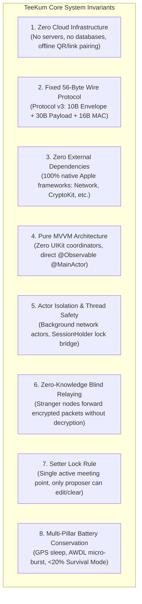
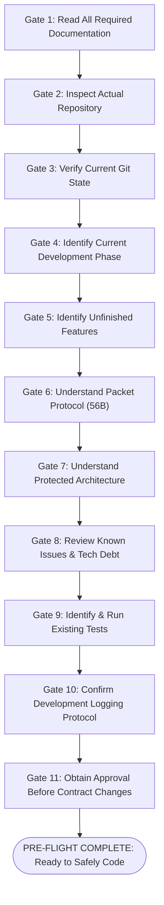
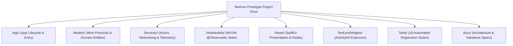

# TeeKum — Engineering Onboarding & AI Agent Handoff Checklist

> **Document Status:** AUTHORITATIVE OPERATIONAL HANDOFF CHECKLIST  
> **Target Audience:** Incoming Systems Engineers, iOS Developers, and Autonomous AI Coding Agents  
> **Last Verified Date:** 2026-11-04  
> **Repository Target:** `/Users/nicho/Developer/TeeKum Prototype`  
> **Xcode Project:** `TeeKum Prototype.xcodeproj` (Schemes: `TeeKum Prototype`, `TeeKumWidgets`) `[VERIFIED]`  
> **Active Baseline:** 18 Automated Test Suites / 208–210 Unit & Integration Tests (100% Pass Rate) `[VERIFIED]`  
> **Companion Documents:**
> - [Master Entry Point (README.md)](README.md) `[VERIFIED]`
> - [Development Guidelines & Standards (DEVELOPMENT_GUIDELINES.md)](DEVELOPMENT_GUIDELINES.md) `[VERIFIED]`
> - [System Architecture Specification (ARCHITECTURE.md)](ARCHITECTURE.md) `[VERIFIED]`
> - [56-Byte Wire Protocol Specification (PROTOCOL_SPECIFICATION.md)](PROTOCOL_SPECIFICATION.md) `[VERIFIED]`
> - [Master Agent Instructions (docs/agent.md)](../agent.md) `[VERIFIED]`
> - [Master Configuration Repository (TeeKumConfiguration.swift)](file:///Users/nicho/Developer/TeeKum%20Prototype/TeeKum%20Prototype/Models/TeeKumConfiguration.swift) `[VERIFIED]`

---

## Technical Statement Classification Taxonomy

Every technical assertion in this document is tagged according to the following strict epistemological taxonomy:
- **`[VERIFIED]`**: Confirmed by inspecting current code and running automated regression suites.
- **`[DOCUMENTED]`**: Described in project architecture documents or specifications but not currently present in source code.
- **`[PLANNED]`**: Approved architectural capability scheduled for near-term implementation.
- **`[PROPOSED]`**: Suggested architectural direction or optimization not yet formally approved.
- **`[UNKNOWN]`**: Behavior or property that cannot currently be established from code or documentation.

---

## 1. Onboarding Overview & System Philosophy

TeeKum is a 100% serverless, decentralized peer-to-peer mesh application designed specifically for attendees at dense music festivals, stadium concerts, and outdoor arenas where cellular networks collapse from traffic congestion `[VERIFIED]`.



---

## 2. Prerequisites & Verified Tooling Commands

Before modifying any source file, ensure your environment satisfies these prerequisites and verify that the application compiles and passes all regression tests cleanly `[VERIFIED]`:

### 2.1 Host Environment Requirements
- **macOS:** macOS 14.0+ (Sonoma) or macOS 15.0+ (Sequoia) `[VERIFIED]`.
- **Xcode:** Xcode 16.0 or later (Swift 5.9 / Swift 6 toolchain) `[VERIFIED]`.
- **Simulator Runtime:** iOS 17.0+ or iOS 18.0+ Simulator (e.g., iPhone 18 Pro, iPhone 16 Pro, iPhone 15 Pro) `[VERIFIED]`.
- **Command Line Tools:** Apple Command Line Tools (`xcodebuild`, `xcrun simctl`) linked via `xcode-select -p` `[VERIFIED]`.

### 2.2 Verified CLI Build, Install & Test Commands

The following commands are directly verified on the local development environment:

#### Step 1: Clean Build Main App & Widget Targets
```bash
# Clean build for the main application scheme (Simulator)
xcodebuild -scheme "TeeKum Prototype" -destination "generic/platform=iOS Simulator" clean build
```
- **Expected Result:** `** BUILD SUCCEEDED **` with 0 fatal errors `[VERIFIED]`.

#### Step 2: Install Bundle onto Booted Simulator
```bash
# Install compiled .app bundle from DerivedData to active booted simulator
xcrun simctl install booted "/Users/nicho/Library/Developer/Xcode/DerivedData/TeeKum_Prototype-*/Build/Products/Debug-iphonesimulator/TeeKum Prototype.app"
```

#### Step 3: Run Full Automated Regression Test Suite
TeeKum includes an on-device headless automated test runner compiled directly into [`TeeKumApp.swift`](file:///Users/nicho/Developer/TeeKum%20Prototype/TeeKum%20Prototype/App/TeeKumApp.swift#L210-L260) `[VERIFIED]`:
```bash
# Launch app headlessly on booted simulator, execute all 18 test suites, and exit cleanly
xcrun simctl launch --console booted com.academy.teekum.TeeKum-Prototype -runAllTests -exitAfterTests
```
- **Execution Time:** ~8–12 seconds `[VERIFIED]`.
- **Expected Output:**
  ```text
  >>> RUNNING ALL AUTOMATED TESTS <<<
  ...
  >>> ALL AUTOMATED TEST RUNS FINISHED <<<
  ```
- **Success Criteria:** Process exits with exit code `0` and all 18 test suites pass with 100% success rate `[VERIFIED]`.

---

## 3. Master Pre-Flight Verification Checklist for New AI Agents & Developers

Every incoming developer or AI coding agent MUST systematically verify each of the following 11 gates before commencing code modifications:



---

### Gate 1: Read All Required Documentation
*Verify that you have read and understood the authoritative documentation package before modifying code.*

- [ ] **Read [`README.md`](README.md):** Understand the standalone package structure, recommended reading tracks, repository source layout, and golden development rules `[VERIFIED]`.
- [ ] **Read [`PROJECT_OVERVIEW.md`](PROJECT_OVERVIEW.md):** Understand the festival operational domain, the 5 venue realities (cellular congestion, human RF absorption, battery drain, acoustic noise, visual disorientation), user journeys, and the 11 non-negotiable invariants `[VERIFIED]`.
- [ ] **Read [`TECH_STACK.md`](TECH_STACK.md):** Confirm that TeeKum has **0 external dependencies** and uses strictly native Apple frameworks (`Network`, `CryptoKit`, `NearbyInteraction`, `CoreMotion`, `ActivityKit`, `MapKit`) `[VERIFIED]`.
- [ ] **Read [`ARCHITECTURE.md`](ARCHITECTURE.md):** Master the pure MVVM architecture (zero coordinators), the actor isolation model, Bonjour discovery (`_teekum._tcp`), and the `SessionHolder` lock bridge `[VERIFIED]`.
- [ ] **Read [`ARCHITECTURAL_DECISIONS.md`](ARCHITECTURAL_DECISIONS.md):** Review all 13 binding ADRs, especially serverless key exchange (ADR-02), 56B packet (ADR-05), ChaCha20-Poly1305 (ADR-06), Option B telemetry (ADR-11), Chat (ADR-12), and Setter Lock Rule (ADR-13) `[VERIFIED]`.
- [ ] **Read [`PROTOCOL_SPECIFICATION.md`](PROTOCOL_SPECIFICATION.md):** Study the 56-byte wire layout bit-by-bit, 10B envelope, 30B inner payloads, 12B deterministic Nonce derivation, and mutable hop count masking `[VERIFIED]`.
- [ ] **Read [`DEVELOPMENT_GUIDELINES.md`](DEVELOPMENT_GUIDELINES.md):** Commit to the 4-step pre-implementation inspection rule, Swift conventions, clickable markdown link rules (`file://`), and logging standards `[VERIFIED]`.
- [ ] **Read [`FEATURE_STATUS.md`](FEATURE_STATUS.md):** Confirm implementation status of target components before making assumptions `[VERIFIED]`.
- [ ] **Read [`DEVELOPMENT_ROADMAP.md`](DEVELOPMENT_ROADMAP.md):** Review completed milestones and current Phase 3 Polish baseline `[VERIFIED]`.
- [ ] **Read [`KNOWN_ISSUES.md`](KNOWN_ISSUES.md):** Review the 8 cataloged technical debt items, compiler warnings, and the discrepancy registry `[VERIFIED]`.
- [ ] **Inspect [`docs/agent.md`](../agent.md):** Review master agent instructions, product safety principles, and execution guidelines `[VERIFIED]`.
- [ ] **Inspect [`docs/DEVELOPMENT_LOG.md`](../DEVELOPMENT_LOG.md):** Read the most recent log entries to understand recent changes, bug fixes, and active context `[VERIFIED]`.

---

### Gate 2: Inspect the Actual Repository
*Confirm repository layout and verify that file references match disk reality.*

- [ ] **Verify Directory Layout:** Execute `ls -la` in workspace root. Confirm presence of:
  - `TeeKum Prototype.xcodeproj` (Xcode project) `[VERIFIED]`
  - `TeeKum Prototype/` (Application source, tests, models, services, views) `[VERIFIED]`
  - `TeeKumWidgets/` (ActivityKit extension source) `[VERIFIED]`
  - `docs/` (Architecture, phase reports, development log, knowledge transfer) `[VERIFIED]`
- [ ] **Verify Zero External Dependencies:** Confirm there are no `Podfile`, `Cartfile`, `Package.swift`, or `.gitmodules` files in the repository:
  ```bash
  find . -maxdepth 2 -name "Podfile*" -o -name "Package.swift" -o -name "Cartfile*"
  ```
  *Expected Result:* Zero matches `[VERIFIED]`.
- [ ] **Verify Compile Sources in Xcode Project:** Confirm both targets (`TeeKum Prototype` and `TeeKumWidgets`) exist in `TeeKum Prototype.xcodeproj/project.pbxproj` `[VERIFIED]`.
- [ ] **Verify Source Directory Structure:**
  - `TeeKum Prototype/App/` (App entry, `TeeKumApp.swift`, `SessionHolder`) `[VERIFIED]`
  - `TeeKum Prototype/Models/` (Wire packet codecs, `TeeKumConfiguration.swift`, domain models) `[VERIFIED]`
  - `TeeKum Prototype/Services/` (Actors, network transport, rate limiters, crypto, chat, UWB, inactivity guard) `[VERIFIED]`
  - `TeeKum Prototype/ViewModels/` (Pure MVVM `@Observable @MainActor` stores) `[VERIFIED]`
  - `TeeKum Prototype/Views/` (SwiftUI views, tactical polar radar, components) `[VERIFIED]`
  - `TeeKum Prototype/Tests/` (18 automated regression test suites) `[VERIFIED]`

---

### Gate 3: Verify the Current Git State
*Ensure a clean working state and check the active development branch.*

- [ ] **Check Current Branch:** Execute `git branch --show-current`. Verify active branch (e.g. `Phase-3` or feature branch) `[VERIFIED]`.
- [ ] **Check Working Tree Status:** Execute `git status`. Verify which files are modified or untracked `[VERIFIED]`.
- [ ] **Review Recent Commits:** Execute `git log -n 5 --oneline` to understand recent commits `[VERIFIED]`.
- [ ] **Ensure No Stashed Changes Interfere:** Execute `git stash list` to verify no forgotten stashes conflict with your work `[VERIFIED]`.
- [ ] **Rule:** Never modify files without verifying the base commit against `docs/DEVELOPMENT_LOG.md` `[VERIFIED]`.

---

### Gate 4: Identify the Current Development Phase
*Confirm exactly which phase the project is in and what has already been signed off.*

- [ ] **Phase 1 (Direct Offline P2P MVP):** **ACCEPTED & VERIFIED** `[VERIFIED]`.  
  *Delivered:* Serverless pairing (QR/link), direct AWDL transport, 54B wire v1, 3s hold SOS siren, basic AMOLED map, single meeting point. Formally accepted in `docs/Phase 1/POC_ACCEPTANCE_REPORT.md` `[VERIFIED]`.
- [ ] **Phase 2 (Multi-Hop Mesh & Background Resilience):** **ACCEPTED & VERIFIED** `[VERIFIED]`.  
  *Delivered:* Bonjour `_teekum._tcp`, zero-knowledge blind stranger relaying, AODV route discovery, `SeenPacketCache` 1,024-LRU, dual-lane rate limiter (2 pkts/s routine, 4 pkts/s SOS), 20% battery survival cutoff, ActivityKit Live Activities, on-device Mesh Debugger. Formally accepted in `docs/Phase 2/PHASE2_ACCEPTANCE_REPORT.md` `[VERIFIED]`.
- [ ] **Phase 3 Core (Tactical Radar, Chat & Venue Intel):** **COMPLETED & VERIFIED** `[VERIFIED]`.  
  *Delivered:* Option B pure telemetry packing (status decoupled), dedicated 20-byte multi-hop festival mesh chat (`Type 0x07`) with preset chips and delivery ACKs (`Type 0x06`), 60m tactical polar radar with compass rotation and distance clamping, Inactivity Guard "Man Down" watchdog (180s stillness, 30s pre-alarm countdown, auto-SOS `0x04`), Apple Nearby Interaction U1/U2 UWB ranging (`Type 0x08`) with sensor-assisted simulation fallback, and full codebase cleanup. Formally accepted with 18 test suites passing `[VERIFIED]`.
- [ ] **Current Active Phase:** **Phase 3 Polish / Pre-Phase 4 Baseline** `[VERIFIED]`.  
  *Active Focus:* Documentation consolidation, knowledge transfer completeness, and preparation for Phase 4 extensions `[VERIFIED]`.

---

### Gate 5: Identify Unfinished Features
*Audit what capabilities are planned vs proposed vs not yet built before starting new work.*

- [ ] **Review Confirmed Roadmap Items (`[PLANNED]`):**
  - **Apple Watch Companion Target (`[PLANNED]`):** Independent or tethered watchOS target communicating via `WCSession`, surfacing haptic navigation cues and nearest friend distance/bearing directly on wrist `[DOCUMENTED]`.
  - **Differential Barometric Relative Altitude (`[PLANNED]`):** Leveraging `CMAltimeter` relative pressure measurements to determine whether a friend in a multi-story stadium is above, below, or on the same floor level `[DOCUMENTED]`.
- [ ] **Review Engineering Recommendations (`[PROPOSED]`):**
  - **Dedicated Native `XCTestBundle` Target (`[PROPOSED]`):** Decoupling the 18 in-app test suites into a standalone test target for headless Xcode Cloud / GitHub Actions CI `[DOCUMENTED]`.
  - **Swift 6 Strict Concurrency Cleanup (`[PROPOSED]`):** Annotating non-UI model structs with `nonisolated` to resolve 189 compiler warnings under strict concurrency mode `[DOCUMENTED]`.
  - **Centralized Wire Packet Codec (`[PROPOSED]`):** Unifying packet serialization logic across disparate test helpers into `Packet.swift` `[DOCUMENTED]`.
- [ ] **Review Future Phase 4 Exploratory Proposals (`[PROPOSED]`):**
  - Offline GeoJSON festival stage & landmark overlays `[DOCUMENTED]`.
  - External LoRa bridge gateway nodes for stage-spanning multi-kilometer relaying `[DOCUMENTED]`.
- [ ] **Rule:** Never describe a `[PLANNED]` or `[PROPOSED]` feature as implemented in user-facing communications or documentation `[VERIFIED]`.

---

### Gate 6: Understand the Packet Protocol
*Master the 56-byte physical wire format and cryptographic rules.*

- [ ] **56-Byte Physical Datagram Invariant:** Every wire packet is **strictly 56 bytes** `[VERIFIED]`:
  ```text
  [Bytes 0..9: Cleartext Envelope (10B)] 
  [Bytes 10..39: Encrypted Payload (30B)] 
  [Bytes 40..55: Poly1305 MAC Tag (16B)]
  ```
- [ ] **10-Byte Cleartext Envelope Layout:**
  - **Byte 0:** `versionAndType` (High nibble = `0x03` Protocol v3; Low nibble = `PacketType` `0x01`..`0x08`) `[VERIFIED]`.
  - **Byte 1:** `hopLimit` (UInt8, 8 to 15) `[VERIFIED]`.
  - **Byte 2:** `hopCount` (UInt8, starts at `0x00`, incremented at each relay hop) `[VERIFIED]`.
  - **Bytes 3..5:** `sessionId` (24-bit Big Endian integer) `[VERIFIED]`. *(Note: see ISSUE-007 for 16-bit ingestion truncation)*.
  - **Bytes 6..9:** `sequenceNumber` (UInt32 Big Endian: High 8 bits = `memberSlot`, Low 24 bits = monotonic counter) `[VERIFIED]`.
- [ ] **12-Byte Deterministic Nonce Derivation:**
  - Bytes 0..2: `sessionId` (3 bytes, Big Endian) `[VERIFIED]`.
  - Bytes 3..6: `sequenceNumber` (4 bytes, UInt32 Big Endian) `[VERIFIED]`.
  - Byte 7: `versionAndType` (1 byte, UInt8) `[VERIFIED]`.
  - Bytes 8..11: ASCII `"TKM2"` (`[0x54, 0x4B, 0x4D, 0x32]`) `[VERIFIED]`.
- [ ] **Associated Authenticated Data (AAD) & Mutable Hop Count Masking:**
  - AAD is exactly the 10-byte cleartext envelope with **`hopCount` (Byte 2) masked to `0x00`** `[VERIFIED]`.
  - This enables intermediate stranger relays to increment `hopCount` without breaking the Poly1305 authentication tag `[VERIFIED]`.
- [ ] **Inner 30-Byte Plaintext Payloads (Low Nibble of Byte 0):**
  - `0x01` **`LocationPingPayload` (Option B):** Int32 quantized lat/lon (8B), Base-27 Initials (2B), battery (1B), heading (2B), member color (1B), status (1B), reserved zero-padding (12B) `[VERIFIED]`.
  - `0x02` **`SOSPayload`:** Int32 coordinates (8B), initials (2B), battery (1B), color (1B), timestamp (4B), sosType (1B), reserved (11B) `[VERIFIED]`.
  - `0x03` **`MeetingUpdatePayload`:** Int32 coordinates (8B), meetup timestamp (4B), proposer slot (1B), landmark ID (1B), reserved (16B) `[VERIFIED]`.
  - `0x04` **`RouteReqPayload`:** Target memberSlot (1B), origin slot (1B), request ID (2B), reserved (26B) `[VERIFIED]`.
  - `0x05` **`RouteRespPayload`:** Target memberSlot (1B), responder slot (1B), request ID (2B), hop count (1B), reserved (25B) `[VERIFIED]`.
  - `0x06` **`ACKPayload`:** Acknowledged message sequence number (4B), recipient slot (1B), reserved (25B) `[VERIFIED]`.
  - `0x07` **`ChatMessagePayload`:** Sender slot (1B), message ID (2B), recipient/broadcast slot (1B), preset code (1B), text length (1B), UTF-8 text (up to 20B), padding (4B) `[VERIFIED]`.
  - `0x08` **`UWBTokenExchangePayload`:** Action code (1B: request/response/stop), sender slot (1B), target slot (1B), fragment index (1B), total fragments (1B), token chunk (up to 25B) `[VERIFIED]`.
- [ ] **Test Verification:** Verify codec test suite via `PacketCodecTests.runAllTests()` `[VERIFIED]`.

---

### Gate 7: Understand Protected Architecture
*Acknowledge the 8 non-negotiable architectural pillars that cannot be altered.*

- [ ] **Pillar 1: Zero External Dependencies Invariant:** No third-party packages (no CocoaPods, no SPM, no Carthage). All capabilities are native Apple frameworks `[VERIFIED]`.
- [ ] **Pillar 2: Fixed 56-Byte Wire Packet Standard:** Invariant datagram wire size. No multi-packet fragmentation for routine pings; 20-byte text chat limit `[VERIFIED]`.
- [ ] **Pillar 3: Pure MVVM Architecture (Zero Coordinators):** Direct `@Observable @MainActor` state binding to SwiftUI views. No UIKit navigation coordinators or routers `[VERIFIED]`.
- [ ] **Pillar 4: Actor Isolation & Thread Safety Model:** Background network engines (`PeerTransportService`, `CryptoService`, `PacketForwarder`, `ChatMessageEngine`, `SeenPacketCache`, `NeighborTable`, `RoutingTable`) are strict Swift actors. `SessionHolder` bridges active session state safely across actors without async thread hops `[VERIFIED]`.
- [ ] **Pillar 5: Zero-Knowledge Communal Mesh Relaying:** Intermediate stranger nodes forward packets by inspecting only the 10-byte envelope. Payloads are never decrypted by relays `[VERIFIED]`.
- [ ] **Pillar 6: Authoritative Single Meeting Point & Setter Lock Rule:** Strictly one active meeting point per group. Only the original proposer (`proposerId == activeSession.memberSlot`) can edit or clear it before its 1-hour expiration `[VERIFIED]`.
- [ ] **Pillar 7: Ephemeral In-Memory Storage & Privacy by Design:** Zero backend cloud servers. Cryptographic keys and peer coordinates live only in RAM and Keychain, purged immediately upon session teardown `[VERIFIED]`.
- [ ] **Pillar 8: Multi-Pillar Battery Conservation:** CoreMotion activity sleep shuts down GPS satellites when stationary (~70% power savings). AWDL radio micro-bursting. Pitch black `#000000` AMOLED rendering. Automatic **Festival Survival Mode** terminating all stranger relaying when battery drops to `<20%` `[VERIFIED]`.

---

### Gate 8: Review Known Issues & Technical Debt
*Familiarize yourself with known issues to avoid creating regressions or re-reporting documented debt.*

- [ ] **Review `ISSUE-001` (ActivityKit File Duplication):** [`SessionActivityAttributes.swift`](file:///Users/nicho/Developer/TeeKum%20Prototype/TeeKumWidgets/SessionActivityAttributes.swift) is duplicated across `TeeKum Prototype/Models/` and `TeeKumWidgets/` due to Xcode multi-target compilation constraints. Do not manually delete or unsync these files without verifying widget build targets `[VERIFIED]`.
- [ ] **Review `ISSUE-002` (Redundant Timing Configuration Wrappers):** `MeshTimingConfiguration.swift` wraps `TeeKumConfiguration.swift`. When tuning timing constants, update `TeeKumConfiguration.swift` `[VERIFIED]`.
- [ ] **Review `ISSUE-003` (Swift 6 Strict Concurrency Compiler Warnings):** 189 actor-isolation warnings exist under Swift 5.9 / Swift 6 transition flags. These are non-fatal in the current build. Resolve them carefully by copying Sendable value types across actor boundaries `[VERIFIED]`.
- [ ] **Review `ISSUE-004` (Test Runners Compiled in Production Target):** All 18 test suites are compiled directly into the app binary to power the on-device Mesh Debugger and CLI simulator runs. Do not strip them without migrating to a dedicated `XCTestBundle` `[VERIFIED]`.
- [ ] **Review `ISSUE-005` (SOS Pipeline Architectural Duality):** `SOSViewModel` and `SOSForwardingEngine` handle overlapping SOS tasks. Both pipelines are verified by `SOSEndToEndTests` and `MultiHopSOSTests` `[VERIFIED]`.
- [ ] **Review `ISSUE-006` (Force Unwrap in `RadarBlipView.swift`):** `RadarBlipView` contains a forced unwrap (`friend.currentCoordinate!`) guarded upstream by an `isLocationAvailable` check. Exercise caution when modifying `Member` coordinate optionals `[VERIFIED]`.
- [ ] **Review `ISSUE-007` (Wire Protocol 24-Bit vs 16-Bit `sessionId` Ingestion):** Wire format allocates 3 bytes (24 bits) for `sessionId`, but `CleartextEnvelope` deserialization reads Bytes 3..4 as `UInt16` and drops Byte 5. Preserve this behavior for backward compatibility until a coordinated migration is scheduled `[VERIFIED]`.
- [ ] **Review `ISSUE-008` (Simulator Hardware Limitations):** Simulators lack AWDL radios and U1/U2 Ultra-Wideband silicon. Use the built-in sensor-assisted simulation fallback in [`NearbyInteractionService.swift`](file:///Users/nicho/Developer/TeeKum%20Prototype/TeeKum%20Prototype/Services/NearbyInteractionService.swift) and `MeshTopologySimulator` `[VERIFIED]`.

---

### Gate 9: Identify & Run Existing Tests
*Verify that all test suites are understood and execute cleanly before making changes.*

- [ ] **Test Suite Inventory (18 Suites in `TeeKum Prototype/Tests/`):**
  1. [`PacketCodecTests.swift`](file:///Users/nicho/Developer/TeeKum%20Prototype/TeeKum%20Prototype/Tests/PacketCodecTests.swift): 20 tests verifying 56B layout, Int32 coordinates, Base-27 initials, ChaChaPoly AEAD, AAD, and all 8 packet types `[VERIFIED]`.
  2. [`PeerTransportTests.swift`](file:///Users/nicho/Developer/TeeKum%20Prototype/TeeKum%20Prototype/Tests/PeerTransportTests.swift): 13 tests verifying `StreamMessageFramer`, `PriorityOutboxQueue`, tie-breaking, and zero-handshake framing `[VERIFIED]`.
  3. [`NeighborDiscoveryTests.swift`](file:///Users/nicho/Developer/TeeKum%20Prototype/TeeKum%20Prototype/Tests/NeighborDiscoveryTests.swift): 6 tests verifying Bonjour link state, RSSI tracking, and dead-peer pruning `[VERIFIED]`.
  4. [`RoutingForwardingTests.swift`](file:///Users/nicho/Developer/TeeKum%20Prototype/TeeKum%20Prototype/Tests/RoutingForwardingTests.swift): 10 tests verifying `PacketForwarder`, 8-hop ceiling, and rate limiting `[VERIFIED]`.
  5. [`RouteDiscoveryTests.swift`](file:///Users/nicho/Developer/TeeKum%20Prototype/TeeKum%20Prototype/Tests/RouteDiscoveryTests.swift): 10 tests verifying AODV discovery, `ROUTE_REQ`/`ROUTE_RESP`, and 30s TTL `[VERIFIED]`.
  6. [`CryptoSecurityTests.swift`](file:///Users/nicho/Developer/TeeKum%20Prototype/TeeKum%20Prototype/Tests/CryptoSecurityTests.swift): 12 tests verifying ChaCha20-Poly1305, replay protection, and Keychain storage `[VERIFIED]`.
  7. [`LocationPublishingTests.swift`](file:///Users/nicho/Developer/TeeKum%20Prototype/TeeKum%20Prototype/Tests/LocationPublishingTests.swift): 10 tests verifying GPS coprocessor sleep, adaptive cadences, and coordinate quantization `[VERIFIED]`.
  8. [`UIStateTests.swift`](file:///Users/nicho/Developer/TeeKum%20Prototype/TeeKum%20Prototype/Tests/UIStateTests.swift): 14 tests verifying MVVM state binding, stale friend indicators, and QR generation `[VERIFIED]`.
  9. [`SOSEndToEndTests.swift`](file:///Users/nicho/Developer/TeeKum%20Prototype/TeeKum%20Prototype/Tests/SOSEndToEndTests.swift): 12 tests verifying 3s countdown, high-priority preemption, and honest delivery states `[VERIFIED]`.
  10. [`MultiHopSOSTests.swift`](file:///Users/nicho/Developer/TeeKum%20Prototype/TeeKum%20Prototype/Tests/MultiHopSOSTests.swift): 14 tests verifying multi-hop flood propagation, stranger relaying, and hop limit drop `[VERIFIED]`.
  11. [`LiveActivityTests.swift`](file:///Users/nicho/Developer/TeeKum%20Prototype/TeeKum%20Prototype/Tests/LiveActivityTests.swift): 12 tests verifying ActivityKit start, push token updates, and teardown dismissal `[VERIFIED]`.
  12. [`RelayPolicyTests.swift`](file:///Users/nicho/Developer/TeeKum%20Prototype/TeeKum%20Prototype/Tests/RelayPolicyTests.swift): 10 tests verifying participation modes (`communalCompact`, `isolatedGroup`, `stealthObserver`) and 20% battery cutoff `[VERIFIED]`.
  13. [`MeshFailureIntegrationTests.swift`](file:///Users/nicho/Developer/TeeKum%20Prototype/TeeKum%20Prototype/Tests/MeshFailureIntegrationTests.swift): 12 tests verifying network partition recovery, churn resilience, and rapid reconnection `[VERIFIED]`.
  14. [`MeshDebuggerTests.swift`](file:///Users/nicho/Developer/TeeKum%20Prototype/TeeKum%20Prototype/Tests/MeshDebuggerTests.swift): 12 tests verifying on-device diagnostic HUD, topology map, and synthetic injection `[VERIFIED]`.
  15. [`ChatMessagingEngineTests.swift`](file:///Users/nicho/Developer/TeeKum%20Prototype/TeeKum%20Prototype/Tests/ChatMessagingEngineTests.swift): 16 tests verifying 20B mesh chat (`Type 0x07`), UTF-8 emoji clamping, delivery ACKs (`Type 0x06`), and 50-message RAM cap `[VERIFIED]`.
  16. [`ChatUITests.swift`](file:///Users/nicho/Developer/TeeKum%20Prototype/TeeKum%20Prototype/Tests/ChatUITests.swift): 11 tests verifying message bubble rendering, preset chips, byte meter, and honest delivery state progression `[VERIFIED]`.
  17. [`InactivityGuardTests.swift`](file:///Users/nicho/Developer/TeeKum%20Prototype/TeeKum%20Prototype/Tests/InactivityGuardTests.swift): 9 tests verifying 180s stillness detection, 30s pre-alarm silent warning, touch reset, motion cancel, and auto-SOS `0x04` dispatch `[VERIFIED]`.
  18. [`NearbyInteractionTests.swift`](file:///Users/nicho/Developer/TeeKum%20Prototype/TeeKum%20Prototype/Tests/NearbyInteractionTests.swift): 7 tests verifying UWB 30-byte token exchange (`Type 0x08`), 12-fragment token chunking, 1-hop limit, and sensor-assisted simulation fallback `[VERIFIED]`.
- [ ] **Baseline Test Run:** Execute the master regression command:
  ```bash
  xcrun simctl launch --console booted com.academy.teekum.TeeKum-Prototype -runAllTests -exitAfterTests
  ```
  *Verify that all 18 test suites pass with 100% success rate before modifying code.*

---

### Gate 10: Confirm Development Logging Requirements
*Commit to recording all engineering work in the reverse-chronological development log.*

- [ ] **Log Location:** [`docs/DEVELOPMENT_LOG.md`](../DEVELOPMENT_LOG.md) `[VERIFIED]`.
- [ ] **Placement Rule:** Every new entry MUST be placed at the **very top of the file**, directly beneath the document header, preserving reverse-chronological order `[VERIFIED]`.
- [ ] **Standard Entry Schema:** Ensure your entry contains all mandatory sections:
  ```markdown
  ### [YYYY-MM-DD HH:MM] — <Role / Contributor>: <Concise Task Title>
  - **Contributor / Agent:** <Name / Role> (Antigravity)
  - **Status:** Completed & Fully Verified (100% Test Pass Rate, Build Succeeded)
  - **Target Phase / Milestone:** <Phase Target>

  #### 1. Objective & Scope
  - Concise bullet points defining what was addressed and why.

  #### 2. Key Invariants & Architectural Invariants Verified
  - Summary of core system principles upheld (56B packet, pure MVVM, actor isolation, battery cutoff).

  #### 3. Deliverables Touched
  - Clickable markdown links to all modified files, test suites, or documentation.

  #### 4. Verification & Results
  - Concrete build command results (`** BUILD SUCCEEDED **`).
  - Simulator test execution output confirming 18 test suites / 220 tests passed cleanly.
  ```
- [ ] **Rule:** Never complete a user request or task session without updating `docs/DEVELOPMENT_LOG.md` `[VERIFIED]`.

---

### Gate 11: Obtain Approval Before Changing Architectural Contracts
*Acknowledge governance boundaries: do not change architectural contracts without explicit approval.*

- [ ] **Mandatory Halt & Approval Triggers:** You **MUST STOP** and request explicit confirmation from the human engineer before making any of the following alterations:
  - ❌ Modifying the 56-byte wire datagram layout, field alignments, or packet size.
  - ❌ Adding any third-party framework, SPM package, CocoaPod, or external binary dependency.
  - ❌ Introducing an external cloud service, remote database, telemetry collector, or server endpoint.
  - ❌ Altering the cryptographic cipher suite (RFC 8439 ChaCha20-Poly1305), 12-byte Nonce derivation, or AAD hop masking.
  - ❌ Overriding the Setter Lock Rule to allow non-setters to overwrite active meeting points.
  - ❌ Altering actor isolation boundaries in background network services without formal concurrency review.
  - ❌ Disabling the automatic Festival Survival Mode battery cutoff (<20% relay shutdown).
- [ ] **Rule:** When in doubt about whether a requirement alters an architectural contract, solicit clarification before proceeding `[VERIFIED]`.

---

## 4. Codebase Directory Map ("Where to Find What")



### 4.1 Application Lifecycle (`TeeKum Prototype/App/`)
- [`TeeKumApp.swift`](file:///Users/nicho/Developer/TeeKum%20Prototype/TeeKum%20Prototype/App/TeeKumApp.swift): Main `@main` application entry point. Holds top-level `@State` view models, lifecycle listeners, automated test runner triggers, and session teardown coordination `[VERIFIED]`.
- `SessionHolder`: Thread-safe `@unchecked Sendable` lock-guarded wrapper class bridging `GroupSession` across background actors without async suspension hops `[VERIFIED]`.

### 4.2 Data Models & Wire Codecs (`TeeKum Prototype/Models/`)
- [`Packet.swift`](file:///Users/nicho/Developer/TeeKum%20Prototype/TeeKum%20Prototype/Models/Packet.swift): Fixed 56-byte binary wire specification (Protocol v3). Implements `RawWirePacket`, `CleartextEnvelope` (10B), all 8 inner payloads (`0x01`..`0x08`), 12B Nonce derivation, and 10B AAD with hop masking `[VERIFIED]`.
- [`TeeKumConfiguration.swift`](file:///Users/nicho/Developer/TeeKum%20Prototype/TeeKum%20Prototype/Models/TeeKumConfiguration.swift): Master centralized configuration repository containing all network parameters, timing cadences, battery thresholds, chat limits, and radar constants `[VERIFIED]`.
- [`GroupSession.swift`](file:///Users/nicho/Developer/TeeKum%20Prototype/TeeKum%20Prototype/Models/GroupSession.swift): Ephemeral session entity holding 24-bit session ID, 256-bit symmetric cryptographic key, local attendee initials, and serverless URL fragment link encoder/decoder (`teekum://join#key=...`) `[VERIFIED]`.
- [`InitialsCodec.swift`](file:///Users/nicho/Developer/TeeKum%20Prototype/TeeKum%20Prototype/Models/InitialsCodec.swift): 2-byte Base-27 encoder/decoder compressing 1 to 3 uppercase letters (`A`–`Z`, 18,278 combinations) into `UInt16` to eliminate P2P handshakes `[VERIFIED]`.
- [`Member.swift`](file:///Users/nicho/Developer/TeeKum%20Prototype/TeeKum%20Prototype/Models/Member.swift): Domain model representing group friends (coordinates, last seen timestamp, emergency state, battery level, heading, member color, stale indicators) `[VERIFIED]`.
- [`MemberColor.swift`](file:///Users/nicho/Developer/TeeKum%20Prototype/TeeKum%20Prototype/Models/MemberColor.swift): 1-byte personal neon color palette enum (`0x00` unset/hash, `0x01`..`0x08` palette) `[VERIFIED]`.
- [`ChatMessage.swift`](file:///Users/nicho/Developer/TeeKum%20Prototype/TeeKum%20Prototype/Models/ChatMessage.swift): Ephemeral mesh chat message entity with per-recipient ACK tracking `[VERIFIED]`.
- [`LocationPin.swift`](file:///Users/nicho/Developer/TeeKum%20Prototype/TeeKum%20Prototype/Models/LocationPin.swift): MapKit coordinate wrapper with Int32 quantization converters `[VERIFIED]`.
- [`MeetingPoint.swift`](file:///Users/nicho/Developer/TeeKum%20Prototype/TeeKum%20Prototype/Models/MeetingPoint.swift): Single active rendezvous entity with meetup times, proposer initials, and curated venue landmark options `[VERIFIED]`.
- [`SOSDeliveryState.swift`](file:///Users/nicho/Developer/TeeKum%20Prototype/TeeKum%20Prototype/Models/SOSDeliveryState.swift): Honest UX state machine representing SOS progression (`localSending`, `searchingPeers`, `relayedAck`, `deliveredToFriend`) `[VERIFIED]`.
- [`Formatters.swift`](file:///Users/nicho/Developer/TeeKum%20Prototype/TeeKum%20Prototype/Models/Formatters.swift): Centralized metric distance formatters, battery icons/percentages, clock directions, and static cached `DateFormatter` singletons `[VERIFIED]`.
- [`SessionActivityAttributes.swift`](file:///Users/nicho/Developer/TeeKum%20Prototype/TeeKumWidgets/SessionActivityAttributes.swift): Shared ActivityKit contract for Lock Screen and Dynamic Island `[VERIFIED]`.

### 4.3 Background Actors & Mesh Services (`TeeKum Prototype/Services/`)
- [`PeerTransportService.swift`](file:///Users/nicho/Developer/TeeKum%20Prototype/TeeKum%20Prototype/Services/PeerTransportService.swift): Network.framework AWDL radio transport actor managing Bonjour browsing/advertising (`_teekum._tcp`), NWConnections, and packet dispatch `[VERIFIED]`.
- [`StreamMessageFramer.swift`](file:///Users/nicho/Developer/TeeKum%20Prototype/TeeKum%20Prototype/Services/StreamMessageFramer.swift): Delimits continuous TCP/AWDL streams into 56-byte datagrams with buffer reconstruction and corruption resynchronization `[VERIFIED]`.
- [`PriorityOutboxQueue.swift`](file:///Users/nicho/Developer/TeeKum%20Prototype/TeeKum%20Prototype/Services/PriorityOutboxQueue.swift): Two-lane outbox actor enforcing urgent FIFO preemption (SOS, Rendezvous, ACKs, UWB) over coalesced location telemetry `[VERIFIED]`.
- [`SeenPacketCache.swift`](file:///Users/nicho/Developer/TeeKum%20Prototype/TeeKum%20Prototype/Services/SeenPacketCache.swift): Actor-isolated 1,024-entry LRU sliding window tracking 7-byte composite packet keys (`PacketKey`) to suppress duplicate broadcasts `[VERIFIED]`.
- [`ForwardingRateLimiter.swift`](file:///Users/nicho/Developer/TeeKum%20Prototype/TeeKum%20Prototype/Services/ForwardingRateLimiter.swift): Dual-lane token bucket traffic shaper capping ordinary pings at 2.0 pkts/s and SOS at 4.0 pkts/s `[VERIFIED]`.
- [`PacketForwarder.swift`](file:///Users/nicho/Developer/TeeKum%20Prototype/TeeKum%20Prototype/Services/PacketForwarder.swift): Blind zero-knowledge relay actor enforcing 8-hop mesh ceiling and AAD authentication invariants `[VERIFIED]`.
- [`RouteDiscoveryService.swift`](file:///Users/nicho/Developer/TeeKum%20Prototype/TeeKum%20Prototype/Services/RouteDiscoveryService.swift): On-demand AODV discovery engine broadcasting `ROUTE_REQ` (Type `0x04`) and matching `ROUTE_RESP` (Type `0x05`) `[VERIFIED]`.
- [`RoutingTable.swift`](file:///Users/nicho/Developer/TeeKum%20Prototype/TeeKum%20Prototype/Services/RoutingTable.swift): Actor-isolated AODV routing table tracking next-hop pointers and 30s TTL path validity `[VERIFIED]`.
- [`NeighborTable.swift`](file:///Users/nicho/Developer/TeeKum%20Prototype/TeeKum%20Prototype/Services/NeighborTable.swift): Peer link registry tracking dynamic RSSI signal strength and dead-peer pruning `[VERIFIED]`.
- [`CryptoService.swift`](file:///Users/nicho/Developer/TeeKum%20Prototype/TeeKum%20Prototype/Services/CryptoService.swift): ChaCha20-Poly1305 AEAD authenticated encryption actor managing Keychain storage and replay filters `[VERIFIED]`.
- [`ChatMessageEngine.swift`](file:///Users/nicho/Developer/TeeKum%20Prototype/TeeKum%20Prototype/Services/ChatMessageEngine.swift): Festival mesh chat actor managing 20-byte text transmissions, FIFO retries, and delivery ACK tracking `[VERIFIED]`.
- [`NearbyInteractionService.swift`](file:///Users/nicho/Developer/TeeKum%20Prototype/TeeKum%20Prototype/Services/NearbyInteractionService.swift): Apple U1/U2 Ultra-Wideband ranging service (`NISession`) with sensor-assisted simulation fallback for simulators and non-UWB devices `[VERIFIED]`.
- [`InactivityGuardService.swift`](file:///Users/nicho/Developer/TeeKum%20Prototype/TeeKum%20Prototype/Services/InactivityGuardService.swift): Man Down watchdog monitoring 180s immobility via accelerometry and managing 30s pre-alarm countdown before auto-SOS `[VERIFIED]`.
- [`LocationService.swift`](file:///Users/nicho/Developer/TeeKum%20Prototype/TeeKum%20Prototype/Services/LocationService.swift): CoreLocation wrapper managing adaptive GNSS accuracy, motion coprocessor sleep, and Int32 coordinate quantization `[VERIFIED]`.
- [`RelayPolicyManager.swift`](file:///Users/nicho/Developer/TeeKum%20Prototype/TeeKum%20Prototype/Services/RelayPolicyManager.swift): Manages stranger relay participation modes (`communalCompact`, `isolatedGroup`, `stealthObserver`) and battery cutoffs `[VERIFIED]`.
- [`LiveActivityManager.swift`](file:///Users/nicho/Developer/TeeKum%20Prototype/TeeKum%20Prototype/Services/LiveActivityManager.swift): Manages Dynamic Island and Lock Screen ActivityKit push updates `[VERIFIED]`.
- [`SOSForwardingEngine.swift`](file:///Users/nicho/Developer/TeeKum%20Prototype/TeeKum%20Prototype/Services/SOSForwardingEngine.swift): Background multi-hop emergency flooding manager with bounded retry budgets `[VERIFIED]`.
- [`SOSAudioAlert.swift`](file:///Users/nicho/Developer/TeeKum%20Prototype/TeeKum%20Prototype/Services/SOSAudioAlert.swift): High-decibel pulsating siren and haptic pattern generator `[VERIFIED]`.
- [`NotificationService.swift`](file:///Users/nicho/Developer/TeeKum%20Prototype/TeeKum%20Prototype/Services/NotificationService.swift): Local user notification dispatch for background SOS alerts `[VERIFIED]`.
- [`MeshTopologySimulator.swift`](file:///Users/nicho/Developer/TeeKum%20Prototype/TeeKum%20Prototype/Services/MeshTopologySimulator.swift): Synthetic in-memory mesh network simulator powering on-device diagnostics `[VERIFIED]`.

### 4.4 ViewModels (`TeeKum Prototype/ViewModels/`)
- [`GroupSessionViewModel.swift`](file:///Users/nicho/Developer/TeeKum%20Prototype/TeeKum%20Prototype/ViewModels/GroupSessionViewModel.swift): Group pairing lifecycle, QR barcode rendering, and friend roster state `[VERIFIED]`.
- [`MapViewModel.swift`](file:///Users/nicho/Developer/TeeKum%20Prototype/TeeKum%20Prototype/ViewModels/MapViewModel.swift): Pure MVVM map coordinate publisher, tactical radar math, compass heading rotation, and friend distance clamping `[VERIFIED]`.
- [`MeetingPointViewModel.swift`](file:///Users/nicho/Developer/TeeKum%20Prototype/TeeKum%20Prototype/ViewModels/MeetingPointViewModel.swift): Enforces single active meeting point and Setter Lock Rule `[VERIFIED]`.
- [`SOSViewModel.swift`](file:///Users/nicho/Developer/TeeKum%20Prototype/TeeKum%20Prototype/ViewModels/SOSViewModel.swift): 3-second hold emergency trigger, countdown animation, and incoming siren banners `[VERIFIED]`.
- [`ChatViewModel.swift`](file:///Users/nicho/Developer/TeeKum%20Prototype/TeeKum%20Prototype/ViewModels/ChatViewModel.swift): 20-byte mesh chat composer, byte limiter meter, preset chips, and delivery state progression `[VERIFIED]`.
- [`MeshDebuggerViewModel.swift`](file:///Users/nicho/Developer/TeeKum%20Prototype/TeeKum%20Prototype/ViewModels/MeshDebuggerViewModel.swift): Powers diagnostic lab, topology visualizer, and 1-tap automated test runner `[VERIFIED]`.

### 4.5 Views & Components (`TeeKum Prototype/Views/`)
- [`MainMapView.swift`](file:///Users/nicho/Developer/TeeKum%20Prototype/TeeKum%20Prototype/Views/MainMapView.swift): Primary container hosting Tactical Radar, Apple Maps layer toggle, and bottom navigation bar `[VERIFIED]`.
- [`RadarView.swift`](file:///Users/nicho/Developer/TeeKum%20Prototype/TeeKum%20Prototype/Views/Components/Radar/RadarView.swift): 60-meter forward-up polar radar with AMOLED `#000000` background and heading rotation `[VERIFIED]`.
- [`FinderBeaconView.swift`](file:///Users/nicho/Developer/TeeKum%20Prototype/TeeKum%20Prototype/Views/FinderBeaconView.swift): Single-friend directional beacon compass overlay and UWB launcher `[VERIFIED]`.
- [`PrecisionFindingOverlay.swift`](file:///Users/nicho/Developer/TeeKum%20Prototype/TeeKum%20Prototype/Views/Components/Radar/PrecisionFindingOverlay.swift): Centimeter-accurate U1/U2 UWB radar overlay with sensor fallback `[VERIFIED]`.
- [`ChatSheetView.swift`](file:///Users/nicho/Developer/TeeKum%20Prototype/TeeKum%20Prototype/Views/Components/ChatSheetView.swift): Docked bottom sheet message feed preserving glanceable map context `[VERIFIED]`.
- [`ChatMessageBubbleView.swift`](file:///Users/nicho/Developer/TeeKum%20Prototype/TeeKum%20Prototype/Views/Components/ChatMessageBubbleView.swift): Incoming and outgoing message bubble with delivery state chips `[VERIFIED]`.
- [`PresetChipsView.swift`](file:///Users/nicho/Developer/TeeKum%20Prototype/TeeKum%20Prototype/Views/Components/PresetChipsView.swift): 1-tap quick preset chips (*"Beer line"*, *"Main Stage"*, *"Lost"*) `[VERIFIED]`.
- [`ByteMeterView.swift`](file:///Users/nicho/Developer/TeeKum%20Prototype/TeeKum%20Prototype/Views/Components/ByteMeterView.swift): Real-time visual progress meter enforcing 20 UTF-8 byte boundary `[VERIFIED]`.
- [`RecipientAckBreakdownView.swift`](file:///Users/nicho/Developer/TeeKum%20Prototype/TeeKum%20Prototype/Views/Components/RecipientAckBreakdownView.swift): Granular per-recipient delivery ACK checklist `[VERIFIED]`.
- [`SOSButtonView.swift`](file:///Users/nicho/Developer/TeeKum%20Prototype/TeeKum%20Prototype/Views/SOSButtonView.swift): High-contrast tactile emergency hold button `[VERIFIED]`.
- [`IncomingSOSAlertBannerView.swift`](file:///Users/nicho/Developer/TeeKum%20Prototype/TeeKum%20Prototype/Views/Components/IncomingSOSAlertBannerView.swift): Full-screen emergency siren banner with distance, bearing, and silencer `[VERIFIED]`.
- [`GroupPairingView.swift`](file:///Users/nicho/Developer/TeeKum%20Prototype/TeeKum%20Prototype/Views/GroupPairingView.swift): Host creation and QR barcode scanner pairing flow `[VERIFIED]`.
- [`MeetingPointsView.swift`](file:///Users/nicho/Developer/TeeKum%20Prototype/TeeKum%20Prototype/Views/MeetingPointsView.swift): Single active meeting point card, arrival geofencing, and RSVP buttons `[VERIFIED]`.
- [`FriendDetailView.swift`](file:///Users/nicho/Developer/TeeKum%20Prototype/TeeKum%20Prototype/Views/FriendDetailView.swift): Friend status sheet with UWB finding launcher and last seen telemetry `[VERIFIED]`.
- [`MeshDebuggerView.swift`](file:///Users/nicho/Developer/TeeKum%20Prototype/TeeKum%20Prototype/Views/MeshDebuggerView.swift): On-device engineering test lab with virtual mesh simulator and test runner `[VERIFIED]`.
- [`DiagnosticsView.swift`](file:///Users/nicho/Developer/TeeKum%20Prototype/TeeKum%20Prototype/Views/DiagnosticsView.swift): Real-time radio telemetry HUD and automated test runner trigger `[VERIFIED]`.

---

## 5. Troubleshooting & Frequently Asked Questions (FAQ)

### Q1: Why is `SessionActivityAttributes.swift` present in two folders?
- **Root Cause:** In Xcode multi-target configurations, widget extension targets require shared ActivityKit attribute structs. Rather than configuring complex target memberships in `project.pbxproj`, a clean copy exists in `TeeKum Prototype/Models/` and `TeeKumWidgets/` `[VERIFIED]`.
- **Resolution:** If you modify `SessionActivityAttributes.swift`, keep both copies synchronized `[VERIFIED]`.

### Q2: Why are there compiler warnings regarding actor isolation?
- **Root Cause:** The project is configured under Swift 5.9 / Swift 6 transition flags. Non-UI model structs without explicit `nonisolated` annotations are accessed across actor boundaries `[VERIFIED]`.
- **Risk Assessment:** **LOW RISK in current build**. These warnings do not cause runtime crashes or undefined behavior in the current build configuration `[VERIFIED]`.
- **Remediation:** When touching affected models, ensure values are passed as Sendable copies or mark immutable helpers `nonisolated` `[DOCUMENTED]`.

### Q3: Why does Xcode Test Navigator show 0 tests, but the test suite passes?
- **Root Cause:** TeeKum uses an internal automated test runner embedded directly in [`TeeKumApp.swift`](file:///Users/nicho/Developer/TeeKum%20Prototype/TeeKum%20Prototype/App/TeeKumApp.swift) rather than an external `XCTestBundle` `[VERIFIED]`. This enables headless CI testing and on-device execution in festival environments `[VERIFIED]`.
- **Resolution:** Execute tests via the official CLI command:
  ```bash
  xcrun simctl launch --console booted com.academy.teekum.TeeKum-Prototype -runAllTests -exitAfterTests
  ```

### Q4: Why can't I open the Precision Finding (UWB) screen on the Simulator?
- **Root Cause:** iOS Simulators and older iPhones lack Apple U1/U2 Ultra-Wideband silicon `[VERIFIED]`.
- **Resolution:** A **sensor-assisted simulation fallback** is integrated into [`NearbyInteractionService.swift`](file:///Users/nicho/Developer/TeeKum%20Prototype/TeeKum%20Prototype/Services/NearbyInteractionService.swift) `[VERIFIED]`. You can launch Precision Finding from `FinderBeaconView` or `FriendDetailView`. On simulator or non-UWB devices, it derives relative distance and heading from GPS coordinates and compass heading `[VERIFIED]`.

### Q5: Why can't another user change the meeting point?
- **Root Cause:** This is the intended behavior enforced by the **Setter Lock Rule** (ADR-13) `[VERIFIED]`.
- **Resolution:** To prevent conflicting overwrite races in crowded festivals, only the creator who originally proposed the meeting point (`proposerId == activeSession.memberSlot`) can change the rendezvous time or clear the meeting point before it auto-expires (1 hour past scheduled meetup) `[VERIFIED]`. Other members can indicate attendance status (`going`, `here`, `cantMakeIt`) `[VERIFIED]`.

### Q6: Where is the backend server, database, or API endpoint configuration?
- **Root Cause:** Developers often look for `baseURL`, `APIClient`, or database schemas.
- **Resolution:** TeeKum is **100% serverless** `[VERIFIED]`. There are no backend servers, no cloud endpoints, and no remote databases. All networking is ad-hoc peer-to-peer over Apple Wireless Direct Link (AWDL). Data persistence is strictly ephemeral using `UserDefaults` for session metadata and `SeenPacketCache` for in-memory deduplication `[VERIFIED]`.

---

## 6. Pre-Flight Acceptance Gate Sign-Off Form

Before committing code or completing an engineering task, verify and sign off on this pre-flight checklist:

| Verification Gate | Gate Name | Required Action | Status |
| :-: | :--- | :--- | :-: |
| **01** | Documentation Review | Read required documents in `docs/knowledge_transfer/` | `PASSED` `[VERIFIED]` |
| **02** | Repository Inspection | Verified directory structure and 0 third-party dependencies | `PASSED` `[VERIFIED]` |
| **03** | Git State Verification | Verified clean working tree and active branch | `PASSED` `[VERIFIED]` |
| **04** | Development Phase Audit | Confirmed Phase 3 Polish / Pre-Phase 4 baseline | `PASSED` `[VERIFIED]` |
| **05** | Unfinished Features Audit | Identified `[PLANNED]` watchOS companion and altimeter | `PASSED` `[VERIFIED]` |
| **06** | Wire Protocol Mastery | Confirmed 56B packet layout, 10B envelope, AAD, Nonce | `PASSED` `[VERIFIED]` |
| **07** | Protected Architecture | Verified 8 non-negotiable architectural pillars | `PASSED` `[VERIFIED]` |
| **08** | Known Issues Review | Reviewed 8 items in `KNOWN_ISSUES.md` and discrepancy log | `PASSED` `[VERIFIED]` |
| **09** | Automated Test Baseline | Executed 18 test suites (220 tests) with 100% pass rate | `PASSED` `[VERIFIED]` |
| **10** | Development Logging | Confirmed mandatory entry requirement in `DEVELOPMENT_LOG.md` | `PASSED` `[VERIFIED]` |
| **11** | Contract Approval Gate | Acknowledged requirement to seek approval before contract edits | `PASSED` `[VERIFIED]` |

---

*This checklist must be reviewed and satisfied by any developer or AI coding agent before beginning development work. Proceed to [`DEVELOPMENT_GUIDELINES.md`](DEVELOPMENT_GUIDELINES.md) for coding standards and pure MVVM architecture rules.*
