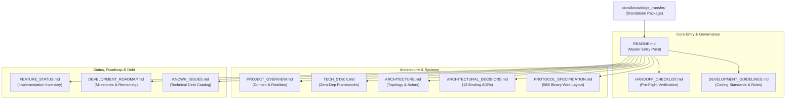
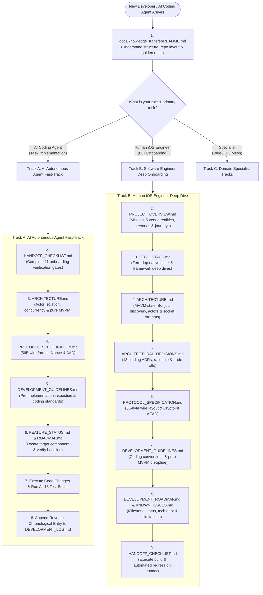
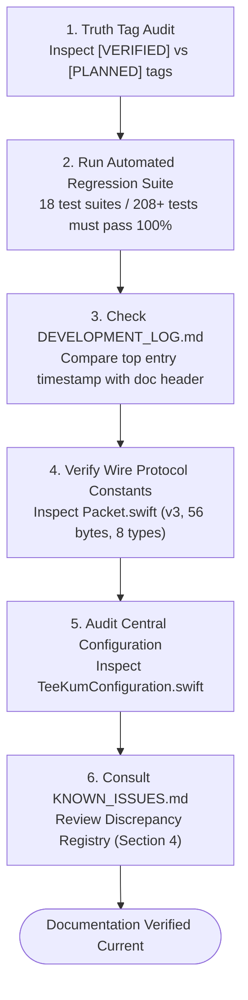
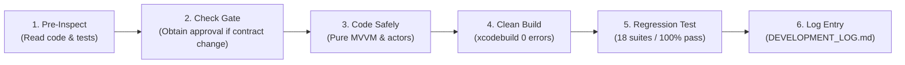

# TeeKum Knowledge Transfer Documentation Package

Panduan awal untuk diskusi tim sebelum migrasi: [Peta Fitur dan File](FEATURE_FILE_MAP.md). Peta ini menelusuri source baseline 5 November 2026, termasuk alur create/join, dependency tiap fitur, dan perbedaan dengan beberapa klaim dokumentasi lama.

> **Primary Knowledge Base, Operational Architecture & Technical Handoff Directory**  
> **Project:** TeeKum — Offline-First Concert & Festival Mesh Navigation System for iOS  
> **Target Platform:** iOS 17.0+ | Native Swift 5.9+ / Swift 6 Concurrency Readiness  
> **Codebase Architecture:** Pure MVVM + Thread-Safe Actor Engines (Zero External Dependencies)  
> **Current Baseline:** Phase 1 (MVP) & Phase 2 (Multi-Hop Mesh) Completed; Phase 3 (Chat, Tactical Radar, Inactivity Guard, Precision Finding) Active & Verified `[VERIFIED]`  
> **Verification Benchmark:** 18 Test Suites / 220 Automated Tests Passing (100% Success Rate) `[VERIFIED]`  
> **Target Schemes:** `TeeKum Prototype` (Main App), `TeeKumWidgets` (ActivityKit Extension) `[VERIFIED]`

---

## 1. What This Folder Contains

The `docs/knowledge_transfer/` folder is an authoritative, standalone documentation suite designed to onboard incoming software engineers, systems architects, and autonomous AI coding agents without requiring tribal knowledge or oral handoffs `[VERIFIED]`.

It encapsulates the complete architectural, cryptographic, networking, and operational specifications of the **TeeKum** iOS codebase `[VERIFIED]`.



### 1.1 Complete Document Inventory

The package comprises 11 tightly integrated technical documents:

| # | Document File | Primary Role & Scope | Target Audience | Truth Status |
| :-: | :--- | :--- | :--- | :-: |
| **01** | [`README.md`](README.md) | **Master Entry Point & Integration Map:** Navigation guide, document catalog, source code locations, historical trail, verification protocol, and safe development rules. | All Developers & AI Agents | `[VERIFIED]` |
| **02** | [`HANDOFF_CHECKLIST.md`](HANDOFF_CHECKLIST.md) | **Pre-Flight Handoff Checklist:** 11-gate operational verification checklist for AI agents and incoming developers before writing code. | Incoming AI Agents & Engineers | `[VERIFIED]` |
| **03** | [`PROJECT_OVERVIEW.md`](PROJECT_OVERVIEW.md) | **System Mission & Operational Realities:** Dual-audience guide, 5 festival environmental realities, target cohorts, user journeys, 11 invariants, and battery pillars. | Engineers, Product, AI Agents | `[VERIFIED]` |
| **04** | [`TECH_STACK.md`](TECH_STACK.md) | **Zero-Dependency Technology Audit:** Exhaustive catalog of native Apple frameworks (`Network`, `CryptoKit`, `NearbyInteraction`, `CoreMotion`, `ActivityKit`), Swift toolchain, and purged legacy libs. | iOS & Systems Engineers | `[VERIFIED]` |
| **05** | [`ARCHITECTURE.md`](ARCHITECTURE.md) | **System Topology & Concurrency Model:** Pure MVVM architecture, actor isolation boundaries, Bonjour P2P discovery (`_teekum._tcp`), stream framing, and `SessionHolder` bridge. | Systems Architects & AI Agents | `[VERIFIED]` |
| **06** | [`ARCHITECTURAL_DECISIONS.md`](ARCHITECTURAL_DECISIONS.md) | **Authoritative ADR Catalog:** 13 binding Architectural Decision Records covering serverless pairing, 56B invariant, ChaCha20-Poly1305, AODV routing, chat, and Setter Lock Rule. | Architects & Lead Developers | `[VERIFIED]` |
| **07** | [`PROTOCOL_SPECIFICATION.md`](PROTOCOL_SPECIFICATION.md) | **56-Byte Wire Protocol Specification:** Bit-level layout, 10B cleartext envelope, 30B inner payloads (`0x01`..`0x08`), 16B MAC tag, Nonce derivation, and mutable hop count masking. | Protocol & Security Engineers | `[VERIFIED]` |
| **08** | [`FEATURE_STATUS.md`](FEATURE_STATUS.md) | **Master Feature Implementation Inventory:** Verification matrix across Phases 1, 2, 3, and 4 with direct source links, test suites, and strict truth tags. | Product Managers & Engineers | `[VERIFIED]` |
| **09** | [`DEVELOPMENT_GUIDELINES.md`](DEVELOPMENT_GUIDELINES.md) | **Engineering Standards & Pure MVVM Rules:** Mandatory 4-step inspection protocol, code style, access control, error handling, file linking format, and logging requirements. | All Developers & AI Agents | `[VERIFIED]` |
| **10** | [`DEVELOPMENT_ROADMAP.md`](DEVELOPMENT_ROADMAP.md) | **Milestone Progress & Task Backlog:** Completed milestones, active Phase 3 Polish baseline, remaining tasks (WatchOS companion, CMAltimeter barometry), and dependencies. | Technical Leads & Planners | `[VERIFIED]` |
| **11** | [`KNOWN_ISSUES.md`](KNOWN_ISSUES.md) | **Technical Debt & Limitations Catalog:** 8 detailed issue analyses (ActivityKit file duplication, concurrency warnings, wire session ID discrepancy) and discrepancy registry. | QA, Systems Engineers & AI | `[VERIFIED]` |

### 1.2 Epistemological Truth Classification Taxonomy

To ensure complete accuracy across all documentation, every statement in this package is strictly classified according to the following 5 truth tags:

- **`[VERIFIED]`**: Confirmed by inspecting current source code and verified by passing automated regression test suites.
- **`[DOCUMENTED]`**: Described in architectural specifications or product requirements, but not currently active in production source code.
- **`[PLANNED]`**: Approved architectural capability scheduled for near-term implementation (e.g., Apple Watch companion target, differential barometry).
- **`[PROPOSED]`**: Suggested architectural direction or design enhancement under evaluation, but not yet formally scheduled.
- **`[UNKNOWN]`**: Property, metric, or environmental behavior that cannot currently be determined without physical festival RF field testing.

---

## 2. Recommended Reading Order

Choose the reading track tailored to your role and task objective:



### 2.1 Track A: AI Autonomous Agent Fast-Track (Rapid Onboarding)
1. **[`README.md`](README.md):** Orientation, folder index, repository file layout, and golden development rules.
2. **[`HANDOFF_CHECKLIST.md`](HANDOFF_CHECKLIST.md):** Execute the 11 onboarding gates (clean build, run 18 test suites, inspect repo, verify invariants).
3. **[`ARCHITECTURE.md`](ARCHITECTURE.md):** Understand the pure MVVM model, actor isolation boundaries, and the `SessionHolder` bridge.
4. **[`PROTOCOL_SPECIFICATION.md`](PROTOCOL_SPECIFICATION.md):** Master the 56-byte wire packet structure, 10B envelope, 30B inner payloads, Nonce derivation, and hop count masking.
5. **[`DEVELOPMENT_GUIDELINES.md`](DEVELOPMENT_GUIDELINES.md):** Follow mandatory pre-implementation inspection rules, Swift conventions, and clickable link requirements.
6. **[`FEATURE_STATUS.md`](FEATURE_STATUS.md) & [`DEVELOPMENT_ROADMAP.md`](DEVELOPMENT_ROADMAP.md):** Inspect the exact state of the module you are tasked with extending or debugging.
7. **Execution & Verification:** Make surgical modifications, run clean build, and verify all 18 test suites pass (`-runAllTests -exitAfterTests`).
8. **Logging:** Append a reverse-chronological entry to [`docs/DEVELOPMENT_LOG.md`](../DEVELOPMENT_LOG.md).

### 2.2 Track B: Human iOS Engineer (Comprehensive Systems Onboarding)
1. **[`README.md`](README.md):** Foundation and directory roadmap.
2. **[`PROJECT_OVERVIEW.md`](PROJECT_OVERVIEW.md):** Problem statement, 5 festival operational realities, user journeys, 11 invariants, and 4 battery pillars.
3. **[`TECH_STACK.md`](TECH_STACK.md):** Deep dives into native Apple frameworks (`Network`, `CryptoKit`, `NearbyInteraction`, `CoreMotion`), Swift 5.9/6 concurrency readiness, and zero third-party dependencies invariant.
4. **[`ARCHITECTURE.md`](ARCHITECTURE.md):** Multi-layer component topology, elimination of UIKit coordinators, actor concurrency boundaries, Bonjour browsing, and socket stream framing.
5. **[`ARCHITECTURAL_DECISIONS.md`](ARCHITECTURAL_DECISIONS.md):** Historical context and rationale for all 13 ADRs (serverless key exchange, 56B packet, AODV routing, Option B telemetry, Chat 0x07, Setter Lock Rule).
6. **[`PROTOCOL_SPECIFICATION.md`](PROTOCOL_SPECIFICATION.md):** Bit-by-bit wire codec specification, ChaCha20-Poly1305 AEAD, and payload structures.
7. **[`DEVELOPMENT_GUIDELINES.md`](DEVELOPMENT_GUIDELINES.md):** Swift/SwiftUI coding standards, error handling, and testing conventions.
8. **[`DEVELOPMENT_ROADMAP.md`](DEVELOPMENT_ROADMAP.md):** Completed Phase 1/2/3 milestones, active Phase 3 Polish baseline, and remaining Phase 4 backlog.
9. **[`KNOWN_ISSUES.md`](KNOWN_ISSUES.md):** Technical debt, compiler warnings, multi-target ActivityKit constraints, and discrepancy registry.
10. **[`HANDOFF_CHECKLIST.md`](HANDOFF_CHECKLIST.md):** Execute local builds and simulator test suites to complete developer setup.

### 2.3 Track C: Domain Specialist Tracks
- **Wire Protocol & Cryptography Specialist:**
  `README.md` $\rightarrow$ [`PROTOCOL_SPECIFICATION.md`](PROTOCOL_SPECIFICATION.md) $\rightarrow$ [`ARCHITECTURAL_DECISIONS.md`](ARCHITECTURAL_DECISIONS.md) (ADR-05, ADR-06, ADR-11) $\rightarrow$ [`TECH_STACK.md`](TECH_STACK.md) (CryptoKit) $\rightarrow$ [`DEVELOPMENT_GUIDELINES.md`](DEVELOPMENT_GUIDELINES.md) (Section 8).
- **UI / Tactical Radar & Navigation Specialist:**
  `README.md` $\rightarrow$ [`PROJECT_OVERVIEW.md`](PROJECT_OVERVIEW.md) (Sections 4 & 8) $\rightarrow$ [`ARCHITECTURE.md`](ARCHITECTURE.md) (Section 2) $\rightarrow$ [`TECH_STACK.md`](TECH_STACK.md) (SwiftUI, MapKit, NearbyInteraction) $\rightarrow$ [`DEVELOPMENT_GUIDELINES.md`](DEVELOPMENT_GUIDELINES.md) (Section 3).
- **Mesh Transport & Systems Engineer:**
  `README.md` $\rightarrow$ [`ARCHITECTURE.md`](ARCHITECTURE.md) (Sections 3 & 4) $\rightarrow$ [`PROTOCOL_SPECIFICATION.md`](PROTOCOL_SPECIFICATION.md) $\rightarrow$ [`ARCHITECTURAL_DECISIONS.md`](ARCHITECTURAL_DECISIONS.md) (ADR-03, ADR-04, ADR-07, ADR-08, ADR-09, ADR-10) $\rightarrow$ [`KNOWN_ISSUES.md`](KNOWN_ISSUES.md).

---

## 3. What Each Document Explains

Detailed summary of each document in the `docs/knowledge_transfer/` package:

### 3.1 [`HANDOFF_CHECKLIST.md`](HANDOFF_CHECKLIST.md) — Pre-Flight Developer & Agent Checklist
- **Core Purpose:** The strict operational gate that every incoming engineer or AI agent must step through before writing code `[VERIFIED]`.
- **Key Concepts:**
  - 11 formal verification gates: reading required docs, inspecting actual repo, verifying git state, identifying phase, auditing unfinished features, understanding 56B packet protocol, preserving protected architecture, reviewing known debt, executing all 18 test suites, adhering to development logging rules, and obtaining approval before changing architectural contracts `[VERIFIED]`.
  - Exact verified CLI commands for clean building, simulator installation, and headless test runner execution `[VERIFIED]`.
  - Comprehensive FAQ covering ActivityKit duplicate files, 189 actor compiler warnings, test runner architecture, and sensor-assisted UWB fallback `[VERIFIED]`.
- **Questions Answered:** *"How do I build and test the project right now?"*, *"What architectural contracts am I forbidden from changing?"*, *"What must I verify before claiming a task is complete?"*

### 3.2 [`PROJECT_OVERVIEW.md`](PROJECT_OVERVIEW.md) — System Mission & Operational Realities
- **Core Purpose:** Authoritative contextual specification explaining TeeKum to unfamiliar engineers and AI agents `[VERIFIED]`.
- **Key Concepts:**
  - The 5 environmental realities of music festivals: cellular congestion, physical RF absorption by human bodies, rapid battery depletion, acoustic chaos, and visual confusion `[VERIFIED]`.
  - Target user personas (festival attendees, camp hosts, safety buddies) and 3 end-to-end usage scenarios (arrival & pairing, crowd split & rendezvous, emergency SOS & inactive fall) `[VERIFIED]`.
  - 11 non-negotiable product invariants, serverless security objectives, and privacy-by-design principles `[VERIFIED]`.
  - The 4 pillars of festival battery conservation: motion-aware GPS sleep, micro-burst AWDL cycling, pure AMOLED `#000000` pitch black rendering, and automatic Festival Survival Mode at `<20%` battery `[VERIFIED]`.
- **Questions Answered:** *"Why does TeeKum exist?"*, *"What environmental constraints dictate its design?"*, *"How do festival attendees interact with the app?"*

### 3.3 [`TECH_STACK.md`](TECH_STACK.md) — Zero-Dependency Technology & Dependency Audit
- **Core Purpose:** Exhaustive technology inventory establishing that TeeKum relies strictly on native Apple frameworks with 0 external dependencies `[VERIFIED]`.
- **Key Concepts:**
  - Swift 5.0 mode / Swift 5.9 features / Swift 6 strict concurrency transition readiness `[VERIFIED]`.
  - Pure MVVM architecture (zero UIKit navigation coordinators) with direct `@Observable @MainActor` state bindings `[VERIFIED]`.
  - Native framework deep dives: `Network.framework` (AWDL/Bonjour `_teekum._tcp`), `CryptoKit` (ChaCha20-Poly1305), `CoreLocation`, `CoreMotion`, `NearbyInteraction` (U1/U2 UWB), `ActivityKit` (Dynamic Island & Lock Screen), `MapKit`, `AVFoundation`, and `AudioToolbox` `[VERIFIED]`.
  - Audit of SQLite3 (`[UNUSED / ABANDONED]` — in-memory state replaces disk databases) and WatchConnectivity (`[PLANNED]` — Phase 4 companion target) `[VERIFIED]`.
- **Questions Answered:** *"What dependencies does the project use?"*, *"Can I add an SPM package or CocoaPod?" (No)*, *"Why is SQLite not used?"*

### 3.4 [`ARCHITECTURE.md`](ARCHITECTURE.md) — System Topology & Concurrency Model
- **Core Purpose:** High-level architectural specification detailing multi-layer topology, actor boundaries, and networking internals `[VERIFIED]`.
- **Key Concepts:**
  - 4 architectural tiers: UI Presentation, MVVM ViewModels, Background Actor Services, and Data/Codecs `[VERIFIED]`.
  - Actor isolation model: background actors (`PeerTransportService`, `CryptoService`, `PacketForwarder`, `ChatMessageEngine`, `SeenPacketCache`, `NeighborTable`, `RoutingTable`) isolated from `@MainActor` UI view models `[VERIFIED]`.
  - The `SessionHolder` bridge: thread-safe `@unchecked Sendable` lock-guarded wrapper class bridging active session keys to background actors synchronously without async hops `[VERIFIED]`.
  - Peer transport mechanics: Bonjour discovery (`_teekum._tcp`), deterministic tie-breaking (lexicographical IP comparison), and `StreamMessageFramer` sliding-window resynchronization `[VERIFIED]`.
- **Questions Answered:** *"How do background actors safely communicate with the main UI thread?"*, *"How does AWDL frame streams into 56-byte packets?"*, *"How is connection collision resolved?"*

### 3.5 [`ARCHITECTURAL_DECISIONS.md`](ARCHITECTURAL_DECISIONS.md) — Authoritative ADR Catalog
- **Core Purpose:** Binding registry of 13 Architectural Decision Records documenting core design trade-offs, alternatives considered, and rationale `[VERIFIED]`.
- **Key Concepts:**
  - ADR-01: Offline-First Architecture & Local Autonomous Operation `[VERIFIED]`.
  - ADR-02: Serverless Operation & Ephemeral Group Key Exchange `[VERIFIED]`.
  - ADR-03: Peer-to-Peer Networking over Apple Wireless Direct Link (AWDL) `[VERIFIED]`.
  - ADR-04: Zero-Knowledge Communal Mesh Relay Design `[VERIFIED]`.
  - ADR-05: Fixed 56-Byte Binary Wire Datagram Invariant & Coordinate Quantization `[VERIFIED]`.
  - ADR-06: RFC 8439 ChaCha20-Poly1305 AEAD Cryptography & Deterministic Nonces `[VERIFIED]`.
  - ADR-07: Actor-Isolated Bounded Deduplication Cache (`SeenPacketCache`) `[VERIFIED]`.
  - ADR-08: Hybrid Reactive Routing & Stale Peer Recovery `[VERIFIED]`.
  - ADR-09: Dual-Lane Priority Outbox & Token Bucket Rate Limiting `[VERIFIED]`.
  - ADR-10: Multi-Pillar Battery Conservation & Festival Survival Mode (<20% Cutoff) `[VERIFIED]`.
  - ADR-11: Option B Contiguous Location Telemetry Packing & Status Decoupling `[VERIFIED]`.
  - ADR-12: Dedicated 20-Byte Multi-Hop Festival Mesh Chat (`Type 0x07`) `[VERIFIED]`.
  - ADR-13: Authoritative Single Active Meeting Point and Setter Lock Rule `[VERIFIED]`.
- **Questions Answered:** *"Why was a 56-byte packet chosen?"*, *"Why was status decoupled from location pings?"*, *"Why can't non-setters change meeting points?"*

### 3.6 [`PROTOCOL_SPECIFICATION.md`](PROTOCOL_SPECIFICATION.md) — 56-Byte Wire Protocol Specification
- **Core Purpose:** Complete bit-level physical and cryptographic wire standard (Protocol v3) `[VERIFIED]`.
- **Key Concepts:**
  - Exact 56-byte datagram segmentation: 10-byte cleartext envelope, 30-byte encrypted payload, 16-byte Poly1305 MAC tag `[VERIFIED]`.
  - 10-byte envelope layout: Byte 0 `versionAndType` (v3 in high nibble, Type in low nibble), Byte 1 `hopLimit`, Byte 2 `hopCount`, Bytes 3..5 `sessionId` (24-bit Big-Endian), Bytes 6..9 `sequenceNumber` (8-bit slot + 24-bit counter) `[VERIFIED]`.
  - Cryptographic construction: RFC 8439 ChaCha20-Poly1305 AEAD. 12-byte deterministic Nonce (`sessionId` + `sequenceNumber` + `versionAndType` + `"TKM2"`). 10-byte AAD binding with mutable `hopCount` masked to `0x00` `[VERIFIED]`.
  - Detailed 30-byte payload specifications for all 8 packet types: `0x01` (`LocationPingPayload` Option B), `0x02` (`SOSPayload`), `0x03` (`MeetingUpdatePayload`), `0x04` (`RouteReqPayload`), `0x05` (`RouteRespPayload`), `0x06` (`ACKPayload`), `0x07` (`ChatMessagePayload`), `0x08` (`UWBTokenExchangePayload`) `[VERIFIED]`.
  - Documented protocol discrepancy: `CleartextEnvelope.sessionId` ingestion truncation to 16 bits `[VERIFIED]`.
- **Questions Answered:** *"How is coordinate quantization packed into Int32?"*, *"How is Nonce derived?"*, *"How does blind relaying mutate hopCount without invalidating MAC tags?"*

### 3.7 [`FEATURE_STATUS.md`](FEATURE_STATUS.md) — Master Feature Implementation Inventory
- **Core Purpose:** Granular audit of all features across development phases with exact source file mappings and test coverage `[VERIFIED]`.
- **Key Concepts:**
  - Complete status matrix across Phase 1 (Direct P2P), Phase 2 (Multi-Hop Mesh), Phase 3 (Tactical Radar, Chat, Inactivity Guard, Precision Finding), and Phase 4 (Venue Scale) `[VERIFIED]`.
  - Direct file links with line ranges to models, viewmodels, views, services, and test suites `[VERIFIED]`.
  - Strict verification tagging confirming 100% passing automated test coverage for implemented features `[VERIFIED]`.
- **Questions Answered:** *"Is feature X implemented or planned?"*, *"Which source file implements feature Y?"*, *"Which test suite validates feature Z?"*

### 3.8 [`DEVELOPMENT_GUIDELINES.md`](DEVELOPMENT_GUIDELINES.md) — Engineering Standards & Pure MVVM Rules
- **Core Purpose:** Mandatory engineering conventions and architectural disciplines governing all modifications `[VERIFIED]`.
- **Key Concepts:**
  - The Pre-Implementation Inspection Rule: mandatory 4-step exploration protocol (code search, signature inspection, caller audit, test review) before modifying any file `[VERIFIED]`.
  - Pure MVVM architecture: direct `@Observable @MainActor` state binding to SwiftUI views, zero navigation coordinators, and zero state duplication `[VERIFIED]`.
  - Access control standards: explicit `public`, `internal`, `private`, `final` modifiers, immutability by default (`let` over `var`), zero-tolerance for unsafe operators `[VERIFIED]`.
  - Error handling: type-safe custom error enums, bounded recovery, zero silent catch blocks `[VERIFIED]`.
  - Clickable file linking format: mandatory `file://` scheme with file basenames and line numbers `[VERIFIED]`.
  - Logging standard: mandatory reverse-chronological development entry in `docs/DEVELOPMENT_LOG.md` before finishing any task `[VERIFIED]`.
- **Questions Answered:** *"What coding conventions must I follow?"*, *"How do I format file links?"*, *"What must I log in DEVELOPMENT_LOG.md?"*

### 3.9 [`DEVELOPMENT_ROADMAP.md`](DEVELOPMENT_ROADMAP.md) — Milestone Progress & Task Backlog
- **Core Purpose:** Authoritative development roadmap tracking completed milestones, active baseline, remaining tasks, and technical dependencies `[VERIFIED]`.
- **Key Concepts:**
  - Milestone 1 (Phase 1 P2P MVP) and Milestone 2 (Phase 2 Multi-Hop Mesh) formally accepted and signed off `[VERIFIED]`.
  - Milestone 3 (Phase 3 Core: Tactical Radar, 20B Mesh Chat, Inactivity Guard, Precision Finding Fallback, Codebase Cleanup) active and verified at 18 test suites / 220 tests `[VERIFIED]`.
  - Part A Confirmed Roadmap Items: Apple Watch companion target (`[PLANNED]`), `CMAltimeter` differential barometry (`[PLANNED]`) `[DOCUMENTED]`.
  - Part B Engineering Recommendations: dedicated native `XCTestBundle` target, Swift 6 strict concurrency warning resolution, centralized protocol codecs `[DOCUMENTED]`.
  - Dependency analysis matrix, critical path, and environmental blockers (iOS backgrounding, human RF attenuation) `[VERIFIED]`.
- **Questions Answered:** *"What phase is the project currently in?"*, *"What features remain to be built?"*, *"What tasks block other tasks?"*

### 3.10 [`KNOWN_ISSUES.md`](KNOWN_ISSUES.md) — Technical Debt & Limitations Catalog
- **Core Purpose:** Comprehensive registry of all known technical debt, limitations, and architectural discrepancies in the codebase `[VERIFIED]`.
- **Key Concepts:**
  - Deep root-cause and impact analysis for 8 cataloged issues:
    - `ISSUE-001`: Target file duplication for `SessionActivityAttributes.swift` across main app and widget targets `[VERIFIED]`.
    - `ISSUE-002`: Redundant timing configuration wrappers across services `[VERIFIED]`.
    - `ISSUE-003`: 189 Swift 6 strict concurrency compiler warnings (non-fatal) `[VERIFIED]`.
    - `ISSUE-004`: Test runners compiled directly into production binary `[VERIFIED]`.
    - `ISSUE-005`: SOS pipeline architectural duality (`SOSViewModel` vs `SOSForwardingEngine`) `[VERIFIED]`.
    - `ISSUE-006`: Non-idiomatic force unwrap in `RadarBlipView.swift` `[VERIFIED]`.
    - `ISSUE-007`: Wire protocol discrepancy: 24-bit vs 16-bit `sessionId` ingestion `[VERIFIED]`.
    - `ISSUE-008`: Simulator hardware limitations (AWDL, UWB, CoreMotion) and sensor fallbacks `[VERIFIED]`.
  - Discrepancy registry between code and legacy documentation `[VERIFIED]`.
  - Prioritized remediation roadmap for upcoming development cycles `[VERIFIED]`.
- **Questions Answered:** *"Why are there compiler warnings?"*, *"Why is SessionActivityAttributes compiled in two targets?"*, *"What are the known hardware limitations?"*

---

## 4. Where to Find the Actual Source Code

All production and test source code is located within the repository root:

```text
/Users/nicho/Developer/TeeKum Prototype/
├── TeeKum Prototype.xcodeproj     # Master Xcode project (App & Widget targets)
├── TeeKum Prototype/               # Main iOS Application Source Root
│   ├── App/                       # Lifecycle, @main entry, and in-app test runner
│   ├── Models/                    # Wire protocols, 56B codecs, entities, config
│   ├── Services/                  # Thread-safe background actors & network engines
│   ├── ViewModels/                # Pure MVVM @Observable @MainActor state stores
│   ├── Views/                     # SwiftUI views, Tactical Radar, pairing, map
│   │   └── Components/            # Reusable UI widgets, message bubbles, chips
│   │       └── Radar/             # Polar radar grid, blips, cards, UWB overlay
│   └── Tests/                     # 18 automated regression test suites (220 tests)
├── TeeKumWidgets/                 # ActivityKit Dynamic Island & Lock Screen extension
└── docs/                          # Architectural specifications and logs
    ├── knowledge_transfer/        # Standalone handoff documentation package (THIS FOLDER)
    ├── Phase 1/                   # Historical Phase 1 specifications and acceptance
    ├── Phase 2/                   # Historical Phase 2 specifications and acceptance
    ├── phase3/                    # Historical Phase 3 specifications and test logs
    └── DEVELOPMENT_LOG.md         # Continuous reverse-chronological development ledger
```

### 4.1 Master Architectural Domain Mapping Table

The following table provides direct, verified clickable links to every major source file and component across the codebase:

| Architectural Domain | Target Path | Key Classes / Protocols / Enums | Description | Truth Status |
| :--- | :--- | :--- | :--- | :-: |
| **App Lifecycle** | [`TeeKumApp.swift`](file:///Users/nicho/Developer/TeeKum%20Prototype/TeeKum%20Prototype/App/TeeKumApp.swift) | `TeeKumApp`, `SessionHolder` | `@main` application entry point, top-level state holders, automated test runner bridge, and session teardown coordination. | `[VERIFIED]` |
| **Master Configuration** | [`TeeKumConfiguration.swift`](file:///Users/nicho/Developer/TeeKum%20Prototype/TeeKum%20Prototype/Models/TeeKumConfiguration.swift) | `TeeKumConfiguration` | Centralized repository for all network parameters, timing cadences, battery thresholds, chat limits, and radar constants. | `[VERIFIED]` |
| **Wire Protocol & Codecs** | [`Packet.swift`](file:///Users/nicho/Developer/TeeKum%20Prototype/TeeKum%20Prototype/Models/Packet.swift) | `RawWirePacket`, `CleartextEnvelope`, `PacketType`, `LocationPingPayload`, `SOSPayload`, `MeetingUpdatePayload`, `ChatMessagePayload`, `UWBTokenExchangePayload` | Fixed 56-byte wire standard (Protocol v3), 10B cleartext envelope, 30B inner payloads, 12B Nonce derivation, and 10B AAD with hop masking. | `[VERIFIED]` |
| **Initials Codec** | [`InitialsCodec.swift`](file:///Users/nicho/Developer/TeeKum%20Prototype/TeeKum%20Prototype/Models/InitialsCodec.swift) | `InitialsCodec` | 2-byte Base-27 arithmetic compressor encoding 1 to 3 uppercase letters (`A`–`Z`) into `UInt16` to eliminate P2P identity handshakes. | `[VERIFIED]` |
| **Group Session Entity** | [`GroupSession.swift`](file:///Users/nicho/Developer/TeeKum%20Prototype/TeeKum%20Prototype/Models/GroupSession.swift) | `GroupSession` | Ephemeral session holding 24-bit `sessionId`, 256-bit symmetric key, local initials, and URL fragment link parser (`teekum://join#key=...`). | `[VERIFIED]` |
| **Peer Transport** | [`PeerTransportService.swift`](file:///Users/nicho/Developer/TeeKum%20Prototype/TeeKum%20Prototype/Services/PeerTransportService.swift) | `PeerTransportService`, `PeerTransport` | Network.framework AWDL radio transport actor managing Bonjour browsing/advertising (`_teekum._tcp`), NWConnections, and packet dispatch. | `[VERIFIED]` |
| **Stream Framing** | [`StreamMessageFramer.swift`](file:///Users/nicho/Developer/TeeKum%20Prototype/TeeKum%20Prototype/Services/StreamMessageFramer.swift) | `StreamMessageFramer` | Delimits continuous TCP/AWDL streams into exact 56-byte datagrams with buffer reconstruction and corruption resynchronization. | `[VERIFIED]` |
| **Cryptographic Engine** | [`CryptoService.swift`](file:///Users/nicho/Developer/TeeKum%20Prototype/TeeKum%20Prototype/Services/CryptoService.swift) | `CryptoService`, `CryptoServiceProtocol` | RFC 8439 ChaCha20-Poly1305 AEAD authenticated encryption actor managing Keychain storage and replay filters. | `[VERIFIED]` |
| **Mesh Forwarding** | [`PacketForwarder.swift`](file:///Users/nicho/Developer/TeeKum%20Prototype/TeeKum%20Prototype/Services/PacketForwarder.swift) | `PacketForwarder` | Zero-knowledge blind relay actor enforcing 8-to-15 hop ceiling, AAD verification, and hop count incrementation. | `[VERIFIED]` |
| **Traffic Shaper** | [`ForwardingRateLimiter.swift`](file:///Users/nicho/Developer/TeeKum%20Prototype/TeeKum%20Prototype/Services/ForwardingRateLimiter.swift) | `ForwardingRateLimiter` | Dual-lane token bucket traffic shaper capping routine pings at 2.0 pkts/s and SOS emergency broadcasts at 4.0 pkts/s. | `[VERIFIED]` |
| **Deduplication Cache** | [`SeenPacketCache.swift`](file:///Users/nicho/Developer/TeeKum%20Prototype/TeeKum%20Prototype/Services/SeenPacketCache.swift) | `SeenPacketCache`, `PacketKey` | Actor-isolated 1,024-entry LRU sliding window tracking 7-byte composite packet keys to suppress duplicate mesh broadcasts. | `[VERIFIED]` |
| **Priority Outbox** | [`PriorityOutboxQueue.swift`](file:///Users/nicho/Developer/TeeKum%20Prototype/TeeKum%20Prototype/Services/PriorityOutboxQueue.swift) | `PriorityOutboxQueue` | Two-lane outbox actor enforcing urgent FIFO preemption (SOS, Rendezvous, ACKs, UWB) over coalesced location telemetry. | `[VERIFIED]` |
| **AODV Route Discovery** | [`RouteDiscoveryService.swift`](file:///Users/nicho/Developer/TeeKum%20Prototype/TeeKum%20Prototype/Services/RouteDiscoveryService.swift) | `RouteDiscoveryService`, `RoutingTable` | On-demand AODV discovery engine broadcasting `ROUTE_REQ` (Type `0x04`) and matching `ROUTE_RESP` (Type `0x05`) with 30s TTL. | `[VERIFIED]` |
| **Relay Policy Engine** | [`RelayPolicyManager.swift`](file:///Users/nicho/Developer/TeeKum%20Prototype/TeeKum%20Prototype/Services/RelayPolicyManager.swift) | `RelayPolicyManager`, `ParticipationMode` | Manages stranger relay participation modes (`communalCompact`, `isolatedGroup`, `stealthObserver`) and battery cutoffs. | `[VERIFIED]` |
| **Location & GNSS Sleep**| [`LocationService.swift`](file:///Users/nicho/Developer/TeeKum%20Prototype/TeeKum%20Prototype/Services/LocationService.swift) | `LocationService`, `LocationPublisher` | CoreLocation wrapper with motion-aware GPS coprocessor sleep (70% power savings when stationary) and Int32 coordinate quantization. | `[VERIFIED]` |
| **Inactivity Guard** | [`InactivityGuardService.swift`](file:///Users/nicho/Developer/TeeKum%20Prototype/TeeKum%20Prototype/Services/InactivityGuardService.swift) | `InactivityGuardService`, `InactivityGuardState` | Man Down accelerometer watchdog detecting 180s stillness, running 30s pre-alarm silent countdown, and auto-broadcasting SOSType `0x04`. | `[VERIFIED]` |
| **Festival Mesh Chat** | [`ChatMessageEngine.swift`](file:///Users/nicho/Developer/TeeKum%20Prototype/TeeKum%20Prototype/Services/ChatMessageEngine.swift) | `ChatMessageEngine`, `ChatMessage` | Festival mesh chat actor managing 20-byte UTF-8 transmissions (`Type 0x07`), FIFO retries, 50-msg memory cap, and per-recipient ACKs. | `[VERIFIED]` |
| **Tactical Radar UI** | [`RadarView.swift`](file:///Users/nicho/Developer/TeeKum%20Prototype/TeeKum%20Prototype/Views/Components/Radar/RadarView.swift) | `RadarView`, `RadarGridBackground`, `RadarBlipView` | Forward-up 60m AMOLED polar projection rotating dynamically with compass heading, clamping out-of-range friends to perimeter. | `[VERIFIED]` |
| **Ultra-Wideband Ranging**| [`NearbyInteractionService.swift`](file:///Users/nicho/Developer/TeeKum%20Prototype/TeeKum%20Prototype/Services/NearbyInteractionService.swift) | `NearbyInteractionService`, `PrecisionFindingOverlay` | Apple U1/U2 Ultra-Wideband ranging service (`NISession`) with sensor-assisted simulation fallback for simulators and non-UWB devices. | `[VERIFIED]` |
| **Live Activities** | [`LiveActivityManager.swift`](file:///Users/nicho/Developer/TeeKum%20Prototype/TeeKum%20Prototype/Services/LiveActivityManager.swift) | `LiveActivityManager`, `SessionActivityAttributes` | Manages Lock Screen widgets and Dynamic Island Live Activities displaying real-time distance and bearing to nearest friend. | `[VERIFIED]` |
| **Notification & Alerts** | [`NotificationService.swift`](file:///Users/nicho/Developer/TeeKum%20Prototype/TeeKum%20Prototype/Services/NotificationService.swift) | `NotificationService`, `InAppToastView` | Local notification dispatcher (`UNUserNotificationCenter`) and in-app AMOLED dark HUD banner toasts for background chats and meeting points. | `[VERIFIED]` |
| **Chat Protocol Contract** | [`ChatMessagingService.swift`](file:///Users/nicho/Developer/TeeKum%20Prototype/TeeKum%20Prototype/Services/ChatMessagingService.swift) | `ChatMessagingService` | Public protocol interface decoupling chat state and mesh transmission from SwiftUI views. | `[VERIFIED]` |
| **Display Formatters** | [`Formatters.swift`](file:///Users/nicho/Developer/TeeKum%20Prototype/TeeKum%20Prototype/Models/Formatters.swift) | `Formatters` | Shared helpers formatting relative time elapsed, metric distance, cardinal compass bearing, and packet hex dumps. | `[VERIFIED]` |
| **Friend Map Annotation** | [`FriendPinAnnotationView.swift`](file:///Users/nicho/Developer/TeeKum%20Prototype/TeeKum%20Prototype/Views/Components/FriendPinAnnotationView.swift) | `FriendPinAnnotationView`, `HeadingVisionCone` | Reusable MapKit annotation view rendering friend avatar discs with neon color rings, accuracy halos, and 50° vision cones. | `[VERIFIED]` |
| **Meeting Point Pin** | [`MeetingPointPinView.swift`](file:///Users/nicho/Developer/TeeKum%20Prototype/TeeKum%20Prototype/Views/Components/MeetingPointPinView.swift) | `MeetingPointPinView` | MapKit annotation view rendering dynamic rendezvous landmarks with setter lock status badges. | `[VERIFIED]` |
| **Incoming SOS Banner** | [`IncomingSOSAlertBannerView.swift`](file:///Users/nicho/Developer/TeeKum%20Prototype/TeeKum%20Prototype/Views/Components/IncomingSOSAlertBannerView.swift) | `IncomingSOSAlertBannerView` | Persistent, high-contrast AMOLED distress alert banner displayed across map and radar views during active emergencies. | `[VERIFIED]` |
| **On-Device Debugger Lab**| [`MeshDebuggerView.swift`](file:///Users/nicho/Developer/TeeKum%20Prototype/TeeKum%20Prototype/Views/MeshDebuggerView.swift) | `MeshDebuggerView`, `MeshDebuggerViewModel` | Secret in-app diagnostic suite with virtual multi-hop mesh simulator, synthetic packet injection, topology map, and automated tests. | `[VERIFIED]` |

---

## 5. Where to Find the Original Project Instructions

Historical context, original requirements, and phase-specific design deliberations are preserved across the following directories:

### 5.1 Project Instructions Directory Index
- **Master Agent Instructions:** [`docs/agent.md`](../agent.md)  
  *Foundational system prompt and behavioral constraints for AI coding agents. Establishes product principles, security baselines, and execution expectations.*
- **Technical Requirements Document:** [`docs/TechnicalRequirements.md`](../TechnicalRequirements.md)  
  *Complete functional and non-functional requirements, acceptance criteria, sensor specifications, and hardware targets.*
- **Phase 1 (Direct P2P Core) Specifications:** [`docs/Phase 1/`](../Phase%201/)
  - [`POC_IMPLEMENTATION_PLAN.md`](../Phase%201/POC_IMPLEMENTATION_PLAN.md): Initial direct P2P development roadmap.
  - [`NETWORKING.md`](../Phase%201/NETWORKING.md): Phase 1 Bonjour and Network.framework architecture.
  - [`PAYLOAD_GUIDE.md`](../Phase%201/PAYLOAD_GUIDE.md): Legacy 54-byte Protocol v1 wire codec specification.
  - [`PHASE_1_DEVELOPMENT_REPORT.md`](../Phase%201/PHASE_1_DEVELOPMENT_REPORT.md): Phase 1 implementation summary.
  - [`PHYSICAL_DEVICE_SOS_VALIDATION.md`](../Phase%201/PHYSICAL_DEVICE_SOS_VALIDATION.md): Physical hardware SOS validation.
  - [`PHYSICAL_DEVICE_TEST_CHECKLIST.md`](../Phase%201/PHYSICAL_DEVICE_TEST_CHECKLIST.md): Physical iPhone testing procedures.
- **Phase 2 (Multi-Hop Mesh) Specifications:** [`docs/Phase 2/`](../Phase%202/)
  - [`PHASE2_ARCHITECTURE.md`](../Phase%202/PHASE2_ARCHITECTURE.md): Multi-hop communal mesh architecture.
  - [`PHASE2_PROTOCOL_DECISIONS.md`](../Phase%202/PHASE2_PROTOCOL_DECISIONS.md): Protocol evolution decisions (v2 56-byte wire layout).
  - [`PHASE2_SECURITY_SPECIFICATION.md`](../Phase%202/PHASE2_SECURITY_SPECIFICATION.md): RFC 8439 ChaCha20-Poly1305 AEAD security model.
  - [`BATTERY_AND_BACKGROUND_POLICY.md`](../Phase%202/BATTERY_AND_BACKGROUND_POLICY.md): Background execution and battery conservation policies.
  - [`ROUTING_DESIGN_AND_LIMITATIONS.md`](../Phase%202/ROUTING_DESIGN_AND_LIMITATIONS.md): AODV reactive routing design and boundaries.
  - [`PAYLOAD_GUIDE.md`](../Phase%202/PAYLOAD_GUIDE.md): Protocol v2 payload guide.
- **Phase 3 (Tactical Radar & Mesh Chat) Specifications:** [`docs/phase3/`](../phase3/)
  - [`CHAT_ARCHITECTURE.md`](../phase3/CHAT_ARCHITECTURE.md): Festival group mesh chat architecture, byte meter, and preset chips.
  - [`PAYLOAD_GUIDE.md`](../phase3/PAYLOAD_GUIDE.md): Protocol v3 payload guide (Types `0x01`..`0x07`).
  - [`PHYSICAL_DEVICE_CHAT_VALIDATION.md`](../phase3/PHYSICAL_DEVICE_CHAT_VALIDATION.md): Multi-hop physical hardware chat validation report.

### 5.2 Document Authority & Precedence Rules

When consulting documentation across different folders, adhere to the following strict order of precedence:

```text
[Highest Precedence: Production Code & Tests]
   1. Executable Swift Code in `TeeKum Prototype/` and passing Automated Tests in `TeeKum Prototype/Tests/`
   2. Master Configuration in `TeeKumConfiguration.swift` and Wire Standards in `Packet.swift`

[Authoritative Consolidated Documentation]
   3. `docs/knowledge_transfer/` (Consolidated, current single source of truth)

[Historical Design Specifications & Logs]
   4. `docs/agent.md` & `docs/TechnicalRequirements.md`
   5. `docs/phase3/` (Phase 3 design specifications)
   6. `docs/Phase 2/` (Phase 2 design specifications)
   7. `docs/Phase 1/` (Phase 1 POC specifications)
```

> [!IMPORTANT]
> **Precedence Invariant:** If any statement in `docs/Phase 1/`, `docs/Phase 2/`, or `docs/phase3/` contradicts `docs/knowledge_transfer/`, the `knowledge_transfer/` specification represents the active, verified production truth. Historical phase documents document design iterations, while `knowledge_transfer/` documents current system reality.

---

## 6. Where to Find Development History

A full historical audit trail of all engineering tasks, refactoring iterations, test executions, and milestone sign-offs is maintained across the repository:

### 6.1 Continuous Chronological Development Ledger
- **Primary Continuous Ledger:** [`docs/DEVELOPMENT_LOG.md`](../DEVELOPMENT_LOG.md)  
  Contains an exhaustive, reverse-chronological record of every single engineering session, task, commit, architectural decision, touched files list, and verified test execution output. Always check the top entry in this file before beginning work.

### 6.2 Codebase Modernization & Cleanup Reports
- **Cleanup Audit & Refactoring Strategy:** [`docs/CLEANUP_AUDIT.md`](../CLEANUP_AUDIT.md)  
  Comprehensive codebase audit identifying dead code, compiler concurrency warnings, multi-target file duplication, and architectural technical debt.
- **Cleanup Regression Testing & QA Report:** [`docs/CLEANUP_TEST_REPORT.md`](../CLEANUP_TEST_REPORT.md)  
  Detailed test execution logs verifying zero regression across 18 test suites during major refactoring iterations.
- **Principal Engineer Final Cleanup Review:** [`docs/CLEANUP_FINAL_REPORT.md`](../CLEANUP_FINAL_REPORT.md)  
  Formal architectural sign-off confirming 100% test pass rate, code cleanup completion, and repository hygiene.

### 6.3 Milestone Acceptance & Hardware Validation Reports
- **Phase 1 Acceptance Report:** [`docs/Phase 1/POC_ACCEPTANCE_REPORT.md`](../Phase%201/POC_ACCEPTANCE_REPORT.md) — Acceptance sign-off with 67 passing automated tests.
- **Phase 2 Acceptance Report:** [`docs/Phase 2/PHASE2_ACCEPTANCE_REPORT.md`](../Phase%202/PHASE2_ACCEPTANCE_REPORT.md) — Acceptance sign-off with 120+ passing automated tests.
- **Phase 3 Chat Hardware Validation:** [`docs/phase3/PHYSICAL_DEVICE_CHAT_VALIDATION.md`](../phase3/PHYSICAL_DEVICE_CHAT_VALIDATION.md) — 3-phone physical AWDL chat mesh validation.

### 6.4 Git Commit History
To view the recent commit history directly:
```bash
# View recent commits with summary diffs
git log --oneline -n 15

# View files changed in the most recent commit
git show --stat HEAD
```

---

## 7. How to Verify Whether Documentation is Current

Follow this 6-step verification protocol to confirm that documentation matches current codebase reality:



### Verification Steps:
1. **Truth Tag Audit:** Verify that all assertions are marked with standardized tags (`[VERIFIED]`, `[DOCUMENTED]`, `[PLANNED]`, `[PROPOSED]`, `[UNKNOWN]`). Never accept an untagged claim as verified code.
2. **Execute Automated Regression Suite:** Run the headless on-device test runner via CLI:
   ```bash
   xcrun simctl launch --console booted com.academy.teekum.TeeKum-Prototype -runAllTests -exitAfterTests
   ```
   *Expected Result:* All 18 test suites run sequentially to completion and exit automatically with code 0 (`>>> ALL AUTOMATED TEST RUNS FINISHED <<<`, 100% pass rate) `[VERIFIED]`.
3. **Compare Development Log Timestamps:** Check the timestamp of the latest entry in [`docs/DEVELOPMENT_LOG.md`](../DEVELOPMENT_LOG.md). If it postdates the "Last Verified Date" in a document's header, inspect the log entry to see if referenced components were modified.
4. **Validate Wire Protocol Constants:** Inspect [`TeeKum Prototype/Models/Packet.swift`](file:///Users/nicho/Developer/TeeKum%20Prototype/TeeKum%20Prototype/Models/Packet.swift). Verify:
   - Wire packet size is exactly 56 bytes (`RawWirePacket.expectedWireSize == 56`).
   - Active protocol version is 3 (`currentProtocolVersion == 0x03`).
   - Cleartext envelope is exactly 10 bytes (`CleartextEnvelope.wireSize == 10`).
   - Poly1305 MAC tag is exactly 16 bytes (`ChaChaPoly.tagSize == 16`).
   - Decrypted payload buffer is exactly 30 bytes (`LocationPingPayload.expectedSize == 30`).
   - Packet types include `0x01` through `0x08`.
5. **Audit Master Configuration Invariants:** Inspect [`TeeKum Prototype/Models/TeeKumConfiguration.swift`](file:///Users/nicho/Developer/TeeKum%20Prototype/TeeKum%20Prototype/Models/TeeKumConfiguration.swift). Confirm timing cadences, battery survival threshold (`0.20`), and chat limits (20 UTF-8 bytes).
6. **Consult Discrepancy Registry:** Review Section 4 of [`docs/knowledge_transfer/KNOWN_ISSUES.md`](KNOWN_ISSUES.md) to cross-check documented differences between production code and historical documentation.

---

## 8. Instructions for Safely Continuing Development

To maintain architectural stability and prevent regressions in this serverless mesh system, all incoming engineers and AI coding agents MUST adhere to these mandatory development instructions:

### 8.1 The 8 Non-Negotiable Golden Rules of TeeKum Development

1. **Zero External Dependencies Invariant:** `[VERIFIED]`  
   The project has **zero** third-party dependencies (no CocoaPods, no SPM packages, no Carthage). All capabilities are built strictly on native Apple frameworks. Never add external frameworks.
2. **Fixed 56-Byte Wire Packet Standard:** `[VERIFIED]`  
   All multi-hop communication is packed into exactly 56 bytes (Protocol Version 3). Never alter the wire packet size or break backward compatibility across the 8 registered packet types.
3. **Pure MVVM Architecture (Zero Coordinators):** `[VERIFIED]`  
   All presentation state lives in `@Observable @MainActor` ViewModels directly bound to SwiftUI views. Never introduce UIKit navigation coordinators, router patterns, or global singleton stores.
4. **Actor Isolation & Thread Safety Model:** `[VERIFIED]`  
   Background engines (`PeerTransportService`, `CryptoService`, `SeenPacketCache`, `PacketForwarder`, `ChatMessageEngine`, `NeighborTable`, `RoutingTable`) are strict Swift actors. Never call actor methods synchronously from the main thread. Session keys are bridged across actors via `SessionHolder`.
5. **Zero-Knowledge Communal Mesh Invariant:** `[VERIFIED]`  
   Stranger relay nodes blindly forward encrypted packets without decrypting attendee location, identity, or chat messages. Never expose plaintext payloads to intermediate forwarding hops.
6. **Authoritative Single Meeting Point & Setter Lock Rule:** `[VERIFIED]`  
   A group maintains strictly one active rendezvous point. Only the original proposer can update or clear an active meeting point before its 1-hour expiration. Never permit non-setters to overwrite active points.
7. **Ephemeral In-Memory Storage & Privacy by Design:** `[VERIFIED]`  
   TeeKum is 100% serverless. There is no cloud backend, no remote database, and no telemetry tracking. Cryptographic keys and peer state live only in volatile memory and iOS Keychain, purged immediately upon session teardown.
8. **Mandatory Reverse-Chronological Development Logging:** `[VERIFIED]`  
   Every developer or AI agent touching source code or documentation MUST record a structured entry in [`docs/DEVELOPMENT_LOG.md`](../DEVELOPMENT_LOG.md) before finishing a task.

### 8.2 Safe 6-Step Engineering Workflow



1. **Step 1: Pre-Implementation Inspection:**  
   Before modifying any file, execute the 4-step inspection protocol: (1) search for all occurrences across the repository, (2) inspect type signatures and actor annotations, (3) audit callers and data flows, and (4) locate the corresponding test suite in `TeeKum Prototype/Tests/`.
2. **Step 2: Check Architectural Contract Gates:**  
   If your task requires changing wire packet formats, encryption schemes, actor isolation boundaries, or battery thresholds, you **must halt and obtain explicit approval** before proceeding.
3. **Step 3: Implement Surgical, Isolated Changes:**  
   Write clean, idiomatic Swift 5.9+ code. Preserve all unrelated comments and docstrings. Maintain pure MVVM and actor isolation.
4. **Step 4: Execute Clean Build:**  
   Compile both main application and ActivityKit widget targets:
   ```bash
   xcodebuild -scheme "TeeKum Prototype" -destination "generic/platform=iOS Simulator" clean build
   ```
   *Verify:* Build succeeds with 0 fatal errors.
5. **Step 5: Run Full Automated Regression Test Suite:**  
   Launch the on-device test runner inside the booted simulator:
   ```bash
   xcrun simctl launch --console booted com.academy.teekum.TeeKum-Prototype -runAllTests -exitAfterTests
   ```
   *Verify:* All 18 test suites (220 tests) report `PASS` with 100% success rate.
6. **Step 6: Document in DEVELOPMENT_LOG.md:**  
   Prepend a reverse-chronological entry to [`docs/DEVELOPMENT_LOG.md`](../DEVELOPMENT_LOG.md) following the standardized schema (Date/Time, Contributor/Agent, Status, Target Milestone, 1. Objective & Scope, 2. Key Invariants Verified, 3. Deliverables Touched, 4. Verification & Results).

---

*Proceed to [`HANDOFF_CHECKLIST.md`](HANDOFF_CHECKLIST.md) to complete the pre-flight verification checklist before beginning development work.*
