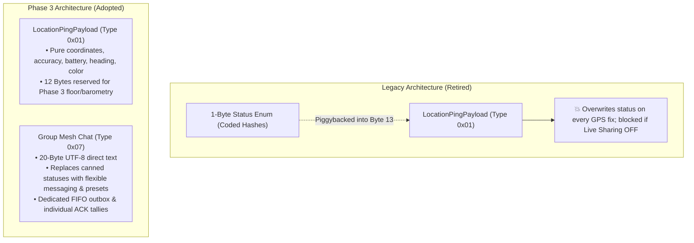
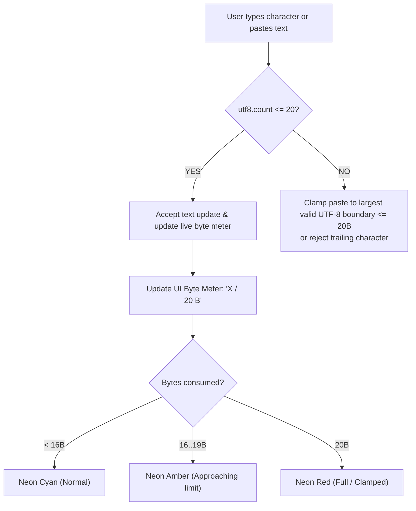
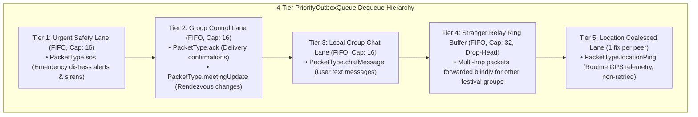
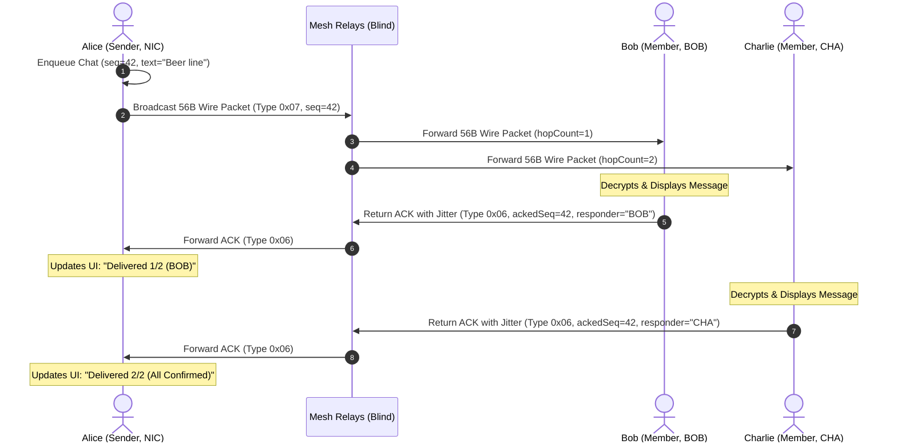
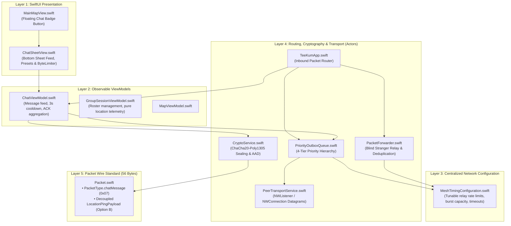
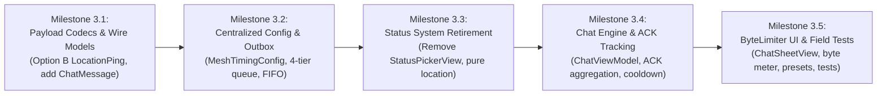

# TeeKum Phase 3 — Festival Group Mesh Chat & Status Retirement Architecture Specification

> **Document Version:** 3.1 (Updated with Project-Owner Decisions)  
> **Status:** APPROVED ARCHITECTURAL BLUEPRINT (Ready for Phased Execution)  
> **Author:** Agent 0 (Phase 3 Technical Architect & Orchestrator)  
> **Date:** 3 November 2026  
> **Target Platform:** iOS 17.0+ (Swift 5.9+ / Swift 6, 100% Native Apple Frameworks, Zero External Dependencies)  
> **Companion Documents:**
> - [Master Agent Instructions (docs/agent.md)](../agent.md)
> - [Technical Requirements Document (docs/TechnicalRequirements.md)](../TechnicalRequirements.md)
> - [Phase 2 Acceptance Report (docs/Phase 2/PHASE2_ACCEPTANCE_REPORT.md)](../Phase%202/PHASE2_ACCEPTANCE_REPORT.md)
> - [56-Byte Wire Protocol & Payload Developer Guide (docs/Phase 2/PAYLOAD_GUIDE.md)](../Phase%202/PAYLOAD_GUIDE.md)
> - [Development Log (docs/DEVELOPMENT_LOG.md)](../DEVELOPMENT_LOG.md)

---

## Executive Summary & Core Decisions

Phase 3 introduces **Festival Group Mesh Chat** (`PacketType.chatMessage = 0x07`) to provide serverless, offline text messaging across the multi-hop ad-hoc mesh network, and implements a pivotal architectural simplification directed by the project owner: **completely removing the legacy status system from the project and replacing it with the group chat system**.

### Key Owner Decisions Integrated:
1. **Retire the Status System Completely:** The legacy 1-byte coded status hash system (`StatusCode`, `UserStatus`, and the horizontal `StatusPickerView` chips carousel) is fully retired. Group members no longer transmit or store canned status hashes. Instead, all activity updates, intentions, and rendezvous requests are communicated through the new **Festival Group Mesh Chat** and its quick-tap preset chips (*"Beer line"*, *"At Main Stage"*, *"Restroom"*, *"Where are you?"*, *"On my way"*, *"Lost"*).
2. **Location Payload Re-Packing (Option B Adopted):** Status (`statusCode` & `targetRefId`) is stripped out of `LocationPingPayload` (Type `0x01`). Telemetry is re-packed contiguously into Bytes 0..17, leaving a consolidated 12-byte contiguous reserved block (Bytes 18..29) ready to absorb Phase 3 vertical floor and barometric altimetry (`floorLevel` + `barometricPressure`). Location pings become pure geographic telemetry and can never mutate or overwrite user messages.
3. **Dedicated "Byte Limiter" Engine in Chat Box:** The 20-character limit is enforced as **maximum 20 UTF-8 encoded bytes**. A dedicated `ByteLimiter` input controller in `ChatSheetView` intercepts text changes, clamps paste operations to valid UTF-8 character boundaries $\le 20$ bytes, and displays a dynamic visual byte meter (`X / 20 B`) with real-time color warnings.
4. **Reconsidering Relay Rate Limits & Centralized Configuration Architecture:** With chat messages and multi-hop ACKs joining the mesh alongside periodic location pings and stranger relaying, the fixed 2 pkts/sec rate limit is re-evaluated. All rate limits (ordinary relay rate, urgent burst rate, token bucket capacity), broadcast cadences, retry counts, and chat cooldowns are decoupled into a centralized, isolated configuration file (`MeshTimingConfiguration.swift`) allowing instantaneous tuning and testing on physical devices without touching routing or codec logic.
5. **Preservation of Core Invariants:** ChaCha20-Poly1305 AEAD authenticated encryption with 10-byte cleartext AAD envelope binding, blind stranger relaying, emergency SOS priority preemption (Tier 1), offline-first serverless architecture, and automatic suspension in Festival Survival Mode (<20% battery) are 100% preserved.

---

## 1. Current-State Findings & Architecture Simplification

An exhaustive audit of the Phase 2 codebase ([`Packet.swift`](file:///Users/nicho/Developer/TeeKum%20Prototype/TeeKum%20Prototype/Models/Packet.swift), [`LocationPublisher.swift`](file:///Users/nicho/Developer/TeeKum%20Prototype/TeeKum%20Prototype/Services/LocationPublisher.swift), [`LocationService.swift`](file:///Users/nicho/Developer/TeeKum%20Prototype/TeeKum%20Prototype/Services/LocationService.swift), [`CryptoService.swift`](file:///Users/nicho/Developer/TeeKum%20Prototype/TeeKum%20Prototype/Services/CryptoService.swift), [`PriorityOutboxQueue.swift`](file:///Users/nicho/Developer/TeeKum%20Prototype/TeeKum%20Prototype/Services/PriorityOutboxQueue.swift), [`PacketForwarder.swift`](file:///Users/nicho/Developer/TeeKum%20Prototype/TeeKum%20Prototype/Services/PacketForwarder.swift), and the 14 test suites with 169 passing tests) was conducted.

### 1.1 Wire Protocol & Datagram Layout (56-Byte Standard)

The system communicates over Apple `Network.framework` P2P datagrams (`NWListener` & `NWConnection` over Bonjour `_teekum._tcp`) using a fixed 56-byte wire format:

```text
+-----------------------+-----------------------------+-------------------------+
|  Outer Envelope (10B) |   Encrypted Payload (30B)   |   Auth Tag (16B)        |
|  (Cleartext Routing)  |   (Zero-Knowledge Cipher)   |   (Poly1305 MAC Tag)    |
+-----------------------+-----------------------------+-------------------------+
0                       10                            40                        56 Bytes
```

- **Cleartext Envelope (10 Bytes):**
  - Byte 0: `version (4 bits) | type (4 bits)`. Current `protocolVersion = 0x03`.
  - Byte 1: `hopLimit` (UInt8, $1 \dots 15$, default 8, SOS 15).
  - Byte 2: `hopCount` (UInt8, starts at 0, incremented per hop, masked to `0x00` in AAD).
  - Bytes 3..5: `sessionId` (UInt24 big-endian session network identifier).
  - Bytes 6..9: `sequenceNumber` (UInt32 big-endian, partitioned: 8-bit `memberSlot` + 24-bit counter).
- **Encrypted Payload (30 Bytes):** Encrypted with ChaCha20-Poly1305 using the group's 256-bit symmetric key.
- **Poly1305 Tag (16 Bytes):** Verifies ciphertext and envelope AAD:
  $$\text{AAD} = \big(\mathtt{versionAndType} \, [1\text{B}] \, \parallel \, \mathtt{hopLimit} \, [1\text{B}] \, \parallel \, \mathtt{0x00} \, [1\text{B}] \, \parallel \, \mathtt{sessionId} \, [3\text{B}] \, \parallel \, \mathtt{sequenceNumber} \, [4\text{B}]\big)$$

### 1.2 Retirement of the Legacy Status System

In Phase 1 and Phase 2, `StatusCode` was a 1-byte enum (`0x00 AVAILABLE`, `0x0A DRINKS`, `0x0B RESTROOM`, etc.) piggybacked on `LocationPingPayload`. This introduced fundamental flaws:
1. **Periodic GPS pings continually overwrote user status.**
2. **Pausing location sharing (Live Sharing OFF) prevented users from broadcasting status updates.**
3. **Canned 1-byte status codes were too rigid for real festival communication.**



By **retiring the status system** rather than introducing an independent status packet type, the protocol and user experience are substantially simplified:
- The UI eliminates the clumsy horizontal chips carousel (`StatusPickerView`).
- `LocationPingPayload` becomes strictly focused on sensor telemetry (Option B).
- The chat sheet with 1-tap quick preset chips (*"Beer line"*, *"At Main Stage"*, *"Restroom"*, *"Where are you?"*, *"On my way"*) completely takes over status sharing with far greater expressiveness.

---

## 2. Re-Packed Location Telemetry Specification (Option B Confirmed)

### 2.1 Wire Changes to `LocationPingPayload` (Type `0x01`)

`statusCode` (formerly Byte 13, 1B) and `targetRefId` (formerly Bytes 14..17, 4B) are completely removed from `LocationPingPayload`. Telemetry is contiguously packed into Bytes 0..17, leaving a consolidated 12-byte contiguous reserved block (Bytes 18..29) at the tail:

```text
+-------------------+-------------------+-------------------+----------+-------------------+--------------+---------+-----------+----------------------+
| latRaw (Int32)    | lonRaw (Int32)    | timestamp (UInt32)| acc (1B) | initials (UInt16) | battery (1B) | hdg (1B)| color (1B)| reserved (12 Bytes)  |
| Bytes 0..3        | Bytes 4..7        | Bytes 8..11       | Byte 12  | Bytes 13..14      | Byte 15      | Byte 16 | Byte 17   | Bytes 18..29         |
+-------------------+-------------------+-------------------+----------+-------------------+--------------+---------+-----------+----------------------+
```

| Byte Range | Field Name | Wire Type | Swift / CoreLocation Type | Description |
| :---: | :--- | :--- | :--- | :--- |
| **0..3** | `latitudeRaw` | `Int32` | `CLLocationDegrees` (`Double`) | Signed 32-bit big-endian: `Int32((latitude * 1_000_000).rounded())` (~11cm resolution). |
| **4..7** | `longitudeRaw` | `Int32` | `CLLocationDegrees` (`Double`) | Signed 32-bit big-endian: `Int32((longitude * 1_000_000).rounded())` (~11cm resolution). |
| **8..11** | `timestamp` | `UInt32` | `Date` | Big-endian Unix epoch seconds (`UInt32(date.timeIntervalSince1970)`). |
| **12** | `accuracy` | `UInt8` | `CLLocationAccuracy` (`Double`) | Horizontal accuracy uncertainty radius in meters ($0 \dots 255$m). |
| **13..14** | `senderInitials` | `UInt16` | `String` (1..3 Chars A-Z) | Big-endian 2-byte Base-27 compressed initials via `InitialsCodec`. |
| **15** | `batteryLevel` | `UInt8` | `Float` | Sender battery percentage ($0 \dots 100$%). |
| **16** | `heading` | `UInt8` | `CLLocationDirection` (`Double`) | Compass heading ($0 \dots 255$ representing $0 \dots 360^\circ$). |
| **17** | `colorCode` | `UInt8` | `MemberColor` (`enum: UInt8`) | 1-byte personal neon color code (`0x00` unset/hash, `0x01`..`0x08` palette). |
| **18..29** | `reserved` | `12 Bytes` | `Data` | Consolidated reserved zero padding (`0x00...00`). Positions Bytes 18..20 to cleanly absorb Phase 3 vertical floor and barometry (`floorLevel: Int8` at Byte 18 + `barometricPressure: UInt16` at Bytes 19..20, leaving 9 bytes reserved). |

**Total Size:** Exactly 30 bytes. Preserves 100% compatibility with the 56-byte datagram standard.

### 2.2 Receiver State Invariant

Upon receiving a valid `.locationPing` datagram in [`TeeKumApp.swift`](file:///Users/nicho/Developer/TeeKum%20Prototype/TeeKum%20Prototype/App/TeeKumApp.swift):
- Only `member.coordinate`, `member.horizontalAccuracy`, `member.heading`, `member.batteryLevel`, and `member.lastSeen` are updated.
- There is no status field on the wire, so **location fixes can never mutate or overwrite user messaging state**.

---

## 3. Festival Group Mesh Chat Specification (`PacketType.chatMessage = 0x07`)

### 3.1 Packet Wire Layout

```text
+-----------------------+-----------------------------+-------------------------+
|  Outer Envelope (10B) |   Encrypted Payload (30B)   |   Auth Tag (16B)        |
|  Type: 0x07 (0x37)    |   (Zero-Knowledge Cipher)   |   (Poly1305 MAC Tag)    |
+-----------------------+-----------------------------+-------------------------+
0                       10                            40                        56 Bytes
```

#### 10-Byte Cleartext Envelope (Bytes 0..9)
- Byte 0: `0x37` (Version `3`, Type `7`).
- Byte 1: `hopLimit` = `0x08` (Default 8 hops max budget).
- Byte 2: `hopCount` = `0x00` (Starts at 0; incremented per relay; masked to `0x00` in AAD).
- Bytes 3..5: `sessionId` (24-bit big-endian session hash).
- Bytes 6..9: `sequenceNumber` (32-bit big-endian partitioned counter: 8b `memberSlot` + 24b counter).

#### 30-Byte Encrypted Payload (`ChatMessagePayload`, Bytes 10..39)

```text
+------------------+------------------+------------------+----------------------------------+------------------+
| senderInitials   | timestamp        | textLength       | textContent                      | reserved         |
| 2 Bytes (0..1)   | 4 Bytes (2..5)   | 1 Byte (6)       | 20 Bytes (7..26)                 | 3 Bytes (27..29) |
+------------------+------------------+------------------+----------------------------------+------------------+
```

| Byte Range | Field Name | Wire Type | Swift Type | Description |
| :---: | :--- | :--- | :--- | :--- |
| **0..1** | `senderInitials` | `UInt16` | `String` (1..3 Chars A-Z) | Big-endian 2-byte Base-27 encoded initials via `InitialsCodec`. |
| **2..5** | `timestamp` | `UInt32` | `Date` | Big-endian Unix epoch seconds (`UInt32(date.timeIntervalSince1970)`). |
| **6** | `textLength` | `UInt8` | `UInt8` | Exact UTF-8 byte count of the text ($0 \dots 20$). |
| **7..26** | `textContent` | `20 Bytes` | `String` / `[UInt8]` | Direct UTF-8 encoded text bytes. Zero-padded (`0x00`) for unused byte positions. |
| **27..29** | `reserved` | `3 Bytes` | `Data` | Padding (`0x000000`) reserved for future expansion. |

#### 16-Byte Authentication Tag (Bytes 40..55)
- Standard 128-bit Poly1305 MAC tag produced by CryptoKit ChaCha20-Poly1305 AEAD sealing over the 30-byte plaintext payload using the deterministic 12-byte nonce:
  $$\text{Nonce} = \big(\mathtt{sessionId} \, [3\text{B}] \, \parallel \, \mathtt{sequenceNumber} \, [4\text{B}] \, \parallel \, \mathtt{0x37} \, [1\text{B}] \, \parallel \, \text{"TKM3"} \, [4\text{B}]\big)$$
- Authenticates the 10-byte cleartext envelope AAD with `hopCount` masked to `0x00`.

---

## 4. Dedicated "Byte Limiter" Engine & UI in Chat Box

Because the wire packet allocates **strictly 20 bytes** for `textContent`, the 20-character limit is formally implemented as a **hard 20-byte limiter**.

```text
+-------------------+---------------------+-------------------------+
| Character Type    | UTF-8 Bytes/Char    | Practical Chat Limit    |
+-------------------+---------------------+-------------------------+
| Standard ASCII    | 1 Byte              | Exactly 20 Characters   |
| Latin Accents     | 2 Bytes             | Up to 10 Characters     |
| Standard Emojis   | 4 Bytes             | Up to 5 Emojis          |
| Mixed Text        | 1..4 Bytes          | Clamped when bytes = 20 |
+-------------------+---------------------+-------------------------+
```

### 4.1 Byte Limiter Specification (`ByteLimiter` Architecture)

To give attendees intuitive, glitch-free typing in high-glare festival environments:



1. **Hard Input Interception:**
   - The view model / binding intercepts every keystroke. If `(draftText + newChar).utf8.count > 20`, the input is rejected with a subtle haptic rejection tick (`UINotificationFeedbackGenerator(.warning)`).
2. **Safe Multi-Byte Paste Clamping:**
   - If a user pastes a string from the clipboard longer than 20 bytes (e.g. from iMessage), the `ByteLimiter` clamps the string to the maximum valid UTF-8 boundary $\le 20$ bytes without splitting multi-byte code points:
     ```swift
     public static func clampTo20Bytes(_ input: String) -> String {
         var accumulated = ""
         for char in input {
             let candidate = accumulated + String(char)
             if candidate.utf8.count <= 20 {
                 accumulated = candidate
             } else {
                 break
             }
         }
         return accumulated
     }
     ```
3. **Visual Byte Meter UI:**
   - Positioned docked to the right of the text field in `ChatSheetView`:
     - Displays live byte usage: `14 / 20 B`.
     - Includes a compact circular progress ring:
       - **Neon Cyan** ($0 \dots 15$ bytes consumed): normal typing.
       - **Neon Amber** ($16 \dots 19$ bytes consumed): approaching byte limit.
       - **Neon Red** ($20$ bytes consumed): maximum capacity reached; send button highlighted.
4. **Guaranteed Preset Chips:**
   - Preset quick-tap chips are pre-validated to never exceed 20 bytes:
     - *"Beer line"* (9 bytes)
     - *"At Main Stage"* (13 bytes)
     - *"Restroom"* (8 bytes)
     - *"Where are you?"* (14 bytes)
     - *"On my way"* (9 bytes)
     - *"Lost"* (4 bytes)

---

## 5. Reconsidering Relay Rate Limits & Centralized Configuration Architecture

### 5.1 Re-evaluating the 2 pkts/sec Relay Limit

Phase 2 established an ordinary stranger relay rate limit of **2 packets/second** (token bucket: capacity 4 tokens, refill 2 tokens/sec) to protect battery. However, in Phase 3:
- Group chat messages add conversational traffic bursts.
- Multi-peer delivery ACKs generate multiple return packets per message.
- Routine location pings continue in the background.

If 4 friends send messages in quick succession, an intermediate relay throttled at 2 pkts/sec would queue or drop legitimate packets. Conversely, removing the rate limiter would drain relay batteries.

### 5.2 The Solution: Centralized, Testable Configuration Architecture

All network timing, cadence, rate limiting, retry counts, and chat cooldown parameters are extracted into a **single, authoritative configuration file**: [`MeshTimingConfiguration.swift`](file:///Users/nicho/Developer/TeeKum%20Prototype/TeeKum%20Prototype/Services/MeshTimingConfiguration.swift).

This allows the developer to instantly change, tune, and test rate-limiting policies on physical devices without modifying routing actors, packet forwarders, or codec logic:

```swift
// Centralized Network & Chat Configuration
public struct MeshTimingConfiguration: Equatable, Sendable {
    
    // MARK: - 1. Relay Rate Limiting & Token Buckets
    /// Maximum ordinary relay forwarding rate (packets per second).
    /// Default: 2.0 pkts/s. Easily tunable to 4.0 or 6.0 during festival stress testing.
    public var ordinaryRelayRateLimit: Double = 2.0
    
    /// Maximum burst token bucket capacity for ordinary relays.
    /// Default: 4 tokens. Easily tunable to 8 or 12 to absorb chat bursts.
    public var ordinaryRelayBurstCapacity: Double = 4.0
    
    /// Maximum urgent SOS forwarding rate (packets per second). Default: 4.0 pkts/s.
    public var urgentSOSRateLimit: Double = 4.0
    
    // MARK: - 2. Group Chat Engine Timings
    /// Enforced client cooldown between outgoing chat messages (seconds). Default: 3.0s.
    public var chatUserCooldown: TimeInterval = 3.0
    
    /// Maximum radio transmission retries for chat messages. Default: 2 retries.
    public var chatMaxRetries: Int = 2
    
    /// Initial retry backoff delay for chat messages (seconds). Default: 0.5s.
    public var chatRetryBackoff: TimeInterval = 0.5
    
    /// Multi-peer ACK confirmation window timeout (seconds). Default: 15.0s.
    public var chatAckTimeout: TimeInterval = 15.0
    
    /// Maximum random jitter delay applied before transmitting ACKs (seconds). Default: 0.35s (0..350ms).
    public var chatAckJitterMax: TimeInterval = 0.35
    
    // MARK: - 3. Broadcast Cadence Timings (Seconds)
    public var distantPeerInterval: TimeInterval = 2.0
    public var movingInterval: TimeInterval = 4.0
    public var stationaryInterval: TimeInterval = 20.0
    public var survivalInterval: TimeInterval = 60.0
    
    // MARK: - Global Shared Instance
    public static var `default` = MeshTimingConfiguration()
}
```

By adjusting `MeshTimingConfiguration.default.ordinaryRelayRateLimit = 4.0` or `ordinaryRelayBurstCapacity = 8.0`, the developer can dynamically evaluate whether a higher forwarding rate improves chat delivery without impacting the 8-hour festival battery budget.

---

## 6. Delivery Semantics, Outbox Queue, and Multi-Peer ACK Tally

### 6.1 4-Tier Outbox Priority Hierarchy ([`PriorityOutboxQueue.swift`](file:///Users/nicho/Developer/TeeKum%20Prototype/TeeKum%20Prototype/Services/PriorityOutboxQueue.swift))

With status packets retired, `PriorityOutboxQueue` simplifies into a streamlined **4-tier priority hierarchy**:



1. **Tier 1 (Urgent Safety):** Emergency SOS packets cut all queues and transmit immediately.
2. **Tier 2 (Group Control):** Delivery ACKs and single active meeting point updates.
3. **Tier 3 (Local Chat):** User group chat messages. Dequeued in strict FIFO order, preempting stranger relays.
4. **Tier 4 (Stranger Relays):** Communal mesh packets forwarded for other festival attendees (governed by `ordinaryRelayRateLimit`).
5. **Tier 5 (Location Coalescing):** Routine periodic GPS pings (superseded fixes overwrite older unsent fixes).

### 6.2 Multi-Peer Delivery Acknowledgement (ACK Tally)



1. **Receiver ACK Dispatch:**
   - Receiving peers construct an [`ACKPayload`](file:///Users/nicho/Developer/TeeKum%20Prototype/TeeKum%20Prototype/Models/Packet.swift#L658-L741) (Type `0x06`) with `ackedSeqNumber` and `responderInitials`.
   - To avoid ACK collision storms, receivers apply a randomized jitter delay ($0 \dots 350\text{ms}$) before enqueuing the ACK into Tier 2.
2. **Sender ACK Aggregation:**
   - The sender records unique `responderInitials` into `confirmedResponders: Set<String>`.
   - UI displays honest progress: *"Delivered 1/3"* $\to$ *"Delivered 3/3 (All Confirmed)"*.
   - If no ACKs arrive within 15 seconds, marks state as *"Sent (No confirmations yet)"*.
3. **Ephemeral Storage & Privacy:**
   - Chat history and ACK states are retained strictly in-memory (up to 50 latest messages).
   - Zero SQLite disk writes. Purged completely upon group leave or session exit.
   - Automatically suspended during Festival Survival Mode (<20% battery).

---

## 7. Subsystem Interfaces and Models

### 7.1 Chat UI Model & Delivery State

```swift
// MARK: - Chat UI Model
public struct ChatMessage: Identifiable, Equatable, Sendable {
    public let id: UUID
    public let sequenceNumber: UInt32
    public let senderInitials: String
    public let text: String
    public let timestamp: Date
    public var confirmedResponders: Set<String>
    public var deliveryState: ChatDeliveryState
    public let isLocalSender: Bool
    
    public init(
        id: UUID = UUID(),
        sequenceNumber: UInt32,
        senderInitials: String,
        text: String,
        timestamp: Date = Date(),
        confirmedResponders: Set<String> = [],
        deliveryState: ChatDeliveryState = .pendingOutbox,
        isLocalSender: Bool
    ) {
        self.id = id
        self.sequenceNumber = sequenceNumber
        self.senderInitials = InitialsCodec.sanitize(senderInitials)
        self.text = text
        self.timestamp = timestamp
        self.confirmedResponders = confirmedResponders
        self.deliveryState = deliveryState
        self.isLocalSender = isLocalSender
    }
}

public enum ChatDeliveryState: Equatable, Sendable {
    case pendingOutbox
    case sentToMesh
    case delivered(confirmedCount: Int, totalMembers: Int)
    case deliveryTimedOut
    case failed
}
```

### 7.2 Chat Wire Codec (`Packet.swift`)

```swift
// MARK: - Type 0x07: Chat Message Payload (30 Bytes)
public struct ChatMessagePayload: Equatable, Sendable {
    public var senderInitials: String // 1..3 uppercase characters
    public var timestamp: Date
    public var text: String           // Capped at 20 UTF-8 bytes
    
    public init(senderInitials: String, timestamp: Date = Date(), text: String) {
        self.senderInitials = InitialsCodec.sanitize(senderInitials)
        self.timestamp = timestamp
        self.text = text
    }
    
    public func serialize() throws -> Data {
        var data = Data(capacity: PacketConstants.encryptedPayloadSize)
        
        // Bytes 0..1: senderInitials (2B Base-27)
        let initialBytes = InitialsCodec.encode(senderInitials) ?? [0, 0]
        data.append(contentsOf: initialBytes)
        
        // Bytes 2..5: timestamp (4B Unix epoch seconds)
        var ts = UInt32(timestamp.timeIntervalSince1970).bigEndian
        data.append(Data(bytes: &ts, count: 4))
        
        // Byte 6: textLength (1B, 0..20)
        let rawUtf8 = Array(text.utf8.prefix(20))
        data.append(UInt8(rawUtf8.count))
        
        // Bytes 7..26: textContent (20B UTF-8, zero-padded)
        data.append(contentsOf: rawUtf8)
        if rawUtf8.count < 20 {
            data.append(Data(repeating: 0, count: 20 - rawUtf8.count))
        }
        
        // Bytes 27..29: reserved (3B padding)
        data.append(Data(repeating: 0, count: 3))
        
        return data
    }
    
    public static func deserialize(from data: Data) throws -> ChatMessagePayload {
        guard data.count >= PacketConstants.encryptedPayloadSize else {
            throw PacketCodecError.bufferUnderflow
        }
        
        let initialBytes = [data[0], data[1]]
        let initials = InitialsCodec.decode(initialBytes) ?? "UNK"
        
        let tsRaw = data.subdata(in: 2..<6).withUnsafeBytes { $0.load(as: UInt32.self).bigEndian }
        let date = Date(timeIntervalSince1970: TimeInterval(tsRaw))
        
        let len = Int(min(data[6], 20))
        let textBytes = data.subdata(in: 7..<(7 + len))
        let text = String(data: textBytes, encoding: .utf8) ?? ""
        
        return ChatMessagePayload(senderInitials: initials, timestamp: date, text: text)
    }
}
```

---

## 8. Dependency Graph & File Ownership

### 8.1 System Architecture Diagram



### 8.2 File Ownership & Modification Matrix

| File Path | Nature | Scope of Changes |
| :--- | :---: | :--- |
| `Models/Packet.swift` | **Modified** | Add `PacketType.chatMessage = 0x07`. Add `ChatMessagePayload`. Update `LocationPingPayload` to Option B (remove `statusCode` & `targetRefId`, pack contiguously Bytes 0..17, leave 12 bytes reserved). |
| `Services/MeshTimingConfiguration.swift` | **Modified** | Centralize all relay rate limits (`ordinaryRelayRateLimit`, `ordinaryRelayBurstCapacity`), chat cooldowns (`chatUserCooldown`), and retry settings for rapid on-device test tuning. |
| `Services/PriorityOutboxQueue.swift` | **Modified** | Restructure into 4-tier priority hierarchy with dedicated Tier 3 local chat FIFO lane. |
| `ViewModels/ChatViewModel.swift` | **NEW** | `@Observable @MainActor` managing message history array, draft input, `ByteLimiter` clamping, 3.0s cooldown, ACK aggregation tally, and transmission dispatch. |
| `Views/Components/ChatSheetView.swift` | **NEW** | Bottom sheet view with message bubble feed, member color avatars, 1-tap quick reply chips, `ByteLimiter` visual progress meter, and send button. |
| `App/TeeKumApp.swift` | **Modified** | Inbound packet router handling `.chatMessage` (decrypt $\to$ append to `ChatViewModel` $\to$ dispatch ACK $\to$ relay mesh). Update `.locationPing` handling so it mutates only coordinates/telemetry without status. |
| `Models/Member.swift` | **Modified** | Retire `status: UserStatus` property in favor of member identity, coordinates, color, and latest chat message. |
| `ViewModels/GroupSessionViewModel.swift` | **Modified** | Remove legacy status update logic; retain clean member location tracking. |
| `Services/LocationPublisher.swift` | **Modified** | Remove `status` arguments from `handleLocationPingReady`. Keep location publishing purely focused on GPS coordinates and motion telemetry. |
| `Views/StatusPickerView.swift` | **RETIRED** | Retired and removed from navigation, replaced by `ChatSheetView`. |
| `Services/PacketForwarder.swift` | **Modified** | Add `chatMessage` (0x07) to evaluation pipeline; permit blind stranger relaying up to 8 hops governed by `MeshTimingConfiguration`. |
| `Tests/PacketCodecTests.swift` | **Modified** | Add automated codec tests for `ChatMessagePayload` and updated Option B `LocationPingPayload`. |
| `Tests/ChatAndRelayTests.swift` | **NEW** | Exhaustive automated test suite (Outbox FIFO, 2-retry backoff, ACK aggregation, byte limiter clamping, tunable rate limiter behavior). |

---

## 9. Risk Analysis & Mitigation Strategies

| # | Identified Risk | Impact | Architectural Mitigation Strategy |
| :---: | :--- | :--- | :--- |
| **R1** | **Multi-Peer ACK Storm** | In an 8-person group, 1 chat message triggers 7 simultaneous ACKs, causing radio packet collisions. | Receiver ACKs apply randomized jitter ($0 \dots 350\text{ms}$) via `chatAckJitterMax`. Sender dedupes by unique `responderInitials`. Forwarding rate limiter smooths radio traffic. |
| **R2** | **Multi-Byte UTF-8 Wire Overflow** | Complex emojis (up to 28 bytes) exceed the 20-byte wire allocation, failing codec serialization. | Hard `ByteLimiter` engine in `ChatSheetView` intercepts input and clamps pastes to valid UTF-8 boundaries $\le 20$ bytes. Wire codec enforces exact 20-byte sizing with zero padding. |
| **R3** | **Relay Bottleneck at 2 pkts/sec** | High chat volume combined with location pings causes intermediate relays to queue or drop packets. | Centralized configuration in `MeshTimingConfiguration.swift` exposes `ordinaryRelayRateLimit` and `ordinaryRelayBurstCapacity`, allowing instant tuning to 4.0 or 6.0 pkts/s during testing. |
| **R4** | **Radio Saturation by Chatty Users** | Rapid messaging saturates peer AWDL basebands, delaying emergency SOS. | Client-side 3.0-second cooldown enforced in `ChatViewModel`. Outbox places Chat in Tier 3, strictly below Tier 1 SOS. |
| **R5** | **Memory Accumulation over Long Festival** | Hundreds of retained chat messages cause iOS memory pressure. | Bounded in-memory ring buffer: retains at most **50 latest messages** per group session. All chat state is wiped on session teardown (zero disk writes). |
| **R6** | **Festival Survival Mode (<20% Battery)** | Sending chat messages exhausts the final battery needed for offline meeting maps or SOS. | Automatic battery guard: At <20% battery or Low Power Mode, chat input and sending are disabled. Emergency SOS remains functional. |

---

## 10. Recommended Implementation Order (5 Milestones)

Execution proceeds in five sequential milestones:



1. **Milestone 3.1 — Wire Codecs & Payload Models:**
   - Update [`Packet.swift`](file:///Users/nicho/Developer/TeeKum%20Prototype/TeeKum%20Prototype/Models/Packet.swift): Re-pack `LocationPingPayload` contiguously (Option B, 12 bytes reserved) and add `ChatMessagePayload` (Type `0x07`).
   - Update [`PacketCodecTests.swift`](file:///Users/nicho/Developer/TeeKum%20Prototype/TeeKum%20Prototype/Tests/PacketCodecTests.swift): Verify 30-byte roundtrips, 20-byte UTF-8 boundaries, and Int32 coordinate quantization.
2. **Milestone 3.2 — Centralized Config & Multi-Lane Outbox:**
   - Expand [`MeshTimingConfiguration.swift`](file:///Users/nicho/Developer/TeeKum%20Prototype/TeeKum%20Prototype/Services/MeshTimingConfiguration.swift) with tunable relay rate limits and chat timings.
   - Restructure [`PriorityOutboxQueue.swift`](file:///Users/nicho/Developer/TeeKum%20Prototype/TeeKum%20Prototype/Services/PriorityOutboxQueue.swift) into 4-tier dequeue hierarchy with dedicated Tier 3 local chat FIFO lane.
3. **Milestone 3.3 — Status System Retirement & Location Decoupling:**
   - Remove status arguments from [`LocationPublisher.swift`](file:///Users/nicho/Developer/TeeKum%20Prototype/TeeKum%20Prototype/Services/LocationPublisher.swift).
   - Update [`TeeKumApp.swift`](file:///Users/nicho/Developer/TeeKum%20Prototype/TeeKum%20Prototype/App/TeeKumApp.swift), [`Member.swift`](file:///Users/nicho/Developer/TeeKum%20Prototype/TeeKum%20Prototype/Models/Member.swift), and [`GroupSessionViewModel.swift`](file:///Users/nicho/Developer/TeeKum%20Prototype/TeeKum%20Prototype/ViewModels/GroupSessionViewModel.swift) to retire canned status handling.
   - Retire `StatusPickerView.swift` (purged from repository in commit `713b563`).
4. **Milestone 3.4 — Chat ViewModel & Multi-Peer ACK Tracking:**
   - Implement `ChatViewModel.swift` (@Observable @MainActor) with 3.0s cooldown, message ring buffer, and `ChatMessageDeliveryState` tally (*"Delivered M/N"*).
   - Update [`TeeKumApp.swift`](file:///Users/nicho/Developer/TeeKum%20Prototype/TeeKum%20Prototype/App/TeeKumApp.swift) to route inbound chat packets, dispatch jittered ACKs, and forward multi-hop chat datagrams.
5. **Milestone 3.5 — Byte Limiter UI & Field Verification:**
   - Implement `ChatSheetView.swift` with docked map badge button on [`MainMapView.swift`](file:///Users/nicho/Developer/TeeKum%20Prototype/TeeKum%20Prototype/Views/MainMapView.swift), 1-tap preset chips, and visual `ByteLimiter` progress meter.
   - Integrate Festival Survival Mode auto-suspension (<20% battery).
   - Execute full test suite to guarantee 100% pass rate.
