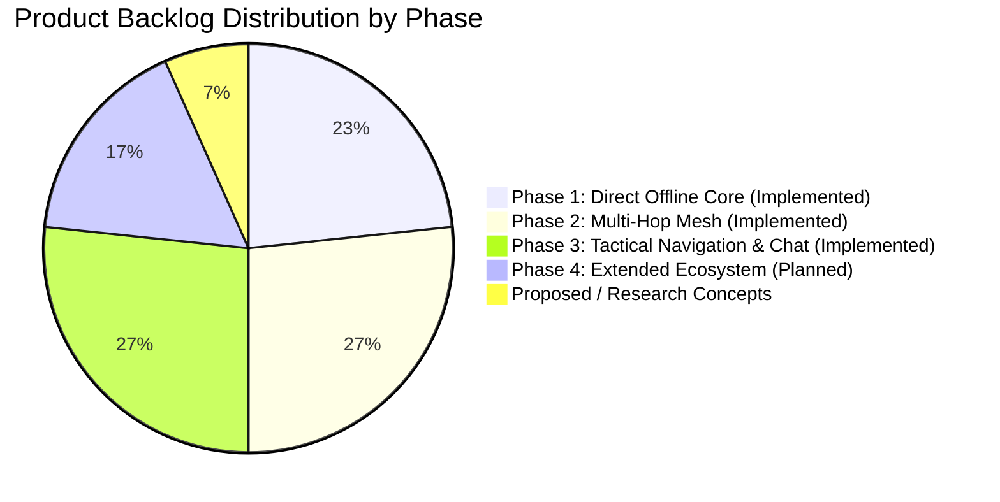
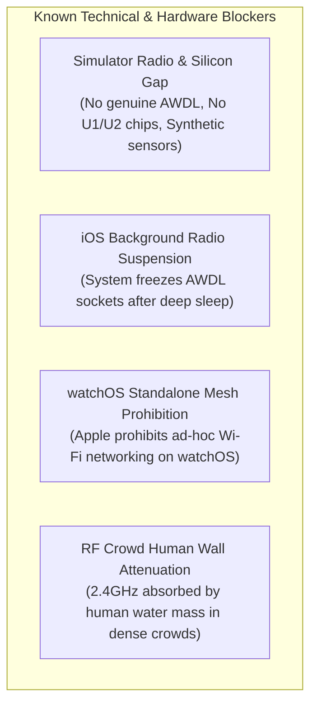

# TeeKum — Official Product Backlog & Engineering Roadmap

> **Document Type:** Master Product Backlog, Sizing & Prioritization Ledger  
> **Target Audience:** Product Owners, Technical Leads, iOS Engineers, and AI Coding Agents  
> **Status:** ACTIVE SPRINT & PHASE PLANNING BASELINE  
> **Current Date:** 2026-11-04  
> **Companion Documents:**
> - [User Stories Specification (USER_STORIES.md)](file:///Users/nicho/Developer/TeeKum%20Prototype/docs/product/USER_STORIES.md)
> - [Feature Requirements Document (FEATURE_REQUIREMENTS.md)](file:///Users/nicho/Developer/TeeKum%20Prototype/docs/product/FEATURE_REQUIREMENTS.md)
> - [Product Decisions & ADRs (PRODUCT_DECISIONS.md)](file:///Users/nicho/Developer/TeeKum%20Prototype/docs/product/PRODUCT_DECISIONS.md)
> - [Master Agent Instructions (agent.md)](file:///Users/nicho/Developer/TeeKum%20Prototype/agent.md)
> - [Knowledge Transfer Master Index (docs/knowledge_transfer/README.md)](file:///Users/nicho/Developer/TeeKum%20Prototype/docs/knowledge_transfer/README.md)

---

## 1. Backlog Governance & Status Schema

Items in this backlog are categorized under the following operational statuses:
- **`IMPLEMENTED & VERIFIED`**: Code is fully written, integrated into the target, and passed by automated regression tests (100% pass rate).
- **`APPROVED FOR EXECUTION`**: Formally approved architecture, scheduled for upcoming implementation sprint.
- **`PROPOSED / UNDER EVALUATION`**: Documented feature proposals undergoing product or architectural assessment.
- **`BLOCKED`**: Progress is halted by hardware availability, platform limitations, or unresolved upstream dependencies.
- **`DEFERRED / RETIRED`**: Deliberately postponed or permanently retired to preserve core product principles.

---

## 2. Master Backlog Summary by Phase

---

## 3. Active & Completed Backlog Items

### 3.1 Phase 1 — Direct Offline P2P Core (Status: COMPLETED & VERIFIED)

| Backlog ID | Story Reference | Feature Area | Title & Scope | Priority | Sizing | Status |
| :---: | :---: | :--- | :--- | :---: | :---: | :---: |
| **`PB-101`** | `US-GRP-01` | Group Management | Serverless Group Creation & 256-Bit Key Generation | `Critical` | 5 SP | `Implemented` |
| **`PB-102`** | `US-GRP-02` | Group Management | In-Person High-Density QR Barcode Display & Scanner | `Critical` | 5 SP | `Implemented` |
| **`PB-103`** | `US-GRP-03` | Group Management | Universal Share Link (`teekum://join#...`) Handling | `High` | 3 SP | `Implemented` |
| **`PB-104`** | `US-GRP-05` | Group Management | Ephemeral Session Teardown & Keychain Purge | `High` | 3 SP | `Implemented` |
| **`PB-105`** | `US-GRP-06` | Group Management | Personal Neon Avatar Color Palette (8 Colors) | `Medium` | 2 SP | `Implemented` |
| **`PB-106`** | `US-LOC-01` | Location | User-Controlled "Live Sharing" Master Toggle | `Critical` | 3 SP | `Implemented` |
| **`PB-107`** | `US-LOC-02` | Location | CoreMotion-Aware Adaptive Cadence (Option B Pure Telemetry)| `High` | 5 SP | `Implemented` |
| **`PB-108`** | `US-LOC-03` | Location | AMOLED `#000000` MapKit View & Friend Annotations | `High` | 5 SP | `Implemented` |
| **`PB-109`** | `US-LOC-04` | Location | Honest UX Staleness Badges & Accuracy Circles | `High` | 3 SP | `Implemented` |
| **`PB-110`** | `US-MTG-01` | Meeting Point | Single Active Meeting Point Proposal & Time Presets | `High` | 5 SP | `Implemented` |
| **`PB-111`** | `US-MTG-03` | Meeting Point | 1-Tap Attendance RSVP Confirmation (`.attending` / `.declined`)| `High` | 3 SP | `Implemented` |
| **`PB-112`** | `US-MTG-04` | Meeting Point | 25-Meter Proximity Auto-Arrival Geofencing | `Medium` | 3 SP | `Implemented` |
| **`PB-113`** | `US-MTG-05` | Meeting Point | 1-Hour Auto-Expiration & Lock Release | `Medium` | 2 SP | `Implemented` |
| **`PB-114`** | `US-EMG-01` | Emergency SOS | 3-Second Continuous Hold SOS Trigger & Progress Ring | `Critical` | 5 SP | `Implemented` |
| **`PB-115`** | `US-EMG-03` | Emergency SOS | Acoustic Siren (`AVAudioEngine`), Haptics & Crimson HUD | `Critical` | 5 SP | `Implemented` |
| **`PB-116`** | `US-DBG-01` | Diagnostics | On-Device Debug HUD Sheet (RSSI dBm, Packets, GPS) | `Medium` | 3 SP | `Implemented` |

---

### 3.2 Phase 2 — Multi-Hop Mesh & Background Resilience (Status: COMPLETED & VERIFIED)

| Backlog ID | Story Reference | Feature Area | Title & Scope | Priority | Sizing | Status |
| :---: | :---: | :--- | :--- | :---: | :---: | :---: |
| **`PB-201`** | `US-GRP-04` | Governance | Communal Mesh Compact Agreement Gating Modal | `Critical` | 3 SP | `Implemented` |
| **`PB-202`** | `US-MSH-01` | Mesh Routing | Zero-Knowledge Blind Stranger Relaying (Masked AAD) | `Critical` | 8 SP | `Implemented` |
| **`PB-203`** | `US-MSH-02` | Mesh Routing | 1,024-Entry Deduplication Cache (`SeenPacketCache`, 5m TTL) | `Critical` | 5 SP | `Implemented` |
| **`PB-204`** | `US-MSH-03` | Mesh Routing | Dual-Lane Token Bucket Rate Limiter (2 pkts/s normal, 4 SOS) | `High` | 5 SP | `Implemented` |
| **`PB-205`** | `US-MSH-04` | Transport | Bonjour AWDL Peer Discovery (`_teekum._tcp`) & Tie-Breaking | `Critical` | 8 SP | `Implemented` |
| **`PB-206`** | `US-MSH-05` | Mesh Routing | AODV Reactive Route Discovery Engine (RREQ / RREP) | `High` | 8 SP | `Implemented` |
| **`PB-207`** | `US-MSH-06` | Battery | Festival Survival Mode & Hard 20% Battery Cutoff | `Critical` | 5 SP | `Implemented` |
| **`PB-208`** | `US-MSH-07` | Background | Background Socket Survival via `showsBackgroundLocationIndicator` | `Critical` | 5 SP | `Implemented` |
| **`PB-209`** | `US-MSH-08` | Background | ActivityKit Live Activity & Dynamic Island Widget Companion | `High` | 5 SP | `Implemented` |
| **`PB-210`** | `US-MTG-02` | Meeting Point | Setter Lock Rule Enforcement (Exclusive Proposer Authority) | `Critical` | 5 SP | `Implemented` |
| **`PB-211`** | `US-EMG-02` | Emergency SOS | Tier 1 Queue Preemption & 15-Hop Emergency Flooding | `Critical` | 5 SP | `Implemented` |
| **`PB-212`** | `US-EMG-06` | Emergency SOS | Transparent 5-State Delivery Progress (`SOSDeliveryState`) | `High` | 3 SP | `Implemented` |
| **`PB-213`** | `US-LOC-05` | Location | Stale Peer Accelerated Cadence & Response Burst Engine | `Medium` | 5 SP | `Implemented` |
| **`PB-214`** | `US-LOC-06` | Location | Dynamic Adaptive GNSS Accuracy Scaling (`applyDynamicAccuracy`) | `High` | 5 SP | `Implemented` |
| **`PB-215`** | `US-DBG-02` | Diagnostics | 1-Tap Automated Health Triage Audit Suite | `High` | 5 SP | `Implemented` |
| **`PB-216`** | `US-DBG-03` | Diagnostics | Live 56-Byte Packet Stream Inspector & Hex Dumper | `High` | 5 SP | `Implemented` |
| **`PB-217`** | `US-DBG-04` | Diagnostics | Synthetic Frame & Cryptographic Fault Injector | `Medium` | 3 SP | `Implemented` |
| **`PB-218`** | `US-DBG-05` | Diagnostics | Virtual Multi-Node Mesh Topology Sandbox (`MeshTopologySimulator`) | `High` | 8 SP | `Implemented` |

---

### 3.3 Phase 3 — Tactical Radar, Group Mesh Chat & Precision Finding (Status: COMPLETED & VERIFIED)

| Backlog ID | Story Reference | Feature Area | Title & Scope | Priority | Sizing | Status |
| :---: | :---: | :--- | :--- | :---: | :---: | :---: |
| **`PB-301`** | `US-NAV-01` | Navigation | Festival Tactical Polar Radar (60M Forward-Up Projection) | `Critical` | 8 SP | `Implemented` |
| **`PB-302`** | `US-NAV-02` | Navigation | 60M Perimeter Clamping & Dual Blip/Carousel Selection | `High` | 5 SP | `Implemented` |
| **`PB-303`** | `US-NAV-03` | Navigation | Apple U1/U2 NearbyInteraction Precision Finding (<8m) | `High` | 8 SP | `Implemented` |
| **`PB-304`** | `US-NAV-04` | Navigation | Sensor-Assisted GPS/Compass Fallback for Non-UWB Devices | `Medium` | 5 SP | `Implemented` |
| **`PB-305`** | `US-NAV-05` | Navigation | Visual Finder Beacon (Screen Flash & 4 Hz Camera Strobe) | `Medium` | 3 SP | `Implemented` |
| **`PB-306`** | `US-LOC-03` | Navigation | Compass Heading Vision Cone (50° Translucent FOV on Map) | `High` | 3 SP | `Implemented` |
| **`PB-307`** | `US-CHT-01` | Mesh Chat | Festival Group Mesh Chat Datagram (`Type 0x07`, 20B UTF-8) | `Critical` | 8 SP | `Implemented` |
| **`PB-308`** | `US-CHT-02` | Mesh Chat | 6 One-Handed Festival Quick Preset Chips | `High` | 3 SP | `Implemented` |
| **`PB-309`** | `US-CHT-03` | Mesh Chat | Real-Time `ByteMeterView` Character Boundary Limiter | `High` | 3 SP | `Implemented` |
| **`PB-310`** | `US-CHT-04` | Mesh Chat | Honest Per-Recipient Delivery State Machine (`ACKPayload`) | `High` | 5 SP | `Implemented` |
| **`PB-311`** | `US-CHT-05` | Mesh Chat | 50-Message Ephemeral RAM FIFO Buffer (Zero Disk Retention) | `Medium` | 3 SP | `Implemented` |
| **`PB-312`** | `US-EMG-04` | Safety | Autonomous "Man Down" Inactivity Watchdog (180s Stillness) | `Critical` | 8 SP | `Implemented` |
| **`PB-313`** | `US-EMG-05` | Safety | 30-Second Silent Vibration Pre-Alarm Warning Countdown | `High` | 5 SP | `Implemented` |
| **`PB-314`** | `US-EMG-07` | Safety | Emergency SOS Cancellation Protocol (`emergencyType = 0x00`) | `Medium` | 3 SP | `Implemented` |
| **`PB-315`** | — | Architecture | Centralized Configuration Hub (`TeeKumConfiguration.swift`) | `High` | 5 SP | `Implemented` |
| **`PB-316`** | — | Architecture | Permanent Retirement of Legacy Status System (Commit `713b563`) | `Critical` | 5 SP | `Implemented` |

---

### 3.4 Phase 4 — Extended Ecosystem & Physical Validation (Status: PLANNED)

| Backlog ID | Story Reference | Feature Area | Title & Scope | Priority | Sizing | Status | Dependencies / Blockers |
| :---: | :---: | :--- | :--- | :---: | :---: | :---: | :--- |
| **`PB-401`** | — | Validation | Multi-Device Physical RF Validation Matrix (PHY-01..PHY-08) | `Critical` | 8 SP | `Approved` | Requires 3 physical iPhones in RF environment. |
| **`PB-402`** | `US-WAT-01` | Apple Watch | Add `TeeKumWatch` Target & `WCSession` Connectivity Layer | `High` | 5 SP | `Planned` | Decision `PD-04` (Shared Target vs Framework). |
| **`PB-403`** | `US-WAT-02` | Apple Watch | High-Intensity Wrist Taptic SOS Alerts (`WKHapticType`) | `Critical` | 3 SP | `Planned` | Dependent on `PB-402`. |
| **`PB-404`** | `US-WAT-03` | Apple Watch | Discrete 3-Second Wrist SOS Trigger & IPC Dispatch | `High` | 5 SP | `Planned` | Dependent on `PB-402`. |
| **`PB-405`** | `US-WAT-04` | Apple Watch | Heads-Up Wrist Compass Navigation & Alignment Haptics | `High` | 5 SP | `Planned` | Dependent on `PB-402`. |
| **`PB-406`** | `US-WAT-05` | Apple Watch | 1-Tap Wrist Meeting Point RSVP Confirmation | `Medium` | 3 SP | `Planned` | Dependent on `PB-402`. |
| **`PB-407`** | `US-ALT-01` | Multi-Floor | `CMAltimeter` Integration & Differential Barometric Math | `High` | 5 SP | `Planned` | Wire Bytes 18..20 reserved in `Packet.swift`. |
| **`PB-408`** | `US-ALT-02` | Multi-Floor | 2D Map Multi-Floor Switcher Pill (`All`, `L1`, `L2`) & Badges | `Medium` | 3 SP | `Planned` | Dependent on `PB-407`. |
| **`PB-409`** | `US-ALT-03` | Multi-Floor | Vertical Elevation Arrival Warning in Tactical Radar | `High` | 3 SP | `Planned` | Dependent on `PB-407`. |
| **`PB-410`** | `US-ALT-04` | Multi-Floor | Manual Floor Level Selector & Calibrated Profile Override | `Medium` | 2 SP | `Planned` | Dependent on `PB-407`. |
| **`PB-411`** | — | Quality / Fix | Remediate `BUG-01`: Replace Initials XOR with Host Slot Allocation | `Critical` | 5 SP | `Approved` | Decision `PD-02`. |
| **`PB-412`** | — | Quality / Fix | Remediate `BUG-02`: Promote `sessionId` to Full 24-Bit in Swift Models | `High` | 3 SP | `Approved` | Decision `PD-03`. |
| **`PB-413`** | — | Quality / Fix | Remediate `BUG-03`: Remove Force Unwrap `distance!` in `RadarBlipView` | `Low` | 1 SP | `Approved` | Safe optional binding. |
| **`PB-414`** | — | Quality / Test| Decouple Test Runners from Production App into Native XCTest | `Medium` | 8 SP | `Approved` | Quality engineering enhancement. |

---

### 3.5 Proposed Future Research Concepts (Status: UNDER EVALUATION)

| Concept ID | Area | Title & Concept Summary | Sizing | Feasibility / Evaluation Status |
| :---: | :--- | :--- | :---: | :--- |
| **`RES-01`** | Maps | Offline GeoJSON Vector Venue Overlays (Stages, Medical, Water) | 8 SP | High feasibility. Decision `PD-05`. Evaluates offline vector parsing. |
| **`RES-02`** | Hardware | LoRa Scaffolding Gateway Repeaters (915 MHz Long-Range Bridge) | 13 SP | Medium feasibility. Requires external BLE-to-LoRa hardware transceivers. |
| **`RES-03`** | Privacy | Anonymized Crowd Density Spatial Heatmaps (Differential Privacy) | 8 SP | High privacy complexity. Requires high crowd penetration rate. |
| **`RES-04`** | Mesh | Store-and-Forward Data Mule Partition Bridging | 8 SP | Complex DTN architecture. Evaluates opportunistic bundle caching. |

---

## 4. Known Blockers & Technical Constraints

1. **`BLK-01: iOS Simulator Hardware Absence`**
   - *Impact:* The Xcode iOS Simulator does not provide genuine AWDL radio interfaces, Apple U1/U2 Ultra-Wideband silicon, or real accelerometer sensors.
   - *Resolution:* Automated testing employs `SimulatedMeshTransport` and `NearbyInteractionService.simulationFallback`. Final physical sign-off requires real iPhones.
2. **`BLK-02: iOS Background Execution Policies`**
   - *Impact:* Aggressive iOS power daemons throttle or terminate background TCP radio sockets after prolonged screen lock.
   - *Resolution:* TeeKum engages `showsBackgroundLocationIndicator = true` while keeping GPS asleep via `CoreMotion` coprocessor monitoring.
3. **`BLK-03: watchOS Standalone Networking Prohibition`**
   - *Impact:* Apple strictly disallows third-party watchOS apps from managing ad-hoc Wi-Fi listeners or Bonjour peer discovery.
   - *Resolution:* Standardized Apple Watch strictly as a tethered companion extension via `WatchConnectivity` (`WCSession`, Decision D10).
4. **`BLK-04: RF "Human Wall" Signal Attenuation`**
   - *Impact:* 40,000 human bodies absorb 2.4 GHz and 5 GHz signals, shrinking AWDL range from 50m to 10–15m.
   - *Resolution:* Multi-hop blind stranger relaying, AODV reactive route discovery, and pre-set Single Active Meeting Points.

---

## 5. Deferred & Permanently Retired Items

| Item Name | Original Plan | Rationale for Retirement / Deferral | Architectural Authority |
| :--- | :--- | :--- | :--- |
| **Legacy 1-Byte Status System** | Canned status codes (`StatusCode`) piggybacked on location pings. | Overwrote user status on every GPS fix; blocked status sharing when Live Sharing was OFF; rigid codes. Replaced by Festival Group Mesh Chat (`Type 0x07`). | Decision D17 / Commit `713b563` |
| **Persistent SQLite3 Database** | Persistent coordinate & session storage via `SessionStorageProtocol`. | Violated Privacy-by-Design and radical simplicity. Ephemeral in-memory actor state and Keychain keys adopted. | Decision D22 / Cleanup Report |
| **Video & Photo Media Streaming** | Sharing crowd photos or voice notes over ad-hoc Wi-Fi. | High-bandwidth media causes instant RF spectrum exhaustion and kills attendee phone batteries in $<1\text{ hour}$. Invariant: Telemetry & short text only. | `NFR-BAT-01` / Project Charter |
| **Standalone watchOS Mesh Node** | Running independent mesh listeners on Apple Watch. | Prohibited by Apple watchOS APIs and causes severe watch battery depletion. Tethered companion model adopted. | Decision D10 / ADR-19 |

---

## 6. Sizing & Next Sprint Priorities

### Next Sprint (Sprint 4: Physical Validation & Defect Remediation)
1. **`PB-411` (P1, Critical):** Remediate `BUG-01` by implementing Host-Assigned sequential slot allocation in `GroupSession.swift` (Decision `PD-02`).
2. **`PB-412` (P1, High):** Remediate `BUG-02` by promoting `sessionId` to full 24-bit representation in Swift models (Decision `PD-03`).
3. **`PB-413` (P2, Low):** Remove force unwrap `distance!` in `RadarBlipView.swift` line 147 (`BUG-03`).
4. **`PB-401` (P1, Critical):** Execute physical 3-device RF field testing on real iPhones using the 8-point physical validation matrix (`PHY-01` through `PHY-08`).

---

> **End of Product Backlog**  
> *Author:* Senior Product Owner & Requirements Engineer  
> *Next Step:* Coordinate human approval for pending decisions `PD-01` through `PD-06`.
